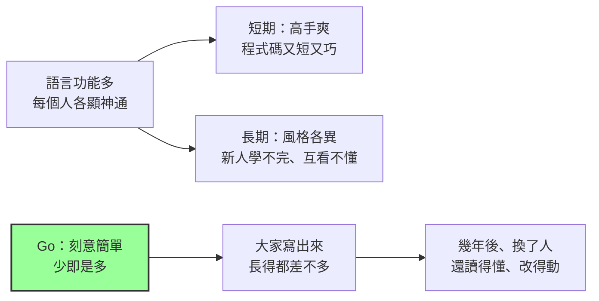

# [go-0-1] 為什麼學 Go？用「簡單」換「大團隊幾年後還維護得動」

> **本章目標**：理解 Go 為什麼存在——它刻意把語言做得「很小、很無聊」，就是為了讓一群人、幾年後、在一個大專案上，還讀得懂、改得動彼此的程式碼。

## 你會學到

- 程式語言「功能越多」背後藏著的隱形成本
- Go 當初想解決 Google 的什麼痛點
- Go 用哪些「刻意的省略」換來可維護性（只有一種迴圈、沒有繼承、沒有例外）
- Go 適合、以及不太適合拿來做什麼

## 概念說明

### 一個你可能沒想過的問題：寫程式，難的是「寫」還是「讀」？

剛學程式時，我們都以為難的是「怎麼把功能寫出來」。但真正燒錢、拖垮專案的，往往是另一件事：**半年後有人（可能就是你自己）要回來改這段程式碼，卻看不懂當初為什麼這樣寫。**

想像一間餐廳的廚房。一位天才主廚可以用 20 種刀工、各種獨門手法做出驚人料理——但如果這間店要**擴張成 500 家分店、請幾千個廚師**，那些花俏手法反而變成災難：每個廚師都有自己的一套，新人要學很久，換班時誰也接不了誰的鍋。

```
小團隊 / 短期專案：
    語言越強大、花招越多 → 高手能寫得又短又巧 → 爽

大團隊 / 長期專案：
    語言花招越多 → 每個人風格不同 → 新人學不完、互相看不懂 → 慢慢爛掉
```

Go 的設計者看清了這件事，於是做了一個很反直覺的決定：**不要把語言做得很強，要把它做得很「無聊」。**

### Go 的身世：Google 的真實痛點

Go（又叫 Golang，因為官網網域是 golang.org）是 Google 在 2007 年開始設計的語言。當時 Google 的工程師有幾千人、程式碼有上億行、編譯一次要等很久，而他們手上的語言各有各的麻煩：

- **C++**：快、底層掌控強，但**非常複雜**，功能多到沒人全懂，編譯又慢。
- **Java**：生態成熟，但**囉嗦**、啟動慢、設定一大堆。
- **Python**：寫起來爽，但**執行慢**、大型專案缺少編譯期檢查、部署要搬一堆依賴。

Go 想要的是這些的「中間值」：**像 Python 一樣好寫、像 C 一樣快、編譯快到幾乎無感、而且刻意簡單到一個新人幾天就能上手整門語言。**

### 「刻意的省略」：Go 拿掉了什麼

Go 最特別的地方不是它有什麼，而是它**故意沒有**什麼。這些省略不是做不到，而是設計者判斷「加了會讓大團隊更難維護」，於是不加：

| Go 故意不給你 | 別的語言常有 | Go 的理由（大白話） |
|---|---|---|
| 只有一種迴圈（`for`） | `for` / `while` / `do-while` / `foreach`… | 少一種寫法，就少一種「別人用了你要重新適應」的風格 |
| 沒有繼承（class 繼承樹） | Java/C# 的 `extends` | 繼承樹一深就沒人看得懂誰蓋掉誰；改用「組合」更直白 |
| 沒有例外（exception） | `try / catch / throw` | 錯誤被「丟上去」會讓人看不出一個函式到底會不會出錯；Go 要你當場面對 |
| 幾乎沒有「同一件事的多種寫法」 | 很多語言的語法糖 | 一致性比個人巧思重要——大家寫出來的 Go 長得都差不多 |



這張圖的重點：功能多的語言在**短期**對高手是加分，但在**長期、大團隊**會因為「每個人一套」而失控；Go 用「刻意簡單」換來「幾年後還維護得動」——這就是它整門語言的賭注。

Go 社群有句常被引用的話：**「Less is exponentially more」（少，是指數級的多）**。意思是每砍掉一個功能，省下的不只是那個功能本身，還有它和其他功能交互產生的無數組合複雜度。

### 那 Go 到底換到了什麼？

付出「語言很樸素」的代價，Go 換來三樣對後端與雲端服務特別值錢的東西（後面各章會深入，這裡先有印象）：

1. **編譯成單一執行檔**：一個 Go 專案最後會編成**一個檔案**，丟到伺服器就能跑，不用在目標機器上裝 Go、不用搬一堆依賴（這點 [go-0-2] 會細講）。
2. **內建並行（concurrency）**：一行 `go` 就能開一條輕量執行緒（goroutine），讓程式輕鬆吃滿多核心。這是 Go 的招牌，整個 Part 4 都在講。
3. **工具鏈統一**：格式化、測試、建置、抓依賴全都內建在官方 `go` 指令裡，不用像別的語言那樣東拼西湊。「程式碼長怎樣」甚至由官方的 `gofmt` 統一決定——連排版風格都不給你吵。

## 程式碼範例

先別擔心看不懂語法（Part 1 會慢慢教），這裡只是讓你**感受** Go「無聊得很好懂」的味道。下面是一支完整、可以跑的 Go 程式，印出一句問候：

```go
// 每個可執行的 Go 程式都屬於 main 套件
package main

// 引入標準庫的 fmt（format，負責格式化輸出入）
import "fmt"

// main 是程式的進入點，每支可執行程式都從這裡開始跑
func main() {
    fmt.Println("哈囉，Go!")
}
```

逐段說明這在做什麼：

- `package main`：宣告這個檔案屬於 `main` 套件。Go 規定「可以編成執行檔」的程式一定要放在 `main` 套件裡（[go-0-4]、Part 5 會細講套件）。
- `import "fmt"`：把標準庫的 `fmt` 套件引進來，它負責把東西印到螢幕。
- `func main() { ... }`：定義 `main` 函式，**程式從這裡開始執行**，就像故事的第一頁。
- `fmt.Println(...)`：印出一行字並換行（`Print` + `line`）。

重點不是這幾行多厲害，而是：**全世界的 Go 工程師寫這段，長得幾乎一模一樣**——沒有十種縮寫、沒有誰的獨門寫法。這份「無聊」正是 Go 想要的。

為了對比「功能多不一定是好事」，看一個 Go **故意不讓你做**的例子。很多語言可以宣告一個變數卻放著不用，Go 不行：

```go
package main

import "fmt"

func main() {
    name := "小明"
    age := 18 // ❌ 宣告了 age 卻沒用到
    fmt.Println(name)
}
```

這段在 Go **連編譯都不會過**，會直接報錯：

```
./main.go:7:2: declared and not used: age
```

意思是「你宣告了 `age` 卻沒有用它」。別的語言頂多給個警告、甚至默默放過，但 Go 把它當成**錯誤**、擋下來。乍看很機車，但它的邏輯是：**沒用到的變數通常是筆誤或沒寫完的 bug，與其讓它悄悄留著累積成垃圾，不如現在就逼你處理。** 這正是「用一點囉嗦，換長期乾淨」的 Go 哲學縮影。

## 小練習

1. 用自己的話，向一個沒學過程式的朋友解釋：「餐廳擴張成 500 家分店」這個比喻，怎麼說明「語言功能太多，對大團隊反而是壞事」？
2. 查一查（或回想）：你聽過哪些有名的軟體或服務是用 Go 寫的？（提示：搜尋「written in Go」或「Go in production」，特別留意雲端基礎設施、容器、資料庫那一類。）
3. 思考題：如果一個專案是「一個人、一兩週內要做完的小腳本」，Go 那套「刻意簡單、逼你處理每個錯誤」的風格，一定比較划算嗎？想想看除了「語言好不好」，選工具還要看什麼。

<details>
<summary>參考解答</summary>

**第 1 題（500 家分店的比喻）**

可以這樣講：「一位天才主廚自己開一間小店，他有越多獨門刀工和花招，菜就越驚豔——功能多對他是加分。但如果這個品牌要開到 500 家分店、請幾千個廚師，那些花招反而變負擔：每個廚師各學一套，新人學不完、換班時誰也接不了誰的鍋，整個品牌的菜就不穩定了。

程式語言一樣：功能多、花招多，對『一個高手、一個小專案』是加分；但對『幾千人、上億行、要維護很多年』的大專案，每個人用不同花招，就會變成『互相看不懂、新人學不完』的災難。所以 Go 乾脆把花招砍掉，讓大家寫出來的程式都長得差不多——**犧牲個人的巧思，換整個團隊長期的好維護**。」

**第 2 題（哪些軟體用 Go 寫）**

這題要你自己查，示範一些常被提到的答案：

- **容器 / 雲端基礎設施**：Docker、Kubernetes（雲端時代最重要的兩個工具，都是 Go 寫的）、Terraform。
- **資料庫 / 儲存**：CockroachDB、InfluxDB、etcd（Kubernetes 的設定儲存核心）。
- **網路 / 工具**：Caddy（網頁伺服器）、Hugo（靜態網站產生器）、以及許多雲端商的後端服務。

共通點：它們大多是**「要長期維護、要吃多核心、要部署到很多台機器」的後端與基礎設施**——正好命中 Go 的強項（好維護、內建並行、單一執行檔好部署）。

**第 3 題（小腳本用 Go 划算嗎）**

**不一定。** Go 的優勢在「大團隊、長期維護、要並行、要部署」的後端服務；而「一個人、一兩週、小腳本」的情境，Go 那套「逼你處理每個錯誤、沒用到的變數就報錯」反而讓你綁手綁腳，不如用 Python 之類「寫起來飛快、不囉嗦」的語言。

選工具除了「語言本身強不強」，還要看：**團隊熟什麼、專案要活多久、有沒有並行/效能需求、生態系有沒有現成輪子**。Go 的賣點是「長期、多人、後端」——用對場景才划算，不是因為它新或流行就硬套。這也呼應了一個通則：**沒有最好的語言，只有最適合某情境的語言**（下一章 [go-0-2] 會把 Go 放進語言地圖裡細看）。

</details>

## 課外讀物

> 想對照「另一種也想解決大型系統問題，但走『沒有 GC、靠所有權』路線」的語言 → **[rust 課程（姊妹課）](../../rust/課程大綱.md)**（Rust 更底層、更難學；Go 更好入門。兩門課刻意對照著看）

> 想先懂「程式碼怎麼被編譯、為什麼要編譯成執行檔」的底層原理 → **[cs 課程（計算機概論）](../../cs/課程大綱.md) Part 4：電腦如何執行你的程式**
