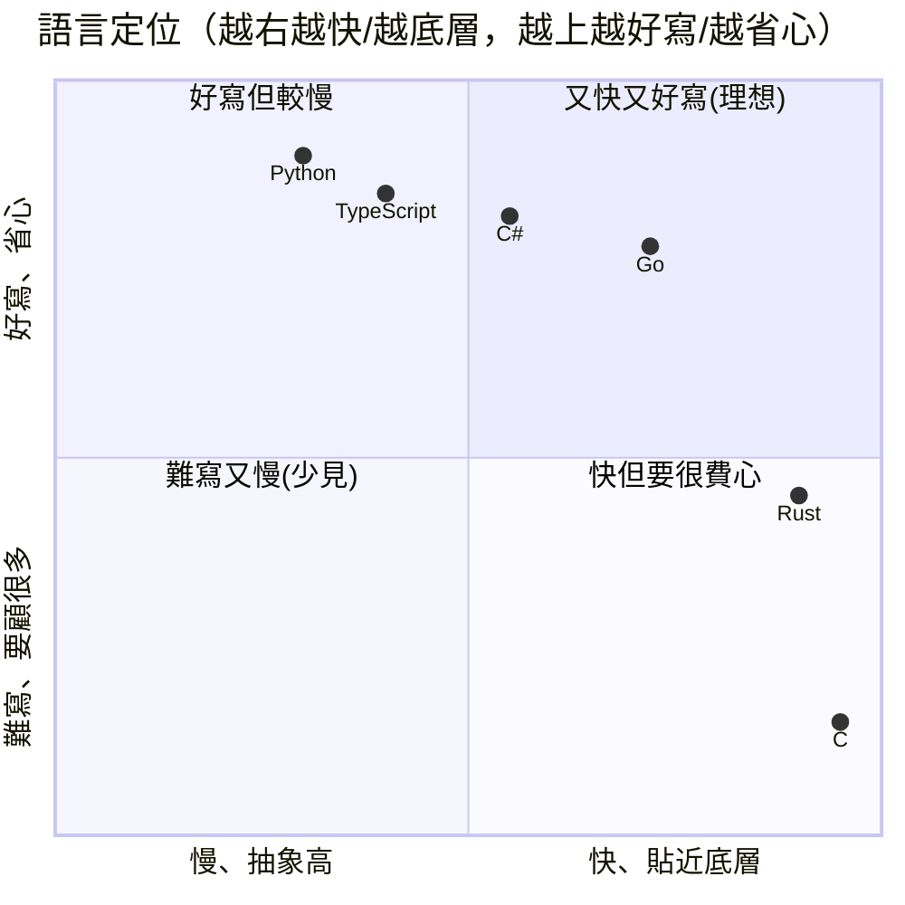

# [go-0-2] Go 站在哪：和 C、Rust、TypeScript/C# 的定位比較

> **本章目標**：把 Go 放進「程式語言地圖」裡，看清楚它有 GC、能編成單一執行檔、內建並行這三個特徵各自換來什麼，幫你判斷「什麼時候該選 Go」。

## 你會學到

- 用兩個軸（執行速度、開發便利）把常見語言排排站
- Go 的三個招牌特徵：有 GC、單一執行檔、內建並行，分別解決什麼
- Go 和 C、Rust、TypeScript/C# 各自的取捨
- 什麼情境適合選 Go、什麼情境其實不必

## 概念說明

### 先記住一句話：Go 是「有 GC 的 C，加上內建的並行」

這是理解 Go 定位最快的一句話。拆開來看：

- **「有 GC」**：GC 是 Garbage Collection（垃圾回收）——一個內建的「記憶體管家」，自動幫你清掉沒用到的記憶體，你不必像 C 那樣親手管。這讓 Go **比 C/Rust 好寫很多**。
- **「的 C」**：Go 像 C 一樣會**編譯成機器碼、跑得快、能編成單一執行檔**，不像 Python 要帶著直譯器跑。
- **「加上內建的並行」**：Go 把「同時做很多事」做成語言內建的能力（goroutine／channel），這是 C#／TypeScript 要靠函式庫才有的。

### 沒有「最好」的語言，只有「最適合某情境」的語言

每種語言都是一組**取捨**。與其問「哪個最強」，不如問「這個工作，我願意拿什麼換什麼」。我們用兩個常見的軸來看：

- **執行速度 / 對底層的掌控**：程式跑得多快、能不能精細控制記憶體。
- **開發便利 / 上手速度**：寫起來多快、多省心、多容易學。



這張圖在表達一個粗略印象：**越往右，程式越快、越能掌控底層；越往上，越好寫、越省心。** Go 待在一個甜蜜的位置——**相當快（靠右），又相當好寫（靠上）**。它沒有 Rust/C 那麼極致的速度與底層掌控，但換來「學得快、寫得順」，對「要快、但更要好維護、好開發」的後端服務剛剛好。注意這是示意圖，實際取捨依場景而定，別當成精確排名。

### Go 的三個招牌特徵，各換來什麼

**特徵一：有 GC（垃圾回收）——好寫，代價是偶爾的小暫停**

你不用管「什麼時候把記憶體還回去」，Go 內建的 GC 管家會自動清理。

```
拿一塊記憶體放資料
... 使用它 ...
（不用管，GC 管家會自己來清）
```

好處是**好寫、不會踩到記憶體地雷**（忘了還、還太早、重複還——這些 C 的經典 bug，Go 幾乎碰不到）。代價是 GC 巡視、清理時，程式可能**短暫暫停一下（GC pause）**。Go 的 GC 已經優化到暫停通常只有「不到一毫秒」，絕大多數後端服務完全無感；只有「延遲一丁點尖刺都不能有」的極端場景（如高頻交易引擎）才會在意——那種場景才輪到 Rust/C 出場。

> 想搞懂 GC、堆疊堆積、記憶體到底怎麼運作 → **[cs 課程（計算機概論）](../../cs/課程大綱.md) Part 3：硬體構造、Part 5：作業系統**

**特徵二：編譯成單一執行檔——部署超省事**

這是 Go 相對於 Python、Node.js（TypeScript）、Java 的一大爽點。對比一下「怎麼把程式送上伺服器」：

```
Python / Node.js：
    要在目標機器裝好對應版本的直譯器(python / node)
    還要把一大包依賴(node_modules / venv)也搬過去
    版本對不上就出事

Go：
    go build → 產生「一個」執行檔
    把那一個檔案丟到(同型)機器 → 直接執行
    目標機器什麼都不用裝
```

Go 編譯時會把「你的程式碼」和「它用到的所有東西（包含 Go 的執行期）」**全部打包進同一個檔案**。所以部署常常就是「複製一個檔案過去、跑起來」這麼簡單——這也是為什麼 Docker、Kubernetes 這些要塞進容器、到處搬的工具，都愛用 Go。

**特徵三：內建並行——語言的一級公民**

「並行」就是「同時處理很多件事」（例如一台伺服器同時服務上萬個使用者）。在 C#／TypeScript，你要靠函式庫、`async/await` 一堆機制拼出來；Go 直接把它做進語言：**一行 `go` 就開一條輕量執行緒（goroutine）**，用 channel（通道）互相傳訊息。

```go
go doSomething() // 就這樣，另開一條並行去做 doSomething，主程式繼續往下走
```

這是 Go 最獨特、最強的部分，整個 Part 4 會慢慢講。這裡只要記得：**別的語言的並行是「外掛」，Go 的並行是「內建」。**

### 一個一個比

**Go vs C**

同樣會編譯成機器碼、跑得快、能編成執行檔。差別：C **沒有 GC**，記憶體要你親手管，快到極致但極易出包；Go 有 GC，犧牲一點點極致效能，換來「好寫、不踩記憶體地雷」。另外 Go 內建並行，C 沒有。

> **一句話**：想要接近 C 的速度與單一執行檔，但不想手動管記憶體、還想要好用的並行 → Go。

**Go vs Rust（姊妹課）**

兩者都為「現代後端、雲端服務」而生、都能編成執行檔。關鍵差別是**怎麼管記憶體**：

- **Rust**：沒有 GC，用「所有權」規則在**編譯期**把記憶體管好——效能更頂、延遲更可預測（沒有 GC pause），但**學習曲線陡**，所有權要花時間磨。
- **Go**：有 GC，**好上手太多**，幾天就能寫出能跑的服務，但有 GC 的一點點開銷與偶爾的小暫停。

選擇主軸：**要「極致效能、可預測延遲、或寫系統/嵌入式」→ Rust；要「快速開發後端服務、團隊好招人、好維護」→ Go。**

**Go vs TypeScript / C#（你在 basic、csharp 課學的）**

這三者都**有 GC、適合做後端**，是比較接近的「競爭對手」。差別：

| | TypeScript / C# | Go |
|---|---|---|
| 記憶體 | GC 自動管 | GC 自動管（相同） |
| 並行 | 靠函式庫 / `async/await` | 語言內建 goroutine / channel |
| 部署 | 要帶直譯器 / 執行環境與依賴 | 單一執行檔，丟過去就跑 |
| 語言風格 | 功能豐富、花招多 | 刻意精簡、一致性優先 |
| 上手 | 快 | 更快（語法極少） |

Go 不見得「更強」，而是在「並行、部署、長期可維護」這幾件事上做了不同的取捨。

### 那 Go 適合、不適合做什麼？

- **很適合**：後端 API 服務、微服務、雲端基礎設施／命令列工具、需要吃滿多核的高並發服務、要長期多人維護的專案。
- **沒那麼適合**：要榨乾最後一滴效能或要求零 GC 暫停的系統（→ Rust/C）、資料科學／AI（→ Python 生態遠更成熟）、前端畫面（→ 那是 JavaScript/TypeScript 的地盤）。

## 程式碼範例

這章是概念比較，沒有要你寫程式。但給你一個「同一件事、不同語言味道」的對照——印出一行字：

```go
// Go：可執行程式一定要有 package main 和 func main
package main

import "fmt"

func main() {
    fmt.Println("Hello")
}
```

```typescript
// TypeScript
console.log("Hello");
```

```rust
// Rust
fn main() {
    println!("Hello");
}
```

看起來 Go 比 TypeScript 囉嗦一點（要寫 `package`、`import`、`func main`）。但**語言的差異不在「印一行字」這種小事**，而在「當程式變大、要同時服務上萬個使用者、要部署到幾十台機器、要讓一個團隊維護好幾年時，誰讓這件事更省心」。那才是選 Go 的真正理由。

## 小練習

1. 用「取捨」的角度，各寫一句話總結：為什麼有人選 Go 而不選 Rust？為什麼有人選 Go 而不選 Python？
2. 假設以下三個專案，你會傾向選哪個語言、為什麼？（沒有標準答案，重點是說出理由）
   - (a) 一個要同時服務上萬個連線、長期多人維護的聊天後端服務
   - (b) 一個資料科學家要用來分析資料、畫圖表的一次性腳本
   - (c) 一個每秒數十萬筆、延遲連一丁點尖刺都不能有的即時交易引擎
3. 查一個你有興趣的雲端或基礎設施工具（例如 Docker、Kubernetes、Terraform），看它用什麼語言寫，想想為什麼選那個語言。

<details>
<summary>參考解答</summary>

**第 1 題（用取捨角度各寫一句話）**

- **為什麼有人選 Go 而不選 Rust？** 因為 Go 願意「用一點 GC 開銷」去換「幾天就能上手、開發飛快、團隊好招人、並行又簡單又內建」——當專案是一般後端服務、效能不到『零 GC 暫停』那種極端要求時，這筆交易很划算，不必付 Rust 學所有權的學費。
- **為什麼有人選 Go 而不選 Python？** 因為 Go 願意「寫起來比 Python 囉嗦一點、要先編譯」去換「跑得快很多、有編譯期檢查擋 bug、部署成單一執行檔、並行內建」——做長期、高並發、要部署到很多台機器的後端服務時，這些都是 Python 的弱項。

**第 2 題（三個專案的語言選擇，重點在理由）**

沒有標準答案，示範一種合理的判斷：

- **(a) 上萬連線、長期多人維護的聊天後端** → 傾向 **Go**。正中 Go 的三個強項：內建並行（goroutine 輕鬆開上萬條）、好維護（刻意簡單、團隊好接手）、單一執行檔好部署。這是 Go 的主場。
- **(b) 資料科學家的一次性分析腳本** → 傾向 **Python**。資料科學的套件生態（pandas、numpy、各種繪圖與 ML 函式庫）Python 遠比 Go 成熟，而且是一次性腳本，不需要 Go 的部署與並行優勢。用 Go 反而少了一堆現成輪子。
- **(c) 每秒數十萬筆、延遲連尖刺都不能有的交易引擎** → 傾向 **Rust（或 C/C++）**。關鍵是「連一丁點延遲尖刺都不能有」——Go 的 GC 雖然暫停很短，但畢竟存在；要徹底沒有 GC pause，得用沒有 GC 的 Rust/C。

判斷主軸：**先問「這個工作最核心的約束是什麼」——是並行與長期維護就靠 Go；是生態與開發速度就靠 Python；是零 GC 暫停的極致延遲就靠 Rust/C。**

**第 3 題（查雲端/基礎設施工具的語言）**

這題要你自己查，示範幾個常見答案與原因：

- **Docker / Kubernetes**：Go。兩者都是「要吃多核、要塞進容器到處搬、要長期多人維護」的基礎設施——Go 的內建並行與單一執行檔正中要害。
- **Terraform**：Go。命令列工具要「編成一個執行檔、各平台都能跑」，Go 的跨平台單一執行檔很合適。
- **（對照）PostgreSQL**：C。資料庫要直接管理記憶體、磁碟、快取，效能極度敏感且歷史悠久，走的是系統程式語言路線。

共通觀察：**「要並行、要好部署、要長期維護」的雲端基礎設施特別愛用 Go；而「要榨乾效能、貼近硬體」的底層軟體則傾向 C/Rust。**

</details>

## 課外讀物

> 想理解「應用層 vs 系統層、軟體有哪些層次」 → **[cs 課程（計算機概論）](../../cs/課程大綱.md) Part 8：軟體與抽象**

> 想看另一種「沒有 GC、靠所有權做並行」的對照路線 → **[rust 課程（姊妹課）](../../rust/課程大綱.md)**（Go 好入門、Rust 更底層，兩門課刻意對照）
