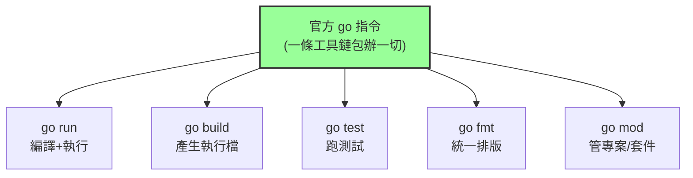

# [go-0-3] 環境準備：安裝 Go、`go` 工具鏈，跑出第一個 Hello World

> **本章目標**：把 Go 開發環境裝起來，理解官方 `go` 指令這一條工具鏈幫你包辦了哪些事，並親手編譯、執行你的第一支 Go 程式。

## 你會學到

- Go 的工具鏈是「一個 `go` 指令包辦一切」，和別的語言有什麼不同
- 怎麼安裝 Go（含 Mac / Linux / WSL / Windows）
- 用 `go run` 跑出第一支程式，再用 `go build` 編成執行檔
- 用 `gofmt`／`go fmt` 體會 Go「連排版都幫你統一」

## 概念說明

### 和別的語言不同：Go 只有「一個指令」

學很多語言時，你要分別認識一堆工具：一個管版本、一個編譯、一個管套件、一個跑測試、一個格式化……Go 的設計哲學「少即是多」也體現在這裡——**幾乎所有事都包在官方的一個 `go` 指令底下**：

```
go run     ── 編譯 + 執行（開發時最常用）
go build   ── 只編譯，產生執行檔
go test    ── 跑測試
go fmt     ── 自動把程式碼排版成官方統一風格
go mod     ── 管理專案與套件（下一章 [go-0-4] 專門講）
go vet     ── 幫你檢查可疑的寫法
```



這張圖的重點：你裝好 Go，就同時得到了編譯、執行、測試、格式化、套件管理**一整套官方工具**，不用再東拼西湊、也不用選型。**本課一律用官方 `go` 工具鏈**——不教第三方的版本管理器之類的東西，因為 Go 官方這一套就夠用、而且是社群的共同標準。

### 關於版本

本課以**現代 Go（1.21 以上）** 為準。這個世代的 Go 已經內建了泛型（generics，Part 2 會教），語法與工具都很穩定。你裝到的通常是最新版（例如 1.2x），跟著本課完全沒問題。

## 程式碼範例

### 步驟一：安裝 Go

官方安裝方式很直接，到 <https://go.dev/dl/> 下載對應你系統的安裝檔。

**Mac**：下載 `.pkg` 安裝檔，雙擊一路下一步即可；或用 Homebrew：

```bash
brew install go
```

**Linux / WSL**：到 <https://go.dev/dl/> 複製最新版的 Linux 下載連結，解壓到 `/usr/local`（官方指示會附上當下最新版的確切指令，照它貼即可），然後把 Go 的執行檔路徑加進環境變數。把下面這行加到你的 `~/.bashrc` 或 `~/.zshrc`：

```bash
export PATH=$PATH:/usr/local/go/bin
```

**Windows（原生，不透過 WSL）**：下載 `.msi` 安裝檔跑起來，依指示安裝，它會自動幫你設好環境變數。

> 從網路下載安裝需要一點時間是正常的。安裝檔都從官方 `go.dev` 取得，不要用來路不明的第三方安裝包。

### 步驟二：確認裝好了

關掉終端機再重開（讓環境變數生效），輸入：

```bash
go version
```

如果印出一個版本號（例如 `go version go1.2x.x ...`），就代表裝好了。想看 Go 相關的環境設定，可以再跑：

```bash
go env
```

它會印出 Go 的一堆環境變數（例如程式碼放哪、快取放哪），現在不用細看，知道有這個指令即可。

### 步驟三：寫第一支程式，用 `go run` 跑起來

新建一個資料夾、進去，再建一個檔案 `main.go`：

```go
// 每個可執行的 Go 程式都要屬於 main 套件
package main

// 引入標準庫的 fmt（format，負責格式化輸出入）
import "fmt"

// main 是進入點，程式從這裡開始跑
func main() {
    fmt.Println("Hello, Go!")
}
```

逐行說明這段在做什麼：

- `package main`：宣告這個檔案屬於 `main` 套件。**可以編成執行檔的程式，進入點一定要放在 `main` 套件**（套件的概念 [go-0-4]、Part 5 會細講，現在先照打）。
- `import "fmt"`：引入標準庫的 `fmt`，它提供印東西到螢幕的功能。
- `func main() { ... }`：定義 `main` 函式，**每支可執行程式都從 `main` 開始跑**（這是約定，就像故事的第一頁）。
- `fmt.Println("Hello, Go!")`：印出一行字並換行。

接著，在 `main.go` 所在的資料夾執行：

```bash
go run main.go
```

你應該會看到：

```
Hello, Go!
```

`go run` 一次做了兩件事：**編譯 + 執行**。它偷偷把你的程式編譯好、跑給你看、然後把暫時的執行檔丟掉。開發時想「快速看結果」就用它。

### 步驟四：用 `go build` 編成「單一執行檔」

`go run` 跑完就把執行檔丟了。如果你想要那個**可以直接拿去別台機器跑的執行檔**（這正是 [go-0-2] 說的「Go 編成單一執行檔」的招牌特性），用 `go build`：

```bash
go build main.go
```

這會在當前資料夾產生一個執行檔（Mac/Linux 叫 `main`，Windows 叫 `main.exe`）。直接執行它：

```bash
./main        # Windows 是 main.exe 或直接打 main
```

一樣印出 `Hello, Go!`。**關鍵差異**：這個 `main` 檔案是獨立的——它把你的程式和 Go 的執行期都打包進去了，拿到另一台（同型）機器，那台**不用裝 Go** 也能直接跑。這跟 Python/Node.js 要在目標機器裝直譯器很不一樣，也是 Go 部署特別省事的原因。

### 步驟五：體會 `gofmt`——連排版都幫你統一

Go 有個很特別的文化：**程式碼長怎樣不給你吵，官方工具說了算**。故意把上面的程式排版弄亂：

```go
package main
import "fmt"
func main() {
fmt.Println("Hello, Go!")
}
```

在這個資料夾跑：

```bash
go fmt
```

再打開 `main.go`，你會發現縮排、空行都被**自動改回官方標準格式**了。這代表全世界的 Go 程式碼排版幾乎一致——不會有人為了「用幾個空白縮排」「大括號要不要換行」吵架，因為 `gofmt` 已經替大家決定了。這正是 Go「用一致性換省心」哲學在工具上的體現。

## 小練習

1. 把 `Hello, Go!` 改成印出你的名字，分別用 `go run` 和 `go build`＋執行兩種方式跑，確認結果一樣。
2. 在 `main` 裡多加一行 `fmt.Println`，印出第二行字。觀察：`go build` 產生的那個執行檔，你把它複製到別的資料夾、`cd` 過去直接執行，還能不能跑？（體會「單一執行檔不綁原始碼」）
3. 故意把 `main.go` 的縮排和空行弄亂，先用肉眼確認它很醜，再跑 `go fmt`，打開檔案看它被改成什麼樣。想想看「團隊裡大家排版都一致」對後來讀程式碼的人有什麼好處。

<details>
<summary>參考解答</summary>

**第 1 題（改成印自己的名字，兩種跑法）**

把 `main.go` 改成（以「小明」為例）：

```go
package main

import "fmt"

func main() {
    fmt.Println("Hello, 小明!")
}
```

兩種跑法：

```bash
go run main.go      # 編譯+執行，跑完不留執行檔

go build main.go    # 產生執行檔 main
./main              # 執行它（Windows 是 main.exe）
```

**驗收點**：兩種方式都印出 `Hello, 小明!`。差別只在 `go build` 會在資料夾留下一個 `main` 執行檔，`go run` 不會。若 `go run` 改了沒生效，多半是改完**忘了存檔**。

**第 2 題（執行檔搬到別的資料夾還能跑嗎）**

```go
package main

import "fmt"

func main() {
    fmt.Println("第一行")
    fmt.Println("第二行")
}
```

先 `go build main.go` 產生 `main`，把這個 `main` 檔**複製到一個完全沒有原始碼的資料夾**，`cd` 過去直接 `./main`：

**驗收點**：它照樣印出兩行。這證明了 **`go build` 產生的執行檔是獨立的**——執行時根本不需要原始碼 `main.go`，也不需要那台機器裝 Go。這就是 [go-0-2] 講的「單一執行檔」的實際體驗：部署時你只要搬那一個檔案。

**第 3 題（弄亂排版再 `go fmt`）**

把程式排版弄亂（頂格、沒空行）：

```go
package main
import "fmt"
func main() {
fmt.Println("Hello")
}
```

跑 `go fmt` 後再打開，會被還原成標準格式：`import` 上方留空行、`main` 函式裡的那行有正確縮排（一個 tab）、該有的空行補回來。

**團隊的好處**：當全組人的程式碼排版都由 `gofmt` 統一，就不會有「A 用 2 空白、B 用 4 空白、C 大括號換行」這種差異。後來讀 code 的人不必適應每個人的習慣；而且版本控制（Git）的 diff 只會顯示「真正的邏輯改動」，不會被排版差異洗版。一句話：**排版統一，讓人把注意力放在真正重要的程式邏輯上。**

</details>

## 課外讀物

> 對終端機指令（`cd`、`ls`、執行檔案）還不熟 → [課外讀物 E-1：終端機操作](../../../課外讀物/E-1-terminal/E-1-1-what-is-terminal.md)

> 想理解「編譯 vs 直譯、原始碼怎麼變成執行檔」 → **[cs 課程（計算機概論）](../../cs/課程大綱.md) Part 4：電腦如何執行你的程式**
