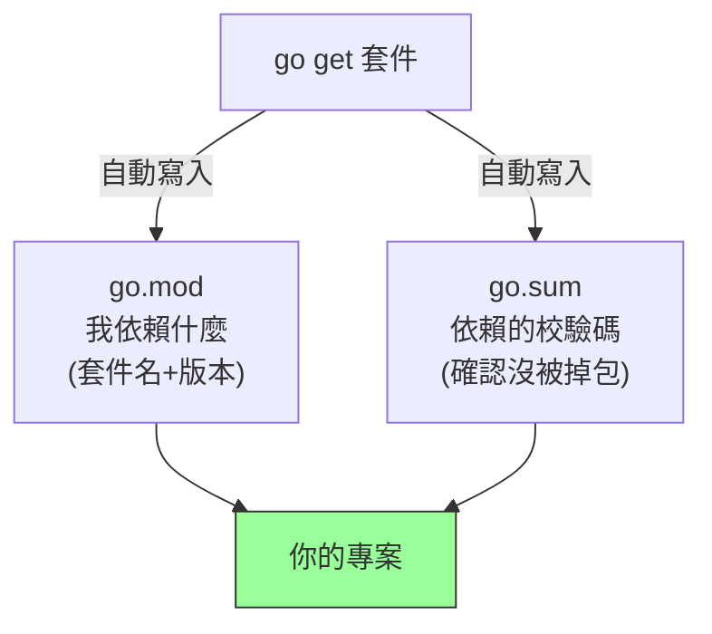

# [go-0-4] Go Modules 入門：`go mod` 建專案、`go build` / `go run`、加套件的日常流程

> **本章目標**：學會用 Go Modules——Go 的專案與套件管理機制——建立一個正式專案、用 `go build` / `go run` 編譯執行、加入別人寫好的套件。這是你之後每天都會用到的日常流程。

## 你會學到

- 為什麼真實專案不能只靠「一個 `main.go` 檔」
- `go mod init` 怎麼建一個模組（module），`go.mod` / `go.sum` 是什麼
- `go run` / `go build` 在「專案」情境下怎麼用（不用再指定檔名）
- 怎麼用 `go get` 加入別人的套件，加完 `go mod tidy` 收尾

## 概念說明

### 為什麼一個 `main.go` 不夠用？

上一章 [go-0-3] 你用 `go run main.go` 跑了一個單檔程式。一個檔案還好，但真實專案會：

- 有**幾十、幾百個檔案**，拆成好幾個套件（package）。
- 用到**別人寫好的套件**（例如一個處理時間、或產生唯一 ID 的函式庫）。
- 需要記錄「我這個專案用了哪些套件、各是哪個版本」，這樣別人（或換台機器的你）才能一模一樣地重現。

這些事需要一個「專案管理機制」。Go 的答案就是 **Go Modules**——用一個 `go.mod` 檔當專案的「身分證＋依賴清單」。

一個比喻：

```
單檔 go run main.go  像「在白紙上塗鴉」：隨手畫畫可以，但沒辦法變成一本書。

Go Modules          像「正式立項」：先幫專案取名字(模組路徑)、
                     開一張依賴清單(go.mod)，之後所有檔案、
                     所有用到的套件，都登記在這個專案底下。
```

> Go 的「模組（module）」裝了一個或多個「套件（package）」。現在你只要知道「模組 ≈ 一個專案」就好；套件怎麼切、怎麼匯出，Part 5 會專門講。

### `go.mod` 和 `go.sum` 是什麼

建好模組後會多出一個 `go.mod` 檔，它記的是**你依賴什麼**：

```
模組叫什麼名字（模組路徑）
這個專案用哪個 Go 版本
依賴哪些別人的套件、各是哪個版本
```

之後一旦你加了套件，還會多出一個 `go.sum`。它記的是每個依賴套件的**校驗碼（checksum）**——用來確認「你下載到的套件，和當初登記的那個一模一樣、沒被掉包」。你幾乎不用手動碰 `go.sum`，但它**要跟著進 Git**，這樣協作者才能驗證拿到的依賴是對的。



這張圖的重點：`go.mod` 記「要哪些套件」、`go.sum` 記「這些套件長怎樣、沒被動過手腳」，而你用 `go get` 加套件時，這兩個檔會被**自動更新**——你很少手寫它們。

> 「套件版本、為什麼要鎖版本、語意化版本」這些觀念跨語言相通 → [課外讀物 E-2：npm 與套件生態](../../../課外讀物/E-2-npm/E-2-1-npm-intro.md)（Go Modules 與 npm 概念互通，只是指令不同）

## 程式碼範例

### 步驟一：建立一個模組

建一個資料夾、進去，然後 `go mod init` 幫它「立項」。模組要取一個**模組路徑（module path）**，慣例是用「你將來會放這份程式碼的網址」當名字（例如放 GitHub 的話是 `github.com/你的帳號/專案名`）；還沒決定放哪、純練習的話，取一個簡單名字也行：

```bash
mkdir todo-app
cd todo-app
go mod init example.com/todo-app
```

跑完資料夾裡會多出一個 `go.mod`，打開看看：

```
module example.com/todo-app

go 1.2x
```

- `module example.com/todo-app`：這個專案的模組路徑（名字）。
- `go 1.2x`：這個專案要求的 Go 版本。
- 目前還沒有任何依賴，所以沒有依賴清單。

### 步驟二：寫程式，用 `go run` / `go build`（不用再指定檔名）

在資料夾裡建 `main.go`：

```go
package main

import "fmt"

func main() {
    fmt.Println("我的待辦事項 App 啟動了")
}
```

有了模組後，`go run` / `go build` **不用再指定檔名**，用 `.` 代表「當前模組」即可：

```bash
go run .      # 編譯+執行整個當前模組
go build .    # 把整個模組編成一個執行檔(名字預設是模組名 todo-app)
```

這比上一章 `go run main.go` 更接近真實用法——因為真實專案有很多檔案，你不可能一個個列出來，交給 Go 用模組自動處理。

### 步驟三：加一個別人寫好的套件

假設我們的待辦事項每一筆要有個「唯一編號」。自己寫一個「保證不重複的 ID 產生器」其實不簡單，社群已經有現成套件，例如 `github.com/google/uuid`（產生 UUID，一種幾乎不會重複的唯一識別碼）。加它只要：

```bash
go get github.com/google/uuid
```

這行會**自動**：下載這個套件、把它寫進 `go.mod` 的依賴清單、把校驗碼寫進 `go.sum`。然後在 `main.go` 裡用它：

```go
package main

import (
    "fmt"

    "github.com/google/uuid" // 引入剛加的第三方套件
)

// Todo 代表一筆待辦事項
type Todo struct {
    ID    string // 每筆待辦的唯一編號
    Title string // 待辦內容
}

func main() {
    // uuid.NewString() 產生一個幾乎不會重複的唯一字串當編號
    task := Todo{
        ID:    uuid.NewString(),
        Title: "學會 Go Modules",
    }

    fmt.Printf("建立待辦：[%s] %s\n", task.ID, task.Title)
}
```

逐段說明這在做什麼：

- `import` 區塊同時引入標準庫的 `fmt` 和第三方的 `uuid`——標準庫和第三方套件的引入方式一樣。
- `type Todo struct {...}`：定義一個「待辦事項」的資料型別，裝編號和內容（struct 是 Part 2 的主角，這裡先感受一下）。
- `uuid.NewString()`：呼叫套件提供的功能，生出一個唯一編號。
- `fmt.Printf(...)`：用帶格式的方式印出（`%s` 會被字串填進去，`\n` 是換行）。

再跑一次：

```bash
go run .
```

你會看到類似：

```
建立待辦：[a1b2c3d4-...] 學會 Go Modules
```

整個過程你**沒有手動下載任何檔案**——`go get` 幫你抓好、`go.mod` / `go.sum` 自動更新好。這就是 Go Modules 的日常。

### 步驟四：`go mod tidy`——收尾，讓依賴清單乾淨

開發久了，你可能加了套件後又不用了、或某個套件被你移除了 import。`go mod tidy` 會幫你**對齊「程式碼實際用到的」和「`go.mod` 記錄的」**：

```bash
go mod tidy
```

它會自動：補上「程式碼有用到、但 `go.mod` 漏記」的依賴，移除「`go.mod` 記了、但程式碼其實沒在用」的依賴。**養成改完依賴就 `go mod tidy` 的習慣**，你的依賴清單就不會累積垃圾——這呼應了「成對的東西要成對：加了就要負責清」的乾淨習慣。

### 日常流程總結

```
go mod init <模組路徑>   # 專案開頭做一次：立項
go run .                 # 開發時：快速跑起來看結果
go get <套件>            # 需要別人的套件時：加進來
（寫 code、import、使用）
go mod tidy              # 改完依賴後：收尾，對齊清單
go build .               # 要產出可部署的執行檔時：編譯
```

這幾個指令就涵蓋了 90% 的日常。沒有複雜的設定檔、沒有額外要裝的工具——官方 `go` 一條工具鏈全包。

## 小練習

1. 用 `go mod init example.com/calculator` 建一個新專案，寫一支 `main.go` 印出 `3 + 5 = 8`（直接用 `fmt.Println(3 + 5)` 之類即可），用 `go run .` 跑起來。觀察這個專案的 `go.mod` 長什麼樣、有沒有 `go.sum`（還沒加套件時應該沒有）。
2. 在上面那個專案 `go get github.com/google/uuid`，然後打開 `go.mod` 和 `go.sum`，看看它們各多了什麼。接著把程式裡用到 `uuid` 的部分**全部刪掉**（連 import 也刪），跑 `go mod tidy`，再看 `go.mod` 的依賴有沒有消失。
3. 思考題：`go.mod` 和 `go.sum` 這兩個檔，哪些該進 Git、哪些不該？為什麼協作時「鎖住依賴的版本」很重要？（提示：想想「你電腦上跑得過，到同事電腦卻壞了」這種慘案怎麼發生。）

<details>
<summary>參考解答</summary>

**第 1 題（建 calculator 專案）**

```bash
mkdir calculator
cd calculator
go mod init example.com/calculator
```

`main.go`：

```go
package main

import "fmt"

func main() {
    // Println 會自動計算 3 + 5 再印出結果
    fmt.Println("3 + 5 =", 3+5)
}
```

```bash
go run .
```

**驗收點**：印出 `3 + 5 = 8`。看 `go.mod` 只有 `module example.com/calculator` 和 `go 1.2x` 兩三行、**沒有依賴清單**；而且資料夾裡**沒有 `go.sum`**——因為你還沒加任何第三方套件，沒有依賴就沒有校驗碼要記。

**第 2 題（加套件再移除，觀察 tidy）**

```bash
go get github.com/google/uuid
```

**觀察**：`go.mod` 多了一行 `require github.com/google/uuid vX.Y.Z`（記錄依賴與版本）；資料夾多出 `go.sum`，裡面是 `uuid`（及它自己的依賴）的校驗碼。

接著把程式裡所有用到 `uuid` 的地方刪掉、連 `import` 的那一行也刪掉，然後：

```bash
go mod tidy
```

**驗收點**：再看 `go.mod`，那行 `require github.com/google/uuid` **消失了**——因為 `go mod tidy` 發現「程式碼已經沒在用它」，就把它從依賴清單移除。這證明了 `tidy` 的用途：**讓 `go.mod` 永遠只記錄你真正用到的東西**，不囤垃圾。

**第 3 題（哪些進 Git、為什麼鎖版本）**

- **`go.mod` 和 `go.sum` 都要進 Git。** `go.mod` 記「要哪些套件、哪個版本」，`go.sum` 記「這些套件的校驗碼」。兩個都進版本控制，協作者 clone 下來後，`go` 才能**精確重現你那套依賴、並驗證沒被掉包**。
- **（補充）下載下來的套件本體不該進 Git**：Go 會把下載的套件放在你機器上的快取，不在專案資料夾裡，所以不像某些語言要特別處理「依賴資料夾」。

**為什麼鎖版本重要**：如果不鎖版本，你今天裝到某套件的 1.0 版、同事下週裝到 1.1 版，而 1.1 改了某個行為——結果「你電腦跑得過、同事電腦卻壞了」，這種「環境不一致」的 bug 最難查。鎖住版本（`go.mod` 記死版本、`go.sum` 驗證內容），就保證**每個人、每台機器、每次建置，拿到的依賴都一模一樣**，把這類慘案擋在門外。這個「可重現的建置」觀念跨語言相通（npm 的 `package-lock.json` 是一樣的道理）。

</details>

## 課外讀物

> 想理解「套件生態系、語意化版本、為什麼要鎖版本」 → [課外讀物 E-2：npm 與套件生態](../../../課外讀物/E-2-npm/E-2-1-npm-intro.md)（觀念與 Go Modules 相通）

> 想知道哪些檔案該進 Git、哪些不該（例如下載的依賴、建置產物） → [課外讀物 E-8：Git 版本控制](../../../課外讀物/E-8-git/E-8-6-gitignore.md)
