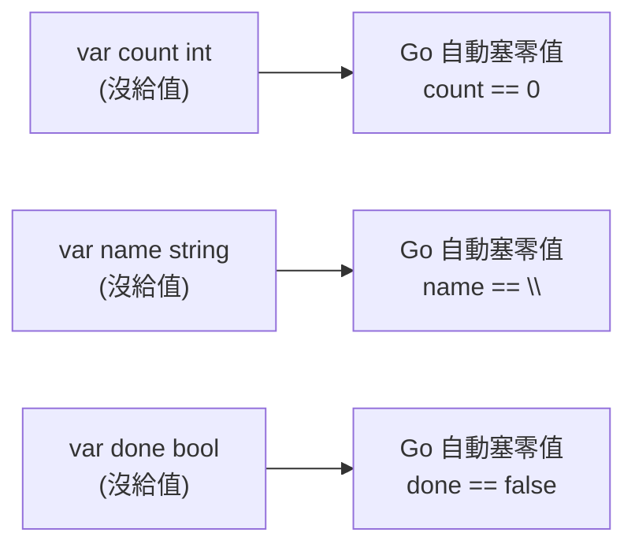

# [go-1-1] 變數、常數與「零值」：為什麼 Go 沒有 undefined

> **本章目標**：學會 Go 宣告變數的幾種寫法（`var` 與 `:=`）與常數 `const`，並理解 Go 一個關鍵設計——**每個型別都有「零值」，所以沒有 `undefined` 這種東西**。

## 你會學到

- 用 `var` 和 `:=` 宣告變數的多種寫法，以及什麼時候用哪一種
- 「零值（zero value）」是什麼，為什麼 Go 不需要 `null` / `undefined`
- 用 `const` 宣告常數，以及它和變數的差別
- Go 的一個硬規則：宣告了卻沒用到的變數會「編譯失敗」

## 概念說明

### 宣告一個變數，其實只是「挖一個有名字的盒子」

寫程式常常要先準備一個「盒子」放值，之後再拿出來用。Go 給你兩種挖盒子的方式，一種囉嗦、一種精簡：

```
正式版（var）：  我要一個叫 count 的盒子，裝 int，先放 0
精簡版（:=）：    count 就等於 0（Go 自己看出來這是 int）
```

### 零值：盒子「天生」就有東西，不會是空的

這是 Go 和很多語言最不一樣的地方。在 JavaScript 裡，一個只宣告、還沒賦值的變數是 `undefined`；很多語言的物件沒給值就是 `null`。這些「什麼都不是」的狀態，正是無數 bug 的來源（經典的 `cannot read property of undefined`）。

Go 把這條路直接堵死：**你宣告一個變數卻沒給初始值，Go 不會讓它「什麼都不是」，而是塞一個該型別的「零值」進去。** 每個型別的零值都是固定、可預期的：

```
整數 int        → 0
浮點 float64    → 0.0
布林 bool       → false
字串 string     → ""（空字串，不是 null）
指標、slice、map → nil
```



這張圖的重點：**在 Go，「宣告了」就等於「已經有一個明確的值」**，不存在「宣告了但還沒初始化」的模糊地帶。這讓你讀程式時不用擔心「這個變數現在會不會是 undefined」——它一定是零值或你給的值，二選一。

## 程式碼範例

### `var`：最正式的寫法

`var 名字 型別 = 值` 是最完整的形式。型別和初始值常常可以擇一省略：

```go
package main

import "fmt"

func main() {
	var count int = 10 // 完整：名字、型別、值都寫
	var name = "待辦清單" // 省略型別：Go 從 "待辦清單" 推斷出是 string
	var done bool       // 省略值：done 自動是零值 false

	fmt.Println(count, name, done) // 10 待辦清單 false
}
```

說明：第三行 `var done bool` 沒給值，但它**不是** undefined——它是 `bool` 的零值 `false`。這就是「零值」在實際程式裡的樣子。

### `:=`：函式內最常用的精簡寫法

在函式裡面，Go 讓你用 `:=`（短變數宣告）一次完成「宣告＋賦值＋型別推斷」，不用寫 `var`，也不用寫型別：

```go
func main() {
	count := 10        // 等同 var count int = 10
	name := "購物車"    // 等同 var name string = "購物車"
	price := 99.5      // Go 推斷成 float64

	fmt.Println(count, name, price)
}
```

這是 Go 程式裡**最常見**的寫法。要注意兩件事：

- `:=` **只能用在函式內部**，不能用來宣告套件層級（全域）的變數——那裡只能用 `var`。
- `:=` 的左邊至少要有一個「新變數」，否則該用 `=`（單純賦值，不是宣告）。

### 一次宣告多個變數

`var` 可以用括號一次宣告一組，`:=` 則可以一行列出多個：

```go
func main() {
	// var 群組寫法，常用在套件層級
	var (
		userID   int    = 1
		userName string = "Alice"
	)

	// := 一行多個
	width, height := 1920, 1080

	fmt.Println(userID, userName, width, height)
}
```

> 這個「一行回傳／接收多個值」的能力，到 [go-1-3] 函式與多回傳值會變成 Go 的招牌用法。

### `const`：編譯期就固定的常數

`const` 宣告的是「永遠不變、編譯時就確定」的常數。它和 `var` 的差別在於：常數的值必須在編譯期就能算出來，而且之後不能改。習慣上用具名常數取代程式裡散落的「魔術數字」：

```go
const maxRetryCount = 3
const pi = 3.14159

func main() {
	const greeting = "歡迎回來"
	fmt.Println(greeting, maxRetryCount, pi)
}
```

> 直接在程式裡寫 `3` 而不說明 3 是什麼，是常見的「魔術數字」反模式 → [課外讀物 E-6-6：程式碼異味與反模式](../../../課外讀物/E-6-best-practices/E-6-6-anti-patterns.md)

注意 Go 的命名慣例和多數語言不同：Go **不用** `UPPER_SNAKE_CASE`。常數和變數一樣用駝峰式（`maxRetryCount`），大小寫開頭另有意義（大寫＝對外匯出，這點到 Part 5 會講）。

### 一個會嚇到新手的硬規則：宣告沒用到就編譯失敗

Go 非常討厭「死程式碼」。**宣告了一個區域變數卻從沒用到，會直接編譯失敗**，不是警告，是錯誤：

```go
func main() {
	count := 10 // ❌ 宣告了卻沒用到
}
```

```
./main.go:4:2: declared and not used: count
```

這很嚴格，但用意是逼你保持程式乾淨——沒用到的變數要嘛是忘了用（bug），要嘛是殘骸（該刪）。Go 乾脆不讓你放著。（`import` 了卻沒用到的套件也一樣會編譯失敗。）

## 小練習

1. 用三種不同寫法宣告三個變數：一個用完整 `var 名字 型別 = 值`、一個用 `var` 省略型別、一個用 `:=`。各印出來。
2. 宣告一個 `var` 變數但**不給初始值**（分別試 `int`、`string`、`bool` 各一個），直接印出來，親眼確認它們是零值 `0`、`""`、`false`，而不是報錯或 undefined。
3. 用 `const` 定義一個「一打的數量」常數 `itemsPerDozen`（值 12），算出 5 打是幾個並印出。想想為什麼用 `const` 比直接在算式裡寫 `12` 好。

<details>
<summary>參考解答</summary>

**練習 1：三種宣告寫法**

```go
package main

import "fmt"

func main() {
	var quantity int = 3 // 完整寫法
	var label = "訂單"     // 省略型別，Go 推斷為 string
	price := 250.0       // := 短宣告，Go 推斷為 float64

	fmt.Println(quantity, label, price) // 3 訂單 250
}
```

三種都對。日常在函式內最常用 `:=`；要宣告套件層級變數或想明確標出型別時用 `var`。

**練習 2：親眼看零值**

```go
package main

import "fmt"

func main() {
	var count int
	var name string
	var done bool

	// %q 會把字串加上引號，方便看清楚它是空字串 "" 而不是 nil
	fmt.Printf("count=%d name=%q done=%t\n", count, name, done)
	// 輸出：count=0 name="" done=false
}
```

重點：這三個變數都「沒給值」，但印出來是 `0`、`""`、`false`，不是錯誤、也沒有 undefined。這就是 Go 的零值保證——宣告即有值。

**練習 3：`const` 取代魔術數字**

```go
package main

import "fmt"

const itemsPerDozen = 12

func main() {
	dozens := 5
	total := dozens * itemsPerDozen
	fmt.Printf("%d 打是 %d 個\n", dozens, total) // 5 打是 60 個
}
```

為什麼用 `const` 比直接寫 `12` 好？

- **有名字＝有意義**：`itemsPerDozen` 一看就懂這是「一打幾個」；算式裡突然冒出的 `12` 讀者得自己猜。
- **只改一處**：萬一哪天定義變了，只改常數那一行，所有用到的地方全跟著變，不會漏改。
- **消滅魔術數字**：這正是把「魔術數字」反模式修掉的標準做法。

</details>

## 課外讀物

> 「用具名常數消滅魔術數字」是 Clean Code 的基本功 → [課外讀物 E-6-6：程式碼異味與反模式](../../../課外讀物/E-6-best-practices/E-6-6-anti-patterns.md)

> 好的變數命名能讓程式自我說明 → [課外讀物 E-6-2：命名的藝術](../../../課外讀物/E-6-best-practices/E-6-2-naming.md)
