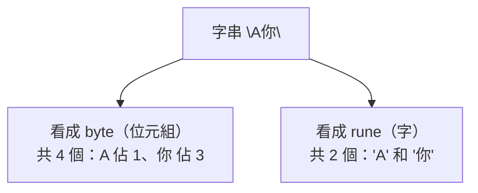

# [go-1-2] 基本型別：整數、浮點、布林、字串，與 byte / rune

> **本章目標**：認識 Go 的基本（純量）型別，搞懂 `byte` 和 `rune` 到底是什麼，並理解 Go 一個很硬的規則——**不同型別之間不會自動轉換，你得自己寫明**。

## 你會學到

- Go 的四大類基本型別：整數、浮點、布林、字串
- `byte` 和 `rune` 是什麼，和字串的關係
- 為什麼 `int` 和 `int64` 相加也要你明寫轉換
- 字串「不可變」是什麼意思

## 概念說明

### 四大類基本型別

Go 的基本型別可以分成四組，就像四種不同的「容器」，各裝各的東西：

```
整數  int / int64 / uint ...    → 42、-7、0      （沒有小數點的數字）
浮點  float64 / float32         → 3.14、-0.5     （有小數點的數字）
布林  bool                      → true / false   （只有兩種可能）
字串  string                    → "你好"、"order" （一串文字）
```

平常你大多只需要記四個「預設選擇」：**`int`（整數）、`float64`（小數）、`bool`（真假）、`string`（文字）**。其他像 `int8`、`uint32` 是需要精確控制大小時才用（例如處理二進位協定、省記憶體）。

### byte 和 rune：字串拆開來到底是什麼

這是 Go 新手最容易卡住的地方。先講結論：

```
byte  = uint8 的別名  → 一個「位元組」（0~255），對應 ASCII 的一個字元
rune  = int32 的別名  → 一個「Unicode 碼位」，對應「一個你眼睛看到的字」（含中文、emoji）
```

為什麼要分兩個？因為**「一個字」和「一個位元組」在 Go 裡不是同一回事**。英文字母 `A` 剛好是 1 個位元組；但中文的「你」在 UTF-8 編碼下佔 **3 個位元組**。



這張圖的重點：**同一個字串，用「位元組」數和用「字」數，答案不一樣**。所以 Go 給你兩個型別：要算「佔幾個位元組」用 `byte`，要算「有幾個字」用 `rune`。這個區別在 [go-1-5] 和 Part 6 處理字串時會一再出現。

### 型別轉換一定要寫明：Go 不幫你「猜」

很多語言裡，`int` 和 `float` 相加會自動幫你轉。Go **不會**。Go 的立場是：**隱式轉換會悄悄改變值（例如小數被砍掉），而「悄悄」正是 bug 的溫床**，所以乾脆禁止——不同型別要運算，你得自己寫出轉換，親手負責。

```
其他語言：  3 + 1.5        → 自動變成 4.5（你沒發現 3 被轉成了 float）
Go：        3 + 1.5        → ❌ 編譯錯誤：mismatched types
Go 要你寫： float64(3) + 1.5 → 4.5（你明確表示「我知道我在把 3 轉成浮點」）
```

這看起來囉嗦，但好處是：**程式裡每一次型別變化都看得見**，不會有「某個數字在你沒注意時偷偷被截斷」的隱藏災難。

## 程式碼範例

### 四大基本型別

```go
package main

import "fmt"

func main() {
	var count int = 42      // 整數
	var price float64 = 9.9 // 浮點
	var inStock bool = true // 布林
	var title string = "Go 入門" // 字串

	// %T 會印出「值的型別」，方便確認
	fmt.Printf("%v (%T)\n", count, count)   // 42 (int)
	fmt.Printf("%v (%T)\n", price, price)   // 9.9 (float64)
	fmt.Printf("%v (%T)\n", inStock, inStock) // true (bool)
	fmt.Printf("%v (%T)\n", title, title)   // Go 入門 (string)
}
```

說明：`%T` 這個格式動詞會印出值的型別，是你確認「Go 推斷成什麼型別」最方便的工具。

### 型別不相容：Go 直接擋下

```go
func main() {
	var apples int = 3
	var ratio float64 = 1.5
	total := apples * ratio // ❌ 編譯錯誤
	fmt.Println(total)
}
```

```
invalid operation: apples * ratio (mismatched types int and float64)
```

要讓它過，你得自己寫轉換，表明「我知道我在做什麼」：

```go
func main() {
	var apples int = 3
	var ratio float64 = 1.5
	total := float64(apples) * ratio // ✅ 明確把 int 轉成 float64
	fmt.Println(total)               // 4.5
}
```

反過來把 `float64` 轉成 `int` 要特別小心——**小數部分會被直接砍掉（無條件捨去，不是四捨五入）**：

```go
func main() {
	price := 9.9
	whole := int(price) // 9，不是 10！小數被砍掉
	fmt.Println(whole)
}
```

> **常見錯誤** — 很多人以為 `int(9.9)` 會四捨五入成 10。它不會，它直接砍成 9。要四捨五入得用 `math.Round`。Go 逼你寫出 `int(...)` 這個轉換，正是要你在這一刻意識到「這裡會掉精度」。

### byte 與 rune：數字串的長度陷阱

```go
func main() {
	s := "A你好"

	// len() 算的是「位元組數」：A=1 + 你=3 + 好=3 = 7
	fmt.Println("位元組數：", len(s)) // 7

	// 轉成 []rune 再算長度，才是「字數」
	fmt.Println("字數：", len([]rune(s))) // 3
}
```

說明：這是 Go 字串最經典的坑——`len(s)` 回傳的是**位元組數**，不是字數。對純英文字串兩者剛好一樣，但只要有中文、emoji 就會差很多。要算「幾個字」，先轉成 `[]rune`。

單獨一個字元常數的型別就是 `rune`（用單引號）：

```go
func main() {
	var r rune = '好'
	// rune 底層是 int32，印出數字會得到它的 Unicode 碼位
	fmt.Printf("%c 的碼位是 %d\n", r, r) // 好 的碼位是 22909
}
```

### 字串是不可變的

Go 的字串一旦建立就不能改裡面的字元——你不能用 `s[0] = 'B'` 去改它：

```go
func main() {
	s := "hello"
	s[0] = 'H' // ❌ 編譯錯誤：cannot assign to s[0]
	fmt.Println(s)
}
```

要「改字串」，實際做法是產生一個**新字串**（例如用 `strings` 套件的函式，或轉成 `[]byte` / `[]rune` 改完再轉回去）。這和 [go-1-1] 的精神一致：Go 偏好「不可變」，因為會被偷偷改的東西最難追蹤。

## 小練習

1. 宣告 `int`、`float64`、`bool`、`string` 各一個，用 `fmt.Printf` 搭配 `%T` 印出它們的值和型別。
2. 寫一段程式：有一個 `int` 的「總價」和一個 `int` 的「人數」，算出「每人平均」。先故意用 `總價 / 人數`（整數相除會砍小數），再改成用 `float64(...)` 轉換算出正確的小數平均，比較兩者差別。
3. 給字串 `"Go語言"`，分別印出它的「位元組數」（`len`）和「字數」（轉 `[]rune` 後 `len`），解釋為什麼兩個數字不一樣。

<details>
<summary>參考解答</summary>

**練習 1：印出值與型別**

```go
package main

import "fmt"

func main() {
	count := 7
	weight := 55.5
	active := false
	city := "台北"

	fmt.Printf("%v (%T)\n", count, count)   // 7 (int)
	fmt.Printf("%v (%T)\n", weight, weight) // 55.5 (float64)
	fmt.Printf("%v (%T)\n", active, active) // false (bool)
	fmt.Printf("%v (%T)\n", city, city)     // 台北 (string)
}
```

**練習 2：整數相除 vs 浮點相除**

```go
package main

import "fmt"

func main() {
	total := 100
	people := 3

	// 整數相除：小數被砍掉
	avgInt := total / people
	fmt.Println("整數相除：", avgInt) // 33（不是 33.33！）

	// 轉成 float64 再除，才有小數
	avgFloat := float64(total) / float64(people)
	fmt.Printf("浮點相除：%.2f\n", avgFloat) // 33.33
}
```

重點：`int / int` 的結果還是 `int`，`100 / 3` 會砍成 `33`。要拿到 `33.33`，必須先把運算元轉成 `float64`。Go 逼你寫出這個轉換，正是提醒你「這裡牽涉到精度」。

**練習 3：位元組數 vs 字數**

```go
package main

import "fmt"

func main() {
	s := "Go語言"

	fmt.Println("位元組數：", len(s))         // 8
	fmt.Println("字數：", len([]rune(s)))     // 4
}
```

為什麼不一樣？`"Go語言"` 裡 `G`、`o` 各 1 個位元組（ASCII），但「語」「言」兩個中文字在 UTF-8 下各佔 3 個位元組，所以 `len` 算出 1+1+3+3 = 8 個位元組。而「字數」是 4（G、o、語、言），要先轉成 `[]rune` 才算得對——`rune` 一個就是一個字，不管它底層佔幾個位元組。

</details>

## 課外讀物

> 整數、浮點在記憶體裡到底怎麼表示（為什麼浮點會有精度誤差） → **cs 課程 Part 3：硬體構造與二進位**

> 字串、字元編碼（UTF-8、Unicode）為什麼「一個字不等於一個位元組」，Part 6 處理 `encoding/json` 和字串時會再深入。
