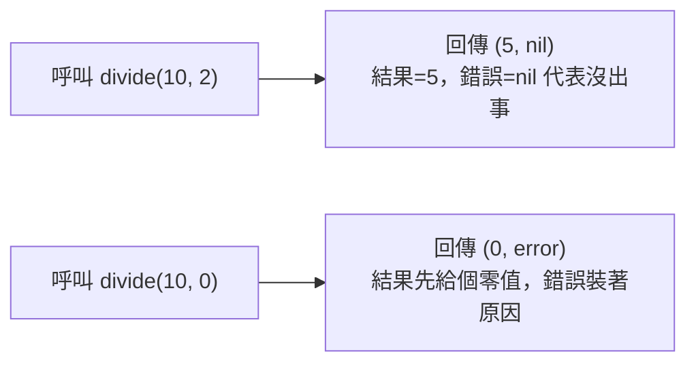

# [go-1-3] 🐹 函式與多回傳值：Go 招牌的 (結果, error)

> **本章目標**：學會 Go 的函式怎麼寫，並認識 Go 最有辨識度的招牌——**函式一次回傳「結果」和「錯誤」兩個值 `(結果, error)`**，建立「多回傳值」的直覺。

## 你會學到

- Go 函式的基本語法：參數型別寫在後面、回傳型別寫在最後
- Go 的招牌：一個函式同時回傳「結果」和「錯誤」
- `if err != nil` 這個你會看到一輩子的檢查式
- 具名回傳值（named return values）是什麼、何時好用
- 用 `_` 丟掉你不想要的回傳值

## 概念說明

### 函式：把一段工作包起來、取個名字

函式就是「把一段固定流程包起來、給它一個名字，之後喊名字就能重用」。Go 的函式語法和別的語言最大的差別，是**型別寫在名字後面**：

```
pseudo：
    函式 add，吃兩個整數 a 和 b，回傳一個整數
    內容：把 a + b 送回去
```

對應到 Go，型別（`int`）跟在參數名後面，回傳型別寫在參數括號之後：

```
func add(a int, b int) int { ... }
      └名字┘ └─參數與型別─┘ └回傳型別┘
```

### Go 的招牌：一次回傳「結果」和「錯誤」

這是整個 Part 1 最該記住的一件事。先看一個問題：**一個函式「可能會失敗」時，它怎麼告訴你失敗了？**

別的語言常用「丟例外（throw exception）」——出事就拋一個 exception 出去，讓某個 `try/catch` 接住。Go 不走這條路。Go 的做法是：**讓函式同時回傳兩個值——一個是「結果」，一個是「錯誤」。**

```
pseudo：
    函式 divide(a, b)：
        如果 b 是 0：
            回傳 (0, 一個說明「不能除以零」的錯誤)
        否則：
            回傳 (a / b, 沒有錯誤)
```



這張圖的重點：Go 函式失敗時**不會「跳走」**，它老老實實回傳兩個值給你。第二個值 `error` 是關鍵——**它是 `nil` 就代表成功，不是 `nil` 就代表出事了，裡面裝著原因**。（`nil` 是「沒有東西」的意思，是 `error` 這類型別的零值，呼應 [go-1-1]。）

收到回傳值的人，就得**當場**決定怎麼辦。這催生了你在 Go 程式裡會看到成千上萬次的一行：

```go
if err != nil {
    // 出事了，處理它（記錄、回報、或往上丟）
}
```

> 這套「錯誤是一個普通的回傳值、強迫你當場面對」的哲學，是 Go 和別的語言最大的分野之一。這裡先建立「多回傳值＋error 一起回」的**直覺**就好；完整的錯誤處理（怎麼包裝、怎麼判斷錯誤種類、`panic` 的分界）是 **Part 3** 的主題。

## 程式碼範例

### 最基本的函式

參數型別在後、回傳型別在最後。`return` 把值送回去：

```go
package main

import "fmt"

// 吃兩個 int，回傳一個 int
func add(a int, b int) int {
	return a + b
}

func main() {
	sum := add(3, 4)
	fmt.Println(sum) // 7
}
```

小技巧：連續同型別的參數可以共用型別，`func add(a, b int)` 和 `func add(a int, b int)` 等價。

### 招牌登場：回傳 (結果, error)

這是 Go 最具代表性的函式形狀。慣例是**錯誤放在最後一個回傳值**。我們用「安全的除法」示範——除以零是會失敗的操作：

```go
package main

import (
	"errors"
	"fmt"
)

// 回傳 (商, 錯誤)。除以零時，商給零值 0，錯誤裝著原因
func divide(a, b float64) (float64, error) {
	if b == 0 {
		return 0, errors.New("不能除以零")
	}
	return a / b, nil // 成功：錯誤是 nil
}

func main() {
	result, err := divide(10, 2)
	if err != nil {
		fmt.Println("出錯了：", err)
		return
	}
	fmt.Println("結果是", result) // 結果是 5
}
```

說明三個重點：

- 回傳型別寫成 `(float64, error)`——用括號包起來，代表「回傳兩個值」。
- 成功時回傳 `(a / b, nil)`：第二個值是 `nil`，代表「沒有錯誤」。
- 失敗時回傳 `(0, errors.New("..."))`：第一個值給一個無意義的零值，第二個值才是重點。

### `if err != nil`：你會寫一輩子的檢查

接到回傳值後，Go 慣例是**立刻**檢查 `err`。失敗的路徑先處理掉（通常 `return` 離開），成功的主流程留在最後，不往右縮排：

```go
func main() {
	result, err := divide(10, 0)
	if err != nil {
		// 錯誤路徑：先處理掉
		fmt.Println("出錯了：", err) // 出錯了： 不能除以零
		return
	}
	// 走到這裡，保證 err 是 nil，可以安心用 result
	fmt.Println("結果是", result)
}
```

這種「**出事就早點 return，讓正常流程保持在左邊**」的寫法叫「快速返回（early return）」，能讓程式避免一層層往右縮的巢狀地獄。

> 深層巢狀（if 裡包 if 包 if）是常見的壞味道 → [課外讀物 E-6-6：程式碼異味與反模式](../../../課外讀物/E-6-best-practices/E-6-6-anti-patterns.md)

### 具名回傳值（named return values）

Go 允許你在函式簽名裡**先給回傳值取名字**。這些名字一宣告就是零值（又見 [go-1-1] 的零值），函式內可以直接賦值，最後寫一個光禿禿的 `return`（叫「裸返回 naked return」）就會把它們送回去：

```go
// 回傳值先命名為 area 和 err
func rectangleArea(width, height float64) (area float64, err error) {
	if width < 0 || height < 0 {
		err = errors.New("邊長不能是負數")
		return // 裸 return：自動回傳目前的 area(0) 和 err
	}
	area = width * height
	return // 裸 return：回傳算好的 area 和 err(nil)
}
```

具名回傳值的好處是**當簽名就說明了每個回傳值的意思**（讀 `(area float64, err error)` 就知道兩個值分別是什麼）。但要節制：函式一長，裸 `return` 會讓人看不清到底回傳了什麼。**短函式用具名回傳值很清爽，長函式建議還是明寫 `return area, err`。** 這是風格取捨，不是硬規則。

### 用 `_` 丟掉不想要的回傳值

Go 規定「宣告了就要用」（[go-1-1]），那如果一個函式回傳兩個值、你只想要其中一個呢？用底線 `_`（空白識別字 blank identifier）明確表示「這個我故意不要」：

```go
func main() {
	// 只想要結果，明確丟掉 error（示範用；實務上 error 不該隨便丟）
	result, _ := divide(10, 2)
	fmt.Println(result) // 5
}
```

`_` 讓「我故意忽略這個值」變成一件寫在程式上、看得見的事，而不是偷偷略過。

> **常見錯誤** — 用 `_` 把 `error` 丟掉，等於把「可能的失敗」直接無視，是很危險的習慣。這裡只是示範語法；實務上除非你非常確定不會錯，`error` 都該被檢查。完整的拿捏在 Part 3。

## 小練習

1. 寫一個函式 `max(a, b int) int`，回傳兩者較大的那個。在 `main` 裡呼叫並印出 `max(3, 9)`。
2. 寫一個函式 `safeSqrt(x float64) (float64, error)`：`x` 是負數時回傳 `(0, 錯誤)`，否則回傳 `(平方根, nil)`（平方根用 `math.Sqrt`）。在 `main` 裡分別用 `9` 和 `-1` 呼叫，並用 `if err != nil` 正確處理兩種情況。
3. 把練習 2 改成用「具名回傳值」寫一次，體會裸 `return` 的感覺。想想：這個函式夠短，具名回傳值讓它更清楚還是更難懂？

<details>
<summary>參考解答</summary>

**練習 1：max**

```go
package main

import "fmt"

func max(a, b int) int {
	if a > b {
		return a
	}
	return b
}

func main() {
	fmt.Println(max(3, 9)) // 9
}
```

（注意：Go 1.21+ 其實內建了 `max`、`min`，但自己寫一次能熟悉 `if` + `return` 的結構。）

**練習 2：safeSqrt 回傳 (結果, error)**

```go
package main

import (
	"errors"
	"fmt"
	"math"
)

func safeSqrt(x float64) (float64, error) {
	if x < 0 {
		return 0, errors.New("負數沒有實數平方根")
	}
	return math.Sqrt(x), nil
}

func main() {
	// 成功的情況
	result, err := safeSqrt(9)
	if err != nil {
		fmt.Println("出錯：", err)
	} else {
		fmt.Println("根號 9 =", result) // 根號 9 = 3
	}

	// 失敗的情況
	result, err = safeSqrt(-1)
	if err != nil {
		fmt.Println("出錯：", err) // 出錯： 負數沒有實數平方根
	} else {
		fmt.Println("結果 =", result)
	}
}
```

重點：兩次呼叫都緊跟著 `if err != nil` 檢查。成功時 `err` 是 `nil`、走 `else`；失敗時 `err` 裝著原因、走錯誤分支。這就是 Go 程式的基本節奏。

**練習 3：改成具名回傳值**

```go
func safeSqrt(x float64) (result float64, err error) {
	if x < 0 {
		err = errors.New("負數沒有實數平方根")
		return // 裸 return：回傳 result(0) 和 err
	}
	result = math.Sqrt(x)
	return // 裸 return：回傳算好的 result 和 err(nil)
}
```

這個函式很短，具名回傳值讓簽名 `(result float64, err error)` 自己就說清楚「回傳一個結果和一個錯誤」，算是更清楚。但如果函式長到幾十行、中間好幾個 `return`，裸 `return` 就會讓人得往回翻「現在 result 是多少」——那時反而明寫 `return result, err` 更好讀。短則清爽、長則明寫，是常見的拿捏。

</details>

## 課外讀物

> 「一個函式只做一件事、失敗路徑早點 return」是函式設計的基本功 → [課外讀物 E-6-3：函式設計](../../../課外讀物/E-6-best-practices/E-6-3-function-design.md)

> Go 用「回傳 error 值」取代「丟例外」的完整哲學與取捨，是 **Part 3：錯誤處理** 的主題，也可對照 → [課外讀物 E-6-8：後端的 Clean Code（錯誤處理）](../../../課外讀物/E-6-best-practices/E-6-8-backend-clean-code.md)
