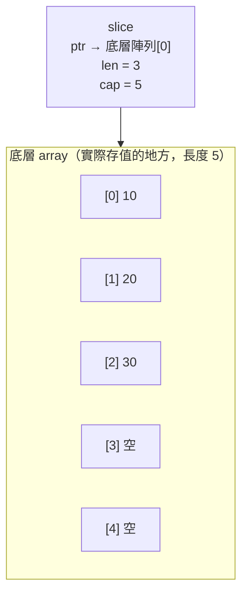
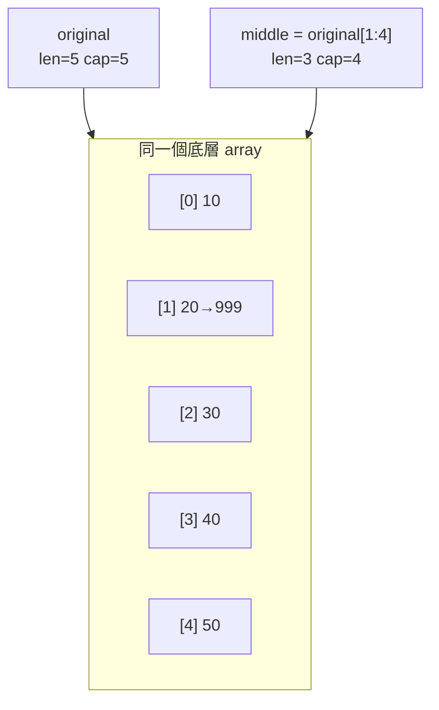
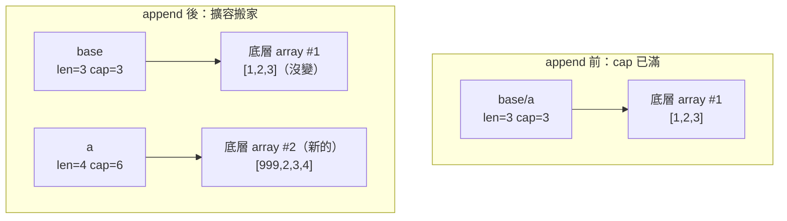

# [go-1-5] 🐹 slice、array 與 map：最常用的集合，與 append 的經典陷阱

> **本章目標**：學會 Go 三種最常用的集合——固定長度的 `array`、會長大的 `slice`、鍵值對的 `map`，並**徹底搞懂 slice 的底層結構與 `append` 的經典陷阱**（這是 Go 新手最常踩的坑）。

## 你會學到

- `array`（陣列）：固定長度、長度是型別的一部分
- `slice`（切片）：Go 日常真正在用的「會長大的陣列」
- slice 的底層三件組：指標、長度（len）、容量（cap）
- `append` 為什麼有時改到別人、有時不會——擴容與底層陣列共享
- `map`（映射）：鍵值對集合，與「key 不存在」的處理

## 概念說明

### array vs slice：固定 vs 會長大

Go 有兩種「一排同型別的值」，差別在**長度能不能變**：

```
array（陣列）：像蛋盒，格數固定。[3]int 就是「剛好 3 格」，塞不進第 4 個
slice（切片）：像可伸縮的書架，能用 append 一直加書
```

實務上 Go 程式**幾乎都在用 slice**，array 很少直接用。但你得先懂 array，因為 **slice 是「建立在 array 之上」的一層包裝**——這正是後面 append 陷阱的根源。

### slice 的真面目：它只是一個「view」

這是本章的關鍵，一定要懂。slice 看起來像一個裝了一堆值的容器，但它**本身不存值**。slice 其實是一個小小的「描述器」，只有三個欄位：

```
slice 的三件組：
    ptr（指標）  → 指向某個底層 array 的某個位置
    len（長度）  → 我「現在」管幾個元素
    cap（容量）  → 從起點到底層 array 結尾，「最多」能放幾個
```



這張圖的重點：**slice 是一個「看向底層 array 的視窗」**。`len=3` 代表視窗現在框住前 3 格（10、20、30），`cap=5` 代表這個底層 array 總共有 5 格、還能再長 2 格不用搬家。**真正的資料在底層 array，slice 只是指過去。** 記住這點，append 的所有詭異行為都解釋得通。

## 程式碼範例

### array：固定長度

```go
package main

import "fmt"

func main() {
	var temps [3]int // 3 格的 int 陣列，每格零值 0
	temps[0] = 25
	temps[1] = 26
	temps[2] = 24

	fmt.Println(temps)      // [25 26 24]
	fmt.Println(len(temps)) // 3
	// temps[3] = 99        // ❌ 編譯/執行錯誤：越界，array 長度就是 3
}
```

說明：`[3]int` 的「3」是型別的一部分——`[3]int` 和 `[4]int` 是**不同型別**，不能互相賦值。這種死板正是大家平常不直接用 array 的原因。

### slice：日常真正在用的集合

宣告 slice 用 `[]型別`（中括號裡**不寫數字**，這是和 array 最明顯的差別）。用 `append` 往後加東西：

```go
func main() {
	var scores []int // 空 slice，零值是 nil

	scores = append(scores, 90) // append 回傳「新的 slice」，要接回去
	scores = append(scores, 85)
	scores = append(scores, 88)

	fmt.Println(scores)      // [90 85 88]
	fmt.Println(len(scores)) // 3
}
```

說明一個最容易忘的點：**`append` 不會「就地」改原 slice，它回傳一個新的 slice，你必須接回去（`scores = append(...)`）**。為什麼？因為 append 可能需要換一個更大的底層 array（見下面「擴容」），換了之後 slice 的三件組就變了，所以得回傳新的讓你接住。

也可以用「字面值」一次建好：

```go
func main() {
	cart := []string{"牛奶", "麵包", "雞蛋"}
	fmt.Println(cart, len(cart)) // [牛奶 麵包 雞蛋] 3
}
```

### 🐹 經典陷阱一：切出來的 slice 和原本「共享底層」

用 `s[開始:結束]` 可以「切」出一段 slice。但切出來的新 slice **和原本指向同一個底層 array**——改一個，另一個也會變：

```go
func main() {
	original := []int{10, 20, 30, 40, 50}

	// 切出中間三個（索引 1 到 3，不含 4）
	middle := original[1:4] // [20 30 40]

	// 改 middle 的第一個元素
	middle[0] = 999

	fmt.Println(middle)   // [999 30 40]
	fmt.Println(original) // [10 999 30 40 50] ← 原本的也被改了！
}
```



這張圖的重點：`middle` 不是 `original` 的「複製」，它是**指向同一塊底層 array** 的另一個視窗。所以 `middle[0] = 999` 改的是底層 array 的 `[1]` 格，`original` 看過去當然也變了。**切片是「借 view」，不是「拷貝」。**

### 🐹 經典陷阱二：append 的「有時影響、有時不影響」

這是最讓人抓狂的坑。承上，`append` 到一個「和別人共享底層」的 slice 時，結果取決於**還有沒有剩餘容量（cap）**：

- **cap 還夠** → append 直接寫進底層 array 的下一格，**會覆蓋到別人看得到的資料**。
- **cap 不夠** → Go 配一個**全新、更大的底層 array**，把資料搬過去，從此和原本「斷開」，再 append 就影響不到別人了。

看兩個對照：

```go
func main() {
	base := []int{1, 2, 3, 4, 5} // len=5, cap=5

	// a 和 base 共享底層，但 a 還有剩餘容量（cap=5, len=2）
	a := base[0:2] // [1 2]，len=2 cap=5

	// append 第三個：cap 還夠，直接寫進底層的 [2] 格，覆蓋掉原本的 3！
	a = append(a, 999)

	fmt.Println(a)    // [1 2 999]
	fmt.Println(base) // [1 2 999 4 5] ← base 的 3 被改成 999 了！
}
```

說明：`a` 的 `len=2` 但 `cap=5`（因為它借的底層 array 有 5 格）。`append(a, 999)` 看到「還有容量」，就把 999 寫進底層 array 的索引 2——而那一格正是 `base` 看得到的 `3`。於是 `base` 被連累。

再看 cap 不夠、觸發「擴容搬家」的情況：

```go
func main() {
	base := []int{1, 2, 3} // len=3, cap=3

	a := base[0:3] // [1 2 3]，len=3 cap=3，已經滿了

	// append 第四個：cap 不夠！Go 配一個更大的新底層 array，把 1 2 3 複製過去
	a = append(a, 4)
	a[0] = 999 // 改 a，此時 a 已經有自己的底層了

	fmt.Println(a)    // [999 2 3 4]
	fmt.Println(base) // [1 2 3] ← base 完全沒被影響，因為 a 已經搬家了
}
```



這張圖的重點：cap 不夠時 `append` 會「搬到新家」——配一個更大的底層 array、複製舊資料過去。從這一刻起 `a` 和 `base` 指向**不同的底層 array**，彼此再也影響不到。

**所以「append 到底會不會改到別人」取決於當下 cap 夠不夠，而 cap 你平常根本沒在盯**——這就是為什麼它是「陷阱」：同樣的程式碼，slice 大小不同，行為可能完全相反。

> **常見錯誤** — 把一個 slice 傳進函式、函式裡 `append` 之後以為原本的不會變（或以為一定會變）。安全的做法是：**需要「獨立一份」時，明確用 `copy` 或 `append([]T{}, s...)` 做出真正的複製**，不要賭 cap。

```go
func main() {
	original := []int{1, 2, 3}

	// 做一份真正獨立的複製
	cloned := make([]int, len(original))
	copy(cloned, original)

	cloned[0] = 999
	fmt.Println(original) // [1 2 3] ← 安全，沒被影響
	fmt.Println(cloned)   // [999 2 3]
}
```

### map：鍵值對集合

`map` 是「用 key 查 value」的集合（別的語言叫 dictionary、hash map）。宣告用 `map[key型別]value型別`，而且**一定要先 `make` 才能寫入**（map 的零值是 `nil`，對 nil map 寫入會 panic）：

```go
func main() {
	stock := make(map[string]int) // key 是 string，value 是 int

	stock["蘋果"] = 10
	stock["香蕉"] = 5

	fmt.Println(stock["蘋果"]) // 10
	delete(stock, "香蕉")      // 刪掉一個 key

	// 也可以用字面值直接建好
	prices := map[string]float64{
		"牛奶": 25.0,
		"麵包": 30.0,
	}
	fmt.Println(prices["牛奶"]) // 25
}
```

### 🐹 map 的陷阱：查不到 key 會回「零值」，不會報錯

這呼應 [go-1-1] 的零值哲學：查一個不存在的 key，map **不會報錯**，而是回傳 value 型別的零值。這可能讓你分不清「這個 key 真的對應 0」還是「這個 key 根本不存在」：

```go
func main() {
	stock := map[string]int{"蘋果": 10}

	fmt.Println(stock["蘋果"]) // 10
	fmt.Println(stock["火龍果"]) // 0 ← 不是報錯，是 int 的零值！
}
```

要分辨「真的是 0」還是「key 不存在」，用 map 的「逗號 ok」寫法——它回傳第二個布林值告訴你 key 在不在：

```go
func main() {
	stock := map[string]int{"蘋果": 10, "芭樂": 0}

	if count, ok := stock["芭樂"]; ok {
		fmt.Println("有芭樂，數量", count) // 有芭樂，數量 0
	} else {
		fmt.Println("沒有芭樂這個 key")
	}

	if count, ok := stock["火龍果"]; ok {
		fmt.Println("數量", count)
	} else {
		fmt.Println("沒有火龍果這個 key") // 走這裡
	}
}
```

說明：`count, ok := stock[key]` 的 `ok` 是布林值——key 存在才是 `true`。這個「逗號 ok」慣用法搭配帶初始化的 `if`（[go-1-4]），是 Go 查 map 的標準寫法。

> 另外提醒：**map 的遍歷順序是隨機的**（Go 故意的，避免你依賴順序）。需要固定順序請另外把 key 排序。

## 小練習

1. 建一個空的 `[]string`，用 `append` 依序加入三個待辦事項，再用 `for range`（[go-1-4]）把它們連同索引印出來。
2. 重現「append 陷阱」：建 `base := []int{1, 2, 3, 4, 5}`，切出 `a := base[0:2]`，對 `a` 做一次 `append(a, 100)`，印出 `a` 和 `base`，解釋為什麼 `base` 被改了。接著改用 `copy` 做出獨立複製，證明這次 `base` 不受影響。
3. 建一個 `map[string]int` 當作「字數統計」，給一個字串 slice `[]string{"a", "b", "a", "c", "a"}`，用 `for range` 數每個字出現幾次，最後印出來。

<details>
<summary>參考解答</summary>

**練習 1：slice + append + range**

```go
package main

import "fmt"

func main() {
	var todos []string
	todos = append(todos, "買菜")
	todos = append(todos, "寫作業")
	todos = append(todos, "運動")

	for index, todo := range todos {
		fmt.Printf("%d. %s\n", index, todo)
	}
	// 0. 買菜
	// 1. 寫作業
	// 2. 運動
}
```

重點：`append` 的結果一定要接回 `todos`，否則加不進去。

**練習 2：重現並避開 append 陷阱**

```go
package main

import "fmt"

func main() {
	base := []int{1, 2, 3, 4, 5}
	a := base[0:2] // [1 2]，len=2 但 cap=5（借 base 的底層）

	a = append(a, 100) // cap 還夠，寫進底層的 [2] 格，覆蓋掉 base 的 3
	fmt.Println("a    =", a)    // [1 2 100]
	fmt.Println("base =", base) // [1 2 100 4 5] ← base 的 3 變成 100 了

	// 用 copy 做出獨立複製就安全了
	base2 := []int{1, 2, 3, 4, 5}
	safe := make([]int, 2)
	copy(safe, base2[0:2]) // 把前兩個複製到一塊全新的底層
	safe = append(safe, 100)
	fmt.Println("safe  =", safe)  // [1 2 100]
	fmt.Println("base2 =", base2) // [1 2 3 4 5] ← 完全沒被影響
}
```

為什麼第一段 `base` 被改？因為 `a` 是 `base` 的「view」，兩者共享底層 array，而 `a` 的 cap 還夠（=5），`append` 就直接寫進底層的第 3 格——那正是 `base[2]`。用 `copy` 把資料搬到一塊全新的底層後，兩者斷開，就安全了。

**練習 3：用 map 做字數統計**

```go
package main

import "fmt"

func main() {
	words := []string{"a", "b", "a", "c", "a"}
	counts := make(map[string]int)

	for _, w := range words {
		counts[w]++ // 妙處：w 不存在時，counts[w] 是零值 0，+1 後變 1
	}

	fmt.Println(counts) // map[a:3 b:1 c:1]
}
```

重點：這裡巧妙用到了 map 的「零值」特性——第一次遇到某個字，`counts[w]` 還不存在，但它回傳零值 `0`，`counts[w]++` 於是把它設成 1。不用先判斷 key 在不在，直接 `++` 就對了。這正是零值哲學帶來的方便。

</details>

## 課外讀物

> slice 背後就是「動態陣列（dynamic array）」、map 背後是「雜湊表（hash table）」，想懂它們為什麼能這樣運作、擴容的代價多大 → **dsa 課程**（[課程大綱](../../dsa/課程大綱.md) Part 2 線性結構、Part 3 雜湊表）

> array 越界、共享記憶體被誤改，在底層都和「記憶體怎麼配置」有關 → **cs 課程 Part 3：記憶體與堆疊堆積**
