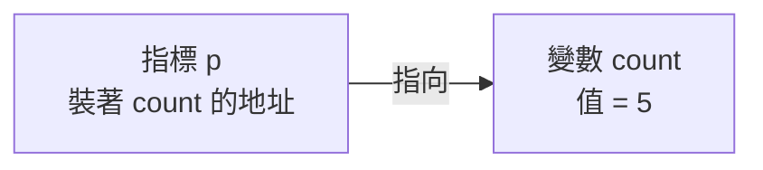
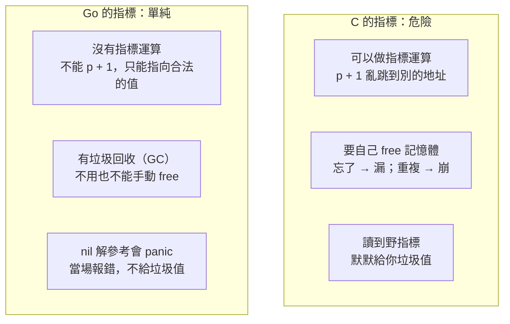

# [go-1-6] 指標入門：* 與 &，為什麼 Go 的指標比 C 單純

> **本章目標**：搞懂「指標（pointer）」是什麼、`*` 和 `&` 怎麼用，並理解為什麼 Go 保留了指標、卻把 C 裡最危險的「指標運算」拿掉了。

## 你會學到

- 指標是什麼：一個「指向某個值住在哪」的箭頭
- `&`（取位址）和 `*`（取值／解參考）兩個符號怎麼用
- 為什麼要用指標——讓函式「真的改到」外面的變數
- Go 的指標為什麼比 C 安全（沒有指標運算、有 GC、有 nil 檢查）

## 概念說明

### 指標：一張「地址紙條」，而不是東西本身

平常一個變數直接裝著值：`count := 5`，`count` 這個盒子裡就是 5。**指標不裝值，它裝的是「某個值住在記憶體的哪個地址」**——像一張寫著門牌號碼的紙條，而不是房子本身。

```
一般變數：  count ──→ [ 5 ]            盒子裡直接是值
指標：      p ──→ [ 0xc0000140 ] ──→ [ 5 ]   盒子裡是「地址」，照著地址才找到值
```



這張圖的重點：`p` 本身不是 5，它是「指向 count 的箭頭」。要透過 `p` 拿到或修改 5，得「順著箭頭走過去」——這個動作就是下面的 `*`。

### 兩個符號：`&` 拿地址、`*` 順著地址走

Go 只需要兩個符號就能玩轉指標：

```
&x   取位址（address-of）：給我 x 住的地址 → 得到一個指標
*p   解參考（dereference）：順著指標 p 走過去，拿到／修改那裡的值
```

一個記法：`&` 是「打包成地址」，`*` 是「拆開地址看裡面」，兩者剛好相反。

### 為什麼需要指標？讓函式「真的改到」外面的東西

這是指標最實際的用途。Go 的函式參數是**傳值（pass by value）**——傳進去的是「一份拷貝」。所以函式裡改參數，**改的是拷貝，外面的原件不會變**：

```
pseudo：
    函式 addOne(n)：   // n 是外面那個值的「拷貝」
        n = n + 1      // 只改到拷貝

    main：
        x = 5
        addOne(x)      // x 還是 5！因為 addOne 改的是拷貝
```

要讓函式「真的改到外面的 x」，就把 **x 的地址**傳進去，函式順著地址回頭改原件：

```
pseudo：
    函式 addOne(p)：    // p 是「x 住哪」的地址
        *p = *p + 1     // 順著地址回去，改的是 x 本尊

    main：
        x = 5
        addOne(&x)      // 傳 x 的地址
        // 現在 x 真的變成 6 了
```

## 程式碼範例

### `&` 和 `*` 的基本動作

```go
package main

import "fmt"

func main() {
	count := 5

	p := &count // p 是指標，裝著 count 的地址
	fmt.Println(p)  // 類似 0xc000012028（一個記憶體地址）
	fmt.Println(*p) // 5 ← 順著 p 走過去，拿到 count 的值

	*p = 99         // 順著 p 走過去，把那裡改成 99
	fmt.Println(count) // 99 ← count 本尊被改了！
}
```

說明：`p := &count` 讓 `p` 指向 `count`。之後 `*p` 就是「count 那個值」——讀它得到 5，寫它（`*p = 99`）就改到了 `count` 本尊。指標型別寫成 `*int`（指向 int 的指標）。

### 傳值 vs 傳指標：眼見為憑

```go
package main

import "fmt"

// 傳值：n 是拷貝，改它影響不到外面
func addOneByValue(n int) {
	n = n + 1
}

// 傳指標：順著地址改到本尊
func addOneByPointer(p *int) {
	*p = *p + 1
}

func main() {
	x := 5

	addOneByValue(x)
	fmt.Println(x) // 5 ← 沒變，剛剛改的是拷貝

	addOneByPointer(&x) // 傳 x 的地址
	fmt.Println(x) // 6 ← 真的變了
}
```

說明：這兩個函式對照得很清楚。`addOneByValue` 收到的是 `x` 的拷貝，怎麼改都影響不到外面。`addOneByPointer` 收到的是 `x` 的地址（`&x`），透過 `*p` 改到的是 `x` 本尊。**「想讓函式改到外面的變數」就是傳指標最常見的理由。**

### 指標的零值是 nil：不要對 nil 解參考

延續 [go-1-1] 的零值哲學，指標的零值是 `nil`（什麼都沒指向）。對一個 `nil` 指標做 `*p` 會直接 panic：

```go
func main() {
	var p *int      // 沒初始化，零值是 nil
	fmt.Println(p)  // <nil>
	fmt.Println(*p) // ❌ panic: invalid memory address or nil pointer dereference
}
```

這其實是 Go 的保護：與其像 C 那樣讓你讀到一塊垃圾記憶體、程式繼續跑出錯誤結果，Go 選擇**當場清楚地 panic**，讓你立刻看到問題（又見 [go-1-2] array 越界的同一種精神）。

### 為什麼 Go 的指標比 C 單純、安全

C 的指標惡名昭彰，因為它允許太多危險動作。Go 保留了指標的「能指向、能改到本尊」這個核心用途，但**砍掉了最容易出事的部分**：



這張圖的重點，逐條說明：

- **沒有指標運算**：C 可以 `p + 1` 讓指標「移動到隔壁地址」，這是無數記憶體漏洞的來源。Go 完全不允許——指標只能「指向一個合法的值」，不能拿來算術亂跳。
- **有垃圾回收（GC）**：C 要你自己 `malloc` / `free`，忘了釋放會記憶體洩漏、重複釋放會崩潰。Go 有 GC（和 C#、TypeScript 一樣），記憶體自動回收，你不用也不能手動 free。
- **nil 解參考會 panic**：C 讀到壞指標常常默默回傳垃圾、程式照跑；Go 直接 panic，把問題攤在陽光下。

所以 Go 的指標是「**閹割過的、安全版的指標**」——保留了「能透過它修改本尊」這個有用的能力，拿掉了「能拿它做危險算術、要自己管生死」這些坑。這也是為什麼 [go-0-2] 說 Go 像「有 GC 的 C」。

> **什麼時候用指標？** 兩個最常見的理由：①想讓函式改到外面的變數（上面示範的）；②傳一個「很大的 struct」時，傳指標（一個地址）比複製整包便宜。第二點牽涉 struct 和「值接收者 vs 指標接收者」，是 **Part 2**（`go-2-2`）的主題，這裡先建立「指標是什麼、怎麼用」的基礎。

## 小練習

1. 宣告 `x := 10`，建一個指向它的指標 `p`，用 `*p` 把 `x` 改成 20，印出 `x` 確認真的變了。
2. 寫一個函式 `double(p *int)`，把指標指向的值變成兩倍。在 `main` 裡對一個變數呼叫它，印出前後的值。
3. 寫一個函式 `swap(a, b *int)`，交換兩個變數的值（經典的「交換」題，正好需要指標才做得到）。在 `main` 裡驗證 `x` 和 `y` 真的被對調了。

<details>
<summary>參考解答</summary>

**練習 1：透過指標改值**

```go
package main

import "fmt"

func main() {
	x := 10
	p := &x // p 指向 x

	*p = 20 // 順著 p 走過去，把 x 改成 20
	fmt.Println(x) // 20
}
```

重點：`*p = 20` 不是改 `p`（地址），而是改「p 指向的那個值」，也就是 `x` 本尊。

**練習 2：double 函式**

```go
package main

import "fmt"

func double(p *int) {
	*p = *p * 2 // 讀出本尊的值、乘 2、再寫回本尊
}

func main() {
	n := 7
	fmt.Println("前：", n) // 前： 7
	double(&n)            // 傳 n 的地址
	fmt.Println("後：", n) // 後： 14
}
```

重點：函式參數型別是 `*int`（指向 int 的指標），呼叫時傳 `&n`（n 的地址）。函式內 `*p` 讀寫的都是 `n` 本尊。

**練習 3：swap 交換兩個值**

```go
package main

import "fmt"

func swap(a, b *int) {
	*a, *b = *b, *a // Go 的多重賦值：一行同時對調兩個本尊的值
}

func main() {
	x, y := 1, 2
	fmt.Println(x, y) // 1 2
	swap(&x, &y)
	fmt.Println(x, y) // 2 1 ← 真的對調了
}
```

為什麼 swap 一定要用指標？因為如果用傳值（`func swap(a, b int)`），函式裡對調的是「兩個拷貝」，外面的 `x`、`y` 根本不會動。唯有傳地址（`&x`、`&y`），函式才改得到本尊。這題正是「指標讓函式能改到外面變數」最經典的例子。

（小補充：`*a, *b = *b, *a` 用到了 Go 的「多重賦值」——右邊先全部算好，再一起賦給左邊，所以不用借助第三個暫存變數就能對調。）

</details>

## 課外讀物

> 指標、地址、堆疊（stack）與堆積（heap）到底在記憶體裡長什麼樣，為什麼「傳值是拷貝」 → **cs 課程 Part 3：硬體構造與記憶體**

> 想看另一種語言怎麼「不靠 GC、靠所有權（ownership）」管記憶體安全 → **rust 課程**（姊妹課，對照 Go 的 GC 與 Rust 的所有權兩條路線）
