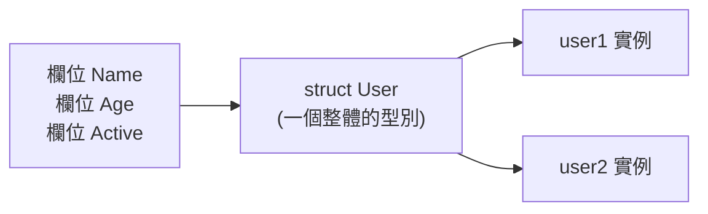
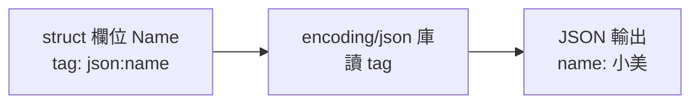

# [go-2-1] struct：定義你自己的資料型別

> **本章目標**：學會用 struct 把「一組相關的欄位」打包成一個有名字、有意義的型別，並認識 struct tag 是做什麼用的。

## 你會學到

- struct 是什麼，為什麼要有它
- 怎麼定義 struct、建立實例、讀寫欄位
- 建立實例的幾種寫法（具名欄位、省略欄位、`new`、匿名 struct）
- struct tag 初探：掛在欄位後面那串反引號字串是什麼、誰會去讀它

## 概念說明

### 從「散落的變數」到「有名字的欄位」

假設你要描述一個使用者，有名字、年齡、是否啟用三項資料。沒有 struct 時，你只能開三個各自獨立的變數：

```
userName   = "小美"
userAge    = 28
userActive = true
```

問題是，這三個變數在程式眼裡毫無關聯——傳給函式要傳三個參數，多一個使用者又要再開三個變數，很快就亂成一團。

**struct（結構體）** 把這些欄位黏成「一個東西」。用一個比喻：

```
散落的變數像「桌上三張便利貼」：要自己記得它們是同一個人的。
struct 像「一張填好的表單」：
        Name:   小美
        Age:    28
        Active: true
        ——裝在同一張紙上，是一個整體。
```

Go 沒有 class、沒有繼承。它組織資料的起點就是 struct：**用 struct 裝資料，下一章再用「方法」把行為綁上去。** 這和物件導向語言的 class 不一樣——Go 刻意把「資料」和「行為」分開定義。



> 這張圖的意思：struct 是「型別（藍圖）」，照著藍圖可以蓋出很多個「實例」。

## 程式碼範例

### 定義與建立

這段程式碼定義一個 `User` 型別，建立一個實例，再把欄位印出來。

```go
package main

import "fmt"

// User 型別名用 PascalCase（大寫開頭）
// 大寫開頭還有另一層意義：代表這個型別可以被其他套件使用（go-5-1 會講）
type User struct {
	Name   string
	Age    int
	Active bool
}

func main() {
	// 建立實例：每個欄位用「欄位名: 值」填好
	user := User{
		Name:   "小美",
		Age:    28,
		Active: true,
	}

	// 用「點 + 欄位名」存取
	fmt.Printf("%s 今年 %d 歲\n", user.Name, user.Age)
}
```

說明：

- `type User struct { ... }` 定義一個叫 `User` 的新型別，列出它有哪些欄位、各是什麼型別。
- 建立實例時用 `欄位名: 值` 一一填好，這叫「具名欄位」寫法（最推薦，因為看得出哪個值對應哪個欄位）。
- 用 `user.Name`、`user.Age` 讀取欄位。

### 零值：沒給的欄位不會是 undefined

還記得 Go 的「零值」嗎（go-1-1）？struct 也適用——**沒填的欄位會自動是該型別的零值**，不會是空的、也不會報錯。

```go
func main() {
	// 只填一個欄位，其餘自動補零值
	var user User
	fmt.Printf("%q %d %t\n", user.Name, user.Age, user.Active)
	// 輸出："" 0 false
	// string 的零值是 ""，int 是 0，bool 是 false
}
```

這是 Go 和很多語言很不一樣的地方：一個剛宣告、什麼都沒填的 struct **立刻就能用**，每個欄位都有合理的預設值，不會有「未初始化」的危險。

### 用指標指向 struct，以及 `new`

`&user` 會得到「指向這個 struct 的指標」（go-1-6 的 `&` / `*`）。Go 有個貼心設計：**透過指標存取欄位時，不用自己寫 `*`**。

```go
func main() {
	user := User{Name: "阿明", Age: 30}

	p := &user      // p 的型別是 *User（指向 User 的指標）
	p.Age = 31      // 不必寫成 (*p).Age，Go 自動幫你解參考
	fmt.Println(user.Age) // 31，改到的是同一個 user

	// new(User) 會配置一個零值的 User，回傳它的指標
	q := new(User)  // q 的型別是 *User，每個欄位都是零值
	q.Name = "小華"
	fmt.Println(q.Name)
}
```

說明：`p.Age` 其實是 `(*p).Age` 的簡寫，Go 看到 `p` 是指標會自動解參考。下一章講「指標接收者」時，這個自動解參考會非常重要。

### 匿名 struct：只用一次、懶得取名

偶爾你只需要「臨時打包幾個欄位」，不值得特地 `type` 一個名字出來。這時可以用匿名 struct：

```go
func main() {
	// 直接定義型別並建立實例，不取名字
	point := struct {
		X int
		Y int
	}{X: 3, Y: 4}

	fmt.Println(point.X, point.Y) // 3 4
}
```

匿名 struct 常用在「只在這個函式裡用一次」的小資料，例如測試資料表（go-5-3 的 table-driven test 會再看到）。平常要重複使用的型別，還是乖乖 `type` 命名。

### struct tag 初探：欄位後面那串反引號是什麼

你遲早會在別人的 Go 程式看到這種寫法——欄位後面跟著一串反引號字串：

```go
type User struct {
	Name   string `json:"name"`
	Age    int    `json:"age"`
	Active bool   `json:"active,omitempty"`
}
```

這串東西叫 **struct tag（結構標籤）**。它**不會影響程式邏輯**，Go 編譯器幾乎不管它——它是一段「給別的程式庫看的備註」。

用一個比喻：struct tag 像「貼在欄位上的便利貼」，上面寫著「如果你要把我轉成 JSON，請把我叫做 `name`」。真正去讀這張便利貼的，是負責做轉換的程式庫（例如標準庫的 `encoding/json`）。



> 這張圖的意思：欄位叫 `Name`（Go 這邊的名字），但 JSON 庫照著 tag 把它輸出成 `name`。tag 是「兩邊名字不同」時的對照表。

現在你只要**認得它、知道它是給函式庫讀的註記**就夠了。tag 的完整用法（為什麼 Go 的欄位要大寫、`omitempty` 是什麼）留到 `go-6-2`（`encoding/json`）再深入。

> **提醒**：tag 的格式是有慣例的（`key:"value"` 用空白分隔多組），寫錯不會編譯失敗，但讀它的庫會默默拿不到資料。這也是為什麼它常是難查的 bug 來源——這一點留到 JSON 那章再談。

## 小練習

1. 定義一個 `Book` struct，欄位有 `Title string`、`Pages int`、`Rating float64`。用「具名欄位」寫法建立一本你喜歡的書，印出三個欄位。
2. 宣告一個 `var b Book`（完全不填），印出它三個欄位，確認零值分別是 `""`、`0`、`0`。
3. 取得上面那本書的指標 `p := &b`，透過 `p` 把 `Rating` 改成 `4.5`（注意：不用寫 `*`），再從原本的 `b` 印出 `Rating` 確認真的改到了。

<details>
<summary>參考解答</summary>

三題寫在同一個 `main` 裡：

```go
package main

import "fmt"

type Book struct {
	Title  string
	Pages  int
	Rating float64
}

func main() {
	// 第 1 題：具名欄位建立
	book := Book{
		Title:  "Go 語言聖經",
		Pages:  380,
		Rating: 4.8,
	}
	fmt.Printf("《%s》，%d 頁，評分 %.1f\n", book.Title, book.Pages, book.Rating)

	// 第 2 題：完全不填 → 每個欄位都是零值
	var b Book
	fmt.Printf("%q %d %v\n", b.Title, b.Pages, b.Rating) // "" 0 0

	// 第 3 題：透過指標修改，p.Rating 自動解參考
	p := &b
	p.Rating = 4.5
	fmt.Println(b.Rating) // 4.5，改到的是同一個 b
}
```

重點提醒：

- **第 2 題**：Go 沒有「未初始化」這回事。`var b Book` 之後每個欄位都有零值，立刻可用。
- **第 3 題**：`p.Rating = 4.5` 等同 `(*p).Rating = 4.5`，Go 自動幫你解參考。因為 `p` 指向的就是 `b` 本人，改 `p` 等於改 `b`——這正是下一章「指標接收者會改到原物件」的伏筆。

</details>

## 課外讀物

> struct 是組織資料的起點，好的欄位命名讓資料自我說明 → [課外讀物 E-6-2：命名的藝術](../../../課外讀物/E-6-best-practices/E-6-2-naming.md)

> struct tag、`omitempty` 與 JSON 的完整用法，之後接資料與做 API 時天天用 → 見本課 `go-6-2`（`encoding/json`）
</content>
</invoke>
