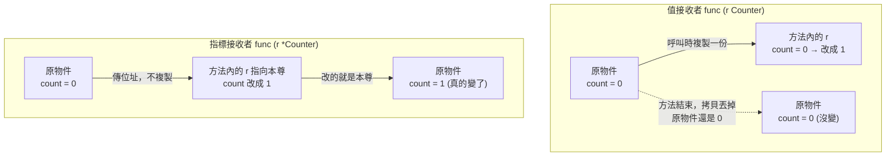

# [go-2-2] 方法與接收者（receiver）：值接收者 vs 指標接收者

> **本章目標**：學會用「方法」把行為綁到 struct 上，並徹底搞懂「值接收者 vs 指標接收者」——也就是「這個方法會不會改到原本的物件」。

## 你會學到

- 方法（method）和一般函式的差別，Go 的方法長什麼樣
- 「接收者（receiver）」是什麼
- **值接收者 vs 指標接收者的差別**：會不會改到原物件、要不要複製
- 一個實用的判斷準則：什麼時候用哪個

## 概念說明

### 資料 + 行為 = 方法

上一章的 struct 只描述「資料長什麼樣」。但資料常有專屬的操作——例如一個「長方形」應該能算自己的面積。Go 的做法是：定義一個函式，但在函式名前面多加一個「接收者」，宣告「這個函式是綁在哪個型別上的」。

```
一般函式：area(rect)      ← 把資料當參數傳進去
方法：    rect.Area()     ← 行為「長在」資料身上，用點呼叫
```

比喻：方法就像「這個東西會的技能」。長方形「會算面積」，你對著一個長方形喊 `.Area()`，它就告訴你。

Go 的方法語法是這樣：

```go
func (r Rectangle) Area() int { ... }
//    ^^^^^^^^^^^^^ 這段就是「接收者」，宣告這個方法綁在 Rectangle 上
```

那個 `(r Rectangle)` 就是**接收者（receiver）**：`r` 是你在方法內用來指涉「呼叫它的那個實例」的變數名（別的語言常叫 `this` 或 `self`，Go 讓你自己取名，慣例是型別的字首小寫）。

### 核心問題：值 vs 指標，差在「會不會改到原物件」

這是本章的重點，也是初學 Go 最容易搞錯的地方。接收者有兩種寫法：

| 寫法 | 名稱 | 方法裡拿到的是 |
|------|------|--------------|
| `func (r Rectangle)` | **值接收者** | 原物件的一份**拷貝** |
| `func (r *Rectangle)` | **指標接收者** | 指向原物件的**指標**（本尊） |

關鍵差別一句話：**值接收者改不到原物件（因為它改的是拷貝），指標接收者改得到（因為它握著本尊的位址）。**

用一個比喻：

```
值接收者   = 你把文件「影印一份」交給對方。對方在影印本上塗改，
             你手上的正本一個字都沒變。
指標接收者 = 你把「正本放在哪個抽屜」的位址告訴對方。
             對方照位址去改，改的就是正本。
```



> 這張圖的意思：值接收者在方法裡動的是「拷貝」，方法一結束拷貝就丟了，原物件毫髮無傷；指標接收者握著原物件的位址，動的就是本尊。

## 程式碼範例

### 值接收者：只讀，不會改到原物件

這段程式碼示範「算面積」——它只需要讀欄位，不改任何東西，所以用值接收者。

```go
package main

import "fmt"

type Rectangle struct {
	Width  int
	Height int
}

// 值接收者：r 是呼叫者的一份拷貝
func (r Rectangle) Area() int {
	return r.Width * r.Height
}

func main() {
	rect := Rectangle{Width: 30, Height: 50}
	fmt.Println(rect.Area()) // 1500
}
```

說明：`Area` 只讀 `r.Width`、`r.Height`，沒有要改任何欄位，用值接收者剛好。

### 用錯接收者的經典 bug：想改卻改不到

這是初學者最常踩的坑。下面的 `Scale` 想把長方形放大，卻用了**值接收者**——結果改的是拷貝，原物件紋風不動：

> **常見錯誤** — 很多人會這樣寫：
>
> ```go
> // ❌ 值接收者：r 是拷貝，改的是拷貝
> func (r Rectangle) Scale(factor int) {
> 	r.Width *= factor
> 	r.Height *= factor
> }
>
> func main() {
> 	rect := Rectangle{Width: 10, Height: 20}
> 	rect.Scale(2)
> 	fmt.Println(rect.Width, rect.Height) // 10 20 ← 竟然沒變！
> }
> ```
>
> 問題是：`Scale` 拿到的 `r` 是 `rect` 的拷貝，方法裡把拷貝放大了，方法一結束拷貝就被丟掉，`rect` 本尊從頭到尾沒被動過。編譯不會報錯、程式照跑，但行為完全不對——這種「安靜的錯」最難查。
>
> 正確做法：**要修改原物件，就用指標接收者。**
>
> ```go
> // ✅ 指標接收者：r 指向本尊
> func (r *Rectangle) Scale(factor int) {
> 	r.Width *= factor
> 	r.Height *= factor
> }
>
> func main() {
> 	rect := Rectangle{Width: 10, Height: 20}
> 	rect.Scale(2)
> 	fmt.Println(rect.Width, rect.Height) // 20 40 ← 這才對
> }
> ```

你可能會問：`rect` 是個值，不是指標，為什麼能直接 `rect.Scale(2)`？因為 Go 很貼心——**只要 `rect` 是可取址的變數（例如用 `:=` 宣告的變數），呼叫指標接收者的方法時 Go 會自動幫你取址**，等同你寫了 `(&rect).Scale(2)`。反過來，指標呼叫值接收者方法，Go 也會自動解參考。所以日常寫起來兩種都用 `.` 呼叫，不用自己加 `&` 或 `*`。

### 第二個理由：避免複製大的 struct

指標接收者還有一個理由跟「改不改」無關——**效率**。值接收者每次呼叫都要複製整個 struct；如果 struct 很大（很多欄位、或內含大陣列），每次複製都是成本。指標只是一個位址（固定小小的），複製它幾乎沒成本。

```go
type BigReport struct {
	Title   string
	Rows    [10000]int // 很大的陣列
	Summary string
}

// 用指標接收者：避免每次呼叫都複製一萬個 int
func (b *BigReport) RowCount() int {
	return len(b.Rows)
}
```

## 一個實用的判斷準則

什麼時候用哪個？記住這個優先順序：

```
1. 方法需要「修改」接收者的欄位嗎？      → 要：指標接收者（非它不可）
2. struct 很大，複製有成本嗎？           → 是：指標接收者
3. 以上皆否（只讀、而且 struct 很小）      → 值接收者也可以
4. 拿不定主意 / 同一型別有些方法要改有些不改
                                        → 全部統一用指標接收者
```

第 4 點是 Go 社群很常見的慣例：**同一個型別的方法，接收者型別最好一致**（要嘛全值、要嘛全指標），不要混用。一旦有任何一個方法需要指標接收者，通常就讓這個型別「全部」用指標接收者，保持一致、也避免意外的拷貝。

> ⚠️ 這是「有強共識的慣例」，不是編譯器強制的規則——Go 允許你混用，但多數團隊和官方風格建議都傾向一致。一致性比選哪一種更重要。

## 小練習

1. 給上一章的 `Book`（`Title string`、`Pages int`、`Rating float64`）加一個值接收者方法 `IsLong() bool`，頁數超過 300 回傳 `true`。在 `main` 建一本書呼叫它。
2. 給 `Book` 加一個方法 `Rate(score float64)`，把 `Rating` 設成 `score`。想清楚：這個方法要改欄位，該用值接收者還是指標接收者？寫出來並驗證 `main` 裡的書評分真的被改到。
3. 故意把第 2 題的 `Rate` 改成值接收者，跑一次看 `Rating` 有沒有變，親眼確認「值接收者改不到原物件」。

<details>
<summary>參考解答</summary>

```go
package main

import "fmt"

type Book struct {
	Title  string
	Pages  int
	Rating float64
}

// 第 1 題：只讀 Pages → 值接收者就夠
func (b Book) IsLong() bool {
	return b.Pages > 300
}

// 第 2 題：要改 Rating → 必須用指標接收者
func (b *Book) Rate(score float64) {
	b.Rating = score
}

func main() {
	book := Book{Title: "大部頭", Pages: 500}
	fmt.Println(book.IsLong()) // true

	book.Rate(4.7)             // Go 自動取址，等同 (&book).Rate(4.7)
	fmt.Println(book.Rating)   // 4.7，真的改到了
}
```

第 3 題：若把 `Rate` 的接收者改成 `func (b Book) Rate(...)`（值接收者），`book.Rate(4.7)` 之後 `book.Rating` 會是 `0`——因為方法改的是拷貝。這就是本章最重要的一課：**要改原物件，必須用指標接收者。**

</details>

## 課外讀物

> 把「資料」與「操作這份資料的行為」綁在一起、各司其職，呼應物件導向的封裝與單一職責 → [課外讀物 E-7-2：單一職責原則](../../../課外讀物/E-7-solid/E-7-2-srp.md)

> 指標、取址 `&` 與解參考 `*` 的基礎，若還不熟 → 複習本課 `go-1-6`
</content>
