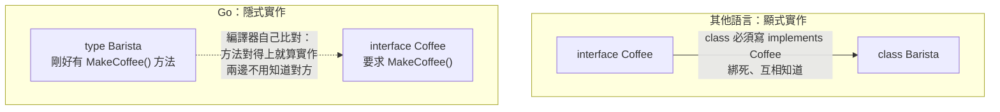
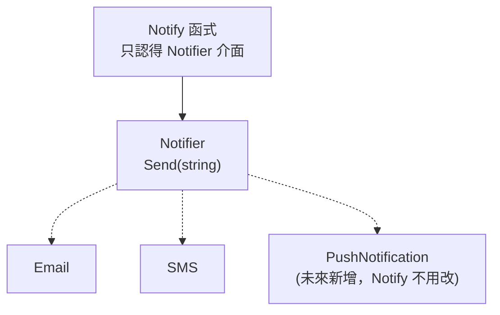

# [go-2-3] 🐹 interface：Go 的「隱式實作」——長得像就算

> **本章目標**：徹底搞懂 Go 的 interface 和別的語言最不一樣的那件事——**不用寫 `implements`，一個型別只要「剛好有」interface 要求的方法，就自動算實作了它**。這是 Go 最反直覺、也最強大的設計。

## 你會學到

- interface 是什麼：一張「只列方法、不管怎麼做」的清單
- Go 的招牌：**隱式實作**——寫 interface 的人和實作的人互不相識
- 為什麼這叫「鴨子型別」
- 怎麼用 interface 寫出「可以換零件」的程式
- `nil` interface 的一個常見坑

## 概念說明

### interface 是「一張能力清單」

先不談 Go。想像你在找打工，徵人廣告上寫：

```
徵：會「煮咖啡」和「結帳」的人
```

廣告**不在乎你是誰**——你是學生、退休教師、還是機器人都行。只要你**會做這兩件事**，你就符合資格。廣告列的是「要會哪些事」，不是「你必須是哪種人」。

**interface（介面）就是這張能力清單**：它只列出「要有哪些方法」，完全不管「是哪個型別、內部怎麼實作」。

```
interface 貼紙機 {
    投幣()
    出貨()
}
```

任何型別，只要它「會投幣、會出貨」，就能被當成「貼紙機」來用——不管它實際上是飲料機、玩具機還是口香糖機。

### Go 最反直覺的地方：隱式實作

這裡是重點，請慢慢讀。

在 Java、C#、TypeScript 裡，一個 class 要「實作」interface，**必須明寫出來**：

```
// 其他語言：必須昭告天下「我要實作 Coffee」
class Barista implements Coffee { ... }
//            ^^^^^^^^^^^^^^^^^ 要明寫
```

**Go 沒有 `implements` 這個字。** 在 Go 裡：

> 一個型別只要「剛好擁有」某個 interface 要求的全部方法，它就**自動**被視為實作了那個 interface——不用宣告、不用註冊、編譯器自己對帳。

換句話說：**「長得像，就算是。」** 寫 interface 的人和寫型別的人，**兩邊可以完全不知道對方存在**，照樣湊得起來。



> 這張圖的意思：其他語言是「型別主動宣告我實作了某介面」（實線、綁死）；Go 是「編譯器默默比對方法清單，對得上就算」（虛線、鬆綁）。

### 為什麼叫「鴨子型別」

有句老話：**「如果一個東西走起來像鴨子、叫起來像鴨子，那就把它當鴨子。」** 重點不是「它是不是鴨子這個品種」，而是「它會不會做鴨子會做的事」。

Go 的 interface 正是這個精神：不問「你是什麼型別」，只問「你會不會這些方法」。

### 這有什麼好處？——能「換零件」的程式

隱式實作最大的價值，是讓你的程式可以**依賴「能力」而不是依賴「具體型別」**。

舉例：你寫一個「通知」函式。如果它寫死「只收 Email 物件」，哪天要改用簡訊就得動它。但如果它收的是「任何會 `Send()` 的東西」（一個 interface），那 Email、簡訊、推播……都能插進去，函式一個字都不用改。

這正是「對介面寫程式，而不是對實作寫程式」——下面的範例會實際做一次。

> 這個「依賴抽象、不依賴具體」的想法，就是 SOLID 裡的依賴反轉（DIP）與介面隔離（ISP）→ 見頂層「課外讀物」裡 **E-7 SOLID** 系列的 ISP 與 DIP 兩章（`E-7-solid/` 之下）。

## 程式碼範例

### 第一次：定義 interface，讓兩個型別隱式實作它

這段程式碼定義一個「通知管道 `Notifier`」介面，要求一個 `Send` 方法。接著做兩個完全不相干的型別（Email、SMS），它們**各自剛好有 `Send` 方法**，於是自動都算 `Notifier`。

```go
package main

import "fmt"

// interface：只列「要會什麼方法」，不管怎麼做
// 慣例：單一方法的 interface 常以「方法名 + er」命名
type Notifier interface {
	Send(message string) string
}

// 型別一：Email。注意它「沒有」任何地方寫 implements Notifier
type Email struct {
	Address string
}

func (e Email) Send(message string) string {
	return fmt.Sprintf("寄信到 %s：%s", e.Address, message)
}

// 型別二：SMS。同樣沒寫 implements，只是剛好也有 Send 方法
type SMS struct {
	PhoneNumber string
}

func (s SMS) Send(message string) string {
	return fmt.Sprintf("傳簡訊到 %s：%s", s.PhoneNumber, message)
}

func main() {
	// 因為 Email 和 SMS 都「剛好有」Send 方法，
	// 它們都能被裝進 Notifier 型別的變數——編譯器自己認可
	var n Notifier

	n = Email{Address: "abc@example.com"}
	fmt.Println(n.Send("您的訂單已出貨"))

	n = SMS{PhoneNumber: "0912345678"}
	fmt.Println(n.Send("您的驗證碼是 1234"))
}
```

說明：

- `Notifier` 介面只寫「要有 `Send(string) string`」，沒說是誰、怎麼寄。
- `Email` 和 `SMS` 都沒有任何「我要實作 Notifier」的宣告——它們只是**剛好**各有一個簽名相符的 `Send` 方法。
- `var n Notifier` 之後，`Email` 和 `SMS` 的實例都能塞進去，因為它們符合那張能力清單。

### 第二次：寫「依賴介面」的函式，就能隨意換零件

這才是 interface 真正發光的地方。下面的 `Notify` 函式收的是 `Notifier`（能力），不是 `Email`（具體型別）。所以它對 Email、SMS 都適用——**以後多一種通知管道，`Notify` 一個字都不用改**。

```go
// 這個函式只依賴「能 Send 的能力」，不在乎背後是 Email 還是 SMS
func Notify(n Notifier, message string) {
	fmt.Println(n.Send(message))
}

func main() {
	channels := []Notifier{
		Email{Address: "abc@example.com"},
		SMS{PhoneNumber: "0912345678"},
	}

	// 同一個 Notify，餵不同的管道都能跑
	for _, c := range channels {
		Notify(c, "系統將於今晚維護")
	}
}
```

說明：`Notify` 完全不知道 `Email`、`SMS` 這些型別的存在，它只知道「我拿到的東西會 `Send`」。這就是「對介面寫程式」——未來要加 `PushNotification`（推播），只要讓它也有 `Send` 方法，塞進 `channels` 就能用，`Notify` 不動。



> 這張圖的意思：`Notify` 只「對著介面」講話，底下插什麼實作都行，加新實作也不會波及 `Notify`。

### 怎麼知道「我的型別到底算不算實作了某介面」？

因為 Go 不用寫 `implements`，有時你會擔心「我是不是漏了某個方法，其實根本沒實作成功？」。Go 的慣用技巧是加一行**編譯期檢查**：

```go
// 這行的意思：試著把一個 Email 值塞進 Notifier，塞得進才編譯得過。
// 塞不進（例如方法簽名打錯）編譯就會直接失敗，當場抓到。
// 用空白識別字 _ 是因為我們只要這個檢查，不要這個變數。
var _ Notifier = Email{}
```

這行不產生任何執行期的東西，純粹是「叫編譯器幫你對帳」。在你寫函式庫、想確保某型別真的滿足某介面時很好用。

### 一個常見坑：`nil` 介面

interface 變數沒給值時是 `nil`。對 `nil` 介面呼叫方法會 **panic**（程式崩潰）。這是預期外的狀態，照本課「該炸就讓它炸」的精神，通常不該默默吞掉，而是從源頭保證它有值；真的可能為 `nil` 時才檢查：

```go
func NotifySafely(n Notifier, message string) {
	if n == nil {
		fmt.Println("沒有設定通知管道，略過")
		return
	}
	fmt.Println(n.Send(message))
}
```

> **進階提醒（先知道有這回事就好）**：Go 有一個惡名昭彰的陷阱——一個「裝了 nil 指標的 interface」本身**不等於** `nil`。也就是說 `n == nil` 有時會是 `false`，即使裡面那個指標是 nil。這個「typed nil」問題初學先不用鑽，等你寫到回傳 interface 的函式時再回來查即可。

## 小練習

1. 定義一個介面 `Shape`，要求一個方法 `Area() float64`。做兩個 struct `Circle{Radius float64}` 和 `Rectangle{Width, Height float64}`，各自實作 `Area()`（圓面積用 `3.14159 * r * r`）。注意：兩個型別都不要寫任何 `implements`。
2. 寫一個函式 `TotalArea(shapes []Shape) float64`，把一堆形狀的面積加總。在 `main` 放一個 `Circle` 和一個 `Rectangle` 進同一個 slice，呼叫它。
3. 加一行 `var _ Shape = Circle{}` 的編譯期檢查。然後故意把 `Circle` 的方法名打錯成 `Aera`，觀察編譯器在哪裡、用什麼訊息抓到你。

<details>
<summary>參考解答</summary>

```go
package main

import "fmt"

// 能力清單：會算面積就算 Shape
type Shape interface {
	Area() float64
}

type Circle struct {
	Radius float64
}

func (c Circle) Area() float64 {
	return 3.14159 * c.Radius * c.Radius
}

type Rectangle struct {
	Width  float64
	Height float64
}

func (r Rectangle) Area() float64 {
	return r.Width * r.Height
}

// 編譯期檢查：確認 Circle 真的滿足 Shape
var _ Shape = Circle{}

// 只依賴 Shape 介面，不在乎具體是圓還是方
func TotalArea(shapes []Shape) float64 {
	total := 0.0
	for _, s := range shapes {
		total += s.Area()
	}
	return total
}

func main() {
	shapes := []Shape{
		Circle{Radius: 2},
		Rectangle{Width: 3, Height: 4},
	}
	fmt.Printf("總面積：%.2f\n", TotalArea(shapes)) // 12.57 + 12 = 24.57
}
```

重點：

- `Circle` 和 `Rectangle` 完全不知道彼此，也沒宣告實作 `Shape`，但因為各有符合簽名的 `Area()`，兩者都能放進 `[]Shape`。
- **第 3 題**：把方法打錯成 `Aera` 後，`Circle` 就少了 `Area()`，不再滿足 `Shape`。編譯器會在 `var _ Shape = Circle{}` 那行報錯，類似「`Circle does not implement Shape (missing method Area)`」——這正是那行檢查的價值：**在定義處當場抓到，而不是等 `main` 用到才爆。**

</details>

## 課外讀物

> interface 讓你「依賴能力（抽象）而非具體型別」，正是依賴反轉的精神 → [課外讀物 E-7-6：D — 依賴反轉原則](../../../課外讀物/E-7-solid/E-7-6-dip.md)

> 介面要「小」才好用（別塞一堆用不到的方法），這是介面隔離原則 → [課外讀物 E-7-5：I — 介面隔離原則](../../../課外讀物/E-7-solid/E-7-5-isp.md)
</content>
