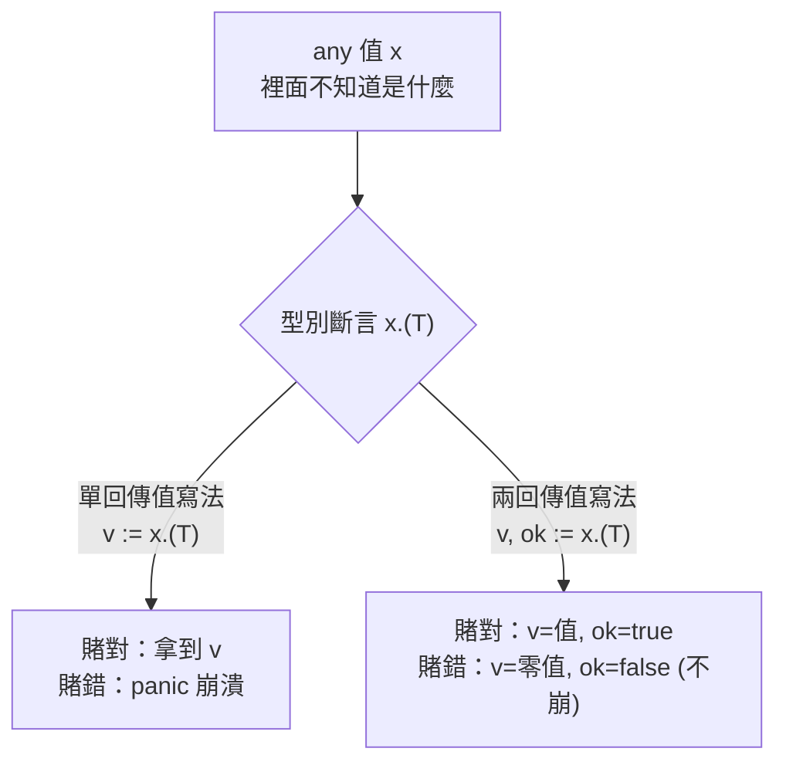

# [go-2-4] 空介面、`any` 與型別斷言：威力大，但要節制

> **本章目標**：認識「什麼型別都能裝」的空介面（`any`），學會用型別斷言和 type switch 把值「拆」回具體型別，並理解為什麼這東西雖然方便、卻要刻意少用。

## 你會學到

- 空介面 `interface{}` 與它的新名字 `any` 是什麼、為什麼「什麼都能裝」
- 型別斷言 `x.(T)`：把 `any` 拆回具體型別，以及安全的「兩回傳值」寫法
- type switch：一次處理多種可能的型別
- 為什麼 `any` 是「最後手段」，不是「方便的萬用型別」

## 概念說明

### 空介面：一張「不要求任何方法」的清單

上一章說 interface 是「能力清單」。那如果清單**一個方法都不列**呢？

```
interface {}   ← 什麼方法都不要求
```

一張「不要求任何能力」的清單，等於**任何型別都符合**——因為任何型別都「至少擁有零個方法」。所以 **空介面 `interface{}` 可以裝任何值**：`int`、`string`、你的 struct、slice……統統能塞。

從 Go 1.18 起，空介面有了一個好讀的別名 **`any`**。兩者完全等價，但**現代 Go 一律寫 `any`**：

```go
var x any      // 等同 var x interface{}，但好讀多了
x = 42         // 裝 int
x = "哈囉"      // 裝 string
x = []int{1, 2} // 裝 slice，都行
```

用一個比喻：`any` 像一個「什麼都能丟的紙箱」。方便，但代價是——**當你之後要用裡面的東西時，你已經忘了它原本是什麼了**。箱子上沒貼標籤，Go 只知道「裡面有個東西」，不知道是 `int` 還是 `string`，所以你不能直接對它做加法或字串操作。

### 把東西拆回來：型別斷言

要用紙箱裡的東西，得先「拆回」它的具體型別，這叫 **型別斷言（type assertion）**，語法是 `x.(T)`：

```
值 := 箱子.(我猜它是這個型別)
```

比喻：型別斷言就是你對著紙箱說「我賭裡面是一顆蘋果」然後伸手去拿。賭對了，拿到蘋果；**賭錯了，程式會 panic（崩潰）**。

所以型別斷言有兩種寫法，差在「賭錯時怎麼辦」：



> 這張圖的意思：同樣是斷言，單回傳值版賭錯會直接崩；兩回傳值版多拿一個 `ok` 讓你安全地問「到底是不是」，不會崩。日常幾乎都該用兩回傳值版。

## 程式碼範例

### 型別斷言：安全版 vs 會崩版

這段程式碼示範兩種寫法的差別。**日常請用「兩回傳值」的安全版**。

```go
package main

import "fmt"

func main() {
	var x any = "我是一個字串"

	// 安全版（兩回傳值）：ok 告訴你賭對了沒，絕不會崩
	if s, ok := x.(string); ok {
		fmt.Println("是字串，長度", len(s))
	} else {
		fmt.Println("不是字串")
	}

	// 會崩版（單回傳值）：賭錯直接 panic
	n := x.(int) // x 裡其實是 string，這行會 panic！
	fmt.Println(n)
}
```

說明：

- `s, ok := x.(string)`：賭 `x` 是 `string`。對的話 `s` 是那個字串、`ok` 是 `true`；錯的話 `s` 是零值、`ok` 是 `false`，**程式不會崩**，你可以好好處理。
- `n := x.(int)`：賭 `x` 是 `int`，但它其實是 string，於是 panic。**除非你 100% 確定型別，否則別用單回傳值版。**

### type switch：一次分辨多種型別

如果一個 `any` 可能是好幾種型別，一個個斷言太囉嗦。Go 給了專門的語法——**type switch**：

```go
// 把任何值描述成人看得懂的字串
func describe(value any) string {
	switch v := value.(type) { // 注意是 .(type)，只能用在 switch
	case int:
		return fmt.Sprintf("整數，加一後是 %d", v+1)
	case string:
		return fmt.Sprintf("字串，長度 %d", len(v))
	case bool:
		return fmt.Sprintf("布林值：%t", v)
	default:
		return fmt.Sprintf("不認得的型別：%T", v)
	}
}

func main() {
	fmt.Println(describe(42))      // 整數，加一後是 43
	fmt.Println(describe("哈囉"))   // 字串，長度 6
	fmt.Println(describe(true))    // 布林值：true
	fmt.Println(describe(3.14))    // 不認得的型別：float64
}
```

說明：

- `switch v := value.(type)` 是 type switch 的固定寫法（`.(type)` 只能用在 switch）。
- 進到哪個 `case`，`v` 就自動是那個具體型別——在 `case int` 裡 `v` 是 `int`（可以 `v+1`），在 `case string` 裡 `v` 是 `string`（可以 `len(v)`）。這比連寫好幾個 `x.(T)` 清爽太多。
- `%T` 這個格式動詞會印出值的型別名，debug 時很好用。

## 為什麼要「節制地用」`any`

`any` 很誘人：一個型別就能裝下所有東西，看起來超方便。但它有嚴重代價，Go 的設計哲學是**能不用就不用**。

> **常見錯誤** — 很多從動態語言來的人會這樣寫：
>
> ```go
> // ❌ 用 any 當「萬用參數」，想省事
> func process(data any) any {
> 	// 裡面充滿型別斷言，每一步都要猜 data 到底是什麼
> 	...
> }
> ```
>
> 問題是：
>
> 1. **把錯誤從「編譯期」推遲到「執行期」**。用具體型別時，型別錯了編譯就擋下來；用 `any`，要等程式跑到那行、斷言失敗 panic，你才知道出事。Go 強型別的最大好處就是「早點發現錯」，`any` 等於自願放棄這個好處。
> 2. **可讀性變差**。函式簽名寫 `any`，呼叫的人完全看不出「到底該傳什麼、會回什麼」，等於沒有文件。
> 3. **要寫一堆型別斷言**，程式又臭又長、又容易漏掉某個 case。

那什麼時候**該**用 `any`？只有在你**真的無法預先知道型別**時，例如：

- 處理「任意 JSON」這種結構不固定的資料（`go-6-2`）。
- 寫 `fmt.Println` 這種「什麼都能印」的通用工具函式。

而且從 Go 1.18 起，很多「以前只能用 `any`」的場景，現在該改用**泛型**（`go-2-6`）——泛型能「對多種型別通用」又**保住型別檢查**，是比 `any` 好得多的工具。

判斷準則一句話：**先問「我能不能寫出具體型別或介面？」能，就別用 `any`；真的不能，才用，而且用兩回傳值的安全斷言。**

## 小練習

1. 寫一個函式 `toInt(x any) (int, bool)`：如果 `x` 是 `int` 就回傳它和 `true`，否則回傳 `0` 和 `false`。用安全的兩回傳值斷言。
2. 擴充上面的 `describe`，多認得一種型別 `[]int`（印出「整數切片，共 N 個元素」）。
3. 想一個你最近寫的函式，如果參數型別改成 `any` 會怎樣？列出它會帶來的兩個壞處（對照本章「節制地用」那段）。

<details>
<summary>參考解答</summary>

```go
package main

import "fmt"

// 第 1 題
func toInt(x any) (int, bool) {
	n, ok := x.(int)
	return n, ok // ok 為 false 時 n 自動是零值 0，剛好符合要求
}

// 第 2 題：多一個 case []int
func describe(value any) string {
	switch v := value.(type) {
	case int:
		return fmt.Sprintf("整數，加一後是 %d", v+1)
	case string:
		return fmt.Sprintf("字串，長度 %d", len(v))
	case []int:
		return fmt.Sprintf("整數切片，共 %d 個元素", len(v))
	default:
		return fmt.Sprintf("不認得的型別：%T", v)
	}
}

func main() {
	fmt.Println(toInt(42))             // 42 true
	fmt.Println(toInt("不是數字"))      // 0 false
	fmt.Println(describe([]int{1, 2, 3})) // 整數切片，共 3 個元素
}
```

第 3 題沒有標準答案，但好的回答會點到：**（a）型別錯誤從編譯期變成執行期才爆**、**（b）函式簽名失去「該傳什麼」的資訊，可讀性變差**。如果你的函式其實只處理固定幾種型別，那更該用具體型別或介面，而不是 `any`。

</details>

## 課外讀物

> 「用 `any` 逃避型別檢查」是本課程明列的反模式之一 → [課外讀物 E-6-6：常見反模式大全](../../../課外讀物/E-6-best-practices/E-6-6-anti-patterns.md)

> 想用「對多型別通用、又不丟掉型別檢查」的正確工具取代 `any` → 見下一章 `go-2-6` 泛型
</content>
