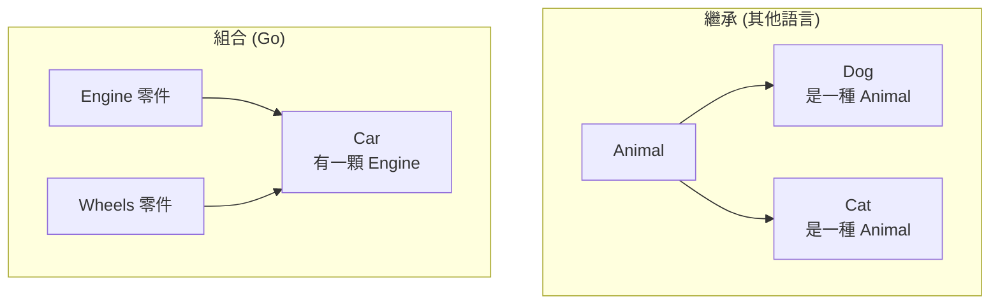

# [go-2-5] 組合而非繼承：用 struct 內嵌取代繼承

> **本章目標**：理解 Go「沒有繼承」是刻意的設計，並學會用 struct 內嵌（embedding）這個組合手法，達到繼承想做到的「複用」，卻避開繼承的毛病。

## 你會學到

- 為什麼 Go 故意不提供繼承
- 「繼承」和「組合」的差別：is-a vs has-a
- struct 內嵌（embedding）：把一個 struct 塞進另一個，欄位和方法會「升上來」
- 內嵌搭配 interface，怎麼做出「可抽換、可複用」的設計

## 概念說明

### Go 沒有繼承，這是故意的

如果你學過 Java、C#、C++，一定看過這種寫法：

```
class Animal { ... }
class Dog extends Animal { ... }   // Dog 繼承 Animal
```

「繼承」讓 `Dog` 自動擁有 `Animal` 的所有欄位和方法。聽起來很方便，但用久了會長出一堆麻煩：

- **脆弱的基底類別**：改一下 `Animal`，所有子孫可能全被波及，你很難預料影響範圍。
- **繼承鏈變深**：`D extends C extends B extends A`，一個方法到底從哪一層來的？要爬四層才知道。
- **強迫的「is-a」關係**：繼承說的是「Dog **是一種** Animal」，但現實很多複用根本不是這種關係，硬套就彆扭。

Go 看了這些問題，直接做了個大膽決定：**不要繼承**。它改用一個更簡單的機制——**組合（composition）**。

### is-a vs has-a

這兩個詞是理解的關鍵：

```
繼承（is-a）：  Dog 「是一種」 Animal
組合（has-a）： Car 「有一個」 Engine
```

繼承強調「血緣」，組合強調「零件」。組合的想法是：**與其讓一個型別「變成」另一個型別，不如讓它「擁有」另一個型別當零件。** 一台車「有一顆」引擎、「有四個」輪子——把零件拼起來，而不是去繼承一個「超級車」基底。



> 這張圖的意思：繼承是「由上往下分家族」（綁死的血緣）；組合是「把零件湊成一個新東西」（鬆散、好替換）。

### struct 內嵌：Go 做組合的語法糖

一般的組合就是「把一個 struct 當成另一個 struct 的欄位」：

```go
type Car struct {
	engine Engine // Car 有一顆 Engine（具名欄位）
}
```

這樣要用引擎的功能得寫 `car.engine.Start()`。Go 另外提供一個便利寫法——**內嵌（embedding）**：欄位**只寫型別、不寫名字**。

```go
type Car struct {
	Engine // 內嵌：注意只有型別、沒有欄位名
}
```

內嵌的魔法是：**被內嵌型別的欄位和方法會「升上來」，變得像是外層型別自己的一樣。** 於是你可以直接寫 `car.Start()`，不用寫 `car.Engine.Start()`。這就是 Go 用來「複用別人的功能」的主要手段——看起來很像繼承，本質卻是組合。

## 程式碼範例

### 內嵌：方法自動「升上來」

這段程式碼讓 `Car` 內嵌 `Engine`。`Engine` 會 `Start()`，於是 `Car` 不用自己寫 `Start`，就直接會了。

```go
package main

import "fmt"

type Engine struct {
	Horsepower int
}

func (e Engine) Start() string {
	return fmt.Sprintf("引擎發動（%d 匹馬力）", e.Horsepower)
}

// Car 內嵌 Engine（只寫型別、不寫欄位名）
type Car struct {
	Engine // ← 內嵌
	Brand  string
}

func main() {
	car := Car{
		Engine: Engine{Horsepower: 200},
		Brand:  "某廠牌",
	}

	// Start 是 Engine 的方法，但「升上來」了，可以直接對 car 呼叫
	fmt.Println(car.Start())        // 引擎發動（200 匹馬力）
	fmt.Println(car.Horsepower)     // 200，欄位也升上來了
	fmt.Println(car.Engine.Start()) // 也還是能明寫完整路徑
}
```

說明：

- `Car` 內嵌 `Engine` 後，`Engine` 的 `Start()` 方法和 `Horsepower` 欄位都能直接用 `car.Start()`、`car.Horsepower` 存取，彷彿是 `Car` 自己的。
- 但它**不是繼承**——`Car` 沒有「變成」`Engine`，它只是「有一顆」`Engine`，Go 幫你把呼叫轉發過去而已。你隨時能寫完整的 `car.Engine.Start()` 看清真相。

### 想「改寫」升上來的方法？直接在外層定義同名方法

如果外層型別想用自己的版本蓋掉內嵌進來的方法，只要定義一個同名方法即可（這有點像其他語言的「覆寫 override」，但規則單純得多）：

```go
// Car 定義自己的 Start，蓋掉 Engine 升上來的那個
func (c Car) Start() string {
	return c.Brand + " 準備出發 → " + c.Engine.Start()
}

func main() {
	car := Car{Engine: Engine{Horsepower: 200}, Brand: "某廠牌"}
	fmt.Println(car.Start())
	// 某廠牌 準備出發 → 引擎發動（200 匹馬力）
}
```

說明：`car.Start()` 現在呼叫的是 `Car` 自己的版本；需要時它再用 `c.Engine.Start()` 去叫底層那個。外層「就近」的方法優先，規則很直覺。

### 內嵌 + interface = 可抽換的設計（最實用的組合）

把內嵌和上一章的 interface 合起來，才是 Go 組合的真正威力。下面讓一個 `Service` 內嵌一個 **interface**（而非具體型別），於是「底層用哪個實作」可以隨時抽換。

```go
package main

import "fmt"

// 介面：會存資料就行（上一章的隱式實作）
type Store interface {
	Save(key, value string) string
}

// 實作一：記憶體版
type MemoryStore struct{}

func (m MemoryStore) Save(key, value string) string {
	return fmt.Sprintf("[記憶體] 存了 %s=%s", key, value)
}

// 實作二：檔案版（簽名一樣，就能互換）
type FileStore struct{ Dir string }

func (f FileStore) Save(key, value string) string {
	return fmt.Sprintf("[檔案 %s] 存了 %s=%s", f.Dir, key, value)
}

// Service 內嵌「介面」，不綁死任何一個具體 Store
type Service struct {
	Store // 內嵌 interface
}

func (s Service) Register(name string) string {
	// 直接用升上來的 Save，不在乎底層是記憶體還是檔案
	return s.Save("user", name)
}

func main() {
	// 想用哪個實作，建立時決定就好，Service 的程式一個字都不用改
	s1 := Service{Store: MemoryStore{}}
	fmt.Println(s1.Register("小美")) // [記憶體] 存了 user=小美

	s2 := Service{Store: FileStore{Dir: "/data"}}
	fmt.Println(s2.Register("阿明")) // [檔案 /data] 存了 user=阿明
}
```

說明：`Service` 只內嵌了 `Store` **介面**，所以它依賴的是「會存資料的能力」，不是某個具體實作。要換資料儲存方式（記憶體換成檔案、或之後換成資料庫），只要塞不同的 `Store` 進去，`Service` 完全不用改。這就是「組合 + 介面」帶來的可抽換性——**比繼承靈活、又沒有繼承的包袱**。

## 一句話總結 Go 的風格

```
別問「這個型別是誰的子類別」（繼承、is-a），
要問「這個型別由哪些零件組成、擁有哪些能力」（組合 + interface、has-a）。
```

Go 社群有句口號：**"Composition over inheritance"（組合優於繼承）**。這不是 Go 發明的——它是一條廣受認同的設計原則，只是 Go 乾脆把繼承拿掉，逼你走這條路。

## 小練習

1. 做一個 `Logger` struct，有一個方法 `Log(msg string)` 印出 `[LOG] msg`。再做一個 `UserService` struct 內嵌 `Logger`，在 `main` 建一個 `UserService` 並直接呼叫 `svc.Log("建立使用者")`，確認方法升上來了。
2. 給 `UserService` 定義自己的 `Log` 方法，在訊息前加上 `[UserService]`，內部再呼叫內嵌的 `Logger.Log`。觀察外層方法如何蓋掉內嵌的。
3. 定義一個 `Notifier` 介面（`Send(msg string) string`），讓 `UserService` 內嵌 `Notifier`（而非具體型別）。分別塞兩個不同實作進去，呼叫同一段邏輯，確認「換零件不用改 `UserService`」。

<details>
<summary>參考解答</summary>

```go
package main

import "fmt"

// 第 1、2 題
type Logger struct{}

func (l Logger) Log(msg string) {
	fmt.Println("[LOG]", msg)
}

type Notifier interface {
	Send(msg string) string
}

type ConsoleNotifier struct{}

func (c ConsoleNotifier) Send(msg string) string { return "主控台通知：" + msg }

type EmailNotifier struct{}

func (e EmailNotifier) Send(msg string) string { return "Email 通知：" + msg }

// 第 1、2、3 題：內嵌具體型別 Logger，也內嵌介面 Notifier
type UserService struct {
	Logger
	Notifier
}

// 第 2 題：外層自己的 Log 蓋掉內嵌的
func (s UserService) Log(msg string) {
	fmt.Println("[UserService]", msg)
	s.Logger.Log(msg) // 需要時再叫底層那個
}

func main() {
	// 第 3 題：換不同 Notifier，UserService 的程式不用改
	svc := UserService{Notifier: ConsoleNotifier{}}
	svc.Log("建立使用者")                 // 走外層版本
	fmt.Println(svc.Send("歡迎加入"))      // 升上來的 Send（主控台版）

	svc2 := UserService{Notifier: EmailNotifier{}}
	fmt.Println(svc2.Send("歡迎加入"))     // 同一段邏輯，換成 Email 版
}
```

重點：

- **第 2 題**：外層的 `Log` 優先，內部用 `s.Logger.Log(msg)` 明確呼叫被蓋掉的那個——規則比繼承的 `super` 單純。
- **第 3 題**：`UserService` 內嵌的是 `Notifier` 介面，所以能塞任何符合的實作。這正是「組合 + interface」的可抽換性。

</details>

## 課外讀物

> 「依賴介面、把實作當零件抽換」讓高層邏輯不綁死低層細節，正是依賴反轉原則 → [課外讀物 E-7-6：D — 依賴反轉原則](../../../課外讀物/E-7-solid/E-7-6-dip.md)

> 想看更多設計模式怎麼靠「組合」達成（例如用抽換策略取代條件分支） → [課外讀物 E-12-7：策略模式](../../../課外讀物/E-12-design-patterns/E-12-7-strategy.md)
</content>
