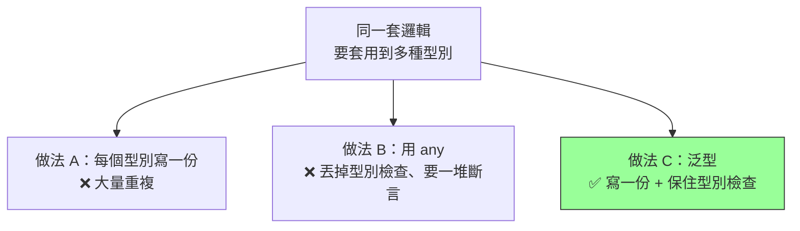

# [go-2-6] 泛型（Generics，Go 1.18+）：型別參數與 constraints 的基礎

> **本章目標**：學會用「型別參數」寫出「對多種型別都通用、又保住型別檢查」的函式與型別，並理解 constraints（型別限制）是做什麼用的。

## 你會學到

- 為什麼需要泛型：在「重複寫很多份」和「用 `any` 丟掉型別檢查」之間的第三條路
- 型別參數的語法：`func Max[T ...](...)` 那個方括號是什麼
- constraints（型別限制）：怎麼規定「T 只能是哪些型別」
- 什麼時候該用泛型、什麼時候其實不必

## 概念說明

### 問題：同樣的邏輯，被型別逼著寫很多份

假設你要寫一個「回傳切片裡最大值」的函式。對 `int` 寫一份：

```go
func MaxInt(nums []int) int { ... }
```

結果 `float64` 也要一份 `MaxFloat`、`string` 也要一份 `MaxString`……邏輯**一模一樣**，只因為型別不同就得複製貼上好幾份。這很蠢。

前一章（`go-2-4`）說過，`any` 能「裝任何型別」。那用 `any` 寫一份不就好了？問題是 `any` 會**丟掉型別檢查**：函式裡拿到的是「不知道是什麼的東西」，不能直接比大小，還得一路型別斷言，而且呼叫者傳錯型別編譯器也不會擋。

**泛型（generics）就是這兩難的第三條路**：寫**一份**程式碼，對多種型別通用，**而且完全保住型別檢查**。



> 這張圖的意思：泛型同時避開了「重複」和「丟型別安全」兩個壞處，是處理「多型別通用邏輯」的正解。

### 型別參數：給函式多加一個「型別的參數」

一般函式的參數是「值」。泛型函式多了一種參數——**型別本身**，寫在函式名後面的方括號 `[ ]` 裡：

```
func Max[T Ordered](items []T) T
//      ^^^^^^^^^^^ 型別參數：T 是「某個可以比大小的型別」，呼叫時才決定
//                 items []T：參數用到了這個 T
//                        ^T：回傳也是 T
```

用一個比喻：一般參數是「等你呼叫時才填的值」，型別參數是「等你呼叫時才填的型別」。`T` 是個佔位符，呼叫 `Max([]int{...})` 時 Go 自動把 `T` 認定成 `int`。

### constraints：規定「T 可以是哪些型別」

但「比大小」不是每種型別都能做（兩個 struct 怎麼比大？）。所以型別參數要搭配一個 **constraint（限制）**，規定「T 只能是支援某些操作的型別」。

上面的 `Ordered` 就是個 constraint，意思是「T 必須是能用 `<`、`>` 比較的型別」（整數、浮點、字串）。constraint 本質上就是一種特殊的 interface——它列的不是「要有哪些方法」，而是「允許哪些型別」。

標準庫 `cmp`（Go 1.21+）已經備好一個現成的 `cmp.Ordered`，你直接拿來用就好，不用自己定義。

## 程式碼範例

### 第一個泛型函式：Max

這段程式碼寫一個 `Max`，對任何「可比大小」的型別都通用。`cmp.Ordered` 這個現成 constraint 保證 `T` 能用 `>` 比較。

```go
package main

import (
	"cmp" // Go 1.21+ 提供，內含 Ordered constraint
	"fmt"
)

// T 必須滿足 cmp.Ordered（整數、浮點、字串等可排序型別）
func Max[T cmp.Ordered](items []T) T {
	biggest := items[0]
	for _, item := range items[1:] {
		if item > biggest { // 因為有 Ordered 限制，這裡能安全地用 >
			biggest = item
		}
	}
	return biggest
}

func main() {
	// 呼叫時 Go 會自動推斷 T：傳 []int → T 是 int
	fmt.Println(Max([]int{3, 7, 2, 9, 1}))        // 9
	fmt.Println(Max([]float64{1.5, 0.2, 3.8}))    // 3.8
	fmt.Println(Max([]string{"banana", "apple"})) // banana（字串按字典序）
}
```

說明：

- `[T cmp.Ordered]` 宣告一個型別參數 `T`，限制它必須是「可排序」的型別。
- 一份 `Max` 同時服務 `int`、`float64`、`string`——而且全程有型別檢查：你要是傳一個 `[]bool`（bool 不可排序），**編譯就直接失敗**，不會等到執行期。
- 呼叫時通常不用自己寫 `Max[int](...)`，Go 會從參數**自動推斷** `T` 是什麼。

### 泛型資料型別：一個什麼都能裝、又型別安全的 Stack

泛型不只能用在函式，也能用在型別。下面做一個泛型的「堆疊（Stack，後進先出）」，`Stack[int]` 就只收 int、`Stack[string]` 就只收 string——比用 `[]any` 安全太多。

```go
package main

import "fmt"

// Stack[T] 是一個「裝 T 的堆疊」
type Stack[T any] struct {
	items []T
}

// 方法也要帶上型別參數 [T]（接收者寫 *Stack[T]）
func (s *Stack[T]) Push(item T) {
	s.items = append(s.items, item)
}

func (s *Stack[T]) Pop() (T, bool) {
	var zero T // T 的零值，拿不到東西時回傳它
	if len(s.items) == 0 {
		return zero, false
	}
	last := s.items[len(s.items)-1]
	s.items = s.items[:len(s.items)-1]
	return last, true
}

func main() {
	// 建立一個「只裝 int」的堆疊
	var numbers Stack[int]
	numbers.Push(10)
	numbers.Push(20)
	if top, ok := numbers.Pop(); ok {
		fmt.Println("拿出", top) // 拿出 20
	}

	// 另一個「只裝 string」的堆疊，同一套程式碼
	var words Stack[string]
	words.Push("哈囉")
	// words.Push(123) // ← 這行會編譯失敗：string 堆疊不收 int，型別安全！
	fmt.Println(words)
}
```

說明：

- `Stack[T any]` 這裡用的 constraint 是 `any`——因為「堆疊」只是存取，不需要對元素做比大小之類的操作，所以不限制型別。**`any` 當 constraint 是合法且常見的**（別和 `go-2-4` 那種「拿 `any` 當參數型別」混淆，這裡 `T` 仍是具體型別，只是還沒決定是哪個）。
- `var zero T` 是泛型裡拿「某型別零值」的標準寫法——因為你不知道 `T` 是什麼，不能寫死 `0` 或 `""`。
- 關鍵好處：`Stack[string]` 真的只收 string，塞 int 編譯就擋——這是 `[]any` 做不到的。

### 自訂 constraint：只接受數字

如果現成的不夠用，你也能自己定義 constraint。下面定義一個 `Number`，讓 `Sum` 只收數字型別：

```go
// 自訂 constraint：用 | 列出允許的型別，~ 代表「以這些為底層型別的也算」
type Number interface {
	~int | ~int64 | ~float64
}

func Sum[T Number](nums []T) T {
	var total T
	for _, n := range nums {
		total += n // 有 Number 限制才能安全地用 +
	}
	return total
}

func main() {
	fmt.Println(Sum([]int{1, 2, 3}))         // 6
	fmt.Println(Sum([]float64{1.5, 2.5}))    // 4
}
```

說明：constraint 是一種只列「允許型別」的 interface。`~int` 的波浪號意思是「底層型別是 int 的也算」（例如你自訂 `type Age int`，`Age` 也能傳進來）。有了這個限制，函式裡才能安心用 `+`。

## 什麼時候該用泛型？不要過度設計

泛型很強，但 Go 的設計哲學是「簡單優先」，**不是每段程式都該泛型化**。判斷準則：

```
該用泛型：
  ✅ 你真的在對「多種型別」做「同一套邏輯」（如集合操作、資料結構）
  ✅ 不泛型化就得複製好幾份一樣的程式碼

先別急著用泛型：
  ❌ 目前只有一種型別會用到 → 先寫具體型別，真的有第二種再說
  ❌ interface（能力抽象）就能解決 → 優先用 interface
```

> **常見錯誤**：剛學會泛型的人容易「看什麼都想加 `[T]`」。但泛型會讓簽名變複雜、可讀性下降。Go 官方的建議是：**先寫具體型別，等你真的發現「這段邏輯要重複套到多種型別」時，再抽成泛型。** 這呼應本課程一貫的「最小可行、不要過早抽象」。

泛型和 interface 不是二選一，它們解決不同問題：**interface 是「不同型別、不同行為，但共用同一組方法」；泛型是「不同型別、但套用完全相同的邏輯」。** 需要抽換行為用 interface，需要同一套邏輯跑在多種型別上用泛型。

## 小練習

1. 寫一個泛型函式 `Contains[T comparable](items []T, target T) bool`，回傳 `target` 是否在 `items` 裡。（`comparable` 是內建 constraint，代表「可以用 `==` 比較」。）用 `int` 和 `string` 各測一次。
2. 寫一個泛型函式 `Map[T, U any](items []T, fn func(T) U) []U`，把一個切片的每個元素經過 `fn` 轉換成新切片。例如把 `[]int{1,2,3}` 透過 `func(n int) string` 轉成 `[]string`。
3. 回頭看第 1 題：如果不用泛型，你要支援 `int` 和 `string` 得寫幾份 `Contains`？再想想：用 `any` 版的 `Contains` 會有什麼缺點？

<details>
<summary>參考解答</summary>

```go
package main

import "fmt"

// 第 1 題：comparable 代表「能用 == 比較」
func Contains[T comparable](items []T, target T) bool {
	for _, item := range items {
		if item == target {
			return true
		}
	}
	return false
}

// 第 2 題：兩個型別參數 T（來源）、U（目標）
func Map[T, U any](items []T, fn func(T) U) []U {
	result := make([]U, 0, len(items))
	for _, item := range items {
		result = append(result, fn(item))
	}
	return result
}

func main() {
	fmt.Println(Contains([]int{1, 2, 3}, 2))             // true
	fmt.Println(Contains([]string{"a", "b"}, "c"))       // false

	nums := []int{1, 2, 3}
	strs := Map(nums, func(n int) string {
		return fmt.Sprintf("第%d個", n)
	})
	fmt.Println(strs) // [第1個 第2個 第3個]
}
```

第 3 題：不用泛型，`int` 和 `string` 要各寫一份 `Contains`（邏輯一模一樣，純複製）。用 `any` 版雖然只寫一份，但缺點是：**（a）呼叫者可能傳進型別互相不一致的 slice 和 target，編譯器擋不住**；**（b）函式內要處理 `any` 的比較會更麻煩、也失去型別資訊**。泛型兩個問題都沒有——一份程式碼，且 `items` 和 `target` 的型別被強制一致。

</details>

## 課外讀物

> 泛型的「寫一份、通用多型別」是避免重複（DRY）的手段，但別為了通用而過早抽象——拿捏這條界線 → [課外讀物 E-6-3：函式設計](../../../課外讀物/E-6-best-practices/E-6-3-function-design.md)

> 泛型與 interface 的分工（相同邏輯 vs 不同行為），接續上一章對抽象的討論 → 複習本課 `go-2-3`（interface）
</content>
