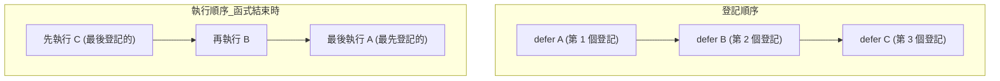

# [go-3-3] 🐹 `defer`：收尾動作怎麼寫、執行順序、關檔與解鎖的標準用法

> **本章目標**：學會 Go 的招牌關鍵字 `defer`——把「收尾動作」寫在「開場動作」的正旁邊，讓關檔、解鎖這類「開了就一定要收」的事再也不會忘。你會徹底搞懂它的兩個關鍵規則：**後進先出（LIFO）的執行順序**，和**參數在 `defer` 當下就求值**。

## 你會學到

- `defer` 是什麼：登記一個「等這個函式結束時才執行」的動作
- 為什麼它能解決「忘記收尾」這個經典 bug
- 執行順序是後進先出（LIFO）——後登記的先執行
- 一個大坑：`defer` 的參數在**登記的當下**就算好了，不是等到執行時
- 關檔、解鎖的標準寫法，以及搭配具名回傳值做錯誤處理

## 概念說明

### 問題：開了東西，就一定要記得收

程式裡有一類操作是「成對」的——開了檔案要關、鎖了資源要解、借了連線要還。麻煩在於：**開場和收尾中間往往隔著一大段邏輯，而那段邏輯任何一個分支提早 `return`，你就可能忘了收尾。**

```
開啟檔案
  ... 讀一點東西
  如果 出錯：
      return        // ← 糟糕，忘了關檔，檔案 handle 洩漏了
  ... 再做一些事
  如果 另一個條件：
      return        // ← 又一個出口，又忘了關
關閉檔案            // ← 只有「一路順到底」才會執行到這裡
```

出口越多，漏掉收尾的風險越高。這是跨語言都存在的經典 bug（C 裡尤其惡名昭彰）。

### `defer`：把收尾登記在開場旁邊

Go 的解法很優雅：`defer` 讓你在**開場的正旁邊**就寫好收尾動作，但這個動作會被「延後」到**整個函式即將結束時**才真正執行——不管函式是從哪個 `return` 出去的，甚至是中途 panic，收尾都保證會跑。

```
開啟檔案
defer 關閉檔案        // ← 開場旁邊就登記好收尾，之後不用再操心
  ... 讀一點東西
  如果 出錯：
      return          // 離開前，Go 自動幫你執行「關閉檔案」
  ... 再做一些事
  如果 另一個條件：
      return          // 這個出口也一樣，Go 自動關檔
                      // 函式正常結束，一樣自動關檔
```

這呼應一個通用原則：**成對的東西要成對出現**——寫下「開」的那一刻，就把「關」補上。`defer` 讓這件事變得自然，因為兩行緊挨著，一眼就看得出有沒有配對。

### 規則一：執行順序是後進先出（LIFO）

一個函式裡可以有很多個 `defer`。它們不是按登記順序執行，而是**後進先出（Last In, First Out，像一疊盤子，最後放上去的最先拿走）**：最後登記的 `defer` 最先執行。



這張圖在說：三個 `defer` 按 A、B、C 登記，但函式結束時倒過來以 C、B、A 執行。

為什麼要 LIFO？因為資源常常是**層層疊套**地開啟的：先開資料庫連線、再開交易（transaction）、再鎖某列資料。收尾時必須**反過來**——先解鎖、再結束交易、最後關連線。LIFO 剛好就是這個順序，天然正確。

### 規則二（大坑）：參數在 `defer` 當下就求值

這是 `defer` 最容易讓人踩雷的地方，一定要記牢：**`defer` 後面那個函式呼叫的「參數」，是在你寫下 `defer` 的那一瞬間就計算好、凍結起來的**；真正執行的時機雖然被延後到函式結束，但參數的值早就定了。

```go
i := 0
defer fmt.Println(i)   // 這裡的 i 是 0，「0」當下就被記下來
i = 100
// 函式結束時，印出的是 0，不是 100！
```

很多人以為會印 `100`（因為執行是在最後），但其實印 `0`——因為參數 `i` 在 `defer` 那行就被求值成 `0` 凍結了。後面怎麼改 `i` 都影響不到它。

> **怎麼記**：把它想成「**動作延後，但參數現在就拍照存檔**」。`defer f(x)` 等於「現在把 `x` 的值拍下來，等結束時拿這張照片去執行 `f`」。

如果你**真的想要**用「最後的值」，有兩個辦法：用 `defer func(){ ... }()` 包一個閉包（closure，閉包讀的是變數本身，不是拍照值），或改用具名回傳值（下面範例會示範）。

## 程式碼範例

### 範例一：關檔的標準寫法

這是 Go 裡最常見的 `defer` 用法。開檔成功後，立刻 `defer file.Close()`，之後整段邏輯不管怎麼 `return` 都保證關檔：

```go
package main

import (
	"fmt"
	"os"
)

// readFirstLine 開啟檔案讀取；重點在「開檔成功後立刻 defer Close」。
func readFirstLine(path string) error {
	file, err := os.Open(path)
	if err != nil {
		// 注意：開檔「失敗」時 file 無效，不需要（也不能）Close，所以在檢查錯誤之前不要 defer
		return fmt.Errorf("開啟 %s 失敗: %w", path, err)
	}
	defer file.Close() // 開檔成功，馬上登記關檔——之後所有出口都會自動關

	info, err := file.Stat()
	if err != nil {
		return fmt.Errorf("讀取 %s 的檔案資訊失敗: %w", path, err)
		// ← 就算從這裡 return，file.Close() 也保證會被執行
	}

	fmt.Printf("檔案 %s 大小為 %d bytes\n", path, info.Size())
	return nil // ← 正常結束，file.Close() 同樣會被執行
}

func main() {
	if err := readFirstLine("go.mod"); err != nil {
		fmt.Println(err)
	}
}
```

說明：`defer file.Close()` 寫在「確認開檔成功」之後，這個順序很重要——開檔失敗時 `file` 是無效的，不該對它呼叫 `Close()`。一旦成功，收尾就交給 `defer`，中間無論從哪個 `return` 離開都不會漏關。這就是「成對的東西，寫下前者當下就補上後者」。

### 範例二：親眼看 LIFO 順序

用三個 `defer` 把執行順序看清楚：

```go
package main

import "fmt"

func main() {
	fmt.Println("函式開始")

	defer fmt.Println("收尾 A（第 1 個登記）")
	defer fmt.Println("收尾 B（第 2 個登記）")
	defer fmt.Println("收尾 C（第 3 個登記）")

	fmt.Println("函式主體結束，接下來跑 defer")
}
```

輸出：

```
函式開始
函式主體結束，接下來跑 defer
收尾 C（第 3 個登記）
收尾 B（第 2 個登記）
收尾 A（第 1 個登記）
```

說明：三個 `defer` 倒著跑——最後登記的 C 最先執行。記住這個順序對「層層疊套的資源」很關鍵：先開的最後關，後開的最先關。

### 範例三：參數求值時機的坑

把「參數當下求值」和「閉包讀變數本身」並排看，差別一目了然：

```go
package main

import "fmt"

func main() {
	i := 0

	// 寫法一：參數在 defer 當下就求值 → 拍下的是 0
	defer fmt.Println("寫法一（參數先求值）印出：", i)

	// 寫法二：閉包讀的是變數 i 本身 → 執行時才讀，印出最後的值
	defer func() {
		fmt.Println("寫法二（閉包讀變數）印出：", i)
	}()

	i = 100
	fmt.Println("i 已經改成 100，函式即將結束")
}
```

輸出：

```
i 已經改成 100，函式即將結束
寫法二（閉包讀變數）印出： 100
寫法一（參數先求值）印出： 0
```

說明：寫法一的 `i` 在 `defer` 那行就被求值成 `0` 並凍結，所以印 `0`；寫法二用閉包（沒有參數），閉包在**真正執行時**才去讀 `i`，那時 `i` 已是 `100`。（兩者都印在「i 已改成 100」之後，而且因為 LIFO，後登記的寫法二先印。）實務上如果你要在收尾時拿「最新的值」，就得用閉包，別直接當參數傳。

### 範例四：解鎖的標準寫法，與搭配具名回傳值

多執行緒下「鎖了就要解」也是 `defer` 的經典場景（`sync.Mutex` 的細節在 `go-4-5`，這裡先看收尾的寫法）：

```go
package main

import (
	"fmt"
	"sync"
)

type Counter struct {
	mu    sync.Mutex
	value int
}

// Increment 鎖住、加一、解鎖。Lock 之後立刻 defer Unlock，保證不管怎麼離開都會解鎖。
func (c *Counter) Increment() {
	c.mu.Lock()
	defer c.mu.Unlock() // 鎖的正旁邊就登記解鎖——忘不了
	c.value++
}

func main() {
	counter := &Counter{}
	counter.Increment()
	counter.Increment()
	fmt.Println("目前計數：", counter.value) // 2
}
```

`defer` 還有一招進階用法：搭配**具名回傳值**，可以在收尾時「補救或修改」函式要回傳的錯誤。因為閉包讀得到具名回傳變數本身：

```go
package main

import "fmt"

// cleanup 示範：用具名回傳值 err，讓 defer 裡的閉包能修改最終回傳的錯誤。
func doWork(fail bool) (err error) { // err 是「具名回傳值」
	defer func() {
		if err != nil {
			// 在收尾時幫錯誤補一層脈絡（err 是具名回傳值，閉包改得到它）
			err = fmt.Errorf("doWork 執行失敗: %w", err)
		}
	}()

	if fail {
		return fmt.Errorf("底層出錯了")
	}
	return nil
}

func main() {
	fmt.Println(doWork(true))  // doWork 執行失敗: 底層出錯了
	fmt.Println(doWork(false)) // <nil>
}
```

說明：`(err error)` 是具名回傳值——它是個真正的變數，`return fmt.Errorf("底層出錯了")` 會先把它設好，**然後才執行 `defer`**。因為閉包讀寫的是 `err` 這個變數本身，所以能在最後一刻把錯誤包上一層脈絡。這是 Go 裡「統一在一處加收尾脈絡」的常見技巧。

## 小練習

1. 寫一個函式，裡面依序 `defer` 印出 `"關閉連線"`、`"結束交易"`、`"解鎖"`（照這個順序登記）。想一想、再執行確認：實際印出來的順序是什麼？對照「資源層層疊套」解釋為什麼這個順序是對的。
2. 寫一個 `defer fmt.Println(x)`，在 `defer` 之後把 `x` 改成別的值，預測會印出哪個值、再跑一次驗證。接著把它改成 `defer func(){ fmt.Println(x) }()`，看看結果有什麼不同。
3. 寫一個函式 `openTwoFiles(a, b string) error`，依序開兩個檔案，各自在開成功後 `defer` 關閉。故意讓第二個檔案不存在，確認：第一個檔案仍然有被正確關閉（可以在關閉動作裡加一行 `fmt.Println` 來觀察）。

<details>
<summary>參考解答</summary>

**練習 1：LIFO 順序**

```go
package main

import "fmt"

func main() {
	defer fmt.Println("關閉連線") // 第 1 個登記
	defer fmt.Println("結束交易") // 第 2 個登記
	defer fmt.Println("解鎖")   // 第 3 個登記
	fmt.Println("工作完成，開始收尾")
}
```

輸出：

```
工作完成，開始收尾
解鎖
結束交易
關閉連線
```

後進先出，所以倒著印：解鎖 → 結束交易 → 關閉連線。這正好對應資源的疊套關係——通常是先開連線、在連線上開交易、在交易裡鎖資料；收尾時必須反過來：先解鎖、再結束交易、最後關連線。LIFO 天然給你這個正確順序。

**練習 2：參數求值 vs 閉包**

```go
func main() {
	x := 10
	defer fmt.Println("參數版：", x) // 這裡 x 是 10，被凍結
	x = 20
	// 結束時印出「參數版： 10」
}
```

改成閉包：

```go
func main() {
	x := 10
	defer func() { fmt.Println("閉包版：", x) }()
	x = 20
	// 結束時印出「閉包版： 20」
}
```

參數版印 `10`（`defer` 當下就把 `x` 的值拍照存檔）；閉包版印 `20`（閉包執行時才去讀 `x`，那時已是 `20`）。

**練習 3：多個 defer 各自關檔**

```go
package main

import (
	"fmt"
	"os"
)

func openTwoFiles(a, b string) error {
	fileA, err := os.Open(a)
	if err != nil {
		return fmt.Errorf("開啟 %s 失敗: %w", a, err)
	}
	defer func() {
		fileA.Close()
		fmt.Println("已關閉", a)
	}()

	fileB, err := os.Open(b)
	if err != nil {
		// 從這裡 return 時，上面登記的「關閉 a」仍會執行
		return fmt.Errorf("開啟 %s 失敗: %w", b, err)
	}
	defer func() {
		fileB.Close()
		fmt.Println("已關閉", b)
	}()

	fmt.Println("兩個檔案都開好了")
	return nil
}

func main() {
	// 假設 go.mod 存在、no-such-file 不存在
	err := openTwoFiles("go.mod", "no-such-file")
	if err != nil {
		fmt.Println("錯誤：", err)
	}
}
```

因為第二個檔案開不起來，函式從中間 `return`。但這時「關閉 a」的 `defer` 已經登記過了，所以它仍會執行，你會看到「已關閉 go.mod」被印出來——第一個檔案不會洩漏。這就是 `defer` 的價值：把收尾綁在開場旁邊，任何出口都安全。

</details>

## 課外讀物

> 「成對的東西要成對出現」「開了就要收」是跨語言的好習慣，`defer` 是 Go 對它的語言級支援 → **[課外讀物 E-6-8] 後端 Clean Code（錯誤處理）**：[後端 Clean Code（錯誤處理）](../../../課外讀物/E-6-best-practices/E-6-8-backend-clean-code.md)

> 鎖（`sync.Mutex`）為什麼存在、什麼時候才需要共享記憶體 → [go-4-5]（本書 Part 4）

> 上一節：包裝與檢查錯誤 → [go-3-2]；下一節：`panic` 與 `recover`，以及 `defer` 在其中扮演的角色 → [go-3-4]
