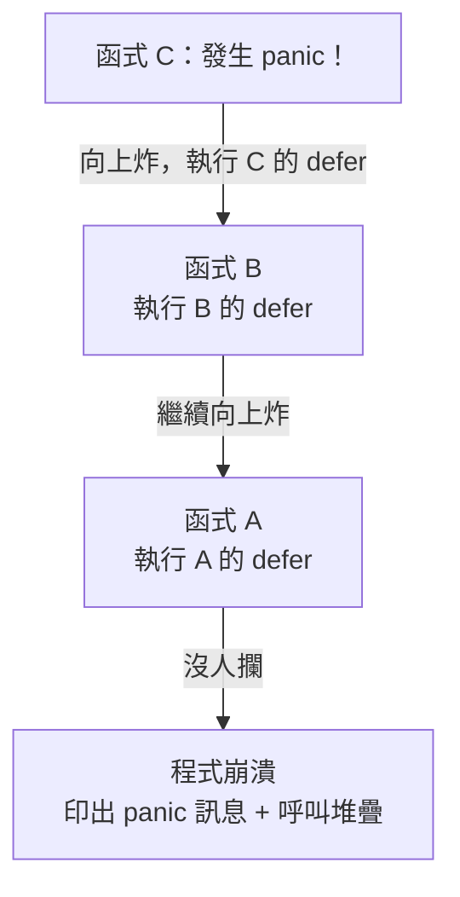
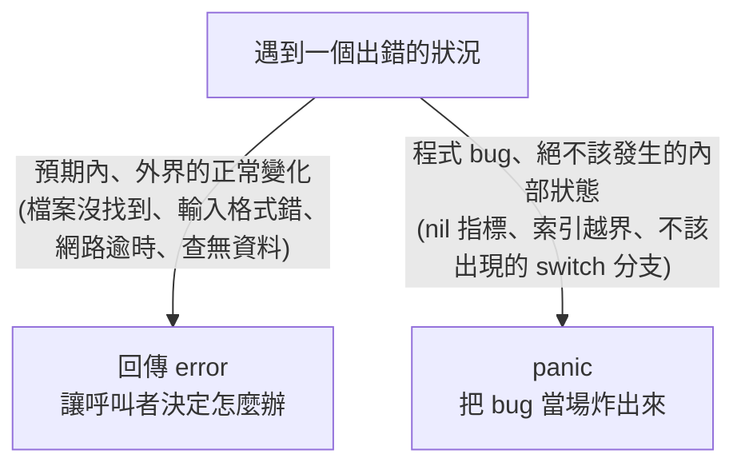

# [go-3-4] `panic` 與 `recover`：什麼時候該用、什麼時候絕對不要

> **本章目標**：認識 Go 的另一條錯誤路線——`panic`（程式中止）與 `recover`（攔截中止）。更重要的是劃清界線：**絕大多數錯誤該用 `error`，`panic` 只留給「程式有 bug、絕不該發生」的情況**。學會這條分界，你才算真的懂 Go 的錯誤哲學。

## 你會學到

- `panic` 是什麼：它跟 `error` 完全是兩回事
- panic 發生時會怎樣：沿著呼叫鏈往上「炸」，一路執行 `defer`
- `recover` 怎麼在 `defer` 裡攔下一個 panic、把程式救回來
- `error` 和 `panic` 的分界：什麼時候用哪個（本章重點）
- 一個實務場景：伺服器用 `recover` 防止「一個請求出事就拖垮整台服務」

## 概念說明

### `panic` 不是「另一種 error」，是「程式崩潰」

`go-3-1` 說過，Go 用 `error`（回傳值）處理「預期內、可以好好應對」的失敗。但還有一類狀況性質完全不同：**程式進入了「絕不該發生」的狀態，繼續跑下去只會更糟**。例如存取 `nil` 指標的欄位、陣列索引越界、除以零。這些代表**程式本身有 bug**。

這種情況 Go 會觸發 **panic**——你可以想成「程式當場舉手大喊：出大事了，我不玩了」。panic 一旦發生：

1. 當前函式**立刻停止**往下執行；
2. 沿著呼叫鏈**一層層往上「炸」**（unwind）；
3. 往上炸的過程中，每一層**已登記的 `defer` 都會照常執行**（這點很重要，收尾還是會做）；
4. 如果一路炸到最頂端都沒人攔，整個程式**崩潰並印出 panic 訊息和呼叫堆疊（stack trace）**。



這張圖在說：panic 像爆炸的衝擊波，從出事的地方一路往上傳，沿途觸發每一層的 `defer`，最後若無人攔截就讓整個程式停擺。

你也能用內建的 `panic("訊息")` **主動**觸發它——但請先把本章讀完，知道「什麼時候才該這麼做」。

### `recover`：在 `defer` 裡把炸彈接住

Go 提供 `recover`，可以**攔下一個正在往上炸的 panic**，讓程式不要真的崩潰。但它有個嚴格的使用條件：**`recover` 只有在 `defer` 裡呼叫才有效**（這也是 `go-3-3` 學的 `defer` 在這裡的用途）。

原理是：panic 往上炸時會執行每一層的 `defer`；如果某一層的 `defer` 裡呼叫了 `recover`，就能把這個 panic「接住」——panic 停止傳播，程式從「這個 `defer` 所在的函式」正常返回，繼續跑下去。

```
func 可能出事():
    defer func():
        如果 recover() 接到東西:
            「接住了，把它當成一個普通錯誤處理，不讓程式崩潰」
    ... 這裡某行 panic 了 ...
    // panic 往上炸 → 執行上面的 defer → recover 接住 → 函式正常返回
```

`recover()` 的回傳值就是當初 `panic(...)` 丟出去的那個東西（沒有 panic 時回傳 `nil`）。

### 本章重點：`error` 和 `panic` 的分界

這是整章最該記住的。選錯工具是 Go 新手最常見的壞習慣之一：



| | 用 `error` | 用 `panic` |
|---|---|---|
| 錯誤來源 | 外界的正常變化（使用者、檔案、網路） | 自己程式的邏輯壞掉（bug） |
| 頻率 | 常常會發生，是日常 | 正常情況下**永遠不該**發生 |
| 該怎麼反應 | 好好處理、回報、重試、給預設值 | 停下來、把 bug 暴露出來、修程式 |
| 佔比 | Go 程式裡 99% 的錯誤處理 | 極少數 |

一個實用判準，問自己一句話：**「這個狀況，是不是只要我的程式寫對了就絕對不會發生？」**

- 是 → 它發生了就代表有 bug → `panic` 合理（把 bug 炸出來，別讓它默默擴散）。
- 否（它本來就可能發生，跟我程式對不對無關）→ 用 `error`。

> **常見錯誤** — 很多剛學 Go 的人（尤其從有例外的語言過來）會想「`panic`／`recover` 不就是 try/throw/catch 嗎？我拿它當例外用就好」：
> ```go
> // 壞：把 panic 當成一般的錯誤控制流程
> func findUser(id int) string {
>     user, ok := db[id]
>     if !ok {
>         panic("使用者不存在") // ← 查無使用者是「預期內」的事，不該 panic！
>     }
>     return user
> }
> ```
> 問題是：「查無使用者」是外界的正常情況，不是 bug。用 `panic` 等於用大炮打蚊子，還讓呼叫端很難好好處理（它得包 `recover`，很醜）。
> 正確做法：回傳 `error`（像 `go-3-1`、`go-3-2` 那樣回傳哨兵錯誤 `ErrUserNotFound`），讓呼叫端用 `if err != nil` 乾淨地處理。

### 那 `recover` 到底什麼時候用？

既然 panic 這麼少用，`recover` 更少。它最正當的用途是**「在邊界上設一道防線，不讓單一的 bug 拖垮整個長命的程式」**。最典型的例子是**伺服器**：一台服務同時處理成千上萬個請求，如果某個請求的處理程式不小心 panic 了（例如踩到一個沒測到的 nil），你不希望**整台伺服器**跟著崩潰、害其他所有使用者也斷線。於是在每個請求的最外層包一個 `recover`：接住這個請求的 panic、記成一筆錯誤 log、回一個 500 給這個使用者，**其他請求照常服務**。（Go 標準庫的 HTTP 伺服器內建就幫每個請求做了這件事。）

一句話：**`recover` 不是用來「處理錯誤」的，是用來「隔離災情」的——把一顆炸彈的波及範圍，限制在它該炸的那一小塊。**

## 程式碼範例

### 範例一：panic 發生時，`defer` 仍會執行

先看 panic 怎麼「往上炸」，以及 `defer` 在過程中照常跑：

```go
package main

import "fmt"

func main() {
	fmt.Println("開始")
	defer fmt.Println("這個 defer 仍然會執行") // 即使接下來 panic，它也會跑

	doPanic()

	fmt.Println("這行永遠不會執行") // panic 後，panic 之後的程式碼被跳過
}

func doPanic() {
	panic("出大事了")
}
```

輸出（之後程式會以非零狀態崩潰，並印出呼叫堆疊）：

```
開始
這個 defer 仍然會執行
panic: 出大事了
...（呼叫堆疊）
```

說明：`panic` 之後，`main` 裡 panic 之後的那行被跳過，但已登記的 `defer` 照常執行——這保證了「就算 panic，該關的檔、該解的鎖還是會收」。沒有人 `recover`，所以程式最後崩潰。

### 範例二：用 `recover` 接住 panic，程式不崩潰

把 `recover` 放進 `defer`，把 panic 轉成一個可控的結果：

```go
package main

import "fmt"

// safeDivide 示範用 recover 攔截「除以零」造成的 panic，轉成一般的錯誤回報。
// （注意：實務上除以零應該「事先檢查」來避免，而不是靠 recover；這裡只是為了示範 recover。）
func safeDivide(a, b int) (result int, err error) { // 具名回傳值，方便在 defer 裡設定 err
	defer func() {
		if r := recover(); r != nil {
			// 接住了 panic，把它轉成一個 error 回傳出去
			err = fmt.Errorf("計算時發生嚴重錯誤：%v", r)
		}
	}()

	result = a / b // b 為 0 時，這裡會 panic
	return result, nil
}

func main() {
	result, err := safeDivide(10, 2)
	fmt.Println(result, err) // 5 <nil>

	result, err = safeDivide(10, 0)
	fmt.Println(result, err) // 0 計算時發生嚴重錯誤：runtime error: integer divide by zero

	fmt.Println("程式沒有崩潰，繼續執行") // 這行會被印出來，證明 panic 被接住了
}
```

說明：`defer` 裡的 `recover()` 在 `b == 0` 引發 panic 時接住它，回傳值 `r` 就是 panic 的內容。我們把它包成一個 `error` 透過具名回傳值 `err` 交出去（`go-3-3` 學過具名回傳值搭 `defer` 的技巧）。於是呼叫端只會拿到一個普通的 `error`，程式不崩潰、繼續往下跑。

> 再強調一次：這個例子是為了**示範 `recover` 的機制**。真實程式裡「除以零」應該用 `go-3-1` 那種「事先檢查 `b == 0` 就回傳 error」來避免，而不是放任它 panic 再去接。`recover` 是最後防線，不是日常手段。

### 範例三：`recover` 的正當用途——隔離單一任務的災情

這才是 `recover` 真正該出現的場景：一個「跑很多個任務」的迴圈，用 `recover` 確保某個任務爆掉時，其他任務還能繼續。

```go
package main

import "fmt"

// runTask 執行單一任務；用 recover 把這個任務的 panic 關在自己裡面，不波及其他任務。
func runTask(name string, job func()) {
	defer func() {
		if r := recover(); r != nil {
			fmt.Printf("任務 %q 發生 panic 並被隔離：%v\n", name, r)
		}
	}()
	job()
	fmt.Printf("任務 %q 正常完成\n", name)
}

func main() {
	tasks := map[string]func(){
		"任務一": func() { fmt.Println("任務一在工作") },
		"任務二": func() { panic("任務二踩到地雷") }, // 這個會 panic
		"任務三": func() { fmt.Println("任務三在工作") },
	}

	// 用固定順序跑，方便觀察（map 迭代順序本身不保證）
	for _, name := range []string{"任務一", "任務二", "任務三"} {
		runTask(name, tasks[name])
	}

	fmt.Println("所有任務都處理過了，主程式健在")
}
```

輸出：

```
任務一在工作
任務 "任務一" 正常完成
任務 "任務二" 發生 panic 並被隔離：任務二踩到地雷
任務三在工作
任務 "任務三" 正常完成
所有任務都處理過了，主程式健在
```

說明：每個任務都包在 `runTask` 裡，它的 `defer + recover` 像一道防火牆——任務二 panic 了，災情被關在 `runTask` 這一層，主迴圈完全沒受影響，任務三照跑。這正是伺服器「一個請求出事，不拖垮整台服務」的縮影。

## 小練習

1. 寫一個函式故意觸發 panic（例如對一個 `nil` 的 map 寫入，或直接 `panic("test")`），在呼叫它的函式裡用 `defer` + `recover` 接住，印出 recover 到的內容，並讓程式在最後印出一句「我還活著」證明沒崩潰。
2. 針對以下三個狀況，各自判斷該用 `error` 還是 `panic`，並說明理由：(a) 使用者上傳的 JSON 設定檔格式壞掉；(b) 一個「照設計一定會被初始化」的全域設定，在使用時竟然是 `nil`；(c) 向資料庫查一筆資料，結果查無此筆。
3. 思考題：範例三如果**不用** `recover`（把 `runTask` 裡的 `defer`/`recover` 拿掉），當「任務二」panic 時，「任務三」還會被執行嗎？整個程式最後會怎樣？說說你的推理。

<details>
<summary>參考解答</summary>

**練習 1：接住 panic**

```go
package main

import "fmt"

func mayPanic() {
	var m map[string]int   // nil map
	m["key"] = 1           // 對 nil map 寫入會 panic
}

func safeRun() {
	defer func() {
		if r := recover(); r != nil {
			fmt.Println("接住了 panic：", r)
		}
	}()
	mayPanic()
	fmt.Println("這行不會執行") // mayPanic 已 panic，被跳過
}

func main() {
	safeRun()
	fmt.Println("我還活著") // 證明 panic 被接住、程式沒崩潰
}
```

對 `nil` map 寫入會 panic（`assignment to entry in nil map`）。`safeRun` 的 `defer`/`recover` 接住它，程式繼續跑到 `main` 的最後印出「我還活著」。順帶一提，這個 bug 的「正解」其實是用 `make(map[string]int)` 先初始化 map——panic 在提醒你「你忘了初始化」，`recover` 只是別讓它炸垮全場。

**練習 2：分界判斷**

- (a) 使用者上傳的 JSON 壞掉 → **`error`**。使用者給的東西本來就可能有問題，這是預期內的輸入，該好好回一個「設定檔格式錯誤」請他修正，程式不該崩。
- (b) 「一定會被初始化」的全域設定竟然是 `nil` → **`panic`**（或至少該當成嚴重 bug）。按你的設計它不可能是 `nil`，如果真的是，代表初始化邏輯壞了、程式進入絕不該發生的狀態。讓它 panic 把 bug 立刻暴露出來，好過默默用 `nil` 繼續跑、在更遠的地方爆出莫名其妙的錯。
- (c) 查無此筆資料 → **`error`**。「查不到」是資料庫操作的正常結果之一（標準庫 `database/sql` 就用哨兵錯誤 `sql.ErrNoRows` 表示），該用 `error` 讓呼叫端決定「沒有就建一筆」還是「回 404」。

**練習 3：思考題**

如果拿掉 `recover`：任務二 panic 時，沒有人攔截，panic 會沿著呼叫鏈一路往上炸——穿過 `runTask`、回到 `main` 的 for 迴圈，再往上炸出 `main`。**「任務三」不會被執行**（迴圈還沒輪到它，程式就已經在往上炸了），結尾那句「所有任務都處理過了」也不會印。整個程式會崩潰、印出 panic 訊息和呼叫堆疊，以非零狀態結束。這正好反證了 `recover` 在這裡的價值：**沒有它，單一任務的 bug 會把整批任務和主程式一起帶走**。

</details>

## 課外讀物

> 「不要吃掉錯誤、該炸就讓它炸」與「錯誤要被明確處理」是一體兩面——panic 的正當用途正是「把 bug 炸出來，而不是藏起來」 → **[課外讀物 E-6-8] 後端 Clean Code（錯誤處理）**：[後端 Clean Code（錯誤處理）](../../../課外讀物/E-6-best-practices/E-6-8-backend-clean-code.md)

> `recover` 把災情隔離在單一請求／任務，是「可靠服務」的基本功之一 → 參見 **sre 課程**（錯誤隔離、別讓局部故障擴散成全域故障）

> 本章大量用到 `defer`（`recover` 只在 `defer` 裡有效）→ 回頭複習 [go-3-3]；Part 3 到此結束，下一站是本書的心臟 **Part 4 並行** → [go-4-1]
