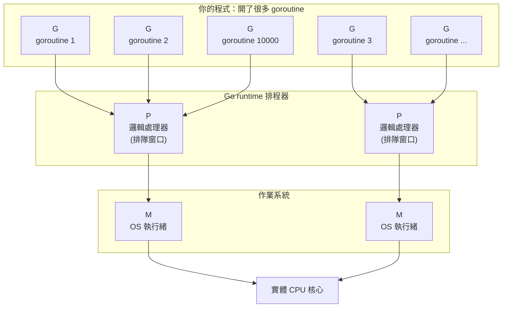

# [go-4-1] 🐹 goroutine：一行 `go` 開一條並行

> **本章目標**：理解 goroutine 是什麼、怎麼用一個 `go` 關鍵字就開一條「同時在跑」的工作，以及為什麼它跟作業系統的執行緒不一樣——不一樣到你可以同時開上萬條都不會把機器壓垮。

## 你會學到

- 並行（concurrency）到底在講什麼，和「平行」差在哪
- 怎麼用 `go` 一行開一條 goroutine
- goroutine 和作業系統執行緒（OS thread）的差別：為什麼一條只要約 2KB、能開上萬條
- Go runtime 怎麼把成千上萬條 goroutine 排到少少幾個 CPU 核心上跑（GMP 排程的直覺）
- 一個新手一定會踩的坑：`main` 結束了，其他 goroutine 就沒機會跑完

## 概念說明

### 先分清楚：並行 vs 平行

這兩個字很常被混用，但意思不一樣，先用一句話定住：

- **並行（concurrency）**：把程式**拆成多條可以獨立推進的工作**，它們在時間上「交錯進行」。重點是「結構」——你把事情組織成好幾條線。
- **平行（parallelism）**：多條工作**真的在同一瞬間一起執行**（需要多個 CPU 核心）。重點是「同時」。

一個好記的比喻（Go 之父 Rob Pike 的講法）：

```
並行：一個咖啡師，手上同時處理三杯訂單——
      磨A的豆子時，B的奶泡機在打、C的水在滾，他在三件事之間切換。
      就算只有他一個人（單核心），這三杯也「同時在進行中」。

平行：三個咖啡師，一人一杯，真的同一秒都在動手。
      這需要三個人（三個核心）。
```

Go 讓你**寫並行**（把程式拆成很多條 goroutine），至於這些 goroutine 會不會真的**平行**跑（分到多核心同時執行），交給 Go runtime 和你的機器決定。你負責把事情「組織成很多條線」，剩下的排程 Go 幫你處理。

> 並行、CPU 排程「怎麼在一顆核心上假裝同時」的底層原理，可軟性呼應 → **cs 課程 Part 5（作業系統、並行）**，在 `../../cs/課程大綱.md`

### goroutine：Go 版的「一條工作」

到目前為止（Part 1～3）你寫的 Go 程式都是「一條線，從 `main` 從頭跑到尾」。要讓程式同時推進好幾件事，Go 給你的工具叫 **goroutine**——你可以把它想成「一條由 Go 自己管理的、超輕量的工作線」。

開一條 goroutine 的語法簡單到不可思議：在任何一個函式呼叫前面加上 `go`。

```
正常呼叫：    doSomething()        // 跑完才往下走
開 goroutine： go doSomething()    // 立刻往下走，doSomething 在另一條線上跑
```

就這樣。`go f()` 的意思是：「**把 `f()` 丟到背景去跑，我不等它，馬上執行下一行。**」

### goroutine 不是作業系統執行緒

你可能聽過「執行緒（thread）」——作業系統提供的並行單位。goroutine **看起來**像執行緒，但底下完全是兩回事。這個差別是 Go 並行能這麼好用的關鍵，值得花時間嚼透。

| | 作業系統執行緒（OS thread） | goroutine |
|---|---|---|
| 由誰管理 | 作業系統核心 | Go 自己的 runtime（跟你的程式一起編進執行檔） |
| 起始堆疊大小 | 固定約 1~8 MB | **約 2 KB**，不夠用時自動長大、用完縮小 |
| 建立成本 | 高（要進核心、要配一大塊記憶體） | 極低（runtime 自己分配） |
| 切換成本 | 高（要陷入核心、存/還一堆暫存器） | 低（在使用者空間切換，不用進核心） |
| 能同時開幾條 | 幾千條就很吃力了 | **輕鬆上萬、甚至上百萬** |

重點在那個**堆疊大小**：一條 OS 執行緒光堆疊就吃掉 1 MB 以上，你開一萬條就是 10 GB 以上，機器直接躺平。而一條 goroutine 起始只要 2 KB，一萬條才 20 MB 左右——這就是為什麼 Go 可以「見一個連線就開一條 goroutine 服務它」，面對上萬個連線也不眨眼。

### Go runtime 怎麼把上萬條 goroutine 塞進幾個核心？

既然你的機器可能只有 8 個核心，那上萬條 goroutine 怎麼跑？答案是 **Go runtime 裡有一個排程器（scheduler）**，它把「很多條 goroutine」對應到「少少幾條 OS 執行緒」上輪流執行。這叫 **M:N 排程**（M 條 goroutine 排到 N 條 OS 執行緒上）。

它的三個角色常被簡寫成 **G、M、P**：



這張圖在說：**G**（goroutine）很多很多，但它們不直接佔用 OS 執行緒；而是先排進 **P**（邏輯處理器，數量預設等於 CPU 核心數）的佇列裡，再由 P 綁定一條 **M**（真正的 OS 執行緒）去實際執行。排程器不斷地把「準備好要跑」的 goroutine 換上 M 執行、把「在等東西」的換下來——所以少少幾條 OS 執行緒就能輪流服務上萬條 goroutine。

你完全不用管 G、M、P 這些細節，Go 幫你弄好。要記住的只有一件事：**goroutine 很便宜，該開就開，別省。**

### 一個一定會踩的坑：`main` 自己也是一條 goroutine

程式一啟動，`main` 函式其實就跑在一條特別的 goroutine（叫 main goroutine）上。規則是：

> **當 main goroutine 結束（`main` 返回），整個程式立刻退出——不管其他 goroutine 跑完了沒。**

所以如果你 `go doSomething()` 開了一條背景工作，然後 `main` 馬上就結束了，那條 goroutine 可能**一個字都還沒印出來就被中止**。這是新手最常見的困惑：「我明明開了 goroutine，怎麼什麼都沒發生？」答案就是 `main` 跑太快、沒等它。

怎麼「等」才對，是下一章 channel 和之後 `sync.WaitGroup` 的主題。這一章我們先用最粗暴的方式（睡一下）把問題演給你看，並說清楚那是**壞示範**。

## 程式碼範例

### 範例一：開一條 goroutine，看看它會不會跑

這段程式開一條 goroutine 印招呼語，然後 `main` 直接結束。先別急著看答案，想一下會印出什麼。

```go
package main

import "fmt"

func sayHello() {
	fmt.Println("你好，我是 goroutine")
}

func main() {
	go sayHello() // 丟到背景跑，main 不等它
	fmt.Println("main 結束了")
}
```

跑起來你很可能**只看到 `main 結束了`**，那句「你好」根本沒印出來。因為 `go sayHello()` 才剛把工作排進去，`main` 下一行就執行完、程式就退出了，排程器還沒輪到那條 goroutine 跑。

### 範例二：用「睡一下」硬等——可以看到效果，但這是壞示範

```go
package main

import (
	"fmt"
	"time"
)

func sayHello() {
	fmt.Println("你好，我是 goroutine")
}

func main() {
	go sayHello()
	time.Sleep(100 * time.Millisecond) // 硬睡 100 毫秒，碰運氣希望 goroutine 這段時間跑得完
	fmt.Println("main 結束了")
}
```

這次「你好」會印出來了。但——

> **常見錯誤** — 很多人會用 `time.Sleep` 來「等」goroutine：
> 問題是：你根本不知道那條 goroutine 要跑多久。睡太短，它還沒跑完就被砍；睡太長，白白浪費時間。更糟的是，這種「猜時間」的寫法會變成**時好時壞、難以重現的 bug**。
> 正確做法：用 **channel**（下一章 `go-4-2`）或 **`sync.WaitGroup`**（`go-4-5`）來明確地「等某條 goroutine 真的做完」。這裡用 `time.Sleep` 只是為了讓你先看到 goroutine 確實有在跑，之後絕對不要這樣寫。

### 範例三：一次開很多條 goroutine

goroutine 便宜，所以用迴圈一次開很多條是家常便飯。這段開 5 條，每條印自己的編號：

```go
package main

import (
	"fmt"
	"time"
)

func main() {
	for id := 0; id < 5; id++ {
		go func() {
			// Go 1.22 起，每次迴圈的 id 都是「這一圈專屬」的一份，
			// 直接用它是安全的（見下方說明）。
			fmt.Println("工作", id, "開始")
		}()
	}

	time.Sleep(100 * time.Millisecond) // 一樣是暫時的壞示範，只為看效果
	fmt.Println("全部派發完畢")
}
```

多跑幾次，你會發現**印出來的順序每次都不一定一樣**（有時 0、1、2、3、4，有時 2、0、3、1、4……）。這就是並行最直觀的特徵：**goroutine 之間誰先誰後不保證**，由排程器決定。任何依賴「它們一定照某個順序跑」的程式都是錯的。

> **歷史坑提醒**：Go 1.22 以前，`for` 迴圈的迴圈變數在每一圈是**同一個變數**被重複使用，上面這種「在 goroutine 裡直接用 `id`」的寫法會讓所有 goroutine 看到的 `id` 都是最後一圈的值（常常全印 5）。這是 Go 早年惡名昭彰的陷阱。Go 1.22（2024 年）改成**每一圈都是新的變數**，這個坑才消失。本課以現代 Go（1.21+）為準，但如果你讀到舊程式碼看到 `id := id` 這種「自己複製一份」的寫法，就是在繞開這個舊坑。

### 範例四：證明「便宜」不是嘴上說說——開一萬條

```go
package main

import (
	"fmt"
	"sync"
)

func main() {
	var counter sync.WaitGroup // 下一步教的工具，這裡先借來「等全部做完」

	for i := 0; i < 10000; i++ {
		counter.Add(1)
		go func() {
			defer counter.Done()
			// 每條 goroutine 做一點小事就好
			_ = i * 2
		}()
	}

	counter.Wait() // 等一萬條都 Done 才往下
	fmt.Println("一萬條 goroutine 都跑完了")
}
```

這段一口氣開了一萬條 goroutine，記憶體用量卻只有幾十 MB，瞬間就跑完。換成 OS 執行緒試試看？機器大概會直接抗議。這就是 goroutine 「輕」的實證。（這裡先借用了 `sync.WaitGroup` 來正確地等待，它的細節留到 `go-4-5`，你現在只要知道它能「等一群 goroutine 全部做完」就好。）

## 小練習

1. 把「範例一」原封不動跑三次，記錄每次的輸出。再把 `go sayHello()` 的 `go` 拿掉（變成普通呼叫）跑一次，比較差別，並用自己的話解釋「為什麼加了 `go` 反而常常看不到那句話」。
2. 改寫「範例三」，用迴圈開 10 條 goroutine，每條印出 `工作 N`。多跑幾次，把每次的順序抄下來，確認順序真的不固定。
3. 觀念題：有人說「goroutine 就是比較快的執行緒」。這句話哪裡不精確？請從「誰來管理」「堆疊大小」「能開幾條」三個角度各講一句話反駁。

<details>
<summary>參考解答</summary>

**第 1 題**：加了 `go`，`sayHello` 被丟到背景當成一條獨立 goroutine，`main` 不等它、下一行馬上執行完就結束，程式整個退出，排程器還沒輪到那條 goroutine，所以「你好」常常印不出來。拿掉 `go` 變成普通呼叫時，`main` 會**乖乖等 `sayHello()` 返回**才往下走，所以每次都看得到。差別就在「要不要等」。

**第 2 題**：會觀察到順序每次不同——這是正常的，代表 goroutine 真的是並行排程、誰先搶到 CPU 不保證。重點是不要寫任何「假設它們照順序」的程式。

**第 3 題**：
- **誰來管理**：執行緒由作業系統核心管理，goroutine 由 Go 自己的 runtime 在使用者空間管理，切換不用進核心，便宜得多。
- **堆疊大小**：執行緒起始堆疊約 1~8 MB 且固定，goroutine 起始約 2 KB 且能自動伸縮。
- **能開幾條**：執行緒開幾千條就很吃力，goroutine 可以輕鬆上萬、上百萬。
所以 goroutine 不是「比較快的執行緒」，而是**完全不同層級、由 Go 自己排程的輕量工作單位**；一條 goroutine 甚至可能在不同時刻被排到不同的 OS 執行緒上跑。

</details>

## 課外讀物

> 行程、執行緒、CPU 排程「怎麼在少少核心上假裝很多事同時進行」的完整背景 → **cs 課程 Part 5（作業系統、並行）**，在 `../../cs/課程大綱.md`

> 下一章：goroutine 開好了，它們之間怎麼安全地**傳資料、互相等待**？這就是 Go 並行哲學的核心——「用傳訊息溝通，不要用共享記憶體溝通」 → [go-4-2] channel
