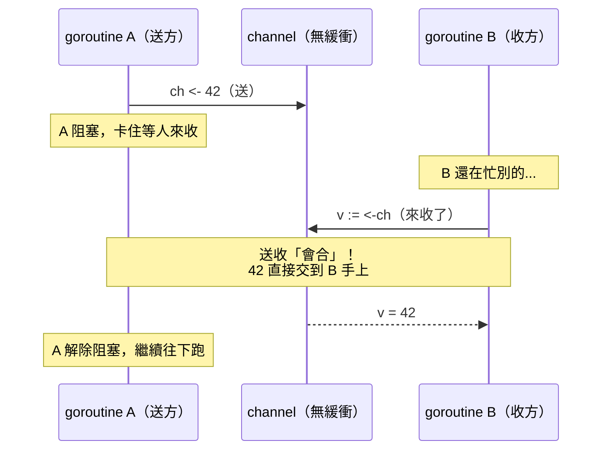
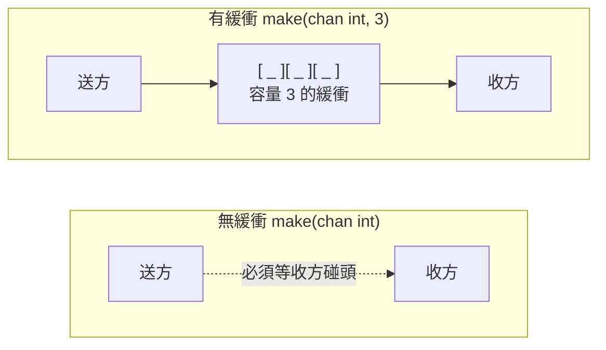

# [go-4-2] 🐹 channel：用傳訊息溝通，不要用共享記憶體溝通

> **本章目標**：理解 Go 並行最核心的哲學——goroutine 之間**用「傳訊息」溝通，而不是「共享一塊記憶體」溝通**；學會用 channel 在 goroutine 之間安全地傳值，並搞懂「有緩衝」和「無緩衝」channel 的關鍵差別。

## 你會學到

- Go 的並行哲學一句話：「不要用共享記憶體來溝通，要用溝通來共享記憶體」
- channel 是什麼：goroutine 之間傳值的「管道」
- 怎麼 `make` 一條 channel、怎麼送（`ch <- v`）和收（`v := <-ch`）
- **無緩衝 channel**：送方和收方必須「碰頭」才能完成，天生就是一種同步
- **有緩衝 channel**：像一條有容量的輸送帶，未滿不用等
- 收到時怎麼知道「對方關了」（`v, ok := <-ch`）、怎麼用 `range` 一直收到關閉

## 概念說明

### 為什麼不直接共享一個變數就好？

你可能會想：goroutine 之間要傳資料，不就宣告一個大家都看得到的變數，一邊寫、一邊讀嗎？

問題就出在這裡。多條 goroutine 同時讀寫同一個變數，會撞出**資料競爭（data race）**——讀到寫到一半的壞值、兩邊的修改互相覆蓋，結果是隨機出現、難以重現的災難。（這類 bug 怎麼抓，是 `go-4-7` 的主題。）傳統語言的解法是加「鎖」（lock）保護那塊共享記憶體，但鎖很容易用錯（忘了解鎖、兩把鎖互相等成死結）。

Go 提出了一條不一樣的路，寫成一句廣為流傳的口號：

> **Do not communicate by sharing memory; instead, share memory by communicating.**
> **不要用「共享記憶體」來溝通；要用「溝通」來共享記憶體。**

意思是：與其讓多條 goroutine 搶著讀寫同一塊記憶體（還要小心加鎖），**不如讓資料「只屬於一條 goroutine」，需要給別人時，就透過一條管道「把它送過去」**。資料在任一瞬間只被一條 goroutine 持有，自然就不會有人同時讀寫、也就沒有資料競爭。這條「管道」就是 **channel**。

```
共享記憶體派（傳統）：
    [goroutine A] ↘        ↙ [goroutine B]
                 [共享變數]            ← 大家搶著讀寫，要加鎖保護
                 [goroutine C] ↑

訊息傳遞派（Go 偏好）：
    [goroutine A] ──送 v──▶ [channel] ──收 v──▶ [goroutine B]
                                                 ← v 一次只屬於一個人
```

> Go 不是禁止你用共享記憶體加鎖（`sync.Mutex` 在 `go-4-5`，有些場景它才是對的）。而是說：**預設先想「能不能用 channel 傳訊息解決」，通常比較不容易出錯。**

### channel 是什麼

**channel（通道）** 是一條**有型別的管道**：你從一端把值送進去，另一端有 goroutine 把值收出來。「有型別」是指一條 `chan int` 只能傳 `int`，`chan string` 只能傳 `string`，編譯器會幫你擋掉送錯型別。

比喻：channel 就像兩個人之間的**傳遞窗口**。A 把文件放進窗口，B 從另一邊拿走。文件在被拿走前只有一份，不會有「兩個人同時改同一份」的問題。

建立和使用的語法：

```
ch := make(chan int)   // 建一條「傳 int」的 channel
ch <- 42               // 送：把 42 送進 ch（箭頭指向 channel）
value := <-ch          // 收：從 ch 收一個值出來（箭頭離開 channel）
```

記箭頭方向的訣竅：**`<-` 永遠指向資料流動的方向**。`ch <- 42` 是「42 流進 ch」；`<-ch` 是「值從 ch 流出來」。

### 無緩衝 channel：送收必須「碰頭」

`make(chan int)` 建出來的是**無緩衝（unbuffered）channel**——它裡面**一個值都存不住**。這帶來一個很重要的性質：

> 在無緩衝 channel 上，**送方會一直卡住，直到有收方來收**；同樣地，**收方會一直卡住，直到有送方來送**。送和收必須「同時到場」才會一起完成，這叫**會合（rendezvous）**。

這其實很合理：channel 存不住東西，那送方把值交出去的唯一辦法，就是「等到有人正好來接」。這個「卡住等對方」的行為叫**阻塞（blocking）**——goroutine 停在那一行不動，直到條件滿足。

用時序圖看「送方先到」的情況最清楚：



這張圖在說：A 先執行送出，但因為沒人收，A 就**停在那一行**；直到 B 來收，兩邊才在那一瞬間一起完成交接，A 才繼續。反過來若 B 先到（先 `<-ch`），那就換 B 停著等，直到 A 送出為止。**無論誰先到，都會等到對方，所以無緩衝 channel 天生就是一個「同步點」。**

這個「同步」性質超好用：它不只傳了資料，還順便告訴你「對方確實收到了」。很多時候我們甚至不在乎傳什麼值，只借它的「會合」來做「等某件事發生」的信號。

### 有緩衝 channel：一條有容量的輸送帶

有時候你不希望送方每次都卡著等人收，而是「先放著，收方晚點再拿」。這時用**有緩衝（buffered）channel**：

```
ch := make(chan int, 3)   // 第二個參數 3 = 緩衝容量，最多先存 3 個
```

它像一條**有 3 格的輸送帶**：

- 緩衝**還沒滿**時，送方把值丟上輸送帶就能**立刻走**，不用等人收。
- 緩衝**滿了**，送方才會卡住，等收方拿走一個騰出空位。
- 緩衝**空的**時，收方才會卡住，等有東西被送上來。



這張圖對比兩者：無緩衝是「一手交錢一手交貨」，送收必須同時在場；有緩衝多了一段可以暫存的輸送帶，只要帶上還有空位，送方丟了就走，兩邊不必同時在場。

**什麼時候用哪個？**
- **無緩衝**：你需要「送方確定對方收到了」這個同步保證，或是當作「事件信號」。這是預設首選，語意最清楚。
- **有緩衝**：你想讓送方和收方的速度「解耦」一點——送方偶爾比收方快時不用立刻卡住。容量要有依據（例如「我知道最多同時會有 N 個任務排隊」），**不要隨便塞一個大數字當「保險」**，那只是把問題藏起來。

### 收方怎麼知道「沒有更多值了」

送方做完事情，可以 `close(ch)` **關閉** channel，宣告「我不會再送了」。收方這端有兩個好用的機制：

1. **雙回傳值收法**：`v, ok := <-ch`。`ok` 是 `false` 代表「channel 已經關了而且也空了」，此時 `v` 是該型別的**零值**（`int` 得到 `0`，`string` 得到 `""`）。

2. **`range` 收到關閉為止**：`for v := range ch { ... }` 會一直收，直到 channel 被關閉且清空，迴圈**自動結束**。這是最常用、最乾淨的收法。

關閉 channel 有一套「誰能關、關了會怎樣」的規矩（關錯會直接 panic），因為那是常見 bug 來源，我們留到 `go-4-4` 專門講清楚。這裡你先會用 `range` 收就夠了。

## 程式碼範例

### 範例一：無緩衝 channel 傳一個值

最小的例子：開一條 goroutine 算出結果，透過 channel 送回 `main`。注意這裡**不再需要 `time.Sleep`**——`<-resultCh` 會自動等那條 goroutine 把結果送回來。

```go
package main

import "fmt"

func main() {
	resultCh := make(chan int) // 無緩衝

	go func() {
		sum := 0
		for i := 1; i <= 100; i++ {
			sum += i
		}
		resultCh <- sum // 算完送回去（會卡住，直到 main 來收）
	}()

	result := <-resultCh // 收（會卡住，直到 goroutine 送出）
	fmt.Println("1 到 100 的總和是", result)
}
```

這段展示了 channel 最漂亮的地方：`<-resultCh` 同時做了兩件事——**拿到結果**，而且**保證那條 goroutine 真的算完了**。上一章用 `time.Sleep` 硬等的壞味道，在這裡完全消失。

### 範例二：生產者 / 消費者，用 `range` 收到關閉

一條 goroutine 當「生產者」不斷送出工作，`main` 當「消費者」用 `range` 一直收，收到生產者關閉為止。

```go
package main

import "fmt"

// 生產者：把 1..5 送進 jobs，送完關閉 channel 宣告「沒了」
func produce(jobs chan<- int) {
	for i := 1; i <= 5; i++ {
		fmt.Println("生產：工作", i)
		jobs <- i
	}
	close(jobs) // 送方負責關（為什麼是送方？見 go-4-4）
}

func main() {
	jobs := make(chan int)

	go produce(jobs)

	// range 會一直收，直到 jobs 被關閉且清空後自動結束
	for job := range jobs {
		fmt.Println("        消費：處理工作", job)
	}
	fmt.Println("全部處理完")
}
```

留意函式參數寫成 `jobs chan<- int`——這是**有方向的 channel**：`chan<-` 表示「這個函式只能往裡送、不能收」。這不是必要的，但它讓**編譯器幫你把關**：`produce` 裡如果手滑寫了 `<-jobs`（收）就會編譯失敗。相對地 `<-chan int` 表示「只能收、不能送」。幫 channel 標上方向，是讓並行程式更不容易寫錯的好習慣。

### 範例三：有緩衝 channel 的「不卡住」效果

同樣送 3 個值，但 channel 有容量 3，送方可以一口氣送完、完全不等收方：

```go
package main

import "fmt"

func main() {
	ch := make(chan string, 3) // 緩衝容量 3

	ch <- "第一份" // 緩衝有空位，不卡，立刻往下
	ch <- "第二份" // 一樣不卡
	ch <- "第三份" // 填滿了，但這一個還是放得進去，不卡
	// ch <- "第四份"  // 如果再送這個，緩衝已滿、又沒人收 → 這裡會永遠卡住（死結）

	close(ch)

	for msg := range ch {
		fmt.Println("收到", msg)
	}
}
```

把 `第四份` 那行的註解打開跑跑看：程式會**卡死**（Go 偵測到所有 goroutine 都在互等，會直接報 `fatal error: all goroutines are asleep - deadlock!`）。這說明有緩衝不是「無限大」——**滿了照樣會卡**。緩衝只是給你一點「不必剛好同時在場」的彈性，容量要配合實際需求設定。

### 範例四：用雙回傳值判斷關閉

當你想手動收、並在收完後做收尾，用 `v, ok := <-ch`：

```go
package main

import "fmt"

func main() {
	ch := make(chan int, 2)
	ch <- 10
	ch <- 20
	close(ch)

	for {
		value, ok := <-ch
		if !ok {
			// ok 為 false：channel 關了且空了，沒有更多值
			fmt.Println("channel 已關閉，結束收取")
			break
		}
		fmt.Println("收到", value)
	}
}
```

這段和 `range` 等價，但把「是否還有值」攤開讓你看清楚：關閉且清空後，`ok` 變成 `false`，`value` 是零值 `0`。實務上能用 `range` 就用 `range`，這個寫法留給「需要在收完那一刻做點事」的場合。

> ⚠️ **並行程式一定要用 `-race` 檢查**：本章用 channel 傳值天生就避開了資料競爭，但只要你的程式有「多條 goroutine 碰同一塊記憶體」的地方，就該養成習慣用 `go run -race main.go` 或 `go test -race` 跑一遍，讓 Go 的競態偵測器幫你抓看不見的 bug。細節在 `go-4-7`。

## 小練習

1. 把「範例一」的 `make(chan int)` 改成 `make(chan int, 1)`（容量 1），觀察程式行為有沒有變。再想一想：對這個「只送一個值」的例子，有沒有緩衝有差嗎？為什麼？
2. 寫一個程式：開一條 goroutine 把字串陣列 `["蘋果", "香蕉", "橘子"]` 一個一個送進 channel，送完關閉；`main` 用 `range` 收出來並印出。
3. 觀念題：用自己的話解釋「為什麼無緩衝 channel 的 `ch <- v` 可以同時達到『傳資料』和『確認對方收到了』兩件事」。這個性質在「想讓一條 goroutine 等另一條做完某件事」時為什麼好用？

<details>
<summary>參考解答</summary>

**第 1 題**：行為看起來一樣（都正確印出總和）。差別在**同步時機**：無緩衝時，goroutine 的 `resultCh <- sum` 會卡住直到 `main` 來收，兩邊會合；容量 1 時，goroutine 送出後**不卡、立刻結束**（值先進了緩衝），`main` 之後再從緩衝拿。對「只送一個值、`main` 一定會來收」的例子，最終結果沒差；但一般而言無緩衝多給你一個「送方確定被收到」的保證，語意更明確，所以當預設首選。

**第 2 題**：

```go
package main

import "fmt"

func main() {
	fruits := make(chan string)

	go func() {
		for _, name := range []string{"蘋果", "香蕉", "橘子"} {
			fruits <- name
		}
		close(fruits)
	}()

	for fruit := range fruits {
		fmt.Println("收到", fruit)
	}
}
```

重點：送方（goroutine）送完後要 `close(fruits)`，否則 `main` 的 `range` 會在收完三個後**永遠卡著等第四個**，造成死結。

**第 3 題**：無緩衝 channel 存不住值，所以 `ch <- v` 的唯一完成方式，就是「有收方正好來接」——送出成功，就等於對方此刻確實收到了。於是這一個動作同時給了你「資料送達」和「對方到場確認」兩件事。拿來「等對方做完某事」時，你可以讓被等的 goroutine 做完後送一個信號值（甚至空的 `struct{}{}`），等待方 `<-ch` 收到時就確定那件事已經完成——這是一個乾淨、不靠 `time.Sleep` 猜時間的同步做法。

</details>

## 課外讀物

> 共享記憶體、鎖、資料競爭的作業系統層背景 → **cs 課程 Part 5（作業系統、並行）**，在 `../../cs/課程大綱.md`

> 下一章：如果一條 goroutine 要**同時等好幾條 channel**，哪條先來就處理哪條，還要能設逾時——這就要用 `select` → [go-4-3] `select`
