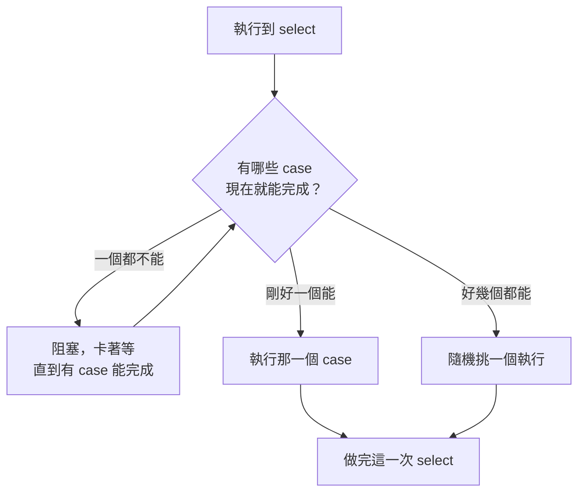
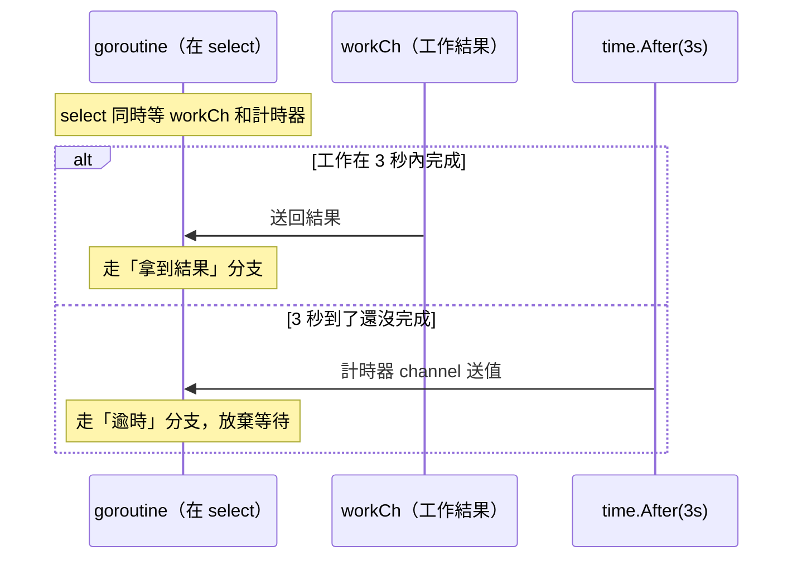

# [go-4-3] `select`：同時等多個 channel，與逾時寫法

> **本章目標**：學會用 `select` 讓一條 goroutine **同時盯著好幾條 channel**，哪一條先準備好就處理哪一條；並掌握兩個關鍵技巧——用 `default` 做「不卡住的試探」，以及用 `time.After` 做「等太久就放棄」的逾時。

## 你會學到

- `select` 是什麼：channel 版的「哪個先來就處理哪個」
- `select` 的基本語法，和它跟 `switch` 的像與不像
- 用 `default` 分支做**非阻塞**的送 / 收
- 用 `time.After` 寫**逾時**：等超過某個時間就不等了
- `for { select { ... } }` 這個在後端服務裡到處都是的迴圈骨架

## 概念說明

### 問題：一條 goroutine 想同時等兩件事

上一章你學會從一條 channel 收值：`v := <-ch`。但它只能等**一條** channel；執行到這行，就只盯著 `ch`，別的 channel 來了值也不管。

真實情況常常是「我同時在等好幾件事，哪件先發生就先處理哪件」。例如：

- 一邊等「工作結果」channel，一邊等「取消信號」channel——誰先來都要能反應。
- 等「資料回來」，但如果「等超過 3 秒」就放棄別等了。

比喻：你是個服務生，面前有**三個出餐窗口**。你不能站在第一個窗口前傻等（萬一第三個窗口的菜先好了呢？），而是**三個一起盯著，哪個窗口先響鈴就先去端那個**。`select` 就是 Go 給你的「同時盯多個窗口」。

### `select`：長得像 `switch`，但等的是 channel

`select` 的語法刻意做得跟 `switch` 很像，但每個 `case` 不是比較值，而是**一個 channel 操作（送或收）**：

```
select {
case v := <-ch1:
    // 如果 ch1 有值可收，就進這裡
case ch2 <- x:
    // 如果 ch2 現在能送得進去，就進這裡
case v := <-ch3:
    // 如果 ch3 有值可收，就進這裡
}
```

它的行為規則是：

1. **看哪些 `case` 現在「可以立刻完成」**（有值可收、或送得進去）。
2. 若**只有一個**可以，就執行那一個。
3. 若**好幾個同時**可以，**隨機挑一個**執行（刻意隨機，避免永遠偏袒排在前面的 channel）。
4. 若**一個都不行**，`select` 就**阻塞**，卡著等——直到任何一個 `case` 變成可以完成。



這張圖在說 `select` 每跑一次的決策：先看當下哪些 channel 操作能馬上成功，一個就做那個、多個就隨機挑一個、全都不行就卡著等。注意：**`select` 一次只處理一個 `case`**，要重複處理得自己套迴圈（後面會講）。

### `default`：讓 `select` 不要卡住

如果你**不想讓 `select` 卡著等**——「現在有就處理，沒有我就先做別的」——加一個 `default` 分支：

```
select {
case v := <-ch:
    // 剛好有值，收下來處理
default:
    // 現在沒有任何 case 能完成，馬上走這裡，不等
}
```

有了 `default`，`select` 就變成**非阻塞**的：規則第 4 條「全都不行時卡著等」被 `default` 取代成「全都不行時就走 `default`」。這招常用在「試著收一下，沒有就算了」的場景（例如輪詢一下有沒有新訊息，沒有就繼續跑迴圈）。

> **提醒**：別把 `default` 放進一個「什麼事都沒做」的 busy loop 裡（`for { select { case...; default: } }` 但 `default` 空轉）——那會讓 CPU 空燒 100%。`default` 適合「沒資料時剛好有別的事做」，不適合用來反覆空轉等資料（那種情況應該用沒有 `default` 的 `select` 讓它乖乖阻塞）。

### 逾時：`time.After` 這個會「時間到才送值」的 channel

Go 沒有專門的「逾時語法」，而是用一個很巧妙的組合：`time.After(d)` 會回傳**一條 channel**，這條 channel 會在經過時間 `d` 之後，自動送進一個值。

把它丟進 `select`，就得到了逾時：

```
select {
case result := <-workCh:
    // 工作在時限內完成了
case <-time.After(3 * time.Second):
    // 等了 3 秒 workCh 還沒來，這條逾時 channel 先響了 → 放棄等待
}
```

這段的意思是「`workCh` 和『3 秒計時器』兩條 channel 一起等，誰先來聽誰的」。如果工作在 3 秒內送回結果，就走第一個 `case`；如果 3 秒到了結果還沒來，`time.After` 的 channel 先送出值，就走第二個 `case`。



這張圖把逾時的兩種結局畫出來：要嘛工作先回來、要嘛計時器先響，`select` 保證你不會無限期卡著等一個可能永遠不來的結果。逾時是後端服務的基本功——呼叫外部服務、等資料庫，都該設個上限。

## 程式碼範例

### 範例一：同時等兩條 channel，誰先來處理誰

兩條 goroutine 各自在不同的時間送回結果，`select` 會先處理先到的那一個。

```go
package main

import (
	"fmt"
	"time"
)

func main() {
	fast := make(chan string)
	slow := make(chan string)

	go func() {
		time.Sleep(100 * time.Millisecond)
		fast <- "我比較快"
	}()
	go func() {
		time.Sleep(300 * time.Millisecond)
		slow <- "我比較慢"
	}()

	// 一起等兩條，先到的先處理（這裡只處理一次）
	select {
	case msg := <-fast:
		fmt.Println("收到 fast：", msg)
	case msg := <-slow:
		fmt.Println("收到 slow：", msg)
	}
	fmt.Println("select 結束（只處理了先到的那一個）")
}
```

跑起來只會印出「收到 fast」，因為它先到。注意 `select` **只處理一次**就往下走了——`slow` 那個值沒人收。要兩個都收，得把 `select` 放進迴圈跑兩次。

### 範例二：`for { select }`——後端服務最常見的骨架

把 `select` 放進 `for` 迴圈，就能「持續地同時盯多條 channel」。這裡示範一個很典型的組合：一邊收工作、一邊監看「結束信號」。

```go
package main

import (
	"fmt"
	"time"
)

func main() {
	jobs := make(chan int)
	done := make(chan struct{}) // 空 struct 當純信號，不帶資料

	// 工作來源：每 200 毫秒送一個工作，送 3 個後發出結束信號
	go func() {
		for i := 1; i <= 3; i++ {
			time.Sleep(200 * time.Millisecond)
			jobs <- i
		}
		close(done) // 關閉 done = 廣播「結束了」
	}()

	// 服務骨架：持續同時盯 jobs 和 done
	for {
		select {
		case job := <-jobs:
			fmt.Println("處理工作", job)
		case <-done:
			fmt.Println("收到結束信號，收工")
			return // 跳出 for，結束
		}
	}
}
```

這個 `for { select { case 工作; case 結束信號 } }` 骨架你之後會一直看到：一條 goroutine 一邊做本份工作，一邊隨時準備好回應「該停了」的信號。（這個「用一條 channel 廣播取消」的點子，之後會被 `context` 標準化——`go-4-6` 會把它變成後端服務的統一做法。）用 `close(done)` 當信號的訣竅：**一條關閉的 channel，所有來收它的 goroutine 都會立刻收到**（收到零值、`ok=false`），所以 `close` 是天然的「一對多廣播」。

### 範例三：逾時——等太久就放棄

模擬一個「可能很慢」的工作，用 `time.After` 設 250 毫秒上限：

```go
package main

import (
	"fmt"
	"time"
)

func doWork() <-chan string {
	ch := make(chan string)
	go func() {
		time.Sleep(500 * time.Millisecond) // 故意比逾時久，模擬太慢的工作
		ch <- "工作完成"
	}()
	return ch
}

func main() {
	select {
	case result := <-doWork():
		fmt.Println(result)
	case <-time.After(250 * time.Millisecond):
		fmt.Println("等太久了，放棄（逾時）")
	}
}
```

因為工作要 500 毫秒、逾時設 250 毫秒，所以每次都會印「等太久了，放棄」。把工作的 `Sleep` 改成比 250 毫秒短，就會換成印「工作完成」。這就是最基本的逾時保護。

### 範例四：`default`——非阻塞地「試收一下」

有時你只想「看看現在有沒有東西，沒有就算了，別卡住」：

```go
package main

import "fmt"

func main() {
	messages := make(chan string, 1)

	// 情況 A：channel 是空的
	select {
	case msg := <-messages:
		fmt.Println("收到：", msg)
	default:
		fmt.Println("現在沒有訊息，先做別的") // 走這裡，不卡
	}

	// 先放一個進去
	messages <- "嗨"

	// 情況 B：channel 裡有東西了
	select {
	case msg := <-messages:
		fmt.Println("收到：", msg) // 走這裡
	default:
		fmt.Println("現在沒有訊息")
	}
}
```

有了 `default`，兩個 `select` 都**不會卡住**：第一次沒訊息就走 `default`，第二次有訊息就收下來。這就是「非阻塞試收」。送也可以這樣做（`case ch <- v:` 配 `default`），用來「塞得進去就塞，塞不進去就別等」。

> ⚠️ 並行程式記得用 `go run -race main.go` 跑一遍，讓競態偵測器幫你把關（細節見 `go-4-7`）。

## 小練習

1. 改寫「範例一」，用一個 `for i := 0; i < 2; i++` 迴圈包住 `select`，讓 `fast` 和 `slow` 兩個值**都被收到**。觀察印出來的順序，想想為什麼是這個順序。
2. 寫一個程式：開一條 goroutine 睡一段「隨機或你指定」的時間後送回一個字串；`main` 用 `select` 搭配 `time.After` 設 300 毫秒逾時。把 goroutine 的睡眠時間分別設成 100 毫秒和 500 毫秒各跑一次，確認一次成功、一次逾時。
3. 觀念題：`select` 在「好幾個 `case` 同時都能完成」時會**隨機**挑一個，而不是永遠挑排最前面的。為什麼這個「隨機」是刻意設計的？（提示：想想如果永遠偏袒第一個 `case`，排後面的 channel 會發生什麼事。）

<details>
<summary>參考解答</summary>

**第 1 題**：

```go
for i := 0; i < 2; i++ {
	select {
	case msg := <-fast:
		fmt.Println("收到 fast：", msg)
	case msg := <-slow:
		fmt.Println("收到 slow：", msg)
	}
}
```

輸出會是先 `fast`（100 毫秒先到）再 `slow`（300 毫秒才到）。第一圈 `select` 時只有 `fast` 準備好、`slow` 還在睡，所以先收 `fast`；第二圈卡著等，直到 `slow` 送出才收到。順序由「誰先準備好」決定，不是由 `case` 的書寫順序決定。

**第 2 題**：

```go
package main

import (
	"fmt"
	"time"
)

func main() {
	ch := make(chan string)
	go func() {
		time.Sleep(100 * time.Millisecond) // 改成 500ms 再跑一次
		ch <- "完成"
	}()

	select {
	case result := <-ch:
		fmt.Println("成功：", result)
	case <-time.After(300 * time.Millisecond):
		fmt.Println("逾時，放棄")
	}
}
```

睡 100 毫秒 < 300 毫秒逾時 → 印「成功」；睡 500 毫秒 > 300 毫秒 → `time.After` 先響，印「逾時」。

**第 3 題**：如果 `select` 永遠挑排最前面能完成的 `case`，那當第一個 channel 一直有源源不絕的值時，後面的 channel 就**永遠輪不到**被處理，形成「飢餓（starvation）」。隨機挑選保證了長期下來每個 ready 的 `case` 都有公平的機會被選中，避免某條 channel 被無限期忽略。

</details>

## 課外讀物

> 逾時、取消、重試這些「別讓服務卡死」的設計，是可靠系統的基本功 → **sre 課程**；逾時的下一步是整條請求鏈的統一取消 → [go-4-6] `context`

> 下一章：有了 goroutine、channel、`select` 三樣零件，就能組出真正實用的並行**模式**——worker pool、fan-out / fan-in，以及「關閉 channel 的規矩」這個常見 bug 來源 → [go-4-4] 常見並行模式
