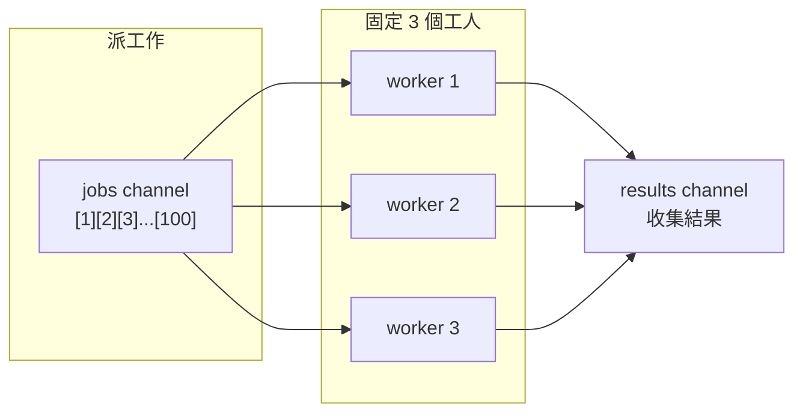
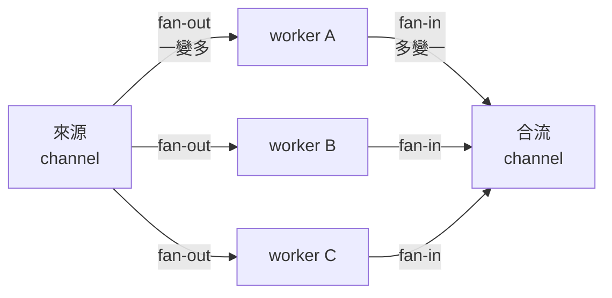
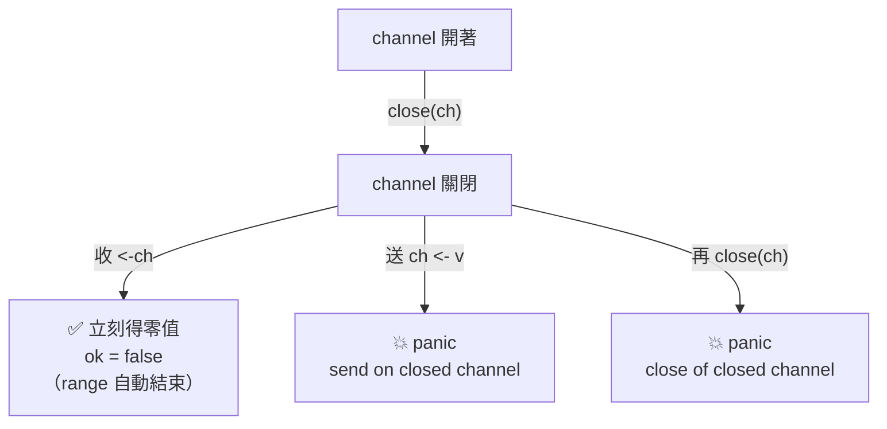

# [go-4-4] 常見並行模式：worker pool、fan-out / fan-in，與關閉 channel 的規矩

> **本章目標**：把前三章的零件（goroutine、channel、`select`）組成實戰常用的並行**模式**——用固定數量的工人消化大量工作（worker pool）、把工作灑出去再收回來（fan-out / fan-in）；並徹底搞懂「關閉 channel 的規矩」這個 Go 新手最常踩爆的地雷。

## 你會學到

- **worker pool（工人池）**：為什麼不是「每個工作開一條 goroutine」，而是用固定幾個工人
- **fan-out / fan-in（扇出 / 扇入）**：把工作分給多條 goroutine 平行處理，再把結果匯回一條 channel
- **關閉 channel 的四條鐵則**：誰負責關、關了之後收會怎樣、送會怎樣、重複關會怎樣
- 一個好用的收尾模式：用 `sync.WaitGroup` 確認「所有送方都做完了」再關 channel

## 概念說明

### 模式一：worker pool（工人池）

你已經知道 goroutine 很便宜，那「有一萬個工作，就開一萬條 goroutine」不行嗎？多數時候**不該這樣**：

- 每個工作如果要用到有限資源（資料庫連線、對外 API 的流量上限、記憶體），一萬條同時衝會把那個資源壓垮。
- 你想**控制同時進行的數量**（並行度），而不是放任它爆炸。

worker pool 的點子是：**開固定數量（例如 3 條）的工人 goroutine，大家一起從同一條「工作 channel」裡拿工作來做。** 工作做完就回去拿下一個，直到工作發完為止。這樣同時最多只有 3 個工作在跑，並行度被你牢牢控制住。



這張圖在說：100 個工作全排在一條 `jobs` channel 上，3 個工人同時去搶著拿、各自處理完把結果丟進 `results`。channel 本身保證「一個工作只會被一個工人拿到」（不會兩個工人拿到同一個），所以你不用加任何鎖。並行度 = 工人數 = 3，想調快調慢就改工人數。

### 模式二：fan-out / fan-in（扇出 / 扇入）

這兩個是一對，描述資料的「分散」和「匯合」：

- **fan-out（扇出）**：**一條** channel 的工作，被**多條** goroutine 同時拿去處理。上面的 worker pool 從 `jobs` 搶工作，就是 fan-out——一個來源扇出給多個處理者。
- **fan-in（扇入）**：**多條** goroutine 的輸出，被匯整到**一條** channel 上。多個工人把結果都丟進同一條 `results`，就是 fan-in——多個來源扇入成一個出口。



這張圖把兩個方向一次畫清楚：左半邊是 fan-out（工作從一條 channel 分散給三個工人），右半邊是 fan-in（三個工人的結果匯回一條 channel）。很多真實的資料處理管線（pipeline）就是「扇出去平行做、再扇回來收」。

### 關閉 channel 的規矩（新手地雷區）

前面幾章你已經看過 `close(ch)`。它看起來人畜無害，但用錯會直接讓程式 **panic（崩潰）**。這是 Go 並行最常見的 bug 來源之一，這裡一次講清楚四條鐵則。

**鐵則一：只有「送方」能關，而且「收方」永遠不要關。**
`close` 的語意是「我不會再送了」，這只有送方說得出口。收方根本不知道送方還想不想送，貿然關掉會害送方 panic（見鐵則四）。

**鐵則二：關閉後「收」是安全的——會一直收到零值、`ok` 為 `false`。**
一條關閉又清空的 channel，你再去收它**不會卡住**，而是立刻拿到該型別的**零值**，且 `v, ok := <-ch` 的 `ok` 是 `false`。`for v := range ch` 也會因此**自動結束迴圈**。這正是收方判斷「沒有更多資料了」的依據。

**鐵則三：對已關閉的 channel「送」會 panic。**
`ch <- v` 送進一條已經關閉的 channel，會直接 `panic: send on closed channel`。所以關閉的時機很重要：一定要**所有送出都結束了**才能關。

**鐵則四：重複關閉會 panic。**
`close(ch)` 一條已經關過的 channel，會 `panic: close of closed channel`。所以要確保 `close` 只被呼叫**一次**。



這張圖把「channel 關閉後，三種操作各自的下場」攤開：收它安全（拿零值）、送它炸、再關它也炸。記住這張圖，就能避開 Go 並行最常見的崩潰。

一句話總結口訣：**「送方關、關一次、關之前確定沒人還要送。」** 收方只管收，收到零值 `ok=false` 就知道結束了。

### 多個送方時，誰來關？用 `WaitGroup` 收尾

鐵則一說「送方關」，但如果有**好幾個送方**（例如 fan-in 時三個工人都往 `results` 送），就不能讓任一個工人關——因為它關了之後，其他工人還在送就會 panic（鐵則三），而且會重複關（鐵則四）。

正確做法：**讓一條「協調者」goroutine 用 `sync.WaitGroup` 等「所有送方都做完」，再由它關一次。**

```
協調者：
    WaitGroup 記住有 N 個送方
    每個送方做完就通知 WaitGroup「我好了」
    協調者 Wait()：等到 N 個全好
    然後才 close(results)   ← 此刻保證沒人還要送，安全
```

`sync.WaitGroup` 的完整介紹在下一章 `go-4-5`，這裡你先把它當成一個計數器：`Add(1)` 加一、`Done()` 減一、`Wait()` 卡住直到歸零。下面的範例會示範這個收尾模式。

## 程式碼範例

### 範例一：完整的 worker pool

3 個工人處理 9 個工作。工作是「把數字乘以 2」（代表任何耗時運算）。

```go
package main

import (
	"fmt"
	"time"
)

// 工人：從 jobs 拿工作，處理後把結果送進 results。
// jobs 是唯讀（<-chan），results 是唯寫（chan<-），方向寫明讓編譯器把關。
func worker(id int, jobs <-chan int, results chan<- int) {
	for job := range jobs { // jobs 關閉後迴圈自動結束
		fmt.Printf("工人 %d 處理工作 %d\n", id, job)
		time.Sleep(50 * time.Millisecond) // 模擬耗時
		results <- job * 2
	}
}

func main() {
	const workerCount = 3
	const jobCount = 9

	jobs := make(chan int, jobCount)
	results := make(chan int, jobCount)

	// 開 3 個工人（fan-out：大家一起搶 jobs）
	for id := 1; id <= workerCount; id++ {
		go worker(id, jobs, results)
	}

	// 派發 9 個工作，派完關閉 jobs（送方只有 main 這一個，由它關）
	for j := 1; j <= jobCount; j++ {
		jobs <- j
	}
	close(jobs) // 告訴所有工人「沒有更多工作了」，它們的 range 會結束

	// 收集 9 個結果（fan-in：所有工人的結果都在 results）
	sum := 0
	for i := 0; i < jobCount; i++ {
		sum += <-results
	}
	fmt.Println("所有結果加總 =", sum)
}
```

幾個關鍵點：

- **派工作的 `main` 是唯一送方**，所以由它 `close(jobs)`，符合「送方關」。工人只收不關。
- 工人用 `for job := range jobs` 收，`jobs` 一關，每個工人的迴圈自然結束、goroutine 退出。
- 收結果這裡用「我知道剛好有 9 個」的方式收滿 9 次。如果數量不固定，就需要下一個範例的 `WaitGroup` 收尾法。

### 範例二：fan-in 多送方——用 `WaitGroup` 安全關閉

這次工人數量多、結果數量不固定，示範「多個送方寫同一條 `results`，誰來關」的正確收尾。

```go
package main

import (
	"fmt"
	"sync"
)

func main() {
	results := make(chan int)
	var wg sync.WaitGroup

	// 開 3 個送方，每個往 results 送兩個值
	for id := 1; id <= 3; id++ {
		wg.Add(1) // 每開一個送方就 +1
		go func() {
			defer wg.Done() // 這個送方做完就 -1（defer 保證一定會執行）
			results <- id * 10
			results <- id*10 + 1
		}()
	}

	// 協調者：另開一條 goroutine 等「3 個送方全做完」再關 results。
	// 不能讓任一個送方自己關——它一關，其他送方還在送就會 panic。
	go func() {
		wg.Wait()      // 卡住，直到三個 Done 都到、計數歸零
		close(results) // 此刻保證沒人還要送，安全關閉
	}()

	// main 用 range 收，results 被關閉後自動結束
	total := 0
	for v := range results {
		fmt.Println("收到", v)
		total += v
	}
	fmt.Println("合計 =", total)
}
```

這段是**多送方 fan-in 的標準骨架**，務必記住它的形狀：

1. 每開一個送方 `wg.Add(1)`，送方結尾 `defer wg.Done()`。
2. **另開一條** goroutine 做 `wg.Wait()` 然後 `close(results)`——這條是唯一負責關的「協調者」，且只關一次。
3. `close` 必須放在 `wg.Wait()` 之後，才能保證「所有送方都送完了」才關，避免「send on closed channel」。
4. `main` 用 `range` 收，channel 一關迴圈就結束。

> **常見錯誤** — 把 `close(results)` 直接寫在某個送方裡：
> 問題一：那個送方關了之後，其他送方繼續 `results <- ...` 會 `panic: send on closed channel`（鐵則三）。
> 問題二：如果好幾個送方都想關，第二個 `close` 會 `panic: close of closed channel`（鐵則四）。
> 正確做法：如上，交給一條「等全部送完再關一次」的協調者 goroutine。

### 範例三：故意踩雷，看三種 panic

把這段分別取消註解跑跑看，親眼確認鐵則二、三、四（建議一次只開一個）：

```go
package main

import "fmt"

func main() {
	ch := make(chan int, 1)
	close(ch)

	// 鐵則二：關閉後「收」是安全的——得零值、ok=false
	v, ok := <-ch
	fmt.Printf("收關閉的 channel：v=%d, ok=%v\n", v, ok) // v=0, ok=false

	// 鐵則三：對關閉的 channel「送」會 panic
	// ch <- 1 // 取消註解 → panic: send on closed channel

	// 鐵則四：重複關會 panic
	// close(ch) // 取消註解 → panic: close of closed channel
}
```

直接跑（兩行都註解著）會正常印出 `v=0, ok=false`，印證「收」是安全的。把任一行 panic 的註解打開，程式就會崩給你看。

> ⚠️ worker pool、fan-in 這類「多條 goroutine 一起動」的程式，一定要用 `go run -race main.go` 或 `go test -race` 跑過。本章範例靠 channel 傳值、沒有共享變數，所以是乾淨的；但只要哪天你圖方便加了個「大家一起累加的全域變數」，`-race` 就會立刻抓出資料競爭。細節見 `go-4-7`。

## 小練習

1. 把「範例一」的 `workerCount` 從 3 改成 1，再改成 9，各跑一次。觀察印出來的「工人 N 處理工作 M」順序和總耗時有什麼不同，並用「並行度」這個詞解釋為什麼。
2. 不看範例二，自己默寫「多送方 fan-in 用 `WaitGroup` 安全關閉」的骨架（4 個步驟），寫完再對照。特別檢查：`close` 有沒有放在 `wg.Wait()` 之後？關的那條 goroutine 是不是獨立的協調者而不是某個送方？
3. 觀念題：為什麼「收方」永遠不該去 `close` channel？如果你是收方、又很想通知送方「我不想再收了，你別送了」，正確的做法應該用什麼？（提示：回想 `go-4-3` 範例二那條用 `close(done)` 當廣播的信號 channel——方向反過來。）

<details>
<summary>參考解答</summary>

**第 1 題**：`workerCount = 1` 時工作一個接一個做，總耗時約 9 × 50 毫秒；`= 3` 時三個一起做，約 (9/3) × 50 毫秒；`= 9` 時九個全平行，約 50 毫秒（加排程開銷）。工人數就是**並行度**——同時能進行幾個工作。工人越多、同時做的越多、總耗時越短，但受限於工作量和機器資源（不是越多越好，太多會壓垮下游資源，這正是 worker pool 要「限制」並行度的理由）。

**第 2 題**：四步驟——(1) 每開一個送方 `wg.Add(1)`、送方結尾 `defer wg.Done()`；(2) 另開一條協調者 goroutine；(3) 協調者 `wg.Wait()` 等全部送完；(4) 協調者 `close(ch)` 關一次。關鍵檢查點：`close` 在 `wg.Wait()` 之後（否則可能 send on closed channel）、負責關的是獨立協調者而非任一送方（否則重複關或互相炸）。

**第 3 題**：因為 `close` 的語意是「不會再送了」，這是送方的權利；收方去關會害還在送的送方 panic（send on closed channel），而且收方根本不知道送方關了沒，容易重複關。收方想喊停送方，正確做法是**用另一條反向的信號 channel**（例如一條 `done` / `quit` channel）：收方 `close(done)` 當廣播，送方在 `select` 裡監看這條 `done`，收到信號就自己停止送出。這樣「關」的還是送出那條 channel 的送方，各自只關自己負責送的 channel。（把這個「取消信號」標準化、還能串整條呼叫鏈的工具，就是 `go-4-6` 的 `context`。）

</details>

## 課外讀物

> Part 4 後半接著講：用 `sync.WaitGroup` / `Mutex` 處理「真的得共享記憶體」的場合 → [go-4-5] `sync`；把「取消 / 逾時信號」標準化、串進整個請求鏈 → [go-4-6] `context`；以及看不見的並行 bug 怎麼用工具抓出來 → [go-4-7] 資料競爭與 `-race`

> 並行管線、背壓（back-pressure）、如何不讓任一環節被壓垮，是可靠系統的進階主題 → **sre 課程**
