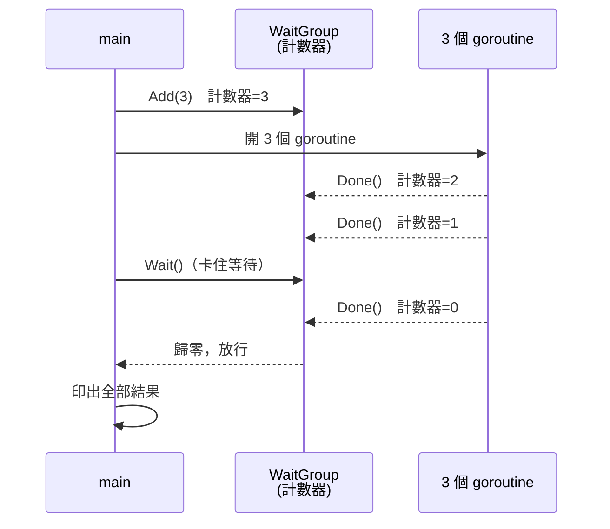
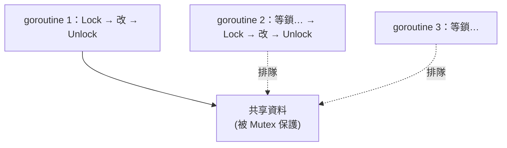
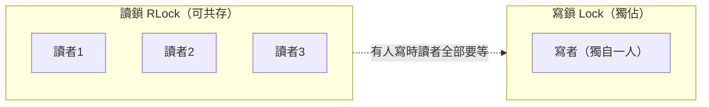

# [go-4-5] `sync`：等所有人做完，與「什麼時候還是得共享記憶體」

> **本章目標**：學會用 `sync.WaitGroup` 等一群 goroutine 全部跑完；理解 Go「用溝通共享記憶體」的優先順序，以及什麼時候反過來、老老實實用 `sync.Mutex` 共享一塊記憶體才是對的。

前面四章（`go-4-1`～`go-4-4`）你已經會用 `go` 開 goroutine、用 channel 讓它們互傳訊息、用 `select` 同時等多個 channel，也看過 worker pool、fan-out/fan-in 這些模式。那一路的主旋律是 Go 的名言：

> **不要用共享記憶體來溝通；要用溝通來共享記憶體。**
> （Do not communicate by sharing memory; instead, share memory by communicating.）

這章要補兩件 channel 不擅長、或根本不該硬塞給 channel 做的事：**「等大家都做完」** 和 **「保護一塊真的要被多個 goroutine 讀寫的記憶體」**。這兩件事的工具都在標準庫的 `sync` 套件裡。

## 你會學到

- 用 `sync.WaitGroup` 等一批 goroutine 全部完成（`Add` / `Done` / `Wait` 的正確用法）
- Go 的取捨：channel 優先，但**共享狀態**這類情況用 `sync.Mutex` 反而更簡單、更直接
- `sync.RWMutex`：讀多寫少時，讓「讀」可以並行
- `sync.Once`：只初始化一次（例如全域設定、連線池）
- 幾個新手一定會踩的 `sync` 地雷

## 概念說明

### 問題一：怎麼知道「一群 goroutine 全部做完了」？

你開了一批 goroutine 去做事，`main` 必須等它們全部結束才能往下走——不然 `main` 一結束，程式整個退出，還沒跑完的 goroutine 直接被中止。

用日常語言描述這個需求：

```
主程式：
    發出去 5 份工作，每份交給一個 goroutine
    在這裡「等」，直到 5 份都回報完成
    印出全部結果
```

`go-4-2` 你學過，可以用 channel 收 5 次來「數」完成的數量。但如果你根本不需要回傳值、只想「等全部做完」，用 channel 數次數有點囉嗦。`sync.WaitGroup` 就是為這件事生的——它是一個**會數數的計數器**：

```
WaitGroup 像一張簽到退表：
    Add(5)   → 登記「有 5 個人出門辦事」
    Done()   → 每個人辦完回來，在表上劃掉自己（計數器 -1）
    Wait()   → 守門的人站在門口，等表上歸零才放行
```



這張圖在說：`main` 先用 `Add` 把計數器加到 3，接著在 `Wait` 卡住；每個 goroutine 做完呼叫 `Done` 把計數器減 1；減到 0 時 `Wait` 才放行。

### 問題二：那還需要 `Mutex` 嗎？不是說「用溝通共享記憶體」嗎？

是，channel 優先仍然成立。但有一類情況，硬用 channel 反而又繞又慢——**「一塊狀態，很多 goroutine 要直接讀寫它」**，典型例子是：

- 一個計數器（有多少請求正在處理中）
- 一個快取 `map`（多個 goroutine 查、偶爾更新）
- 一份設定或統計資料

這種「大家圍著同一塊記憶體讀寫」的場景，如果用 channel，你得額外養一個「管家 goroutine」專門持有那塊資料、別人都透過 channel 跟它要——程式碼會膨脹。這時候 Go 官方的建議很務實：

> **誰適合就用誰。** 要在 goroutine 之間「傳遞資料的所有權、串接流程」→ 用 channel；只是要「保護一小塊共享狀態」→ 用 `sync.Mutex` 更直接。

`Mutex` 是 **mutual exclusion（互斥鎖）** 的縮寫。比喻和你在別的語言看過的一樣：

```
Mutex 像廁所門鎖：
    一次只有一個 goroutine 能進去（Lock 成功）。
    其他要進的得在外面排隊等，直到裡面的出來（Unlock）。
→ 保證「同一時間只有一個 goroutine 在碰這塊資料」。
```



這張圖在說：`Mutex` 讓 goroutine 排隊輪流存取同一塊資料，一次一個。犧牲一點同時性，換來不會讀到壞掉的中間狀態。

> 為什麼「多個執行緒同時讀寫同一塊記憶體」會壞？互斥鎖、競爭條件、死結的作業系統底層原理 → 參見 **[cs 課程大綱](../../cs/課程大綱.md)** 的並行章節。下一章 `go-4-7` 會實際示範一個「沒上鎖就壞掉」的 bug。

## 程式碼範例

### 範例一：用 `WaitGroup` 等一批批次工作做完

情境：有 5 份工作（這裡用「把數字平方」當中性例子），各丟一個 goroutine 去算，全部算完再印出結果。

```go
package main

import (
	"fmt"
	"sync"
)

func process(job int) int {
	return job * job
}

func main() {
	jobs := []int{1, 2, 3, 4, 5}
	results := make([]int, len(jobs))

	var wg sync.WaitGroup
	for index, job := range jobs {
		wg.Add(1) // 每開一個 goroutine 前，計數器 +1
		go func(i, value int) {
			defer wg.Done() // 不管怎麼離開，都會把計數器 -1
			results[i] = process(value)
		}(index, job)
	}

	wg.Wait() // 卡在這裡，直到 5 個都 Done
	fmt.Println("全部處理完：", results)
}
```

逐項說明：

- `wg.Add(1)`：**開 goroutine 之前**就加計數。為什麼不放到 goroutine 裡面？因為 goroutine 不保證馬上開始跑，若 `Add` 放進去，`Wait` 可能在計數還沒加上去時就看到 0、提早放行。
- `defer wg.Done()`：放在 goroutine 一開頭用 `defer`（`go-3-3` 學過），確保**無論這個 goroutine 怎麼結束**（正常跑完、提早 `return`、甚至 panic）都會把計數器減 1。忘了 `Done` 會讓 `Wait` 永遠卡住。
- `go func(i, value int) {...}(index, job)`：把迴圈變數 `index`、`job` 當**參數傳進去**。這一步很重要——goroutine 和迴圈是並行的，如果直接在閉包裡用外層的 `index`，不同 Go 版本行為不同（Go 1.22 以前整個迴圈共用同一個變數，goroutine 很可能全讀到最後一輪的值）。傳參數進去，每個 goroutine 就有自己的一份，任何版本都正確。
- 注意：每個 goroutine 寫的是 `results[i]`，**各寫各的格子、index 不重疊**，所以這裡不需要鎖。這是「切開、各做各的、不碰到彼此」的安全並行——能做到就比上鎖更好。

> `WaitGroup` 的計數器 **歸零後可以重用**（再 `Add` 開下一批），但**絕對不要把一個 `WaitGroup` 用值（而不是指標）傳進函式**——複製出來的那份計數器和原本的是兩個獨立的東西，`go vet` 會對這點提出警告。

### 範例二：`Mutex` 保護一塊真正共享的狀態

情境：一個計數器，很多 goroutine 要同時往上加。這就是前面說的「大家圍著同一塊記憶體讀寫」——各做各的切不開，只能上鎖。

```go
package main

import (
	"fmt"
	"sync"
)

func main() {
	counter := 0
	var mu sync.Mutex
	var wg sync.WaitGroup

	for i := 0; i < 1000; i++ {
		wg.Add(1)
		go func() {
			defer wg.Done()
			mu.Lock()   // 取得鎖，其他 goroutine 要等
			counter++   // 在鎖的保護下安全地改
			mu.Unlock() // 放鎖
		}()
	}

	wg.Wait()
	fmt.Println("最終 counter =", counter) // 一定是 1000
}
```

說明：

- `counter++` 看起來是一個動作，實際上是「讀目前值 → 加 1 → 寫回去」三步。沒有鎖的話，兩個 goroutine 可能同時讀到同一個舊值、各加 1 後互相覆蓋，1000 次加法最後可能只剩 900 多。**下一章 `go-4-7` 會把這個「沒上鎖」的版本跑給你看，用工具抓出來。**
- `mu.Lock()` / `mu.Unlock()` 夾住的那段叫**臨界區（critical section）**，保證同一時間只有一個 goroutine 在裡面。
- `sync.Mutex` 的**零值就是「沒上鎖、可用」的狀態**（這是 `go-1-1` 講過的 Go 哲學：每個型別都有可用的零值），所以 `var mu sync.Mutex` 直接就能用，不用初始化。

> **常見錯誤 1 — 忘了 Unlock，或中途 return 漏掉 Unlock：**
> ```go
> mu.Lock()
> if somethingWrong {
>     return // ❌ 鎖沒放，下一個來的 goroutine 永遠卡死
> }
> counter++
> mu.Unlock()
> ```
> 正確做法：用 `defer` 把放鎖這件事綁在函式結束上，和開檔要關檔（`go-3-3`）同一個套路——**成對的東西，寫下 Lock 的當下就補上 Unlock**：
> ```go
> mu.Lock()
> defer mu.Unlock() // 不管從哪裡 return，離開前都會放鎖
> if somethingWrong {
>     return
> }
> counter++
> ```
> 唯一要留意的是：`defer` 到**函式結束**才放鎖，如果臨界區後面還有很耗時的工作，別讓它們也被鎖包住拖慢別人；必要時把臨界區拆成獨立的小函式。

### 範例三：`RWMutex` —— 讀多寫少時讓「讀」並行

`Mutex` 很公平：不管你是讀還是寫，一律排隊一個一個來。但很多共享狀態是**讀遠多於寫**的，例如一個快取——大量查詢、偶爾更新。這時候「多個 goroutine 同時讀」其實是安全的（大家都只讀、沒人改），全部排隊就太浪費了。

`sync.RWMutex`（讀寫鎖）把鎖分成兩種：

```
RLock（讀鎖）：可以同時有很多個 goroutine 持有 → 讀可以並行
Lock （寫鎖）：同一時間只有一個，而且持有時連讀鎖都擋住 → 寫是獨佔
```



這張圖在說：多個讀者可以同時拿讀鎖一起讀；一旦有寫者要拿寫鎖，它會獨佔，期間所有讀者和其他寫者都得等。

把快取包成一個型別，讀用 `RLock`、寫用 `Lock`：

```go
package main

import (
	"fmt"
	"sync"
)

type Cache struct {
	mu   sync.RWMutex
	data map[string]int
}

func NewCache() *Cache {
	return &Cache{data: make(map[string]int)}
}

func (c *Cache) Get(key string) (int, bool) {
	c.mu.RLock()         // 讀鎖：多個 Get 可以同時進行
	defer c.mu.RUnlock()
	value, ok := c.data[key]
	return value, ok
}

func (c *Cache) Set(key string, value int) {
	c.mu.Lock()          // 寫鎖：獨佔，期間沒人能讀也沒人能寫
	defer c.mu.Unlock()
	c.data[key] = value
}

func main() {
	cache := NewCache()
	var wg sync.WaitGroup
	for i := 0; i < 100; i++ {
		wg.Add(1)
		go func(n int) {
			defer wg.Done()
			cache.Set("count", n)
			cache.Get("count")
		}(i)
	}
	wg.Wait()
	value, ok := cache.Get("count")
	fmt.Println("讀到：", value, ok)
}
```

說明：

- `map` 在 Go 裡**本來就不是並行安全的**——多個 goroutine 同時讀寫一個 `map`，Go 執行期（runtime）會直接偵測到並讓程式 crash（印出 `fatal error: concurrent map ...`）。所以共享的 `map` 幾乎一定要搭鎖。
- 把鎖和它保護的 `data` 包在同一個 `struct` 裡、只透過 `Get`/`Set` 方法存取，外面的人碰不到 `data`——這樣「存取前要上鎖」這條規矩被型別本身保證了，不會有人忘記。這是把「共享狀態」收斂成一個單一職責的小物件。
- 什麼時候才值得用 `RWMutex` 而不是 `Mutex`？**讀的比例很高、而且臨界區不是極短**的時候。如果讀寫差不多、或臨界區只是一行，`RWMutex` 自己的簿記成本反而可能比 `Mutex` 慢——別預先最佳化，先用 `Mutex`，有量到效能問題再換。

> 這裡用 `Get`/`Set` 把「上鎖」這件事封裝進型別，不讓呼叫端煩惱——是把一塊共享狀態的責任收斂到單一物件的體現 → **[課外讀物 E-7-2] S — Single Responsibility Principle**

### 範例四：`sync.Once` —— 保證只初始化一次

有些東西全程只該建立一次：資料庫連線池、設定檔、一個很貴的物件。但在並行環境下，很多 goroutine 可能同時第一次用到它、同時想初始化——你需要保證「不管幾個 goroutine 同時呼叫，初始化只跑一次，其他人等它好」。`sync.Once` 就是做這個：

```go
package main

import (
	"fmt"
	"sync"
)

type Config struct {
	value string
}

var (
	instance *Config
	once     sync.Once
)

func GetConfig() *Config {
	once.Do(func() {
		fmt.Println("（只會看到這行一次）初始化設定…")
		instance = &Config{value: "已載入"}
	})
	return instance
}

func main() {
	var wg sync.WaitGroup
	for i := 0; i < 5; i++ {
		wg.Add(1)
		go func() {
			defer wg.Done()
			_ = GetConfig() // 5 個 goroutine 搶著第一次呼叫
		}()
	}
	wg.Wait()
	fmt.Println("設定內容：", GetConfig().value)
}
```

說明：

- `once.Do(f)`：不管被呼叫幾次、被幾個 goroutine 同時呼叫，裡面的 `f` **只會執行一次**；同時衝進來的其他 goroutine 會被擋著等，直到 `f` 跑完才一起放行。執行完那行「初始化設定…」只會印一次。
- 這比「自己用 `Mutex` + 一個 `bool` 判斷有沒有初始化過」簡潔，而且不會寫錯。

## 小練習

1. **WaitGroup 基本功**：開 10 個 goroutine，每個印出自己的編號，用 `WaitGroup` 確保 `main` 等全部印完才結束。故意把 `wg.Add(1)` 搬到 goroutine 內部第一行，跑跑看會發生什麼、想想為什麼。
2. **該不該上鎖**：把範例二的 `mu.Lock()` / `mu.Unlock()` 兩行刪掉，直接 `counter++`。多跑幾次，看最終數字是不是每次都 1000。（下一章你會學到用 `-race` 把這種 bug 直接抓出來。）
3. **思考題**：什麼情況你會選 channel、什麼情況選 `Mutex`？用自己的話各舉一個例子。

<details>
<summary>參考解答</summary>

**第 1 題（WaitGroup + Add 放錯位置）**

正確版本（`Add` 在開 goroutine 之前）：

```go
package main

import (
	"fmt"
	"sync"
)

func main() {
	var wg sync.WaitGroup
	for id := 1; id <= 10; id++ {
		wg.Add(1)
		go func(n int) {
			defer wg.Done()
			fmt.Println("goroutine", n)
		}(id)
	}
	wg.Wait()
	fmt.Println("全部印完")
}
```

把 `wg.Add(1)` 搬進 goroutine 內部（`go func(n int) { wg.Add(1); ... }`）後，`main` 的 `wg.Wait()` 有機會在任何一個 goroutine 還來不及執行 `Add` 之前就看到計數器是 0，於是直接放行、`main` 提早結束——你會看到印出來的行數時多時少、不穩定。這就是「`Add` 必須在開 goroutine 之前」的原因。

**第 2 題（拿掉鎖）**

拿掉 `Lock`/`Unlock` 後，`counter++` 變成不受保護的共享寫入。多跑幾次會發現最終數字**常常小於 1000**（例如 900 多），而且每次不一樣。因為兩個 goroutine 可能同時讀到同一個舊值（比如都讀到 500），各自加 1 寫回去都變 501，結果兩次加法只生效一次。這就是**資料競爭（data race）**，下一章 `go-4-7` 會正式介紹並示範怎麼抓。

**第 3 題（channel vs Mutex）**

- 用 **channel**：當你要在 goroutine 之間**傳遞資料、交棒、串接流程**時。例如一條生產線——producer 把工作丟進 channel，worker 們從 channel 拿來做（`go-4-4` 的 worker pool）。重點是「資料在流動、所有權在轉移」。
- 用 **Mutex**：當你有**一塊固定的共享狀態，很多 goroutine 要直接讀寫它**，而這塊狀態不適合「交給某一個 goroutine 保管」。例如一個計數器、一個共享快取 `map`。重點是「資料待在原地，只是要防止同時碰」。

一句話記法：**資料要「動」用 channel，資料要「待著被保護」用 Mutex。**

</details>

## 課外讀物

> 互斥鎖、競爭條件、死結、為什麼多執行緒共用記憶體這麼危險——完整的作業系統背景 → 參見 **[cs 課程大綱](../../cs/課程大綱.md)** 的並行章節

> 另一種語言怎麼解同一個問題：Rust 用所有權 + `Arc<Mutex<T>>`，並在編譯期就擋掉忘記上鎖的程式 → 參見 **[rust 課程大綱](../../rust/課程大綱.md)** 的共享狀態章節（和本章 `Mutex` 對照著看很有收穫）

> 下一章：比「等做完」更進一步——怎麼主動**通知一群 goroutine「別做了，收工」** → `go-4-6` `context`
