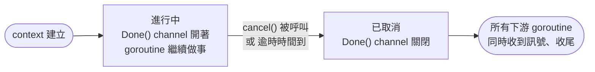
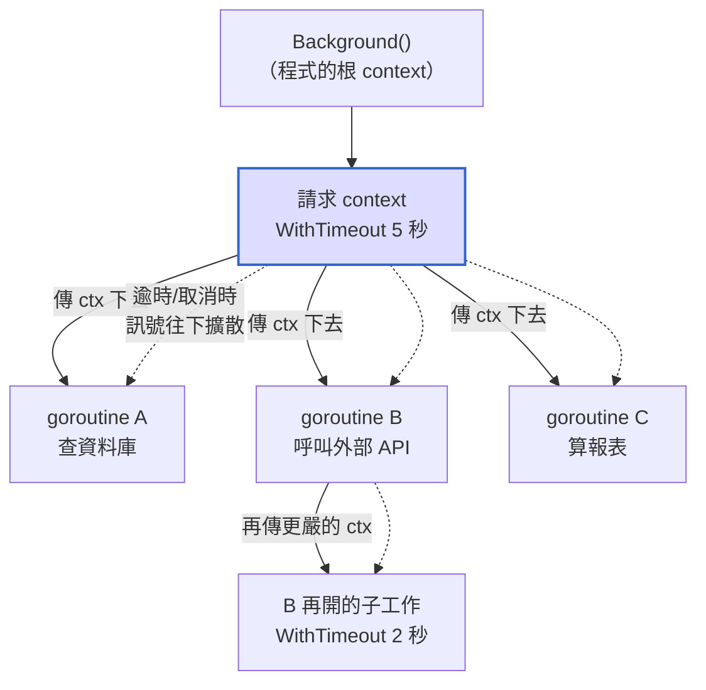

# [go-4-6] 🐹 `context`：取消、逾時，把「請求範圍」的訊號串下去

> **本章目標**：學會用 `context` 把「該停了」這個訊號，從最上游一路傳到所有下游 goroutine；學會設逾時、設取消；並學會 goroutine 收到取消訊號後該怎麼乾淨收尾。這是每一個正經的 Go 後端服務的骨架。

`go-4-5` 你學的 `WaitGroup` 是「**等**一群 goroutine 做完」。這章反過來——當上游決定「不用做了」（使用者關掉頁面、請求逾時、服務要關機），怎麼**通知**底下那一大串正在忙的 goroutine 統統收手？這就是 `context` 的工作，也是這整個 Part 裡對後端最關鍵的一章，值得慢慢嚼。

## 你會學到

- `context` 要解決什麼問題：怎麼把「取消」這個訊號傳給一整串 goroutine
- `context.WithCancel`：手動喊停
- `context.WithTimeout` / `WithDeadline`：時間到就自動喊停
- 怎麼把 context **一層一層往下傳**，形成一棵「取消會往下擴散」的樹
- goroutine 收到取消訊號後**該怎麼收尾**（`select` + `ctx.Done()`）
- `context.Value` 傳請求範圍的資料，以及為什麼要非常節制地用

## 概念說明

### 為什麼需要 context？一個會「洩漏 goroutine」的故事

想像一個後端 API：使用者發一個請求進來，你的 handler 為了湊齊回應，開了好幾個 goroutine 去做事——查資料庫、呼叫另一個服務、算一份報表。pseudo code：

```
處理請求(請求)：
    開 goroutine A：查資料庫
    開 goroutine B：呼叫外部 API
    開 goroutine C：算報表
    等這三個都好 → 組成回應送回去
```

現在使用者**在 A、B、C 還沒跑完時就關掉了瀏覽器**。你希望發生什麼？

- 理想：A、B、C 收到「不用做了」的通知，立刻停手、釋放資源（關掉資料庫查詢、斷開外部連線）。
- 現實（如果你沒處理）：A、B、C **渾然不知**，繼續把那個沒人要的報表算完、繼續佔著資料庫連線。使用者走了，這些 goroutine 還在耗 CPU、佔連線——這叫 **goroutine 洩漏（goroutine leak）**。請求量一大，洩漏的 goroutine 越積越多，服務最後被拖垮。

問題的核心是：**goroutine 之間沒有父子關係，上游沒有一個內建的辦法去「叫停」下游。** `go` 出去的 goroutine 就像斷了線的風箏，你喊不回來。

`context` 就是補上這條線的工具。它給你一個**可以廣播「停！」訊號的物件**，你把它一路傳給所有下游 goroutine；上游一喊停，所有拿著這個 context 的 goroutine 都會收到。

### context 的核心：一個 `Done()` channel

`context.Context` 是一個介面（`go-2-3` 的 interface），它最核心的方法是：

```
Done() → 回傳一個 channel
```

這個 channel 平常是「空的、讀不出東西」（會阻塞）。一旦 context 被取消或逾時，**這個 channel 會被關閉**。還記得 `go-4-2`／`go-4-3` 的規矩嗎——**從一個已關閉的 channel 讀，會立刻回傳（不阻塞）**。所以 goroutine 只要用 `select` 盯著 `ctx.Done()`，就能在「被取消的那一刻」立刻知道：

```
goroutine 的主迴圈：
    select：
        收到 ctx.Done()（channel 被關了）→ 代表要取消了，收尾、return
        否則 → 繼續做手上的事
```



這張圖在說：context 一開始是「進行中」，`Done()` channel 開著、goroutine 照常做事；一旦被取消或逾時，狀態變成「已取消」、`Done()` channel 關閉，所有在 `select` 等它的 goroutine 同時被喚醒去收尾。

### 取消訊號怎麼「往下擴散」——context 是一棵樹

`context` 真正強大的地方，是它會**長成一棵樹**。你每次用一個 context 去「衍生」出新的 context（加上取消、加上逾時），新的就成為舊的**子節點**。規則只有一條，但威力很大：

> **父 context 一取消，它底下所有的子孫 context 全部一起取消。**

這正好對應後端的現實：一個請求（最上游）被取消，它底下為了這個請求而開的所有工作（子孫）都該一起停。



這張圖是本章的核心，請看懂它：

- 最上面 `context.Background()` 是**根**——程式啟動時就有的、永不取消的空 context，一切從它衍生。
- 請求進來，從根衍生出一個帶 5 秒逾時的「請求 context」。這個 context 被**當參數一路傳**給 A、B、C。
- B 自己又衍生出一個更嚴格（2 秒）的子 context 給它的子工作 B1。
- 當「請求 context」逾時或被取消，**虛線代表的取消訊號會往下擴散到 A、B、C，連 B 底下的 B1 也一起被取消**——整棵子樹瞬間收到「停」。
- 反過來，子節點取消（例如 B1 自己 2 秒逾時）**不會**往上影響父節點。訊號只往下，不往上。

把「傳 context」想成「發給每個下游一支連著總開關的對講機」：上游按下總開關，所有對講機同時響。

### 鐵則：context 一定當第一個參數傳，不要塞進 struct

Go 的慣例非常明確：**context 透過函式參數一層一層往下傳，而且固定當第一個參數、命名為 `ctx`。**

```go
func handleRequest(ctx context.Context, req Request) error
func queryDatabase(ctx context.Context, id int) (Row, error)
```

為什麼不乾脆存進某個 struct 欄位、省得每個函式都要帶？因為 context 代表的是**「這一次請求/呼叫的生命週期」**——它是跟著「這一趟呼叫」走的，不是跟著某個物件走的。存進 struct 會讓「這個 context 到底管哪段生命週期」變得模糊，也容易把早就該取消的舊 context 留著用。所以：**context 用傳的，不用存的。**

## 程式碼範例

### 範例一：`WithCancel` —— 手動喊停一群 worker

情境：開三個 worker 一直做事，主程式在某個時刻決定喊停，三個 worker 都要收到並乾淨退出。

```go
package main

import (
	"context"
	"fmt"
	"sync"
	"time"
)

func worker(ctx context.Context, id int, wg *sync.WaitGroup) {
	defer wg.Done()
	for {
		select {
		case <-ctx.Done():
			// Done() channel 被關 → 收到取消訊號，收尾後退出
			fmt.Printf("worker %d 收到取消訊號（%v），收尾退出\n", id, ctx.Err())
			return
		default:
			// 沒被取消，繼續做一小段工作
			time.Sleep(50 * time.Millisecond)
		}
	}
}

func main() {
	// 從根 context 衍生出一個「可手動取消」的 context 和它的 cancel 函式
	ctx, cancel := context.WithCancel(context.Background())

	var wg sync.WaitGroup
	for id := 1; id <= 3; id++ {
		wg.Add(1)
		go worker(ctx, id, &wg)
	}

	time.Sleep(200 * time.Millisecond)
	cancel()  // ← 按下總開關：三個 worker 的 ctx.Done() 同時被關閉
	wg.Wait() // 等三個都確實收尾退出（go-4-5）
	fmt.Println("全部 worker 已退出")
}
```

逐項說明：

- `context.WithCancel(parent)` 回傳**兩個東西**：新的 `ctx`，和一個 `cancel` 函式。呼叫 `cancel()` 就是「按下總開關」，會關閉這個 ctx 的 `Done()` channel。
- 每個 worker 的主迴圈用 `select` 同時看兩件事：`ctx.Done()`（要不要停）和 `default`（還沒停就繼續做）。這是收取消訊號的標準骨架。
- `ctx.Err()` 告訴你**為什麼被取消**：手動取消是 `context.Canceled`，逾時是 `context.DeadlineExceeded`。
- 這段程式印出三行「worker N 收到取消訊號」後，`main` 才印「全部已退出」——證明 `cancel()` 的訊號確實傳到了三個 goroutine，而且 `main` 有等它們收尾（靠 `WaitGroup`）。

> **關鍵習慣：`cancel` 一定要被呼叫，而且最好 `defer cancel()`。** 下一個範例會解釋為什麼——就算 context 會逾時自動取消，你也還是要呼叫 `cancel`，否則會洩漏資源。

### 範例二：`WithTimeout` —— 時間到自動喊停（後端最常用）

情境：呼叫一個可能很慢的下游（這裡用 `fetchData` 模擬一個要 2 秒的工作），但我們最多只肯等 500 毫秒，逾時就放棄。

```go
package main

import (
	"context"
	"errors"
	"fmt"
	"time"
)

func fetchData(ctx context.Context) (string, error) {
	result := make(chan string, 1) // 緩衝 1：就算沒人收，送資料的 goroutine 也不會卡住洩漏
	go func() {
		time.Sleep(2 * time.Second) // 模擬一個很慢的工作
		result <- "資料"
	}()

	select {
	case <-ctx.Done():
		// 還沒拿到資料，ctx 就先逾時/取消了 → 回報錯誤，不再傻等
		return "", ctx.Err()
	case data := <-result:
		return data, nil
	}
}

func main() {
	// 從根衍生一個「最多活 500 毫秒」的 context
	ctx, cancel := context.WithTimeout(context.Background(), 500*time.Millisecond)
	defer cancel() // 無論如何都要呼叫，釋放這個 context 相關的資源

	data, err := fetchData(ctx)
	if err != nil {
		if errors.Is(err, context.DeadlineExceeded) {
			fmt.Println("逾時了，放棄等待")
		}
		return
	}
	fmt.Println("拿到", data)
}
```

說明：

- `context.WithTimeout(parent, 500ms)`：衍生一個「500 毫秒後自動取消」的 context。時間一到，它的 `Done()` channel 自動關閉，效果和有人幫你呼叫 `cancel()` 一樣。因為 `fetchData` 要 2 秒，所以這段一定走 `ctx.Done()` 那條路，印出「逾時了」。
- `defer cancel()` —— **為什麼逾時會自動取消，還要呼叫 cancel？** 因為 `WithTimeout` 底層會**開一個計時器並登記這個 context**；如果工作其實很快就做完了（沒等到逾時），計時器還掛在那裡等。`cancel()` 的作用是「我用完了，提早把計時器和登記清掉」。不呼叫它，`go vet` 會警告 `the cancel function is not used on all paths`，而且在高流量下會累積出資源洩漏。所以規矩是：**`WithTimeout`/`WithCancel` 回傳的 cancel，拿到就馬上 `defer cancel()`。**
- `errors.Is(err, context.DeadlineExceeded)` 用 `go-3-2` 學的錯誤比對，分辨「是逾時」還是別的錯誤。
- `WithDeadline` 和 `WithTimeout` 幾乎一樣，差別只在：`WithTimeout` 給「從現在起多久」，`WithDeadline` 給「到哪個絕對時間點為止」。底層同一套。

### 範例三：一層一層串下去，收到取消就一路放棄

情境：這是後端最真實的樣子——請求進來 → handler → service → 查資料庫，context 一路往下傳。上游設一個 100 毫秒的逾時，下游資料庫要 300 毫秒，逾時訊號會沿著這條鏈一路往下，讓最底層的查詢直接放棄。

```go
package main

import (
	"context"
	"fmt"
	"time"
)

// 最底層：模擬一個要 300 毫秒的資料庫查詢
func queryDatabase(ctx context.Context) error {
	select {
	case <-time.After(300 * time.Millisecond):
		return nil // 查完了
	case <-ctx.Done():
		return ctx.Err() // 上游喊停，立刻放棄查詢
	}
}

// 中間層：business logic，只是把 ctx 原封不動往下傳
func handleRequest(ctx context.Context) error {
	return queryDatabase(ctx)
}

func main() {
	// 上游：整個請求最多 100 毫秒
	ctx, cancel := context.WithTimeout(context.Background(), 100*time.Millisecond)
	defer cancel()

	if err := handleRequest(ctx); err != nil {
		fmt.Println("請求失敗：", err) // 印出：請求失敗： context deadline exceeded
		return
	}
	fmt.Println("請求成功")
}
```

說明：

- 注意 `handleRequest` 自己**沒有對 context 做任何事**，只是把 `ctx` 當第一個參數繼續往下傳。這就是「串下去」——中間層通常不需要碰 context，只負責傳遞。
- 真正響應取消的是最底層 `queryDatabase`：它用 `select` 同時等「查詢完成」和「`ctx.Done()`」。上游 100 毫秒一到，`ctx.Done()` 先觸發，查詢直接回傳 `context.DeadlineExceeded`，不會傻等到 300 毫秒。
- 這就是 context 的價值：**上游設一次逾時，底下整條呼叫鏈都自動遵守**。你不需要在每一層都重新計時。
- 真實的 `database/sql`、`net/http` 這些標準庫本身就吃 context（例如 `db.QueryContext(ctx, ...)`、`http.NewRequestWithContext(ctx, ...)`），你把 ctx 傳進去，它們內部就會在 ctx 取消時主動中斷——你會在 `go-6-3`、`go-6-4` 用到。

### goroutine 收到取消後，「收尾」要做什麼？

「收到 `ctx.Done()` 就 `return`」只是最低標。一個負責任的 goroutine 收到取消訊號後，應該像 `go-3-3` 的 `defer` 收尾那樣，把借出去的東西還回去（`CLAUDE.md` 說的「成對的東西要成對」）：

```
收到取消訊號後，退出前：
    - 關掉自己開的檔案、連線
    - 停掉自己起的計時器、ticker
    - 通知自己底下再開的 goroutine 也停（如果有的話）
    - 把「我被取消了」這件事回報給上游（通常是回傳 ctx.Err()）
```

**不要做的事**：收到取消就無聲無息地吞掉、假裝成功回傳。取消是一個真實的結果，要誠實往上回報（回傳 `ctx.Err()`），讓上游知道「這件事沒做完、是被取消的」——這呼應 `go-3-1` 的「錯誤是值、該往上傳就往上傳」。

### `context.Value`：可以傳資料，但要非常節制

context 還能攜帶一點「請求範圍」的資料，用 `context.WithValue(ctx, key, value)` 放、`ctx.Value(key)` 取。合理的用途**只有**：跨越整個請求、但又不屬於任何一個函式參數的「中介資料」，例如一條請求的追蹤 ID（trace ID）、經過驗證的使用者身分。

> **常見錯誤 — 把 context 當成萬能的參數袋：**
> ```go
> // ❌ 不要用 context.Value 傳函式「本來就該明寫」的參數
> ctx = context.WithValue(ctx, "userID", 42)
> ctx = context.WithValue(ctx, "pageSize", 20)
> // 然後在深處 ctx.Value("pageSize").(int) 硬拆出來用
> ```
> 問題有三個：(1) 這些值是 `any` 型別，取出來要做型別斷言（`go-2-4`），編譯器幫不了你，打錯 key 或型別只會在執行期炸；(2) 看函式簽名完全不知道它偷偷依賴了哪些 context value，可讀性差；(3) 必要的參數被藏起來，違反「依賴要明講」。
> **正確做法**：`pageSize`、`userID` 這種函式邏輯需要的東西，就老實當**一般參數**傳。context 只放那種「每一層都可能要、但又不想污染每個函式簽名」的橫切資料（trace ID 之類），而且 key 要用自訂型別避免撞名。

## 小練習

1. **基本取消**：改寫範例一，改成開 5 個 worker，每個 worker 每 100 毫秒印一次「我還在做」。主程式 500 毫秒後呼叫 `cancel()`，確認 5 個 worker 都會停下來並印出退出訊息。
2. **逾時與正常完成都要對**：改寫範例二的 `fetchData`，讓那個「慢工作」只睡 300 毫秒。把逾時分別設成 500 毫秒和 100 毫秒各跑一次，確認前者印出「拿到 資料」、後者印出「逾時了」。
3. **思考題**：如果你在 `fetchData` 裡把送資料的 channel 寫成**無緩衝**（`make(chan string)`），而且上游逾時先發生、`fetchData` 走了 `ctx.Done()` 那條 return 了——那個還在睡、醒來要往 channel 送資料的 goroutine 會發生什麼事？（提示：沒人收，它會卡在哪裡？這和「緩衝 1」有什麼差別？）

<details>
<summary>參考解答</summary>

**第 1 題（5 個 worker，定時印、500ms 後取消）**

```go
package main

import (
	"context"
	"fmt"
	"sync"
	"time"
)

func worker(ctx context.Context, id int, wg *sync.WaitGroup) {
	defer wg.Done()
	ticker := time.NewTicker(100 * time.Millisecond)
	defer ticker.Stop() // 成對：起了 ticker 就要停（go-4-5 / CLAUDE.md）

	for {
		select {
		case <-ctx.Done():
			fmt.Printf("worker %d 退出\n", id)
			return
		case <-ticker.C:
			fmt.Printf("worker %d 我還在做\n", id)
		}
	}
}

func main() {
	ctx, cancel := context.WithCancel(context.Background())
	var wg sync.WaitGroup
	for id := 1; id <= 5; id++ {
		wg.Add(1)
		go worker(ctx, id, &wg)
	}
	time.Sleep(500 * time.Millisecond)
	cancel()
	wg.Wait()
	fmt.Println("全部退出")
}
```

驗收點：每個 worker 在 500 毫秒內大約印 4~5 次「我還在做」，`cancel()` 後五個都印出「退出」，最後 `main` 印「全部退出」。注意用 `time.NewTicker` 時記得 `defer ticker.Stop()`——這也是「成對」原則：起了計時器就要停，否則計時器會洩漏。

**第 2 題（慢工作 300ms，逾時 500ms vs 100ms）**

把範例二的 `time.Sleep(2 * time.Second)` 改成 `time.Sleep(300 * time.Millisecond)`：

- 逾時設 500 毫秒：工作 300 毫秒就做完，`result` 那條 case 先觸發 → 印「拿到 資料」。
- 逾時設 100 毫秒：100 毫秒先到，`ctx.Done()` 先觸發 → 印「逾時了」。

這驗證了 `select` 是「誰先好就走誰」，而 context 的逾時只是其中一個競爭者。

**第 3 題（無緩衝 channel 的洩漏）**

如果 `result` 是無緩衝 channel（`make(chan string)`），送方必須**等到有人同時在收**才能送出去。但 `fetchData` 已經因為逾時走 `ctx.Done()` return 了，`select` 不再去收 `result`——於是那個睡醒的 goroutine 執行 `result <- "資料"` 時**永遠卡住**（沒有收方），再也不會結束。這就是一個 **goroutine 洩漏**：它會一直佔著記憶體直到程式結束。

用**緩衝 1**（`make(chan string, 1)`）就解決了：緩衝區能先收下那一個值，送方不必等收方，送完就能正常結束、被回收。這是「開了 goroutine 去算、但上游可能提早放棄」時的標準保險做法——給它一個不會卡住送方的出口。

</details>

## 課外讀物

> 「收到關機訊號就排空進行中的請求再退出」——context 在優雅關機（graceful shutdown）裡怎麼用，是可靠服務的基本功，本課後面會專門做一章 → `go-7-5` 優雅關機與 `context`

> 為什麼「可取消、可逾時」是線上服務的韌性底線（逾時、重試、熔斷這一整套） → 參見 **[sre 課程大綱](../../sre/課程大綱.md)**；並行與請求生命週期的底層概念 → 參見 **[cs 課程大綱](../../cs/課程大綱.md)**

> 下一章：前兩章都在教你「怎麼寫對」，下一章反過來——當你**沒**寫對、goroutine 偷偷同時讀寫同一塊記憶體時，那個看不見的 bug 怎麼被工具抓出來 → `go-4-7` 資料競爭與 `-race`
