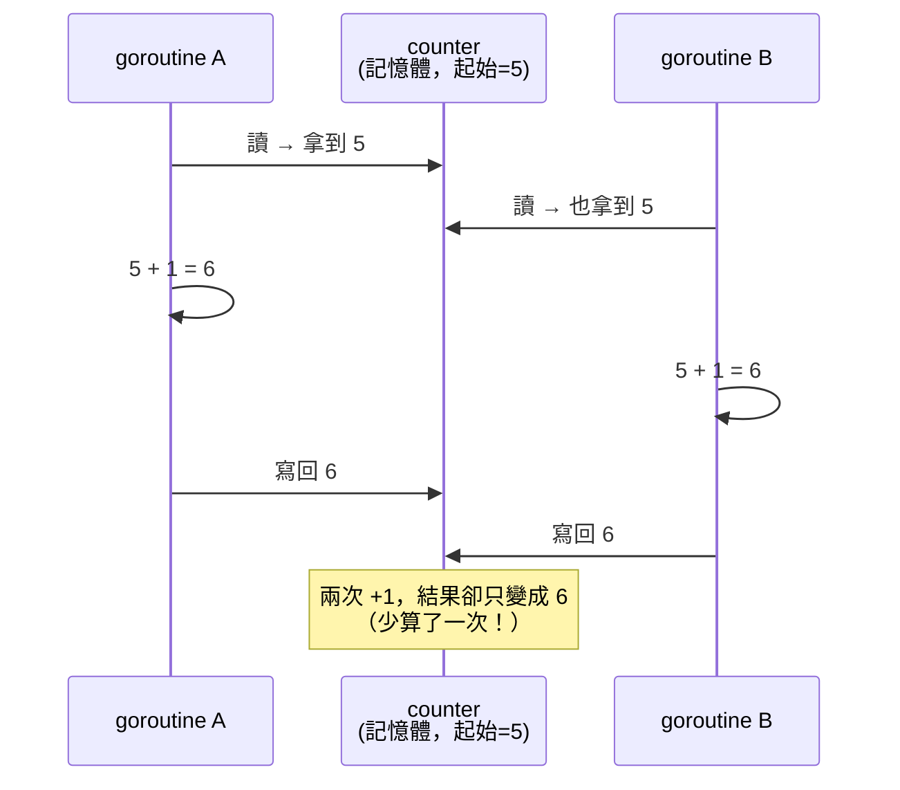
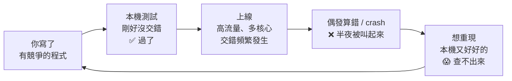

# [go-4-7] 資料競爭（data race）與 `-race`：看不見的並行 bug 怎麼抓

> **本章目標**：理解什麼是資料競爭、為什麼它特別難抓；學會用 Go 內建的 `-race` 偵測器把它當場揪出來；並學會三種修法。這是你寫並行程式時最實用的防身術。

走到這裡，Part 4 的工具你都有了：goroutine（`go-4-1`）、channel（`go-4-2`）、`select`（`go-4-3`）、並行模式（`go-4-4`）、`sync`（`go-4-5`）、`context`（`go-4-6`）。這一章不是教新工具，而是教你怎麼抓一種**最陰險的 bug**——它平常不報錯、測試常常過、demo 給老闆看也好好的，上線後在高流量下偶爾算錯、偶爾 crash，而且你在本機怎麼重現都重現不出來。這就是資料競爭。好消息是：Go 內建一個幾乎像作弊的工具能直接抓它。

## 你會學到

- 什麼是資料競爭（data race），為什麼它「看不見」又難重現
- 用 `go run -race` / `go test -race` 把競爭當場抓出來
- 怎麼讀 `-race` 的報告（它會直接告訴你哪兩行在打架）
- 三種修法：`sync.Mutex`、`sync/atomic`、channel，各適合什麼情況

## 概念說明

### 什麼是資料競爭

一句話定義：

> **資料競爭 = 兩個以上的 goroutine 同時存取同一塊記憶體，其中至少一個是寫入，而且沒有任何同步機制（鎖、channel…）協調它們。**

為什麼這會出事？因為一個看起來「一步」的操作，對 CPU 來說常常是**好幾步**。拿 `go-4-5` 看過的 `counter++` 來說，它其實是：

```
第 1 步：從記憶體讀出 counter 目前的值
第 2 步：把值加 1
第 3 步：把結果寫回記憶體
```

兩個 goroutine 同時做這三步，就可能這樣交錯：



這張圖在說：A 和 B 都讀到舊值 5，各自加 1 都算出 6，先後寫回去——兩次加法最後只生效一次。`go-4-5` 的練習裡，1000 次加法常常只剩 900 多，就是這麼丟失的。

而且丟幾次、什麼時候丟，**完全看 CPU 當下怎麼排程**，每次跑都不一樣。更糟的是：競爭不只會「算錯數字」，還可能在讀寫像 `map`、slice 這種有內部結構的資料時，讓資料結構本身壞掉，直接 crash。

### 為什麼它特別可怕



這張圖在說資料競爭的惡性循環：它取決於時序（timing），而本機負載低、核心閒，交錯很難發生，所以測試常常矇混過關；一上到高流量多核心的正式環境，交錯頻繁發生就出事；等你想重現，本機又重現不出來。**它是一種「你看不見、靠運氣沒爆」的 bug。**

所以你不能靠「多跑幾次看看會不會錯」來確認安全——沒錯不代表沒競爭，只代表這次沒交錯到。你需要一個能**直接偵測「有沒有未同步的共享存取」**的工具，而不是碰運氣。

### Go 的解法：`-race` 偵測器

Go 工具鏈內建一個 **race detector（競爭偵測器）**，只要在跑程式或測試時加上 `-race` 這個旗標，Go 會幫你的程式裝上「監視器」，**實際監看每一次記憶體存取**：一旦發現「兩個 goroutine 存取同一位址、至少一個在寫、而且中間沒有任何同步」，它就立刻印出一份詳細報告，告訴你是哪兩行、哪兩個 goroutine 在打架。

```
go run  -race ./...   ← 跑程式時偵測
go test -race ./...   ← 跑測試時偵測（最常用，接進 CI）
go build -race        ← 編出帶偵測器的執行檔
```

它的厲害之處是：**只要那次執行真的發生了未同步存取，不管有沒有造成看得見的錯誤，它都會抓到**。不用你剛好「算錯」才看得出來。代價是加了 `-race` 後程式會變慢（大約慢 2～10 倍）、更吃記憶體，所以它用在開發和測試階段，不會開在正式環境。

## 程式碼範例

### 步驟一：寫一個真的會 race 的程式

這是 `go-4-5` 範例二「拿掉鎖」的版本——1000 個 goroutine 同時對一個 `counter` 加 1，沒有任何保護：

```go
package main

import (
	"fmt"
	"sync"
)

func main() {
	counter := 0
	var wg sync.WaitGroup
	for i := 0; i < 1000; i++ {
		wg.Add(1)
		go func() {
			defer wg.Done()
			counter++ // ← 多個 goroutine 無保護地同時寫，資料競爭就在這
		}()
	}
	wg.Wait()
	fmt.Println("最終 counter =", counter)
}
```

直接 `go run` 它（不加 `-race`），你會看到數字時而 1000、時而 900 多，每次不一樣——但程式**不會報錯**，它以為自己好好的。這正是危險所在。

### 步驟二：用 `-race` 把它抓出來

同一支程式，改用 `go run -race` 跑：

```
go run -race main.go
```

偵測器立刻印出類似這樣的報告（節錄）：

```
==================
WARNING: DATA RACE
Read at 0x00c000012178 by goroutine 14:
  main.main.func1()
      /.../main.go:15 +0x68

Previous write at 0x00c000012178 by goroutine 6:
  main.main.func1()
      /.../main.go:15 +0x78

Goroutine 14 (running) created at:
  main.main()
      /.../main.go:13 +0x6c
...
==================
最終 counter = 915
Found 2 data race(s)
exit status 66
```

怎麼讀這份報告——它已經把兇手指給你看了：

- **`WARNING: DATA RACE`**：抓到競爭。
- **`Read at ... by goroutine 14` / `Previous write at ... by goroutine 6`**：同一個記憶體位址（`0x...12178`，就是 `counter`），goroutine 14 在讀、goroutine 6 之前在寫，兩者沒同步——這就是打架的兩方。
- 兩邊都指到 **`main.go:15`**，正是 `counter++` 那一行。偵測器直接把出問題的**行號**標給你。
- `Goroutine ... created at ... main.go:13`：告訴你這些 goroutine 是在第 13 行（`go func()`）被開出來的，方便你回溯。
- 最後 `Found 2 data race(s)`、`exit status 66`：加了 `-race` 後，一偵測到競爭，程式會以非零狀態結束——所以把 `go test -race` 接進 CI，有競爭就會讓建置失敗，擋在上線之前。

### 步驟三：三種修法

**修法 A：`sync.Mutex`（最通用）**

用 `go-4-5` 的鎖把 `counter++` 包起來，讓一次只有一個 goroutine 能改：

```go
package main

import (
	"fmt"
	"sync"
)

func main() {
	counter := 0
	var mu sync.Mutex
	var wg sync.WaitGroup
	for i := 0; i < 1000; i++ {
		wg.Add(1)
		go func() {
			defer wg.Done()
			mu.Lock()
			counter++
			mu.Unlock()
		}()
	}
	wg.Wait()
	fmt.Println("最終 counter =", counter) // 永遠 1000
}
```

適用：保護任何共享狀態，尤其臨界區裡不只一個動作（例如同時改好幾個欄位、操作 `map`）。最泛用，不確定用哪個就用它。

**修法 B：`sync/atomic`（只做簡單數值運算時最快）**

如果共享的就只是一個數字、要做的只是「加、減、讀、設定」，可以用 `sync/atomic` 提供的**原子操作**——它靠 CPU 指令保證「讀-改-寫」一步到位、不會被打斷，不需要鎖：

```go
package main

import (
	"fmt"
	"sync"
	"sync/atomic"
)

func main() {
	var counter atomic.Int64 // 原子整數
	var wg sync.WaitGroup
	for i := 0; i < 1000; i++ {
		wg.Add(1)
		go func() {
			defer wg.Done()
			counter.Add(1) // 原子地加 1，不會被另一個 goroutine 打斷
		}()
	}
	wg.Wait()
	fmt.Println("最終 counter =", counter.Load()) // 永遠 1000
}
```

適用：**單純的計數器、旗標（flag）這類簡單數值**。比 `Mutex` 輕量。但它只能做它提供的那幾種單一操作——一旦你的臨界區是「改完 A 再根據 A 改 B」這種複合邏輯，`atomic` 就不夠，得回去用 `Mutex`。

**修法 C：channel（把共享變成「不共享」）**

回到 Go 的本心（`go-4-5` 開頭那句話）：與其讓大家搶著改同一個變數，不如讓**只有一個 goroutine 擁有這個 counter**，其他人要加就透過 channel「送一個 +1 的請求」給它。這樣 counter 根本不被共享，自然沒有競爭：

```go
package main

import (
	"fmt"
	"sync"
)

func main() {
	increments := make(chan int)
	done := make(chan int)

	// 只有這一個 goroutine 碰 counter，它是 counter 的唯一主人
	go func() {
		counter := 0
		for n := range increments { // 一次處理一個請求，天生不會衝突
			counter += n
		}
		done <- counter // channel 關閉後，回報最終值
	}()

	var wg sync.WaitGroup
	for i := 0; i < 1000; i++ {
		wg.Add(1)
		go func() {
			defer wg.Done()
			increments <- 1 // 不自己改，而是送「加 1」的訊息
		}()
	}
	wg.Wait()
	close(increments) // 送完了，關閉 channel，讓主人跳出 range（go-4-4 的收尾規矩）
	fmt.Println("最終 counter =", <-done)
}
```

適用：當「狀態歸屬某個流程/擁有者」比「一塊大家共用的資料」更貼近你的問題時。它程式碼比上鎖多一點，但把「誰能碰這個資料」講得一清二楚，常常更好維護、更不容易出錯。

**三種都用 `go run -race` 跑過，都乾淨無警告、結果都是 1000。** 你可以自己驗證：把這三個版本和步驟一的壞版本各跑一次 `-race`，只有壞版本會報 `DATA RACE`。

### 怎麼選？

```
只是一個計數器 / 旗標，做簡單加減讀寫 → atomic（最輕）
要保護一塊狀態、臨界區有多個動作或操作 map → Mutex（最通用）
這塊狀態天生屬於某個流程、適合「交給一個主人管」 → channel（最 Go 風，意圖最清楚）
```

沒有哪個「最好」——看你的資料更像「大家共用的一塊記憶體」還是「在流程間流動的東西」。但無論選哪個，**最後都用 `-race` 驗證一次**，別靠肉眼和運氣。

> **常見錯誤 — 以為「多跑幾次沒錯就是安全」：**
> 資料競爭是否爆發取決於時序，本機低負載時很可能一直矇混過去。**「跑了 100 次都對」證明不了沒有競爭**，只證明這 100 次沒交錯到。唯一可靠的判斷是 `go test -race` 乾淨通過。把它接進 CI，當成並行程式的標準配備。

## 小練習

1. **親手抓一次**：把步驟一那支會 race 的程式打出來，先 `go run` 跑幾次看數字飄來飄去，再 `go run -race` 跑一次，讀讀看報告指到哪一行。
2. **換個會壞的資料**：寫一個程式，開 50 個 goroutine 同時往同一個 `map[int]int` 寫入（`m[i] = i`）。先不加 `-race` 跑，看會不會 crash（`fatal error: concurrent map writes`）；再加 `-race`，比較兩者的訊息有什麼不同。然後用 `sync.Mutex` 修好它。
3. **思考題**：修法 B 的 `atomic` 能做「加 1」，但假設你的需求是「如果 counter 還沒超過 100 就加 1，超過就不加」——這個「先判斷再加」的複合邏輯，為什麼不能只靠 `atomic.Add`？該換成哪種修法？

<details>
<summary>參考解答</summary>

**第 1 題（親手抓）**

重點在讀報告：`Read at 0xXXX` 和 `Previous write at 0xXXX` 是同一個位址，兩邊的堆疊都指向 `counter++` 那一行，`Goroutine N created at` 指向 `go func()` 那一行。看懂這三個資訊，你就知道「哪個變數、哪一行、哪裡開的 goroutine」在競爭。`exit status 66` 代表偵測器讓程式以錯誤狀態結束。

**第 2 題（並行寫 map）**

會 race 的版本：

```go
package main

import "sync"

func main() {
	m := make(map[int]int)
	var wg sync.WaitGroup
	for i := 0; i < 50; i++ {
		wg.Add(1)
		go func(n int) {
			defer wg.Done()
			m[n] = n // 多個 goroutine 同時寫同一個 map
		}(i)
	}
	wg.Wait()
}
```

- 不加 `-race`：Go runtime 內建對 map 並行寫的偵測，常會直接 `fatal error: concurrent map writes` 讓程式 crash（這是 runtime 的保護，不是 race detector）。
- 加 `-race`：會先印出 `WARNING: DATA RACE` 的詳細報告，指出是哪兩行在爭這個 map——資訊比 fatal error 完整得多，告訴你確切位置。

修好（用 Mutex 包住每次寫入；注意迴圈變數 `i` 要當參數傳進去，見 `go-4-5`）：

```go
package main

import "sync"

func main() {
	m := make(map[int]int)
	var mu sync.Mutex
	var wg sync.WaitGroup
	for i := 0; i < 50; i++ {
		wg.Add(1)
		go func(n int) {
			defer wg.Done()
			mu.Lock()
			m[n] = n
			mu.Unlock()
		}(i)
	}
	wg.Wait()
}
```

加 `-race` 跑這個修好的版本，乾淨無警告。

**第 3 題（為什麼複合邏輯不能只靠 atomic.Add）**

「如果還沒超過 100 就加 1」是**兩個動作**：先讀出目前值判斷、再決定要不要加。`atomic.Add` 只能原子地「加」，不能原子地「讀出來、判斷、再決定加不加」。如果你拆成 `if counter.Load() < 100 { counter.Add(1) }`，那「Load 判斷」和「Add」之間有空隙——兩個 goroutine 可能同時讀到 99、都通過判斷、都加 1，結果變成 101，超過了。

這種「讀-判斷-寫」要當成**一個不可分割的整體**來保護，正是 `Mutex` 的場景：用 `mu.Lock()` 把整段 `if ... { ... }` 包起來。（`atomic` 其實也有 `CompareAndSwap` 能處理某些這類情況，但邏輯一複雜就不如 `Mutex` 直覺——先學會用 `Mutex` 包住複合臨界區。）

</details>

## 課外讀物

> 競爭條件（race condition）、記憶體一致性、為什麼多核心下「讀寫順序」不如你想的直覺——完整的作業系統與並行底層 → 參見 **[cs 課程大綱](../../cs/課程大綱.md)** 的並行章節

> 另一種語言的對照：Rust 選擇在**編譯期**就用所有權規則擋掉資料競爭（能編譯過就沒有 race），而 Go 選擇在**執行期**用 `-race` 偵測——兩種哲學各有取捨，對照著看很有收穫 → 參見 **[rust 課程大綱](../../rust/課程大綱.md)** 的並行章節

> 恭喜，你翻過了 Part 4 這座「本書心臟」的山。接下來 Part 5 會教你怎麼把 `-race` 接進測試、把專案組織好 → `go-5-3` 寫測試（Go 招牌的 table-driven test）
