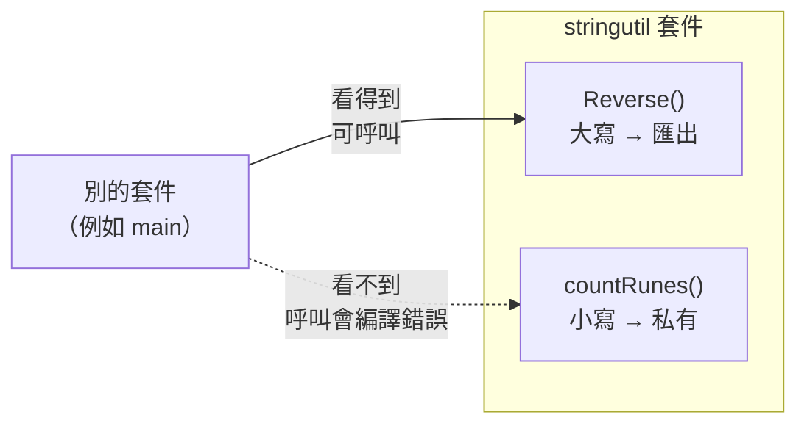

# [go-5-1] package 與可見性：大寫開頭＝對外匯出，`import` 與套件怎麼切

> **本章目標**：理解 Go 用「package（套件）」當程式碼的組織單位，學會用「名字的第一個字母大小寫」控制誰看得到誰——這是 Go 刻意做到極簡的存取控制，也是你把專案切成多個檔案、多個套件時的第一條規矩。

前面四個 Part，你的程式幾乎都擠在一個 `package main` 裡。真正的專案不會這樣——程式碼會被切成好幾個套件，各管一塊。這一章就講 Go 怎麼切、怎麼決定「哪些東西給外面用、哪些藏起來」。

## 你會學到

- `package` 是什麼：Go 組織程式碼的基本單位，和「資料夾」的對應關係
- `package main` 為什麼特別：它是「能編成執行檔」的那一種
- Go 的存取控制有多簡單：**名字第一個字母大寫＝匯出（exported），小寫＝套件私有**
- `import` 怎麼用：匯入路徑、套件別名、`_` 空白匯入
- 怎麼把一包程式碼合理地切成多個套件（以及「不要切太細」的取捨）

## 概念說明

### 套件就是「一個資料夾裡的一群 `.go` 檔」

先給一個生活類比：套件（package）就像**辦公室裡的一個部門**。同一個部門（套件）的人共用資料、彼此直接喊名字就找得到；跨部門要合作，就得走「對外窗口」——只有掛牌對外的人（匯出的名字）別的部門才找得到。

Go 的規則很機械，記住兩句就好：

- **一個資料夾 = 一個套件。** 同一個資料夾底下所有 `.go` 檔，開頭都要宣告同一個 `package 名字`。
- **同一個套件裡的檔案，彼此看得到所有東西**，不用 `import` 對方——它們本來就是同一個部門的人。

```
stringutil/              ← 這個資料夾是一個套件
├── reverse.go           package stringutil
└── count.go             package stringutil   （和上面同一包，互相直接用）
```

`reverse.go` 和 `count.go` 雖然是兩個檔案，但同屬 `stringutil` 這個套件，所以 `reverse.go` 裡的函式可以直接呼叫 `count.go` 裡的函式，不用匯入。**檔案只是給人看的分割，套件才是 Go 眼中的單位。**

### `package main` 是特別的那一個

你會看到兩種套件：

```
package main          // 特別：這包會被編成一個「可執行檔」，而且必須有一個 func main()
package stringutil    // 一般：這是「函式庫」套件，給別人 import 來用，自己不能直接跑
```

`package main` 就是程式的進入點所在——`go build` 看到 `main` 套件才知道「要產一個執行檔」，然後從 `func main()` 開始跑。其他名字的套件都是**函式庫**，它們不能自己跑，只能被 import。

### 可見性：唯一的規則是「名字的第一個字母」

這是 Go 最有個性的設計之一。別的語言用 `public`／`private`／`protected` 一堆關鍵字管存取，Go **一個關鍵字都不用**，只看名字：

> **一個名字（變數、常數、函式、型別、struct 欄位、方法）的第一個字母——大寫就是「匯出（exported）」，套件外的人看得到、用得到；小寫就是「未匯出（unexported）」，只有同一個套件內部用得到。**

```go
package stringutil

func Reverse(s string) string { ... }   // 大寫 R → 匯出，別的套件可以 stringutil.Reverse(...)
func countRunes(s string) int { ... }   // 小寫 c → 私有，只有 stringutil 內部能用
```



這張圖在說：站在套件外面（例如 `main`），只有大寫開頭的 `Reverse` 伸得進去用；小寫的 `countRunes` 像關在部門內部，外面碰不到。想改一個名字的「公開/私有」，不用改宣告關鍵字，**改第一個字母的大小寫就好**。

這個設計逼你養成一個好習慣：**預設把東西設成私有（小寫），只有真的要給別人用的才大寫匯出。** 匯出的東西越少，你之後能自由改動的空間越大——因為沒人依賴的東西，你改了不會弄壞別人。這正是「最小公開介面」的精神。

> 「只對外公開必要的最小介面、其餘藏起來」這條原則，在物件導向叫封裝、在介面設計叫 ISP → **[課外讀物 E-7-5] I — Interface Segregation Principle**：[I — Interface Segregation Principle](../../../課外讀物/E-7-solid/E-7-5-isp.md)

### `import`：把別的套件請進來

要用別的套件的東西，先 `import` 它的**匯入路徑**，之後用 `套件名.名字` 存取：

```go
import "strings"            // 標準庫套件

strings.ToUpper("hello")    // 用「套件名.函式名」呼叫
```

對你自己的套件，匯入路徑是**「模組路徑 + 資料夾相對路徑」**（模組是什麼，`go-5-2` 會講）。假設你的模組叫 `example.com/myapp`，底下有個 `stringutil` 資料夾：

```go
import "example.com/myapp/stringutil"

stringutil.Reverse("hello")
```

注意一個常見的誤會：**`import` 寫的是「路徑」，但程式裡用的是「套件名」**。多數情況資料夾名和套件名一樣（都叫 `stringutil`），所以感覺不出差別；但它們其實是兩件事。

### 套件該怎麼切？——按「職責」，不要按「型別」

初學者最常問：「我該把程式碼切成幾個套件？」Go 社群的共識是：**按功能職責切，一個套件是一個「有意義的能力單元」，而不是硬把每個 struct 拆成一個套件。**

```
// 好的切法：按職責
myapp/
├── main.go           package main        （進入點、把各塊組起來）
├── stringutil/       package stringutil  （字串處理工具）
└── todo/             package todo         （待辦清單的資料與邏輯）

// 不好的切法：切太細、按型別硬拆
myapp/
├── user/             package user
├── userservice/      package userservice
├── userrepository/   package userrepository
└── usertypes/        package usertypes   （四個套件其實都在講同一件事）
```

切太細的壞處是：套件之間會為了互相拿資料而大量 `import`，甚至繞成一圈（Go **不允許套件循環 import**，A 匯入 B、B 又匯入 A 會直接編譯失敗）。寧可先讓一個套件大一點、長到真的有獨立職責了再拆。

> **常見錯誤** — 很多人剛學會分套件就切得過細：
> 把「一個 struct 配一個套件」當原則，結果十個型別切成十個套件。
> 問題是：這些套件彼此黏得很緊、天天互相 import，反而更難讀，還容易撞上「循環 import」的牆。
> 正確做法：先問「這段程式碼是一個能獨立描述的能力嗎？」（字串工具、待辦邏輯、HTTP 處理……）是，才給它一個套件。切套件是為了「隔開不相干的東西」，不是為了「每個檔案都有家」。

套件命名也有慣例：**用簡短、全小寫、單一名詞**（`strings`、`http`、`todo`），不要用底線或駝峰。而且套件名會變成呼叫端的前綴，所以別取 `util`、`common` 這種什麼都裝的名字——`util.DoThing()` 完全看不出在做什麼。

## 程式碼範例

### 範例一：把字串工具切成獨立套件，並用大小寫控制可見性

我們做一個小專案：一個 `stringutil` 套件提供字串工具，`main` 套件來用它。先看套件本身——注意兩個函式一個大寫（給外面用）、一個小寫（內部輔助）：

`stringutil/stringutil.go`：

```go
// package stringutil 提供一些小而通用的字串工具。
package stringutil

import "strings"

// Reverse 把字串反轉。大寫開頭 → 匯出，套件外可用。
// 注意用 []rune 轉換，才能正確處理中文等多位元組字元（見 go-1-2）。
func Reverse(s string) string {
	runes := []rune(s)
	for i, j := 0, len(runes)-1; i < j; i, j = i+1, j-1 {
		runes[i], runes[j] = runes[j], runes[i]
	}
	return string(runes)
}

// IsPalindrome 判斷是不是回文（正著讀、反著讀一樣）。
func IsPalindrome(s string) bool {
	normalized := normalize(s) // 直接呼叫同套件的私有函式，不用 import
	return normalized == Reverse(normalized)
}

// normalize 去掉空白、統一成小寫。小寫開頭 → 私有，只有 stringutil 內部用。
func normalize(s string) string {
	return strings.ToLower(strings.ReplaceAll(s, " ", ""))
}
```

`main.go`：

```go
package main

import (
	"fmt"

	"example.com/myapp/stringutil" // 匯入我們自己的套件
)

func main() {
	fmt.Println(stringutil.Reverse("hello"))        // olleh
	fmt.Println(stringutil.IsPalindrome("上海自來水來自海上")) // true

	// fmt.Println(stringutil.normalize("A B")) // ← 這行會編譯失敗！
	// normalize 是小寫開頭，對 main 套件不可見
}
```

說明：

- `stringutil` 套件裡，`IsPalindrome` 直接呼叫 `normalize`——因為它們是同一個套件的「同部門同事」，不用匯入也看得到彼此。
- `main` 只能用大寫的 `Reverse`、`IsPalindrome`；想碰小寫的 `normalize` 會在編譯期就被擋下（錯誤訊息類似 `undefined: stringutil.normalize` 或「unexported」）。這就是 Go 的存取控制——**編譯器照名字的大小寫執法**。
- `import` 區塊裡習慣把標準庫（`fmt`）和自己的套件（`example.com/...`）用空行分組，`gofmt` 和 `goimports` 會自動幫你排好。

### 範例二：struct 欄位的大小寫，決定欄位能不能被外面讀寫

可見性不只管函式，連 **struct 的每個欄位**都各自照自己的首字母決定公開或私有。這在設計型別時很有用——你可以只開放該開放的欄位：

`todo/todo.go`：

```go
package todo

import "fmt"

// Task 是一個待辦事項。
type Task struct {
	Title string // 大寫 → 外部可讀可寫
	Done  bool   // 大寫 → 外部可讀可寫
	id    int    // 小寫 → 私有，外部看不到，只有 todo 套件內部維護
}

// nextID 是套件層級的私有變數，用來發號；外部碰不到，保證 id 由套件自己掌控。
var nextID int

// NewTask 是建立 Task 的對外入口（建構子慣例：New 開頭）。
func NewTask(title string) Task {
	nextID++
	return Task{Title: title, id: nextID}
}

// Describe 讓外部能「看到」id 的內容，但不能直接改它。
func (t Task) Describe() string {
	status := "未完成"
	if t.Done {
		status = "已完成"
	}
	return fmt.Sprintf("#%d [%s] %s", t.id, status, t.Title)
}
```

`main.go`：

```go
package main

import (
	"fmt"

	"example.com/myapp/todo"
)

func main() {
	task := todo.NewTask("寫 Go 套件章節")
	task.Done = true // OK：Done 是大寫，外部可以改

	// task.id = 999 // ← 編譯失敗：id 是小寫，外部不能碰

	fmt.Println(task.Describe()) // #1 [已完成] 寫 Go 套件章節
}
```

說明：

- `Task` 把 `Title`、`Done` 開放（大寫），但把 `id` 藏起來（小寫）。外部能自由改標題和完成狀態，卻**無法亂改 id**——id 只能由套件內的 `NewTask` 透過私有的 `nextID` 統一發放。這就是「封裝」：把「不該被外人亂動的內部狀態」關在套件裡。
- 想讓外部「讀得到但改不了」私有欄位，就提供一個方法（這裡的 `Describe`）當唯讀窗口。這是 Go 很常見的手法。

> 這裡 `NewTask` 把「怎麼產生 id」這件事收在套件內部、不讓外面插手——外面只依賴「我拿得到一個 Task」這個對外介面，不依賴內部細節。這種「依賴抽象、不依賴實作細節」的方向，就是 DIP 的精神 → **[課外讀物 E-7-6] D — Dependency Inversion Principle**：[D — Dependency Inversion Principle](../../../課外讀物/E-7-solid/E-7-6-dip.md)

### 範例三：`import` 的三種進階寫法

大多數時候 `import` 就是單純一行，但有三種變化你遲早會遇到：

```go
import (
	"fmt"

	crand "crypto/rand" // 1. 別名：這個套件也叫 rand，取別名避免和 math/rand 撞名
	"math/rand"

	_ "github.com/lib/pq" // 2. 空白匯入：只為了觸發它的初始化副作用，不直接用它的名字
)

func demo() {
	fmt.Println(rand.Intn(100)) // 用 math/rand
	_ = crand.Reader            // 用 crypto/rand（透過別名 crand）
}
```

說明：

- **套件別名**（`crand "crypto/rand"`）：當兩個套件的名字一樣（這裡都叫 `rand`），或名字不好讀時，給其中一個取別名。之後用別名當前綴。
- **空白匯入**（`_ "..."`）：有些套件 import 進來不是為了叫它的函式，而是為了讓它的 `init()` 函式跑起來（例如資料庫驅動會在 `init` 裡把自己註冊給 `database/sql`，你在 `go-6-4` 會看到）。這種「我要它的副作用，但不直接用它的名字」的情況，用 `_` 匯入，否則「匯入了卻沒用到」在 Go 是**編譯錯誤**。
- 順帶一提：Go 對「import 了卻沒用」和「宣告了變數卻沒用」都是**直接編譯失敗**，不是警告。一開始會不習慣，但這讓你的 import 區塊永遠乾淨、沒有死掉的依賴。

## 小練習

1. 建一個模組（`go mod init example.com/practice`，指令細節 `go-5-2` 會深入），在底下開一個 `mathutil` 套件，提供一個匯出的 `Max(a, b int) int` 和一個匯出的 `Clamp(value, low, high int) int`（把 value 夾在 low 和 high 之間）。讓 `Clamp` 內部呼叫一個**私有**的輔助函式 `min`（小寫）。在 `main` 裡呼叫 `Max` 和 `Clamp`，並試著呼叫 `mathutil.min` 看編譯器怎麼擋你。
2. 把範例二的 `todo` 套件加一個匯出方法 `MarkDone()`，讓外部「透過方法」把任務設成完成，而不是直接改 `Done` 欄位。想想看：如果未來「標記完成」需要同時記錄完成時間，有方法當窗口 vs 讓外部直接改欄位，哪一種比較好改？
3. 思考題：你有一個 `user` 套件和一個 `order` 套件。`order` 需要知道「下單的是哪個 user」，`user` 也想在某處顯示「這個 user 有哪些 order」。如果兩個套件直接互相 import，會撞上 Go 的什麼限制？可以怎麼重新安排（提示：把共用的型別抽到第三個套件，或讓依賴只有單向）？

<details>
<summary>參考解答</summary>

**練習 1：`mathutil` 套件**

`mathutil/mathutil.go`：

```go
package mathutil

// Max 回傳兩者中較大的。
func Max(a, b int) int {
	if a > b {
		return a
	}
	return b
}

// Clamp 把 value 夾在 [low, high] 範圍內。
func Clamp(value, low, high int) int {
	if value < low {
		return low
	}
	return min(value, high) // 呼叫同套件私有函式
}

// min 小寫開頭 → 私有輔助函式。
func min(a, b int) int {
	if a < b {
		return a
	}
	return b
}
```

`main.go`：

```go
package main

import (
	"fmt"

	"example.com/practice/mathutil"
)

func main() {
	fmt.Println(mathutil.Max(3, 7))        // 7
	fmt.Println(mathutil.Clamp(150, 0, 100)) // 100
	// fmt.Println(mathutil.min(1, 2))      // 編譯失敗：min 未匯出
}
```

試著打開那行被註解的 `mathutil.min`，編譯器會回報類似 `undefined: mathutil.min`——因為小寫的 `min` 對 `mathutil` 外面根本不存在。（注意：Go 1.21 起內建了全域的 `min`／`max`，所以實務上你其實不用自己寫；這題只是為了練私有函式。）

**練習 2：用方法當窗口**

```go
// MarkDone 把任務標記為完成。用方法而不是讓外部直接改 Done 欄位。
func (t *Task) MarkDone() {
	t.Done = true
	// 未來若要記錄完成時間，只要改這裡一處：
	// t.completedAt = time.Now()
}
```

（注意接收者要用指標 `*Task` 才改得到原本的值，見 `go-2-2`。）

「有方法當窗口」明顯比較好改：未來要加「記錄完成時間」時，所有呼叫端寫的都是 `task.MarkDone()`，你只要改方法內部一處，呼叫端一行都不用動。如果當初是讓外部各自寫 `task.Done = true`，那新增邏輯就得去每一個改欄位的地方補——改一百個點 vs 改一個點。這就是「把內部細節收在窗口後面」的價值。

**練習 3：循環 import**

兩個套件直接互相 import（`order` import `user`、`user` 又 import `order`）會形成**循環 import（import cycle）**，Go 直接編譯失敗、連跑都跑不起來。這是 Go 刻意的限制，逼你把依賴關係理清楚。常見的解法有兩種：

- **抽出共用型別**：把雙方都要用的核心型別（例如 `User`、`Order`）放進第三個中立套件（例如 `domain`），讓 `user` 和 `order` 都只 import `domain`，而不互相 import。
- **讓依賴單向**：重新想「到底誰該依賴誰」。通常「訂單知道它屬於哪個使用者」比「使用者持有一堆訂單」更自然，所以讓 `order` 單向依賴 `user`，而 `user` 不要反過來抓 `order`——要查「某使用者的訂單」就由上層（或 `order` 套件）提供查詢函式，而不是塞進 `user`。

一句話：循環 import 幾乎都是「職責沒切乾淨」的信號。它逼你回答「誰依賴誰」這個本來就該想清楚的問題。

</details>

## 課外讀物

> 「只公開最小必要介面、其餘藏起來」是跨語言的通用設計原則，背後是封裝與介面隔離 → **[課外讀物 E-7-5] I — Interface Segregation Principle**：[I — Interface Segregation Principle](../../../課外讀物/E-7-solid/E-7-5-isp.md)

> 套件怎麼命名、怎麼不切太細、避免 `util`/`common` 這種萬能垃圾桶——這些都屬於「讓程式碼好讀」的功夫 → **[課外讀物 E-6-2] 命名的藝術**：[命名的藝術](../../../課外讀物/E-6-best-practices/E-6-2-naming.md)

> 下一章：套件靠「匯入路徑」互相找到彼此，而那條路徑的開頭（`example.com/myapp`）是「模組」定義的。模組怎麼建、`go.mod`／`go.sum` 在管什麼、怎麼拉第三方套件並控制版本 → `go-5-2`
