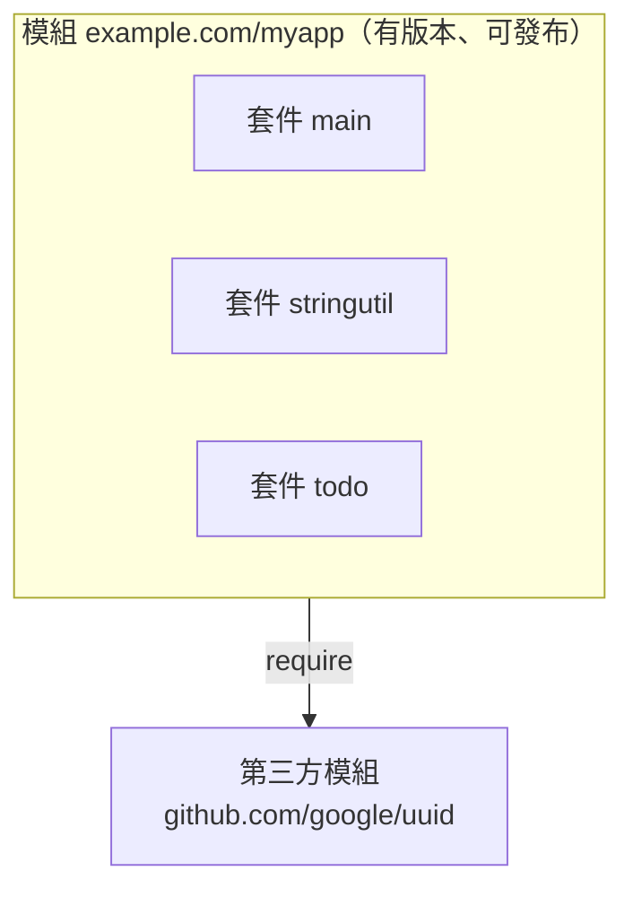
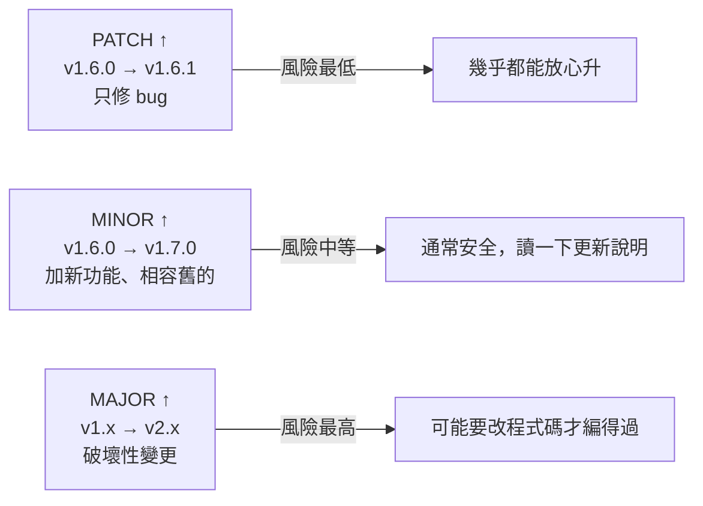

# [go-5-2] Go Modules 深入：`go.mod` / `go.sum`、語意化版本、`go get` 升降版

> **本章目標**：把 `go-0-4` 用過的 `go mod` 從「照著打指令」升級到「看懂它在管什麼」。你會讀懂 `go.mod` 和 `go.sum` 每一行的意思、懂語意化版本（SemVer）怎麼決定升級風不風險，並學會用 `go get` 精準地升版、降版、移除依賴。

`go-5-1` 說過：套件靠「匯入路徑」互相找到彼此，而路徑的開頭（`example.com/myapp`）是**模組（module）**定義的。模組就是 Go 的「專案」與「依賴管理」單位——這一章把它講透。

## 你會學到

- 模組（module）到底是什麼：它和套件（package）的層級關係
- `go.mod` 每一行在說什麼：`module`、`go`、`require`、`// indirect`
- `go.sum` 是什麼、為什麼要進版控、為什麼**不要**手動改它
- 語意化版本（Semantic Versioning）：`v1.4.2` 三個數字各代表什麼、哪種升級會咬你
- 用 `go get` 升版 / 降版 / 加 / 移除依賴，以及 `go mod tidy` 的日常角色

## 概念說明

### 模組 vs 套件：一個抽屜櫃 vs 一個抽屜

`go-5-1` 講的「套件」和這章的「模組」很容易混。用一個比喻分清楚：

- **模組（module）＝整個抽屜櫃**：它是你「發布、版本控管、拉進別人專案」的最小單位。一個模組有一個全域唯一的名字（模組路徑），有自己的版本號。
- **套件（package）＝櫃子裡的一個抽屜**：模組裡面可以有很多套件，各管一塊功能。



這張圖在說：你的專案是**一個模組**，裡面裝了好幾個套件；當你需要別人的程式碼，是「依賴另一個模組」（連同它的版本號），而不是依賴單一檔案。`go.mod` 這個檔案就是這個抽屜櫃的「身分證＋依賴清單」。

### `go.mod`：模組的身分證與依賴清單

`go mod init example.com/myapp` 會在專案根目錄產生一個 `go.mod`。一個用了幾個第三方套件的專案，`go.mod` 大概長這樣：

```
module example.com/myapp

go 1.21

require (
	github.com/google/uuid v1.6.0
	github.com/gorilla/mux v1.8.1
)

require golang.org/x/sys v0.15.0 // indirect
```

逐行讀：

- `module example.com/myapp`：**本模組的路徑**。這就是 `go-5-1` 裡 import 路徑的開頭——別的檔案要 import 你的 `todo` 套件，就寫 `example.com/myapp/todo`。慣例用你（未來）放程式碼的網址，例如 `github.com/你的帳號/專案名`；純本機練習隨便取個 `example.com/xxx` 也行。
- `go 1.21`：**這個模組要求的 Go 語言版本下限**。它會影響編譯器開啟哪些語言特性（例如泛型要 1.18+）。不是「你裝的 Go 版本」，是「這專案最低需要哪個版本」。
- `require (...)`：**直接依賴清單**。每一行是「一個模組路徑 + 一個版本號」。這些是你程式碼裡**直接 import** 到的。
- `// indirect`：標著 indirect 的，是**你沒有直接 import、但你依賴的某個模組又去依賴的**（依賴的依賴）。Go 也要把它們的版本釘住，才能保證建置可重現。

### `go.sum`：防掉包的校驗清單，**別手動改**

`go.mod` 旁邊還會有一個 `go.sum`。它不是給人讀的，裡面是每一個依賴模組（連同每個版本）的**加密雜湊（checksum）**：

```
github.com/google/uuid v1.6.0 h1:NIvaJDMOsjHA8n1jAhLSgzrAzy1Hgr+hNrb57e+94F0=
github.com/google/uuid v1.6.0/go.mod h1:TIyPZe4MgqvfeYDBFedMoGGpEw/LqOeaOT+nhxU+yHo=
```

它的作用是**供應鏈安全**：下次在別台機器（或 CI）建置時，Go 會重新下載依賴，並比對雜湊——如果某個版本的程式碼被偷偷換掉了（雜湊對不上），建置會直接失敗，而不是默默吃下被動手腳的程式碼。

兩條鐵則：

- **`go.mod` 和 `go.sum` 都要進版本控制（git）。** 它們一起保證「每個人、每台機器、每次建置，裝到的依賴一模一樣」。
- **`go.sum` 永遠不要手動編輯。** 它由 `go` 工具自動維護（`go get`、`go mod tidy` 會更新它）。手改只會把校驗弄壞。

### 語意化版本（SemVer）：三個數字各在警告你什麼

Go 的依賴版本長這樣：`v1.6.0`。這套規則叫**語意化版本（Semantic Versioning，SemVer）**，三個數字由左到右是 `主版本.次版本.修訂版本（MAJOR.MINOR.PATCH）`，每一位的「跳號」都在傳達一個明確承諾：

```
v  1  .  6  .  0
   │     │     └── PATCH（修訂）：只修 bug，不改行為、不加功能。升它最安全。
   │     └──────── MINOR（次版）：加了新功能，但「舊的用法照舊能用」（向後相容）。
   └────────────── MAJOR（主版）：有破壞性變更，舊程式碼可能要改才能編得過。升它要小心。
```



這張圖在說：**升級風不風險，看跳的是哪一位數**。PATCH 幾乎永遠能升；MINOR 多半安全；MAJOR 是明說「我改壞了相容性」，升之前要看它的遷移說明。

Go 對 MAJOR 還有一個特別規定：**v2 以上的主版本，模組路徑結尾要帶上版本**，例如 `github.com/foo/bar/v2`。這讓 v1 和 v2 可以當成「兩個不同的東西」同時存在，不會打架。你第一次看到 import 路徑結尾有 `/v2`、`/v3` 時，就是這個原因。

### 從哪裡下載？——代理與快取（知道有這回事就好）

`go get` 預設不是直接去 GitHub 拉，而是透過一個叫 **module proxy** 的服務（預設 `proxy.golang.org`）。好處是：下載快、版本不會因為對方 repo 哪天被刪就消失、而且配合 `go.sum` 做校驗。你平常不用管它，只要知道：**依賴是透過官方 proxy 拉的、會在本機快取**，所以同一個版本不會每次都重新下載。

## 程式碼範例

> 這章的「程式碼」主要是**指令**——模組管理是用 `go` 工具鏈操作的，不是寫在 `.go` 檔裡。下面每一組都標了「這個指令在做什麼、會怎麼改動 `go.mod`／`go.sum`」。

### 範例一：從零建一個模組，加第一個第三方依賴

情境：新專案要用 Google 的 `uuid` 套件來產生唯一識別碼。完整流程：

```bash
# 1. 建資料夾、進去、初始化模組（這一步產生 go.mod）
mkdir myapp && cd myapp
go mod init example.com/myapp

# 2. 在 main.go 裡 import 並使用 github.com/google/uuid（見下方程式碼）

# 3. 讓 go 去補齊依賴：掃描你的 import、下載需要的模組、寫進 go.mod/go.sum
go mod tidy
```

`main.go`：

```go
package main

import (
	"fmt"

	"github.com/google/uuid" // 第三方模組
)

func main() {
	id := uuid.New() // 產生一個隨機的 UUID
	fmt.Println("新的識別碼：", id)
}
```

說明：

- `go mod init example.com/myapp` 只產生最小的 `go.mod`（只有 `module` 和 `go` 兩行），**還沒有任何依賴**。
- 你在 `main.go` 寫下 `import "github.com/google/uuid"` 後，如果直接 `go run` 會失敗——因為 `go.mod` 裡還沒宣告這個依賴。
- `go mod tidy` 是日常最常用的一招：它**掃過你所有的 import**，把「有用到但沒宣告的」加進 `go.mod`、把「宣告了卻沒用到的」移除，並同步更新 `go.sum`。跑完之後 `go.mod` 的 `require` 區就會多出 `github.com/google/uuid v1.6.0`（版本號依當下最新而定）。
- 記住這個習慣：**改完 import 就 `go mod tidy`**，讓 `go.mod` 永遠和程式碼實際用到的東西一致。

### 範例二：`go get` 升版、降版、指定版本

`go get` 是調整依賴版本的工具。它改的是 `go.mod`／`go.sum`，不是你的程式碼。常見幾種用法：

```bash
# 升到「最新版」
go get github.com/google/uuid

# 升到「指定版本」（精準釘住）
go get github.com/google/uuid@v1.5.0

# 降版：一樣用 @版本 指定一個較舊的
go get github.com/google/uuid@v1.4.0

# 升到「最新的修訂版（patch）」但不跳 minor —— 只想要 bug fix、不想要新功能
go get -u=patch github.com/google/uuid

# 把這個模組的所有「直接＋間接」依賴都升到最新的相容版本
go get -u ./...
```

說明：

- `@版本` 這個語法是精髓：你可以 `@v1.5.0` 釘死一個確切版本、`@latest` 要最新、`@v1.4.0` 回退到舊版。升版和降版是**同一個指令**，差別只在你給的版本號比現在新還是舊。
- 什麼時候會降版？最常見是：升上去之後發現新版有 bug 或破壞了你的用法，先 `@` 回退到上一個能用的版本止血，再慢慢查。
- `-u` 是 "update" 的意思——`go get -u ./...` 會把整個專案的依賴都往上升。這威力大、風險也大（可能一次升一堆 minor），升完**一定要跑測試**（`go-5-3`、`go-5-4`）確認沒被改壞。
- 每次 `go get` 之後，`go.mod` 對應那行的版本號會改變，`go.sum` 也會補上新版本的校驗。**改完記得 `go mod tidy` 收尾**，清掉因為版本變動而不再需要的間接依賴。

### 範例三：讀懂一次升級「安不安全」

假設你的 `go.mod` 現在是 `github.com/gorilla/mux v1.8.0`，你想升級。對照三種情況判斷風險：

```bash
# 情況 A：升到 v1.8.1（PATCH ↑）—— 只修 bug
go get github.com/gorilla/mux@v1.8.1
# → 最安全。理論上你的程式碼一行都不用改。

# 情況 B：升到 v1.9.0（MINOR ↑）—— 多了新功能
go get github.com/gorilla/mux@v1.9.0
# → 通常安全（舊用法還在），但建議去看它的 release note 有沒有「雖然相容但建議改」的提醒。

# 情況 C：升到 v2（MAJOR ↑）—— 破壞性變更
go get github.com/gorilla/mux/v2@v2.0.0
#   ↑ 注意路徑結尾多了 /v2！這是 Go 對 v2+ 的硬規定
# → 最危險。你的 import 路徑要改成 .../v2，而且 API 可能變了，要照它的遷移指南改程式碼。
```

說明：

- 這三條指令完美對應前面 SemVer 那張圖：**跳 PATCH 幾乎無痛、跳 MINOR 多半 OK、跳 MAJOR 要當成「換一個新東西」來對待**。
- 情況 C 的 `/v2` 不是打錯——它是「主版本進到 2 以上，模組路徑就要帶版本」的規定。這代表你 import 的地方全都要從 `github.com/gorilla/mux` 改成 `github.com/gorilla/mux/v2`。好處是：你甚至可以在過渡期讓 v1 和 v2 並存，一個檔案一個檔案慢慢搬。
- 不管升哪一種，**升完就跑測試**。測試就是你判斷「這次升級有沒有把東西弄壞」最可靠的那張安全網——下一章就專門教它。

## 小練習

1. 建一個新模組 `example.com/dice`，用 `go mod init` 開起來。先看一眼剛產生的 `go.mod` 有幾行。然後寫一支程式 import `github.com/google/uuid`，跑 `go mod tidy`，再看一次 `go.mod`——比較前後差了什麼，並打開 `go.sum` 看看多了哪些行（看看就好，不要手改）。
2. 接上題，用 `go get github.com/google/uuid@v1.4.0` 把版本降到 `v1.4.0`，確認 `go.mod` 裡的版本號變了。再用 `go get github.com/google/uuid@latest` 升回最新，觀察版本號又跳回去。體會「升版和降版是同一個指令」。
3. 判斷題（不用真的執行）：你的 `go.mod` 有 `github.com/foo/bar v3.2.1`。以下三個升級，哪個最可能讓你「程式碼不用改就能編過」、哪個最可能「要改 import 路徑和程式碼」？為什麼？
   - (a) `go get github.com/foo/bar@v3.2.2`
   - (b) `go get github.com/foo/bar@v3.5.0`
   - (c) `go get github.com/foo/bar/v4@v4.0.0`

<details>
<summary>參考解答</summary>

**練習 1：觀察 `go.mod` 的前後變化**

- `go mod init example.com/dice` 後，`go.mod` 只有兩行有內容：`module example.com/dice` 和 `go 1.xx`，**沒有任何 `require`**。
- 寫下 `import "github.com/google/uuid"` 並 `go mod tidy` 後，`go.mod` 會多出一個 `require github.com/google/uuid v1.x.x`；`go.sum` 會多出兩行（一行是該模組程式碼的雜湊 `h1:`，一行是它 `go.mod` 的雜湊 `/go.mod`）。
- 重點體會：**`go.mod` 的依賴不是你手打的，是 `go mod tidy` 根據你的 import 自動補的。** 你負責寫 import，工具負責對帳。

**練習 2：降版再升版**

```bash
go get github.com/google/uuid@v1.4.0   # go.mod 變成 ... uuid v1.4.0
go get github.com/google/uuid@latest   # go.mod 變回最新，例如 ... uuid v1.6.0
```

兩次都是同一個 `go get ...@版本`，只是 `@` 後面一個給舊版號、一個給 `latest`。這就是「升/降版本質上是同一個操作：把依賴釘到你指定的那個版本」。

**練習 3：判斷升級風險**

- **(a) `@v3.2.2`（PATCH ↑）** → 最可能「不用改就編過」。只跳修訂號，按 SemVer 的承諾只修 bug、不動 API。
- **(b) `@v3.5.0`（MINOR ↑）** → 多半也能編過（加了新功能、但舊用法向後相容），風險中等，建議看一下 release note。
- **(c) `/v4@v4.0.0`（MAJOR ↑）** → 最可能「要改 import 路徑和程式碼」。注意路徑結尾變成 `/v4`——這是 Go 對 v2+ 的硬規定，代表所有 import 都要改，而且主版本跳號本身就是在宣告「我有破壞性變更」。

一句話：**看版本號哪一位在跳，就能先猜到這次升級要花多少力氣。**

</details>

## 課外讀物

> 把依賴版本釘死、連 `go.sum` 校驗一起進版控，本質是「讓每一次建置都可重現、不被偷換依賴」——這屬於「供應鏈安全」的範疇，資安課外讀物 E-10 系列可延伸閱讀（本課不展開）。

> `go.mod`／`go.sum` 要進版控、但下載下來的依賴快取不該進——「什麼該進 git、什麼不該」是通用功夫 → **[課外讀物 E-8-6] `.gitignore`：哪些檔案不該進版控**：[.gitignore](../../../課外讀物/E-8-git/E-8-6-gitignore.md)

> 下一章（本 Part 的重頭戲 🐹）：專案長大了、依賴升級了，你怎麼確定「沒把原本好的東西改壞」？答案是測試。Go 把測試做成語言內建，而且有一套招牌寫法——table-driven test → `go-5-3`
