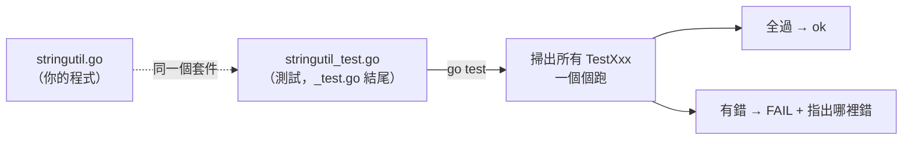
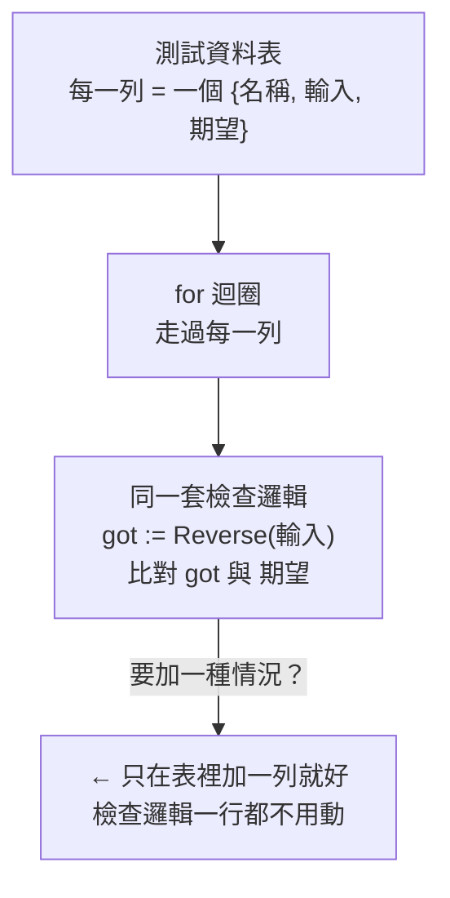

# [go-5-3] 🐹 寫測試：`testing` 套件、`go test`、Go 招牌的 table-driven test

> **本章目標**：學會為 Go 程式碼寫自動化測試——Go 把測試做成語言內建（不用裝框架），而且有一套幾乎人人都用的招牌寫法：**table-driven test（表格驅動測試）**。學完你能用「一張表配一個迴圈」把一個函式的十幾種情況測得又全又好讀。

這是本 Part 標 🐹 的招牌章，會花最多篇幅。原因是：**測試是你敢放心改程式、敢升級依賴（`go-5-2`）、敢重構的底氣**。而 Go 的測試風格（table-driven）又特別值得嚼透——它簡單到沒有藉口不寫，表達力卻很強。

## 你會學到

- 為什麼要寫測試，以及 Go「測試是語言內建」的設計
- 測試檔的規矩：`_test.go`、`func TestXxx(t *testing.T)`、怎麼用 `go test` 跑
- `t.Errorf` vs `t.Fatalf`：報告失敗的兩種方式差在哪
- 🐹 **table-driven test**：用「一張表＋一個迴圈」測遍所有情況（本章核心）
- 用 `t.Run` 開子測試，讓每一列都有名字、能單獨跑
- 一個好測試的骨架：Arrange–Act–Assert

## 概念說明

### 測試是「會自動幫你檢查」的安全網

每次改完程式，你怎麼確定「沒把原本好的東西改壞」？手動一個個試很累、又容易漏掉邊角情況。**自動化測試**就是「寫一段程式，去檢查另一段程式的行為對不對」，之後一個指令（`go test`）就能把所有檢查重跑一遍。

比喻：測試像**房子的煙霧偵測器**——裝好之後它默默守著，一有狀況（你某處改壞了）就立刻警報，讓你在「釀成大禍之前」就發現。沒有測試的程式碼，就像沒裝偵測器的房子：平常沒事，真的失火時你往往是最後一個知道的。

Go 對寫測試特別友善——**它是語言內建的**：不用額外裝任何框架、不用設定檔，標準庫的 `testing` 套件加上 `go test` 指令就是全部。這讓「寫測試」的門檻低到沒有藉口。

> 為什麼測試讓你「敢改程式」、測試金字塔、單元/整合/E2E 的分別 → **[課外讀物 E-9-1] 為什麼要寫測試**：[為什麼要寫測試](../../../課外讀物/E-9-testing/E-9-1-why-test.md)、**[課外讀物 E-9-2] 測試的種類**：[測試的種類](../../../課外讀物/E-9-testing/E-9-2-test-types.md)

### Go 測試的三條硬規矩

Go 用「約定」取代「設定」。要讓 `go test` 認得你的測試，只要遵守三條命名規矩：

```
1. 測試檔名字 ── 以 _test.go 結尾    （例如 stringutil_test.go）
2. 測試函式名 ── 以 Test 開頭、後面接大寫字母   （例如 TestReverse）
3. 測試函式簽名 ── 固定吃一個 *testing.T 參數   （func TestReverse(t *testing.T)）
```



這張圖在說：測試檔和被測的程式放在**同一個套件、同一個資料夾**，只是檔名多了 `_test.go`；`go test` 會自動把這些檔案裡所有 `Test` 開頭的函式找出來跑。`_test.go` 的檔案**不會被編進正式執行檔**——測試程式碼零負擔，不會跟著你的程式上線。

### 怎麼報告「測試失敗」：`t.Errorf` 與 `t.Fatalf`

Go 的測試**沒有 `assertEqual` 這種斷言函式**（這點和別的語言不同，一開始會不習慣）。你就是普通地用 `if` 判斷「結果對不對」，不對就呼叫 `t` 上的方法報告失敗：

```go
got := Reverse("hello")
want := "olleh"
if got != want {
    t.Errorf("Reverse(\"hello\") = %q，期望 %q", got, want)
}
```

報告失敗有兩個常用方法，差別很重要：

| 方法 | 做什麼 | 什麼時候用 |
|---|---|---|
| `t.Errorf(...)` | 記下這次失敗，但**繼續往下跑**這個測試 | 多數情況。一個測試裡可以收集多個失敗一起報 |
| `t.Fatalf(...)` | 記下失敗後**立刻中止**這個測試函式 | 當「後面的程式碼沒有意義了」時——例如前一步就拿到 `nil`，再往下存取只會 panic |

一句話抓重點：**「錯了但還能繼續檢查」用 `Errorf`；「錯了再往下跑只會更亂（甚至 crash）」用 `Fatalf`**。例如「函式回傳了 error，我接下來要檢查的那個結果值根本不可信了」就該 `Fatalf`。

### 一個好測試長什麼樣：Arrange–Act–Assert

不管哪種語言，一個清楚的測試都有三段式結構，叫 **AAA**：

```
Arrange（準備）：把輸入、前置條件都備好
Act（執行）：    呼叫那個被測的函式，拿到結果
Assert（斷言）： 檢查結果符不符合預期，不符就報告失敗
```

養成把測試寫成這三段（哪怕不寫註解，心裡也照這個順序），測試就會好讀——別人一眼看出「餵什麼進去、做了什麼、期望什麼出來」。

> AAA 原則怎麼讓測試好讀、好維護 → **[課外讀物 E-9-4] 什麼是好的測試？AAA 原則**：[AAA 原則](../../../課外讀物/E-9-testing/E-9-4-aaa-principle.md)

### 🐹 table-driven test：Go 的招牌

現在進到本章的主角。想像你要測一個函式 `Reverse`，但光測 `"hello"` 一個情況不夠——你還想測空字串、單一字元、中文、含空白……每種都寫一個 `if got != want` 會變成一大坨重複：

```go
// 笨方法：每種情況複製貼上一段，又臭又長、還容易漏改
func TestReverse(t *testing.T) {
    if got := Reverse("hello"); got != "olleh" {
        t.Errorf("...")
    }
    if got := Reverse(""); got != "" {
        t.Errorf("...")
    }
    if got := Reverse("a"); got != "a" {
        t.Errorf("...")
    }
    // ... 再十種，複製十次
}
```

**table-driven test 的想法**：把「每一種情況」整理成**一張表格**（每一列是一個 `{輸入, 期望輸出}`），然後用**一個迴圈**跑過整張表、對每一列做同樣的檢查。

用 pseudo code 先抓精神：

```
測試資料表 = [
    { 名稱:"一般英文", 輸入:"hello", 期望:"olleh" },
    { 名稱:"空字串",   輸入:"",      期望:"" },
    { 名稱:"單一字元", 輸入:"a",     期望:"a" },
    { 名稱:"中文",     輸入:"你好",   期望:"好你" },
]

對 表裡的每一列 情況：
    實際 = Reverse(情況.輸入)
    如果 實際 != 情況.期望：
        報告失敗（印出 情況.名稱、輸入、實際、期望）
```



這張圖點出 table-driven 的最大好處：**「情況」和「檢查邏輯」分開了**。要多測一種邊角情況，你只在表裡**加一列資料**，不用再寫一段新的 `if`。十種情況和一百種情況，檢查邏輯都只有那一份。這就是為什麼幾乎所有 Go 專案都這樣寫測試——它把「測得全」這件事的成本壓到最低。

## 程式碼範例

> 以下範例假設有一個 `stringutil` 套件（沿用 `go-5-1` 的），測試檔和它放一起。你可以在本機建個模組跟著跑：被測程式放 `stringutil.go`、測試放 `stringutil_test.go`，在該資料夾下 `go test`。

### 範例一：最小的一個測試

先從「一個情況、一個測試」開始，熟悉骨架。被測的函式：

`stringutil.go`：

```go
package stringutil

// Reverse 把字串反轉（用 []rune 才能正確處理中文等多位元組字元）。
func Reverse(s string) string {
	runes := []rune(s)
	for i, j := 0, len(runes)-1; i < j; i, j = i+1, j-1 {
		runes[i], runes[j] = runes[j], runes[i]
	}
	return string(runes)
}
```

`stringutil_test.go`：

```go
package stringutil

import "testing"

func TestReverse(t *testing.T) {
	// Arrange：準備輸入與期望
	input := "hello"
	want := "olleh"

	// Act：呼叫被測函式
	got := Reverse(input)

	// Assert：檢查結果
	if got != want {
		t.Errorf("Reverse(%q) = %q，期望 %q", input, got, want)
	}
}
```

在這個資料夾下執行：

```bash
go test
# 或看得更詳細（印出每個測試的名字）：
go test -v
```

成功時 `go test -v` 大致印出：

```
=== RUN   TestReverse
--- PASS: TestReverse (0.00s)
PASS
ok      example.com/myapp/stringutil   0.002s
```

說明：

- 測試檔開頭 `package stringutil`——**和被測程式同一個套件**，所以測試裡可以直接呼叫 `Reverse`（包含小寫的私有函式也測得到）。
- `import "testing"` 是標準庫，不用裝任何東西。
- 失敗訊息用 `%q`（帶引號印字串）而不是 `%s`——這樣 `""`（空字串）和 `" "`（一個空白）才看得出差別，追查邊角情況時特別有用。
- 失敗訊息一定要帶上「輸入是什麼、實際得到什麼、期望什麼」。`t.Errorf("failed")` 這種訊息等於沒講，失敗時你還得回去翻程式碼猜。

### 範例二：🐹 把它改寫成 table-driven test（本章重點）

同樣測 `Reverse`，但這次要一口氣測很多情況。這就是你之後會一直寫的標準寫法：

```go
package stringutil

import "testing"

func TestReverse(t *testing.T) {
	// 這張表就是「所有要測的情況」。欄位用大寫是慣例（struct 欄位），
	// name 給這一列一個看得懂的名字，方便失敗時定位。
	tests := []struct {
		name  string
		input string
		want  string
	}{
		{name: "一般英文", input: "hello", want: "olleh"},
		{name: "空字串", input: "", want: ""},
		{name: "單一字元", input: "a", want: "a"},
		{name: "中文多位元組", input: "你好", want: "好你"},
		{name: "含空白", input: "a b", want: "b a"},
	}

	for _, tt := range tests {
		// t.Run 開一個「子測試」，用這一列的 name 當名字
		t.Run(tt.name, func(t *testing.T) {
			got := Reverse(tt.input)
			if got != tt.want {
				t.Errorf("Reverse(%q) = %q，期望 %q", tt.input, got, tt.want)
			}
		})
	}
}
```

逐項說明（這段請看熟，是 Go 測試的「模板」）：

- `tests := []struct{ ... }{ ... }`：定義一個**匿名 struct 的 slice**，當場填好每一列。這就是「表格」。常見慣例是把這個變數命名為 `tests`，每一列的變數在迴圈裡叫 `tt`（test table 的縮寫，這是社群通用慣例，屬於第 3 類「流行慣例」）。
- **每一列一定要有一個 `name` 欄位**：它讓失敗訊息能指出「是哪一列掛了」，也讓你能單獨只跑某一列（下一個範例會示範）。
- `for _, tt := range tests`：走過每一列，對每一列做**完全相同**的檢查。要新增情況？在表裡加一行 `{...}` 就好，迴圈裡一個字都不用改——這就是 table-driven 的威力。
- `t.Run(tt.name, func(t *testing.T) { ... })`：為每一列開一個**子測試（subtest）**。好處有三：(1) 失敗訊息會顯示 `TestReverse/中文多位元組`，一眼知道哪種情況壞了；(2) 可以只跑某一列（`go test -run TestReverse/中文`）;(3) 某一列失敗不會中斷其他列。
- 跑 `go test -v` 會看到每一列各自一行 PASS/FAIL：
  ```
  === RUN   TestReverse/一般英文
  --- PASS: TestReverse/一般英文 (0.00s)
  === RUN   TestReverse/中文多位元組
  --- PASS: TestReverse/中文多位元組 (0.00s)
  ...
  ```

> **常見錯誤** — 不給每一列名字，直接用索引報錯：
> ```go
> for i, tt := range tests {
>     got := Reverse(tt.input)
>     if got != tt.want {
>         t.Errorf("第 %d 列失敗", i) // ← 只說「第 3 列」，你還得回去數是哪一列
>     }
> }
> ```
> 問題是：失敗時你只知道「第 3 列」，得回去數表格才知道是哪種情況，情況一多就很痛。
> 正確做法：給每列一個 `name`，並用 `t.Run(tt.name, ...)`。失敗直接告訴你 `TestReverse/含空白` 壞了，省掉數格子的功夫。

### 範例三：測「會回傳 error 的函式」——這裡 `Fatalf` 派上用場

實務上很多函式回傳 `(結果, error)`（`go-3-1`）。測這種函式，table 裡要多一個欄位：**這一列「該不該出錯」**。沿用 `go-5-1` 練習的 `parsePort` 概念：

`port.go`：

```go
package stringutil

import (
	"fmt"
	"strconv"
)

// ParsePort 把字串轉成合法的埠號（1~65535），否則回傳錯誤。
func ParsePort(s string) (int, error) {
	n, err := strconv.Atoi(s)
	if err != nil {
		return 0, fmt.Errorf("不是數字：%q", s)
	}
	if n < 1 || n > 65535 {
		return 0, fmt.Errorf("埠號 %d 超出範圍", n)
	}
	return n, nil
}
```

`port_test.go`：

```go
package stringutil

import "testing"

func TestParsePort(t *testing.T) {
	tests := []struct {
		name    string
		input   string
		want    int
		wantErr bool // 這一列是否「預期會出錯」
	}{
		{name: "正常埠號", input: "8080", want: 8080, wantErr: false},
		{name: "邊界最小值", input: "1", want: 1, wantErr: false},
		{name: "邊界最大值", input: "65535", want: 65535, wantErr: false},
		{name: "不是數字", input: "abc", want: 0, wantErr: true},
		{name: "超出範圍", input: "70000", want: 0, wantErr: true},
		{name: "零不合法", input: "0", want: 0, wantErr: true},
	}

	for _, tt := range tests {
		t.Run(tt.name, func(t *testing.T) {
			got, err := ParsePort(tt.input)

			// 先檢查「出錯與否」符不符合預期
			if tt.wantErr {
				if err == nil {
					t.Fatalf("ParsePort(%q)：期望出錯，但沒有出錯（got=%d）", tt.input, got)
				}
				return // 預期出錯且確實出錯 → 這一列通過，不用再比 got
			}
			// 到這裡代表「不該出錯」。若竟然出錯了，後面比 got 沒意義 → Fatalf 中止這一列
			if err != nil {
				t.Fatalf("ParsePort(%q)：不該出錯，卻得到錯誤 %v", tt.input, err)
			}
			if got != tt.want {
				t.Errorf("ParsePort(%q) = %d，期望 %d", tt.input, got, tt.want)
			}
		})
	}
}
```

說明：

- table 多了一個 `wantErr bool`——測「可能失敗」的函式，**「這次該不該出錯」本身就是要驗的東西**，所以當成表格的一欄。
- 這裡示範了 `Fatalf` 的正確用途：**「預期不該出錯卻出錯了」時，`err != nil` 代表 `got` 根本不可信，再往下比 `got != tt.want` 只會印出莫名其妙的訊息，所以用 `Fatalf` 當場中止這一列**。而「值錯了」用 `Errorf`（還能繼續，雖然這裡後面也沒別的可檢查了）。
- `return`：預期出錯、也確實出錯的那幾列，驗到「有出錯」就夠了，不必再比 `got`，直接 `return` 結束這個子測試。
- 因為每列都包在 `t.Run` 裡，就算「超出範圍」這列掛了，「不是數字」那列照樣會跑——失敗彼此隔離。

### 範例四：跑測試的日常指令

寫好測試後，這些指令是你每天會用的：

```bash
# 跑「目前資料夾」這個套件的測試
go test

# -v：verbose，印出每個測試（含子測試）的名字和 PASS/FAIL
go test -v

# 跑「整個模組」底下所有套件的測試（最常用，提交前跑一遍）
go test ./...

# 只跑名字符合某樣式的測試（-run 吃正則）
go test -run TestParsePort          # 只跑 TestParsePort
go test -run TestParsePort/超出範圍   # 只跑那一個子測試（table 的某一列）

# 接上 go-4-7 學的 -race：一邊測一邊偵測資料競爭
go test -race ./...
```

說明：

- `go test ./...` 的 `./...` 是「這個資料夾與底下所有子資料夾的套件」——一個指令測遍整個專案。**提交程式碼前跑這個**，是最基本的自我驗收。
- `-run` 吃的是**正則表達式**，`TestParsePort/超出範圍` 這種「測試名/子測試名」的寫法，讓你能精準只跑 table 裡的某一列——debug 單一情況時超好用。
- `-race` 呼應 `go-4-7`：把資料競爭偵測器接進測試。並行程式碼一定要用 `-race` 跑測試，否則那些「看不見的並行 bug」測不出來。

## 小練習

1. 幫 `go-5-1` 的 `IsPalindrome`（判斷回文）寫一個 **table-driven test**，至少涵蓋這些情況並各給 `name`：一般回文（`"上海自來水來自海上"`）、英文回文（`"level"`）、不是回文（`"hello"`）、空字串、單一字元、含空白與大小寫（`"A man a plan"` 之類——想想你的 `normalize` 會怎麼處理）。用 `t.Run` 讓每列有名字。
2. 幫一個新函式 `Clamp(value, low, high int) int`（把 value 夾在 `[low, high]`）寫 table-driven test。設計你的表格涵蓋：value 在範圍內、剛好等於下界、剛好等於上界、低於下界、高於上界。想想「邊界值」為什麼特別值得測。
3. 思考題：範例三裡，「預期不該出錯、卻出錯了」我用的是 `t.Fatalf` 而不是 `t.Errorf`。如果這裡改成 `t.Errorf`（記下失敗但繼續往下跑），接下來的 `if got != tt.want` 會發生什麼事、印出的訊息會多混亂？用這個例子說說 `Fatalf` 和 `Errorf` 的分界。

<details>
<summary>參考解答</summary>

**練習 1：`IsPalindrome` 的 table-driven test**

（假設 `IsPalindrome` 會先 `normalize`——去空白、轉小寫——再判斷，見 `go-5-1`。）

```go
func TestIsPalindrome(t *testing.T) {
	tests := []struct {
		name  string
		input string
		want  bool
	}{
		{name: "中文回文", input: "上海自來水來自海上", want: true},
		{name: "英文回文", input: "level", want: true},
		{name: "不是回文", input: "hello", want: false},
		{name: "空字串算回文", input: "", want: true},
		{name: "單一字元算回文", input: "x", want: true},
		{name: "忽略空白與大小寫", input: "A man a nam A", want: true},
	}

	for _, tt := range tests {
		t.Run(tt.name, func(t *testing.T) {
			if got := IsPalindrome(tt.input); got != tt.want {
				t.Errorf("IsPalindrome(%q) = %v，期望 %v", tt.input, got, tt.want)
			}
		})
	}
}
```

重點：空字串和單一字元是典型「邊角情況」，手動測很容易漏，但在 table 裡只是多兩列。最後一列特意測「空白＋大小寫」，驗證 `normalize` 真的有發揮作用。

**練習 2：`Clamp` 的 table-driven test**

```go
func TestClamp(t *testing.T) {
	tests := []struct {
		name              string
		value, low, high  int
		want              int
	}{
		{name: "範圍內不變", value: 50, low: 0, high: 100, want: 50},
		{name: "等於下界", value: 0, low: 0, high: 100, want: 0},
		{name: "等於上界", value: 100, low: 0, high: 100, want: 100},
		{name: "低於下界被拉上來", value: -20, low: 0, high: 100, want: 0},
		{name: "高於上界被壓下去", value: 150, low: 0, high: 100, want: 100},
	}

	for _, tt := range tests {
		t.Run(tt.name, func(t *testing.T) {
			if got := Clamp(tt.value, tt.low, tt.high); got != tt.want {
				t.Errorf("Clamp(%d, %d, %d) = %d，期望 %d",
					tt.value, tt.low, tt.high, got, tt.want)
			}
		})
	}
}
```

為什麼「邊界值」特別值得測：bug 最愛躲在邊界——`<` 寫成 `<=`、`>` 寫成 `>=` 這種差一錯誤（off-by-one），只有在「剛好等於下界/上界」時才會現形。範圍正中間的值怎麼寫都對，測了也抓不到這類錯。所以「剛好在邊界上」的那幾列，往往比「正常範圍內」那列更有價值。

**練習 3：為什麼用 `Fatalf` 而不是 `Errorf`**

如果把「不該出錯卻出錯」那行改成 `t.Errorf`，程式**不會中止**，會繼續往下跑到 `if got != tt.want`。但此時 `err != nil`、函式是走失敗分支回來的，`got` 是個沒意義的零值（`0`）。於是 `0 != tt.want` 幾乎必定成立，又報一次「值錯了」的失敗——結果**同一列印出兩條互相矛盾的失敗訊息**：一條說「不該出錯卻出錯」，一條說「值是 0、期望某數」。看的人會一頭霧水，還要自己判斷哪條才是根因。

分界就在這裡：**當一個失敗讓「後面的檢查失去意義」時，用 `Fatalf` 當場停住，只報這一條根因**；當失敗彼此獨立、繼續檢查還能提供有用資訊時，用 `Errorf` 收集起來一起報。範例三那個情境屬於前者——拿到 error 就代表結果不可信，沒必要再比值了。

</details>

## 課外讀物

> 測試為什麼是「敢改程式」的底氣、測試金字塔、單元/整合/E2E 的分別 → **[課外讀物 E-9-1] 為什麼要寫測試**：[為什麼要寫測試](../../../課外讀物/E-9-testing/E-9-1-why-test.md)

> 一個好測試的 Arrange–Act–Assert 結構，讓測試自己說清楚「餵什麼、做什麼、期望什麼」 → **[課外讀物 E-9-4] AAA 原則**：[AAA 原則](../../../課外讀物/E-9-testing/E-9-4-aaa-principle.md)

> 用 TypeScript 的 Vitest 寫同樣的單元測試長什麼樣，對照著看能看出「測試觀念共通、只是語法不同」 → **[課外讀物 E-9-3] 單元測試入門**：[單元測試入門](../../../課外讀物/E-9-testing/E-9-3-unit-testing.md)

> 下一章：測試會了，接著是三個「進階但實用」的工具——怎麼量「測試覆蓋了多少程式碼」、怎麼用 `Benchmark` 量效能、怎麼用 `httptest` 不開真伺服器就測 HTTP handler → `go-5-4`
