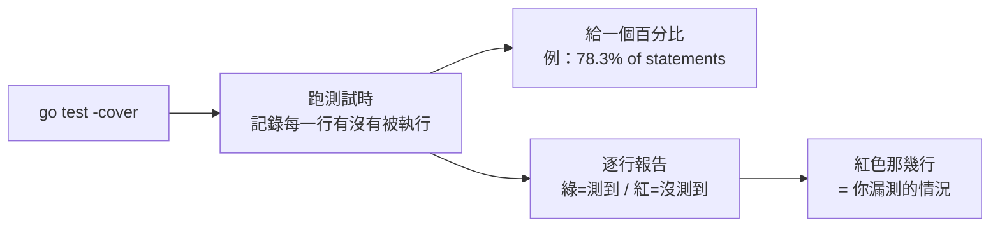
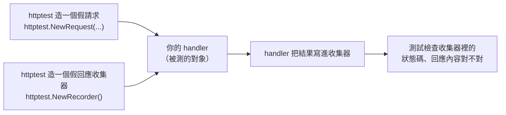

# [go-5-4] 進一步的測試：覆蓋率、`Benchmark`、用 `httptest` 測 HTTP handler

> **本章目標**：在 `go-5-3` 的基礎上，學三個 Go 測試工具鏈免費附贈、但很多人沒用熟的能力——用**覆蓋率**看「哪些程式碼根本沒被測到」、用 **`Benchmark`** 量「這段程式到底多快」、用 **`httptest`** 不開真伺服器就測 HTTP handler（這招直接通往 Part 7 的 Web 後端）。

`go-5-3` 教你把「功能對不對」測清楚。這一章補上三個維度：**測得夠不夠全**（覆蓋率）、**跑得夠不夠快**（benchmark）、以及**怎麼測 Web handler**（httptest）——後者是你寫後端服務時天天要用的。

## 你會學到

- 用 `go test -cover` 看覆蓋率，用 `-coverprofile` 產生「逐行標色」報告
- 覆蓋率數字怎麼讀：它能告訴你什麼、又**不能**保證什麼
- 用 `func BenchmarkXxx(b *testing.B)` 量一段程式的效能，看懂 `b.N` 的巧妙
- 用 `net/http/httptest` 在記憶體裡測 HTTP handler，不用真的開 port、發網路請求

## 概念說明

### 覆蓋率：找出「我以為測了、其實根本沒跑到」的程式碼

你寫了一堆測試，但怎麼知道「有沒有漏測哪段」？**測試覆蓋率（test coverage）**就是回答這個問題的工具：它在跑測試時，記錄**哪幾行程式碼真的被執行到了**，最後給你一個百分比和一份「逐行報告」。

比喻：覆蓋率像**打掃完用手電筒照一遍地板**——你以為都掃了，手電筒一照才發現沙發底下那塊從沒碰過。那塊「從沒被測試執行到」的程式碼，就是 bug 最愛躲的地方。



這張圖在說：覆蓋率的真正價值不是那個百分比數字，而是**那份逐行報告裡的「紅色」**——它精準指出「哪個 `if` 分支、哪個錯誤處理，你一次都沒測到」。

> **重要的誠實話**：覆蓋率高**不等於**測得好。覆蓋率只量「這行有沒有被執行」，不量「你有沒有好好斷言它的結果」。你可以寫一個呼叫了函式、卻什麼都不檢查的爛測試，照樣衝到 100% 覆蓋率。所以：**把覆蓋率當「找漏洞的雷達」（紅色的地方確實沒測），別把它當「品質的獎牌」（高分不代表測得好）。** 別為了湊數字而測，要為了「真的會錯的地方」而測。

### Benchmark：用數據回答「這樣寫到底快不快」

`go-5-3` 的測試回答「對不對」。**benchmark（效能基準測試）**回答另一個問題：「**多快？**」當你在兩種寫法之間猶豫（例如用 `+` 串字串 vs 用 `strings.Builder`），與其憑感覺吵，不如讓 benchmark 跑個數據出來。

Go 的 benchmark 和測試共用同一套機制，只是函式名用 `Benchmark` 開頭、參數是 `*testing.B`。它最巧妙的地方是那個 `b.N`：

```
Go 不會只跑你的程式一次就計時（太短、量不準）。
它會自動「反覆跑 N 次」，而且會自己調整 N——
太快就加大 N、直到累計時間夠長、量出來的「每次平均耗時」才穩定可信。
你要做的只是：寫一個「for i := 0; i < b.N; i++ { 跑一次要量的東西 }」。
```

一句話：**你負責把「要量的那段」放進 `for i := 0; i < b.N; i++` 迴圈裡，Go 負責決定 N 要多大、幫你算出每次操作的平均耗時與記憶體配置。**

### httptest：不開真伺服器，就能測 Web handler

這是**通往 Part 7 的橋**。後端服務的核心是一個個 **HTTP handler**（收到請求、產生回應的函式）。問題來了：要測一個 handler，難道每次都要真的啟動伺服器、綁一個 port、用網路發請求進去？那太慢、太麻煩、還會跟別的測試搶 port。

標準庫的 `net/http/httptest` 解決這件事：它讓你**在記憶體裡偽造一個 HTTP 請求、接住 handler 的回應**，完全不碰真正的網路。



這張圖在說：`httptest` 給你兩個道具——一個「假請求」和一個「假的回應記錄器（recorder）」。你把它們丟給 handler，handler 照常運作、把回應寫進記錄器；測試再從記錄器把「狀態碼、回應內容」撈出來斷言。全程在記憶體裡，快到可以跑幾千次。

## 程式碼範例

### 範例一：看覆蓋率，揪出沒測到的分支

沿用 `go-5-3` 的 `ParsePort`。假設你只測了「正常」和「不是數字」兩種情況，漏了「超出範圍」：

```bash
# 加 -cover：跑測試並印出覆蓋率百分比
go test -cover
# 輸出類似：
# ok   example.com/myapp/stringutil   0.003s   coverage: 72.7% of statements
```

光一個百分比看不出「漏在哪」。產生逐行報告：

```bash
# 1. 把覆蓋資料寫進一個檔案
go test -coverprofile=coverage.out

# 2. 用瀏覽器開啟「逐行標色」的報告（綠=測到、紅=沒測到）
go tool cover -html=coverage.out

# （或在終端機看每個函式的覆蓋率摘要）
go tool cover -func=coverage.out
```

說明：

- `-coverprofile=coverage.out` 把「哪行被執行到」的原始資料存成檔案（`coverage.out` 是慣例檔名；記得它是測試產物，該進 `.gitignore`，別提交）。
- `go tool cover -html=coverage.out` 會開一個網頁，你的原始碼逐行標色：**綠色＝測試有跑到、紅色＝一次都沒跑到**。如果你漏測「超出範圍」，`ParsePort` 裡 `if n < 1 || n > 65535` 那個回傳錯誤的分支就會是紅的——報告直接把漏洞指給你看。
- 補上那一列 table（`{name:"超出範圍", input:"70000", wantErr:true}`，見 `go-5-3`）後重跑，紅色消失、覆蓋率上升。**這就是覆蓋率的正確用法：拿紅色當待辦清單，一個個補上有意義的測試。**
- 別追求「100% 才罷休」。有些分支（例如「理論上不可能發生、但防禦性地留著」的錯誤處理）硬要測反而是浪費。把力氣放在「真的會走到、又真的可能錯」的路徑上。

### 範例二：用 Benchmark 比較兩種字串串接寫法

經典問題：在迴圈裡把很多小字串串成一個大字串，用 `+=` 還是用 `strings.Builder`？用 benchmark 讓數據說話。

`concat.go`：

```go
package stringutil

import "strings"

// ConcatPlus 用 += 串接（每次 += 都會配置一塊新記憶體、把舊的複製過去）。
func ConcatPlus(parts []string) string {
	result := ""
	for _, p := range parts {
		result += p
	}
	return result
}

// ConcatBuilder 用 strings.Builder 串接（內部重複利用同一塊緩衝，少很多次配置）。
func ConcatBuilder(parts []string) string {
	var b strings.Builder
	for _, p := range parts {
		b.WriteString(p)
	}
	return b.String()
}
```

`concat_test.go`：

```go
package stringutil

import (
	"strconv"
	"testing"
)

// 準備一份夠大的測試資料：1000 個小字串
func makeParts() []string {
	parts := make([]string, 1000)
	for i := range parts {
		parts[i] = strconv.Itoa(i)
	}
	return parts
}

func BenchmarkConcatPlus(b *testing.B) {
	parts := makeParts() // 準備資料的時間不該算進效能，放迴圈外
	b.ResetTimer()       // 歸零計時器，從這裡才開始算
	for i := 0; i < b.N; i++ {
		ConcatPlus(parts)
	}
}

func BenchmarkConcatBuilder(b *testing.B) {
	parts := makeParts()
	b.ResetTimer()
	for i := 0; i < b.N; i++ {
		ConcatBuilder(parts)
	}
}
```

執行（benchmark 預設不會跟著 `go test` 跑，要用 `-bench` 明確打開）：

```bash
# -bench=. 跑所有 Benchmark；-benchmem 連「記憶體配置」也一起量
go test -bench=. -benchmem
```

輸出大致長這樣（實際數字依機器而定）：

```
BenchmarkConcatPlus-8        1024    1130400 ns/op   2655431 B/op   999 allocs/op
BenchmarkConcatBuilder-8    61424      19210 ns/op     16376 B/op    11 allocs/op
```

怎麼讀這份報告（這是重點）：

- `-8`：用了 8 個 CPU 核心（`GOMAXPROCS`）。
- 第二欄（`1024`、`61424`）：Go 自動決定的 `b.N`，也就是「總共跑了幾次」。**越快的函式，Go 會跑越多次**才量得準——所以 Builder 那行次數多很多，這是正常的。
- `ns/op`：**每次操作幾奈秒**，這是最關鍵的比較欄。`ConcatPlus` 要 1130400 ns、`ConcatBuilder` 只要 19210 ns——Builder 快了**約 60 倍**。
- `B/op`：每次操作配置了幾位元組記憶體。`allocs/op`：每次操作做了幾次記憶體配置。`ConcatPlus` 的 `999 allocs/op` 暴露了問題根源：**每次 `+=` 都重新配一塊記憶體**，1000 次串接就配了近 1000 次；Builder 只配了 11 次。

說明：

- `b.ResetTimer()`：把「準備資料（`makeParts`）」的時間排除在計時之外——你要量的是串接本身，不是造資料。準備工作放 `b.N` 迴圈**之前**，並在開始量之前 `ResetTimer`。
- 這個例子也印證了一句老話：**「過早最佳化是萬惡之源」，但「有數據支持的最佳化」是工程。** 你不是憑感覺說 Builder 比較快，而是用 benchmark 量出「60 倍、少 900 次配置」這種硬數據。什麼時候該優化？等 benchmark（或線上監控）告訴你「這裡真的是瓶頸」再動手。

> 「還沒有效能問題就開始優化」是反模式；但「用 benchmark/profiler 量出瓶頸再針對性優化」是正道 → **[課外讀物 E-11-6] 後端效能剖析（profiling）**：[後端效能剖析](../../../課外讀物/E-11-performance/E-11-6-backend-profiling.md)

### 範例三：🌉 用 `httptest` 測一個 HTTP handler（通往 Part 7）

這是本章最實用的一招。我們寫一個最簡單的 handler：收到請求，回一句 JSON 問候。重點是**怎麼測它**——不開伺服器、不發真網路請求。

`greet.go`：

```go
package web

import (
	"encoding/json"
	"net/http"
)

// GreetHandler 回傳一段 JSON：{"message":"你好，<name>"}。
// name 從查詢字串 ?name=... 取；沒給就用 "世界"。
func GreetHandler(w http.ResponseWriter, r *http.Request) {
	name := r.URL.Query().Get("name")
	if name == "" {
		name = "世界"
	}
	w.Header().Set("Content-Type", "application/json")
	json.NewEncoder(w).Encode(map[string]string{
		"message": "你好，" + name,
	})
}
```

`greet_test.go`：

```go
package web

import (
	"encoding/json"
	"net/http"
	"net/http/httptest"
	"testing"
)

func TestGreetHandler(t *testing.T) {
	tests := []struct {
		name        string
		query       string // 請求的查詢字串
		wantMessage string // 期望 JSON 裡的 message
	}{
		{name: "有帶名字", query: "?name=小明", wantMessage: "你好，小明"},
		{name: "沒帶名字用預設", query: "", wantMessage: "你好，世界"},
	}

	for _, tt := range tests {
		t.Run(tt.name, func(t *testing.T) {
			// Arrange：造一個假的 GET 請求，和一個假的回應記錄器
			req := httptest.NewRequest(http.MethodGet, "/greet"+tt.query, nil)
			rec := httptest.NewRecorder()

			// Act：直接呼叫 handler（不開伺服器！）
			GreetHandler(rec, req)

			// Assert 1：狀態碼應該是 200 OK
			if rec.Code != http.StatusOK {
				t.Fatalf("狀態碼 = %d，期望 %d", rec.Code, http.StatusOK)
			}

			// Assert 2：把回應的 JSON 解出來，比對 message
			var body map[string]string
			if err := json.NewDecoder(rec.Body).Decode(&body); err != nil {
				t.Fatalf("回應不是合法 JSON：%v", err)
			}
			if body["message"] != tt.wantMessage {
				t.Errorf("message = %q，期望 %q", body["message"], tt.wantMessage)
			}
		})
	}
}
```

逐項說明：

- `httptest.NewRequest(method, url, body)`：**在記憶體裡造一個 `*http.Request`**。這裡 body 傳 `nil`（GET 沒有 body）。查詢字串直接接在 url 後面（`/greet?name=小明`）。
- `httptest.NewRecorder()`：造一個 `*httptest.ResponseRecorder`，它同時扮演 `http.ResponseWriter`——handler 把回應寫給它，它會**把狀態碼、標頭、body 都記下來**供你檢查。
- `GreetHandler(rec, req)`：關鍵的一行——**直接把 handler 當普通函式呼叫**，把假請求和記錄器丟進去。沒有 `http.ListenAndServe`、沒有真的 port、沒有網路。
- 測試後從 `rec` 撈結果：`rec.Code` 是狀態碼、`rec.Body` 是回應內容。這裡用 `json.NewDecoder(rec.Body).Decode(...)` 把 JSON 解回 map 再比對——比直接比字串穩，不會被欄位順序、空白干擾。
- 這就是 Part 7 測 Web API 的標準做法：**handler 是個普通函式，`httptest` 讓你能像測普通函式一樣測它。** 又快又不依賴環境，幾百個端點測試都能在一兩秒內跑完。

> 測整個 API 端點（請求進去、回應出來、連資料庫一起驗）的完整觀念 → **[課外讀物 E-9-8] 後端 API 測試**：[後端 API 測試](../../../課外讀物/E-9-testing/E-9-8-api-testing.md)

## 小練習

1. 拿 `go-5-3` 的 `ParsePort` 和你寫的測試，跑 `go test -coverprofile=coverage.out` 再 `go tool cover -html=coverage.out`。**故意從你的 table 刪掉「超出範圍」那一列**，重看報告——確認 `n > 65535` 那個分支變紅了。然後把它加回來，看紅色消失。體會「覆蓋率報告＝漏測清單」。
2. 幫 `go-5-1` 的 `Reverse` 寫一個 benchmark，用 `go test -bench=. -benchmem` 量它處理一個長字串要多久、配置幾次記憶體。接著想一個問題：如果把 `[]rune(s)` 換成直接對 byte 操作，對「純英文」和「含中文」的字串，結果會有什麼不同？（提示：中文一個字是多個 byte，見 `go-1-2`。）
3. 幫範例三的 `GreetHandler` 加一列測試：當 `name` 帶了會被 JSON 跳脫的字元（例如 `?name=a"b`）時，確認回應仍是合法 JSON、`message` 是 `你好，a"b`。想想：如果 handler 不是用 `json.NewEncoder` 而是自己用字串拼 JSON（`"{\"message\":\"你好，" + name + "\"}"`），這一列測試會不會掛？為什麼這說明「別自己手拼 JSON」？

<details>
<summary>參考解答</summary>

**練習 1：覆蓋率報告當漏測清單**

刪掉「超出範圍」那列後，`ParsePort` 裡 `if n < 1 || n > 65535 { return 0, fmt.Errorf("埠號 %d 超出範圍", n) }` 這段**在整個測試過程中一次都沒被執行到**，`go tool cover -html` 的報告會把它標紅，覆蓋率百分比也下降。加回那列（`{name:"超出範圍", input:"70000", wantErr:true}`）後，這段被執行到、變綠、百分比回升。這就是覆蓋率最正確的用法：**把紅色當 TODO**，而不是盯著百分比數字焦慮。

**練習 2：`Reverse` 的 benchmark**

```go
func BenchmarkReverse(b *testing.B) {
	s := strings.Repeat("abcde你好", 200) // 一個夠長、中英混合的字串
	b.ResetTimer()
	for i := 0; i < b.N; i++ {
		Reverse(s)
	}
}
```

跑 `go test -bench=BenchmarkReverse -benchmem`。關於「換成 byte 操作」的思考：

- 對**純英文**字串，一個字元剛好一個 byte，直接反轉 byte 不但更快、結果也正確。
- 對**含中文**的字串就會壞——中文一個字由多個 byte 組成（UTF-8），如果直接反轉 byte，會把每個中文字內部的 byte 也拆開顛倒，產生亂碼。這正是 `Reverse` 要先 `[]rune(s)` 的原因：`rune` 以「一個字元」為單位，反轉才正確。

結論：`[]rune` 轉換有一點成本，但它買到「正確處理多位元組字元」。benchmark 能告訴你「慢多少」，但**不能**替你決定「為了快而犧牲正確」值不值得——這種取捨要你自己判斷，而這個 case 顯然不值得。

**練習 3：JSON 跳脫與「別手拼 JSON」**

加一列：

```go
{name: "名字含引號要被跳脫", query: "?name=a\"b", wantMessage: "你好，a\"b"},
```

用 `json.NewEncoder` 的版本**會通過**：encoder 會自動把 `"` 跳脫成 `\"`，產出的仍是合法 JSON（`{"message":"你好，a\"b"}`），解回來 `message` 正是 `你好，a"b`。

但如果 handler 改成自己用字串硬拼（`"{\"message\":\"你好，" + name + "\"}"`），當 `name` 是 `a"b` 時，拼出來的字串會是 `{"message":"你好，a"b"}`——那個沒被跳脫的 `"` 提早關掉了字串，整段變成**不合法的 JSON**，測試裡 `json.NewDecoder(...).Decode(...)` 會回傳錯誤、`t.Fatalf` 觸發，這列掛掉。

這正說明為什麼「別自己手拼 JSON」：手拼無法處理跳脫、巢狀、特殊字元這些魔鬼細節，使用者只要在名字裡放一個 `"` 就能讓你的回應壞掉（嚴重時還是個安全漏洞）。永遠用 `encoding/json` 這類正規的序列化工具——這個坑和它的正確做法，`go-6-2` 會專門講。

</details>

## 課外讀物

> 覆蓋率只量「有沒有執行到」、不量「有沒有好好斷言」——測試品質怎麼看、什麼是過度測試，通用觀念 → **[課外讀物 E-9-2] 測試的種類**：[測試的種類](../../../課外讀物/E-9-testing/E-9-2-test-types.md)

> 用 `httptest` 測 handler 是「API 測試」的 Go 實踐；測整個端點（含資料庫）的完整觀念 → **[課外讀物 E-9-8] 後端 API 測試**：[後端 API 測試](../../../課外讀物/E-9-testing/E-9-8-api-testing.md)

> 「有數據才優化、別過早最佳化」背後的效能思維 → **[課外讀物 E-11-6] 後端效能剖析**：[後端效能剖析](../../../課外讀物/E-11-performance/E-11-6-backend-profiling.md)

> 恭喜，Part 5 完成——你的程式現在能切套件（`go-5-1`）、管依賴版本（`go-5-2`）、被測試保護（`go-5-3`、`go-5-4`）。接下來 Part 6 進標準庫：`fmt`、`strings`、`time`、`encoding/json`、`net/http`、`database/sql`——這些是做後端服務天天要用的工具 → **[Go 課程大綱](../課程大綱.md)** Part 6
