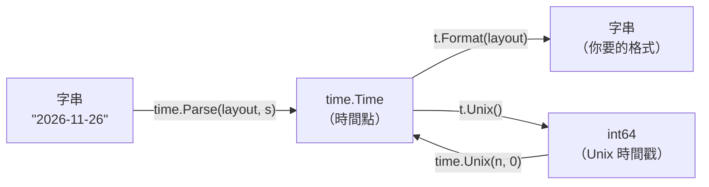

# [go-6-1] 日常工具：`fmt`、`strings`、`strconv`、`time`

> **本章目標**：把後端幾乎每天都會碰的四個標準庫套件一次摸熟——怎麼格式化輸出（`fmt`）、怎麼處理字串（`strings`）、怎麼在字串和數字之間轉換（`strconv`），以及怎麼正確處理時間與時區（`time`，這塊坑最多）。

前面幾個 Part 教的是「語言本身」。從這章開始進 Part 6，我們看 Go 真正強大的地方：**標準庫（standard library）**。Go 的標準庫厚到很多專案「只靠它」就能上線，不裝任何第三方套件。這章先挑四個你寫任何 Go 程式都躲不掉的日常工具，最後一個 `time` 是重點——時間與時區的坑，是後端最常見的靜默 bug 來源之一。

## 你會學到

- `fmt`：`Printf` 的常用動詞（verb）、`Sprintf` 把格式化結果變成字串
- `strings`：切割、拼接、搜尋、去空白，以及拼大量字串時為什麼要用 `strings.Builder`
- `strconv`：字串 ↔ 數字的正確轉換，以及為什麼不能直接「硬轉」
- `time`：`time.Time`、`Duration`、Go 那個很怪的「參考時間」格式字串
- **時區與解析的坑**：為什麼 `time.Parse` 沒指定時區時會當成 UTC、`time.Now()` 又是本地時間

## 概念說明

### `fmt`：格式化的入口

`fmt`（format 的縮寫）你其實從 `go-0-3` 的 Hello World 就在用了。它負責「把值變成人看得懂的文字」。最常用的三組：

```
Println(...)  → 印一行，自動在值之間加空白、結尾換行（最隨手）
Printf(格式, ...) → 照「格式字串」精準控制輸出（要排版、補零、對齊時用）
Sprintf(格式, ...) → 跟 Printf 一樣，但不印出來，而是「回傳一個字串」
```

`Printf` 的格式字串裡有「動詞（verb）」，用 `%` 開頭，告訴它「這個位置的值要怎麼印」。你不需要背完，記住最常用的幾個：

| 動詞 | 用途 | 範例輸出 |
|------|------|---------|
| `%d` | 十進位整數 | `42` |
| `%s` | 字串 | `hello` |
| `%f` | 浮點數 | `3.140000` |
| `%.2f` | 浮點數、保留 2 位小數 | `3.14` |
| `%t` | 布林 | `true` |
| `%v` | 「預設格式」印任何值（最通用） | 隨型別而定 |
| `%+v` | 印 struct 時連欄位名一起印（除錯神器） | `{Name:Alice Age:30}` |
| `%q` | 加引號的字串（看清楚有沒有空白/特殊字元） | `"hello"` |
| `%T` | 印出值的「型別」而不是值 | `int`、`string` |

> **小訣竅**：除錯時搞不清楚一個值到底是什麼，先 `fmt.Printf("%+v (%T)\n", x, x)`——同時看到「值」和「型別」。

### `strings`：字串處理的工具箱

Go 的字串是唯讀的（不可變），所有「處理字串」的操作都在 `strings` 套件裡，而且**都回傳一個新字串**，不會改到原本的。常用的你掃一眼就懂：

```
strings.Contains(s, sub)      → s 裡面有沒有 sub？（回傳 bool）
strings.HasPrefix(s, p)       → s 是不是以 p 開頭？
strings.Split(s, sep)         → 用 sep 把 s 切成 []string
strings.Join(parts, sep)      → 反過來，把 []string 用 sep 黏成一個字串
strings.TrimSpace(s)          → 去掉頭尾的空白、換行
strings.ReplaceAll(s, a, b)   → 把 s 裡所有的 a 換成 b
strings.ToLower(s) / ToUpper  → 轉大小寫
```

這些都很直覺，真正要特別講的是**拼接大量字串**的效能坑，看程式碼範例的最後一段。

### `strconv`：字串和數字之間要「明確轉換」

Go 是強型別語言，`"42"`（字串）和 `42`（整數）是**兩種完全不同的東西**，不能像 JavaScript 那樣含糊地混用。從 HTTP 請求、設定檔、命令列讀進來的東西幾乎都是字串，你要自己把它轉成數字——這就是 `strconv`（string conversion）的工作。

```
strconv.Atoi("42")        → 字串轉 int，回傳 (int, error)        // Atoi = ASCII to integer
strconv.Itoa(42)          → int 轉字串，回傳 string              // Itoa = integer to ASCII
strconv.ParseFloat(s, 64) → 字串轉 float64，回傳 (float64, error)
strconv.ParseBool("true") → 字串轉 bool，回傳 (bool, error)
```

注意這幾個「字串轉過去」的函式幾乎都回傳 `(值, error)`——因為**轉換可能失敗**（`"abc"` 根本不是數字）。這正是 `go-3-1` 說的「錯誤是值」：轉不出來不是崩潰，是回一個你必須處理的 `error`。

> **常見錯誤 — 想用「型別轉換」把字串變數字：**
> ```go
> s := "42"
> n := int(s) // ❌ 編譯錯誤：cannot convert s (string) to type int
> ```
> `int(x)` 這種轉換只在**數字型別之間**（例如 `int` ↔ `float64`）有效，它是「重新解讀同一塊數字」。字串 `"42"` 底層是三個位元組的文字，不是數字，必須用 `strconv.Atoi` **解析**它。記住區別：**數字之間用 `int(...)` 轉型，文字與數字之間用 `strconv` 解析。**

### `time`：時間、時長，與那個很怪的格式字串

`time` 套件有兩個核心型別：

- `time.Time`：一個「時間點」（某年某月某日某時某分某秒，還帶時區）。
- `time.Duration`：一段「時長」（底層是 `int64` 的奈秒數），例如 `5 * time.Second`、`100 * time.Millisecond`。你在 `go-4-6` 的 `context.WithTimeout` 已經用過它。

Go 格式化時間的方式是全世界最特別的：**它不用 `YYYY-MM-DD` 這種符號，而是用一個固定的「參考時間」當範本。** 這個參考時間是：

```
2006-01-02 15:04:05
```

為什麼是這串數字？因為它剛好是 `1 2 3 4 5 6`（美式排法：月 1、日 2、時 3（下午 3 點=15）、分 4、秒 5、年 06）。你要輸出什麼格式，就把這個參考時間「排成你要的樣子」：

```
t.Format("2006-01-02")           → 2026-11-26
t.Format("2006/01/02 15:04:05")  → 2026/11/26 14:30:00
t.Format("15:04")                → 14:30
```

一開始會很不習慣，但記住「它用的是 `2006-01-02 15:04:05` 這個樣板」就好。



這張圖在說：`time.Time` 是中心，字串靠 `Parse`／`Format` 進出，而和外部系統（資料庫、API）傳遞時間常用的 **Unix 時間戳**（從 1970 年起算的秒數）靠 `Unix()`／`time.Unix()` 進出。

**時區（timezone）才是真正的坑**，單獨開一段講。

### 時區：最容易靜默算錯的地方

`time.Time` 內部一定帶著一個「時區（Location）」，而這件事常常被忽略，結果時間莫名其妙差了 8 小時。三個你必須知道的事實：

1. **`time.Now()` 回傳的是「本地時間」**（程式所在機器的時區，`time.Local`）。你在台灣跑就是 UTC+8，部署到 UTC 的伺服器上就是 UTC——同一支程式，行為跟著機器跑。
2. **`time.Parse(layout, s)` 當字串裡「沒寫時區」時，會把它當成 UTC**，不是你的本地時間。所以 `time.Parse("2006-01-02", "2026-11-26")` 解出來的是「UTC 的 2026-11-26 00:00」，不是「台北的午夜」。
3. 要在指定時區解析，用 `time.ParseInLocation(layout, s, loc)`；要載入某個時區用 `time.LoadLocation("Asia/Taipei")`。

> **後端的黃金守則**：**內部一律用 UTC 存、用 UTC 算，只在「要顯示給使用者看」的最後一刻才轉成當地時區。** 資料庫存 UTC、服務之間傳 UTC，可以省掉無數「到底這個時間是哪個時區」的災難。程式裡需要當下時間就用 `time.Now().UTC()`。

## 程式碼範例

### 範例一：`fmt` 的格式化動詞

這段示範幾個最常用的動詞，特別是除錯時好用的 `%+v` 和 `%T`。

```go
package main

import "fmt"

type User struct {
	Name string
	Age  int
}

func main() {
	user := User{Name: "Alice", Age: 30}

	fmt.Printf("姓名：%s，年齡：%d\n", user.Name, user.Age) // 姓名：Alice，年齡：30
	fmt.Printf("圓周率約 %.2f\n", 3.14159)                   // 圓周率約 3.14
	fmt.Printf("預設格式：%v\n", user)                       // 預設格式：{Alice 30}
	fmt.Printf("帶欄位名：%+v\n", user)                      // 帶欄位名：{Name:Alice Age:30}
	fmt.Printf("型別是：%T\n", user)                         // 型別是：main.User

	// Sprintf：不印出來，而是組成一個字串（常用來組訊息、組 key）
	label := fmt.Sprintf("user-%d", user.Age)
	fmt.Println(label) // user-30
}
```

重點：除錯印 struct 時用 `%+v`（看得到欄位名），要組字串時用 `Sprintf` 而不是硬用 `+` 串——可讀性好很多。

### 範例二：`strings` 處理一行 CSV

情境：拿到一行逗號分隔的文字，把它切開、去掉每格頭尾的空白、再組回去。這模擬了解析設定或簡單資料的日常。

```go
package main

import (
	"fmt"
	"strings"
)

func main() {
	line := " Alice , 30 , Taipei "

	// 1. 用逗號切成好幾段
	fields := strings.Split(line, ",")

	// 2. 逐段去掉頭尾空白
	for i, field := range fields {
		fields[i] = strings.TrimSpace(field)
	}
	fmt.Printf("%q\n", fields) // ["Alice" "30" "Taipei"]

	// 3. 再用 " | " 黏回去
	fmt.Println(strings.Join(fields, " | ")) // Alice | 30 | Taipei

	// 其他常用判斷
	fmt.Println(strings.Contains(line, "Taipei"))   // true
	fmt.Println(strings.HasPrefix("user-42", "user")) // true
}
```

說明：`%q` 幫我們把每個字串加上引號印出來，一眼就能確認空白真的被去乾淨了（這也是 `%q` 的日常用途）。

### 範例三：`strconv` 安全地把輸入轉成數字

情境：從外部（例如網址查詢參數）拿到字串 `"25"`，要轉成數字來用。關鍵是**處理轉換失敗**。

```go
package main

import (
	"fmt"
	"strconv"
)

func main() {
	inputs := []string{"25", "3.14", "abc"}

	for _, in := range inputs {
		n, err := strconv.Atoi(in)
		if err != nil {
			// 轉不出整數就是壞輸入，誠實回報（go-3-1）
			fmt.Printf("%q 不是合法的整數：%v\n", in, err)
			continue
		}
		fmt.Printf("%q → %d（平方是 %d）\n", in, n, n*n)
	}

	// int 轉回字串
	fmt.Println("組出來的 key：" + "item-" + strconv.Itoa(99)) // item-99
}
```

輸出：`"25"` 成功轉成 25，`"3.14"` 和 `"abc"` 都因為不是整數而印出錯誤訊息。**重點是永遠檢查 `err`**——外部輸入隨時可能是垃圾，`strconv` 把「這不是數字」變成一個你必須面對的 `error`，而不是給你一個亂猜的值。

### 範例四：`time` 的格式化、解析與時區

這段把前面講的時區坑用程式碼演一遍：同一個時間點，在 UTC 和台北時區印出來差了 8 小時。

```go
package main

import (
	"fmt"
	"time"
)

func main() {
	// 建一個明確的 UTC 時間點：2026-11-26 00:00:00 UTC
	t := time.Date(2026, 11, 26, 0, 0, 0, 0, time.UTC)

	// 用 Go 的參考時間樣板格式化
	fmt.Println(t.Format("2006-01-02 15:04:05 MST")) // 2026-11-26 00:00:00 UTC

	// 轉到台北時區看看——同一個瞬間，顯示差 8 小時
	taipei, err := time.LoadLocation("Asia/Taipei")
	if err != nil {
		panic(err) // 時區資料庫載入失敗屬於環境問題，這裡直接炸（go-3-4）
	}
	fmt.Println(t.In(taipei).Format("2006-01-02 15:04:05 MST")) // 2026-11-26 08:00:00 CST

	// 解析字串：沒寫時區 → 被當成 UTC
	parsed, _ := time.Parse("2006-01-02", "2026-11-26")
	fmt.Println(parsed.Location()) // UTC（不是你的本地時間！）

	// 要在指定時區解析，用 ParseInLocation
	parsedTpe, _ := time.ParseInLocation("2006-01-02", "2026-11-26", taipei)
	fmt.Println(parsedTpe) // 2026-11-26 00:00:00 +0800 CST

	// Duration：量一段程式跑了多久
	start := time.Now()
	time.Sleep(10 * time.Millisecond)
	fmt.Printf("耗時約 %v\n", time.Since(start)) // 耗時約 10ms 左右
}
```

逐項說明：

- `time.Date(...)` 建一個「明確指定時區」的時間點——這是最不會搞錯的建法，因為你被迫寫出時區（最後那個 `time.UTC`）。
- `t.In(taipei)`：**同一個時間瞬間**換個時區「顯示」。注意時間點沒變，變的只是呈現方式，所以 UTC 的 00:00 等於台北的 08:00。
- `time.Parse` 解析沒帶時區的字串時，`parsed.Location()` 印出 `UTC`——這就是坑：你以為解出「今天」，其實差了 8 小時。要指定時區請改用 `time.ParseInLocation`。
- `time.Since(start)` 等於 `time.Now().Sub(start)`，回傳一個 `Duration`，是量「這段程式跑多久」的標準寫法。

> **常見錯誤 — 用時間字串做「相等」比較：**
> `time.Time` 還帶一個「單調時鐘（monotonic clock）」讀數和時區資訊，兩個「看起來一樣」的時間用 `==` 比可能不相等。要比較兩個時間點請用 `t1.Equal(t2)`（它只比「是不是同一個瞬間」，不管時區與單調時鐘），要比先後用 `t1.Before(t2)` / `t1.After(t2)`。

## 小練習

1. **格式化練習**：寫一個函式 `formatPrice(cents int) string`，把「以分為單位的整數金額」格式化成 `$12.34` 這種字串（提示：`fmt.Sprintf` 配 `%d` 和除法、取餘數，或用 `%.2f` 配 `float64(cents)/100`——想想哪種比較不會有精度問題）。
2. **解析練習**：寫一個函式 `parseConfig(line string) (key, value string, err error)`，接受 `"timeout = 30"` 這種設定行，用 `strings` 切出 `key` 和 `value` 並各自 `TrimSpace`。格式不對（沒有 `=`）時回傳一個有意義的 error。
3. **時區思考題**：你的服務部署在 UTC 的雲端伺服器，資料庫把一筆訂單的建立時間存成 `time.Now()`（本地時間，就是 UTC）。前端要顯示給台北的使用者看。請描述「存」和「顯示」這兩端各該怎麼處理時區，才不會差 8 小時。

<details>
<summary>參考解答</summary>

**第 1 題（格式化金額）**

用「整數除法 + 取餘數」最穩，避免浮點數精度問題（這個精度坑下一章 `go-6-2` 會再碰到）：

```go
func formatPrice(cents int) string {
	// 用整數運算拆出「元」和「分」，不碰浮點數
	dollars := cents / 100
	remainder := cents % 100
	return fmt.Sprintf("$%d.%02d", dollars, remainder) // %02d：不足兩位補零
}
// formatPrice(1234) → "$12.34"
// formatPrice(5)    → "$0.05"（%02d 讓它印成 05 而不是 5）
```

關鍵是 `%02d`——補零到兩位，否則 `formatPrice(5)` 會印成 `$0.5`。用整數運算的理由：錢永遠不該用浮點數存，`float64(cents)/100` 在某些數值會出現 `12.339999...` 這種誤差。

**第 2 題（解析設定行）**

```go
func parseConfig(line string) (key, value string, err error) {
	parts := strings.SplitN(line, "=", 2) // SplitN 限切 2 段：value 裡若也有 = 不會被切壞
	if len(parts) != 2 {
		return "", "", fmt.Errorf("設定格式錯誤，少了 '='：%q", line)
	}
	return strings.TrimSpace(parts[0]), strings.TrimSpace(parts[1]), nil
}
// parseConfig("timeout = 30") → ("timeout", "30", nil)
// parseConfig("壞掉的行")      → ("", "", error)
```

兩個細節：用 `SplitN(line, "=", 2)` 而不是 `Split`，這樣 value 裡萬一也有 `=`（例如 `url = http://a?x=1`）不會被切壞；錯誤訊息帶上 `%q` 把原始輸入印出來，方便除錯（呼應 `CLAUDE.md`「錯誤訊息要對人有意義」）。

**第 3 題（存與顯示的時區處理）**

- **存**：伺服器在 UTC，`time.Now()` 剛好是 UTC，存進去沒問題——但**不要依賴「伺服器剛好在 UTC」這件事**，哪天搬機器就爆。正確做法是明確寫 `time.Now().UTC()`，讓「存 UTC」變成程式碼寫死的保證，和機器時區脫鉤。
- **顯示**：從資料庫讀出來的是 UTC 時間點，在送給前端（或在前端）用 `t.In(taipei)` 轉成台北時區再格式化。或者後端直接回傳 UTC 的 ISO 8601 字串（例如 `2026-11-26T00:00:00Z`），讓前端依使用者的瀏覽器時區去顯示。
- **核心原則**：UTC 進、UTC 存、UTC 算，只在最後呈現那一刻才落地到當地時區。差 8 小時的 bug 幾乎都來自「存的時候就用了本地時間，又在別的時區讀出來」。

</details>

## 課外讀物

> 金額為什麼不該用浮點數存、JSON 裡的數字精度坑 → 下一章 `go-6-2` `encoding/json`

> 這些工具組起來就能處理 HTTP 請求的輸入（字串參數轉數字、組回應字串） → `go-6-3` `net/http`
