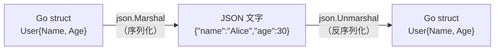

# [go-6-2] `encoding/json`：struct tag、序列化與反序列化

> **本章目標**：學會用 `encoding/json` 在「Go 的 struct」和「JSON 文字」之間來回轉換，掌握 struct tag 控制欄位名、`omitempty` 的真正行為，以及 JSON 數字精度這個會讓金額靜默算錯的坑。

後端的日常就是收 JSON、回 JSON。前端送一包 JSON 進來，你要把它變成程式裡好用的 struct；算完之後再把 struct 變回 JSON 送出去。這兩個動作有正式名稱：**序列化（serialization / marshal）**是「struct → JSON 文字」，**反序列化（deserialization / unmarshal）**是「JSON 文字 → struct」。Go 用標準庫 `encoding/json` 就能做，不需要像別的語言那樣裝第三方函式庫。

## 你會學到

- `json.Marshal` / `json.Unmarshal`：struct 和 JSON 之間來回轉
- struct tag：用 `` `json:"..."` `` 控制 JSON 裡的欄位名
- 為什麼「大寫開頭」的欄位才會被序列化（呼應 `go-5-1` 的可見性）
- `omitempty` 到底在什麼時候「省略」欄位，以及它常被誤解的地方
- **JSON 數字精度的坑**：為什麼大整數和金額用 `float64` 接會出錯

## 概念說明

### 序列化與反序列化：一張圖看懂方向



這張圖在說：`Marshal` 把程式裡的 struct 轉成可以透過網路傳、可以存檔的 JSON 文字；`Unmarshal` 反過來，把收到的 JSON 文字「灌」回一個 struct，讓你用型別安全的方式存取。後端 handler 幾乎就是這兩步夾著一段商業邏輯。

### 兩個鐵則：大寫開頭 + struct tag

Go 的 JSON 有兩個一開始最容易踩的規則：

**鐵則一：只有「大寫開頭」的欄位會被序列化。** 還記得 `go-5-1` 的可見性嗎——大寫開頭＝對外匯出（exported），小寫＝套件私有。`encoding/json` 在另一個套件裡，它**看不到**你的小寫欄位，所以小寫欄位會被完全忽略。

```go
type User struct {
	Name string // 大寫 → 會出現在 JSON
	age  int     // 小寫 → json 看不到，完全不會出現
}
```

**鐵則二：預設的 JSON 欄位名就是 Go 欄位名（含大寫），要改名得靠 struct tag。** 但 JSON 的慣例是小寫（`name` 而不是 `Name`），所以幾乎每個欄位都會加一個 **struct tag** 來指定 JSON 裡的名字。struct tag 是寫在欄位後面反引號裡的「中繼資料」，你在 `go-2-1` 第一次見過它：

```go
type User struct {
	Name string `json:"name"`      // 序列化成 "name"
	Age  int    `json:"age"`        // 序列化成 "age"
}
```

把 tag 想成「貼在欄位上的翻譯標籤」：Go 這邊叫 `Name`（大寫，才能被匯出），但告訴 JSON「你那邊請叫我 `name`」。

### `omitempty`：空值就省略，但「空」的定義要小心

tag 還能加選項，最常用的是 `omitempty`——「當這個欄位是**零值（zero value）**時，序列化就整個省略不輸出」。

```go
type User struct {
	Name     string `json:"name"`
	Nickname string `json:"nickname,omitempty"` // 空字串就不輸出這個欄位
}
```

`Nickname` 是空字串 `""` 時，JSON 裡**根本不會有 `nickname` 這個 key**；有值時才出現。這在「可選欄位」很好用，少傳一堆 null。

> **常見錯誤 — 以為 `omitempty` 能區分「0」和「沒給」：**
> `omitempty` 判斷的是「零值」：數字的零值是 `0`、布林是 `false`、字串是 `""`、指標/slice/map 是 `nil`。問題來了——一個 `Count int` 欄位，值**真的是 0** 和「使用者沒填」在 `omitempty` 眼裡**一模一樣**，都會被省略。如果你需要分辨「數量是 0」和「沒提供數量」，`omitempty` 幫不了你，要改用**指標**（`*int`）：`nil` 代表沒給、`&zero` 代表真的是 0。這是 Go 處理「可選數值」的標準手法。

### JSON 數字精度的坑

這是最隱密、最容易靜默出錯的地方。JSON 規格裡「數字」只有一種，沒有分整數和浮點數。而 Go 的 `encoding/json` 在**反序列化到 `interface{}`（`any`）時，一律把 JSON 數字解析成 `float64`**。

`float64` 是 64 位元浮點數，它能精確表示的整數上限大約是 2⁵³（約 9×10¹⁵）。超過這個範圍的大整數——例如某些 64 位元的 ID、雪花演算法（snowflake）產生的 ID——用 `float64` 接會**悄悄失真**：

```
原始 ID：  9007199254740993
經過 float64：9007199254740992   ← 最後一位被吃掉了，而且不報錯！
```

這不是會崩潰的錯誤，是**算出來的值就是錯的**——最可怕的那種 bug。金額也一樣：`0.1 + 0.2` 在浮點數世界等於 `0.30000000000000004`，拿來算錢遲早出事。

處理原則：

1. **大整數 ID**：在 struct 裡明確用 `int64` 接（只要你有對應的 struct 欄位、不是解析到 `any`，`encoding/json` 就會正確用 `int64`，不走 `float64`）。真的大到超過 int64 或需要跟 JavaScript 前端相容，就**用字串傳 ID**（`"id": "9007199254740993"`）。
2. **金額**：永遠不要用浮點數。用「最小單位的整數」（例如「分」而不是「元」）存，或用十進位小數型別（`go-6-4` 的資料庫章節會再提 `DECIMAL`）。
3. 需要保留 JSON 數字原始精度再自己決定怎麼解讀時，用 `json.Number`（它其實是個字串）。

## 程式碼範例

### 範例一：序列化——struct 轉 JSON

這段把一個 `User` 轉成 JSON 文字。注意 tag 怎麼控制欄位名、`omitempty` 怎麼讓空欄位消失。

```go
package main

import (
	"encoding/json"
	"fmt"
)

type User struct {
	ID       int64  `json:"id"`
	Name     string `json:"name"`
	Nickname string `json:"nickname,omitempty"` // 空的就不輸出
	password string // 小寫 → 永遠不會進 JSON（連想輸出都不行）
}

func main() {
	user := User{ID: 1, Name: "Alice", password: "secret"}

	data, err := json.Marshal(user)
	if err != nil {
		// 序列化幾乎只有在遇到無法表示的型別（如 channel）時才失敗
		fmt.Println("序列化失敗：", err)
		return
	}
	fmt.Println(string(data)) // {"id":1,"name":"Alice"}

	// 想要有縮排、好讀的 JSON（印 log、回開發用 API 時）用 MarshalIndent
	pretty, _ := json.MarshalIndent(user, "", "  ")
	fmt.Println(string(pretty))
}
```

重點：

- 輸出是 `{"id":1,"name":"Alice"}`——`nickname` 因為是空字串被 `omitempty` 省掉了，`password` 因為小寫根本不存在。順帶一提，「小寫欄位不會進 JSON」也是個安全特性：像密碼這種不該外洩的欄位，天生就序列化不出去。
- `json.Marshal` 回傳的是 `[]byte`（位元組切片），要印出來看得先 `string(data)` 轉成字串。
- `MarshalIndent` 產生有縮排的漂亮 JSON，適合除錯；正式 API 回應通常用 `Marshal`（省頻寬）。

### 範例二：反序列化——JSON 轉 struct

情境：收到一包 JSON 文字（模擬前端送來的請求 body），把它灌進 struct。

```go
package main

import (
	"encoding/json"
	"fmt"
)

type User struct {
	ID       int64  `json:"id"`
	Name     string `json:"name"`
	Nickname string `json:"nickname,omitempty"`
}

func main() {
	// 模擬收到的 JSON（實務上來自 HTTP request body）
	raw := []byte(`{"id": 42, "name": "Bob", "nickname": "bobby", "extra": "被忽略"}`)

	var user User
	if err := json.Unmarshal(raw, &user); err != nil {
		// JSON 格式壞掉、型別對不上時會在這裡回 error
		fmt.Println("反序列化失敗：", err)
		return
	}

	fmt.Printf("%+v\n", user) // {ID:42 Name:Bob Nickname:bobby}
}
```

說明：

- `json.Unmarshal(raw, &user)` 第二個參數要傳 **`&user`（指標）**——因為它要「填進」你的變數，不是回傳新值。忘了加 `&` 會灌不進去（這是 `go-1-6` 指標的實際用途）。
- JSON 裡多出來的 `extra` 欄位，struct 沒有對應欄位，會被**安靜忽略**（預設行為）。如果你希望「收到沒定義的欄位就報錯」，要用 `json.Decoder` 配 `DisallowUnknownFields()`。
- 反序列化會回 `error`，一定要檢查——前端送來的 JSON 隨時可能壞掉或型別不符，這是 `go-3-1`「錯誤是值」的典型場景。

### 範例三：JSON 數字精度的坑，眼見為憑

這段把前面講的 `float64` 失真演出來，讓你親眼看到「大整數被安靜改小」。

```go
package main

import (
	"encoding/json"
	"fmt"
)

func main() {
	raw := []byte(`{"id": 9007199254740993}`)

	// 壞做法：解析到 any → 數字變成 float64，大整數失真
	var loose map[string]any
	json.Unmarshal(raw, &loose)
	fmt.Printf("解析到 any：%.0f（被改掉了！）\n", loose["id"]) // 9007199254740992

	// 好做法：有明確 int64 欄位的 struct → 精確
	var strict struct {
		ID int64 `json:"id"`
	}
	json.Unmarshal(raw, &strict)
	fmt.Printf("解析到 int64：%d（正確）\n", strict.ID) // 9007199254740993
}
```

說明：

- 第一種做法把 JSON 解析到 `map[string]any`，所有數字都變 `float64`，於是 `...993` 被無聲改成 `...992`——**沒有任何錯誤，值就是錯的**。
- 第二種做法用明確的 `int64` struct 欄位，`encoding/json` 會把數字正確解析成 64 位元整數。
- 教訓：**盡量定義明確的 struct 來接 JSON，少用 `map[string]any` 這種「什麼都能接」的容器**——它不只失去型別安全（`go-2-4` 講過空介面要節制用），還會悄悄弄壞你的大整數。

## 小練習

1. **tag 與 omitempty**：定義一個 `Product` struct，有 `ID int64`、`Name string`、`Description string`（可選，空的就不輸出）、`Price int`（以「分」為單位）。序列化一個 `Description` 為空的 Product，確認輸出的 JSON 裡沒有 `description` 這個 key。
2. **可選的 0 vs 沒給**：延續上題，假設 `Product` 多一個「庫存數量」欄位，你要能分辨「庫存是 0（賣完了）」和「這次請求沒提供庫存」兩種情況。想想該用什麼型別，寫出這個欄位的定義並解釋。
3. **反序列化錯誤處理**：寫一個函式 `parseUser(raw []byte) (*User, error)`，把 JSON 反序列化成 `User`，並在 JSON 格式錯誤時回傳一個有意義的錯誤（提示：用 `fmt.Errorf` 搭 `%w` 包裝原始錯誤，呼應 `go-3-2`）。

<details>
<summary>參考解答</summary>

**第 1 題（tag 與 omitempty）**

```go
type Product struct {
	ID          int64  `json:"id"`
	Name        string `json:"name"`
	Description string `json:"description,omitempty"` // 空字串就省略
	Price       int    `json:"price"`                 // 以分為單位，避免浮點
}

func main() {
	p := Product{ID: 1, Name: "筆記本", Price: 12000} // Description 留空
	data, _ := json.Marshal(p)
	fmt.Println(string(data)) // {"id":1,"name":"筆記本","price":12000}
}
```

驗收點：輸出裡**沒有** `description`。`Price` 用 `int`（分），所以 12000 代表 $120.00——錢用整數存，不碰浮點數（呼應 `go-6-1` 練習和本章的精度坑）。

**第 2 題（0 vs 沒給，用指標）**

要分辨「真的是 0」和「沒給」，用 **`*int`（指標）**：

```go
type Product struct {
	// ... 其他欄位
	Stock *int `json:"stock,omitempty"` // nil=沒提供；指向 0=庫存真的是 0
}
```

- `Stock == nil`：請求根本沒帶這個欄位（沒給）。
- `Stock != nil && *Stock == 0`：明確告訴你庫存是 0（賣完）。
- 為什麼不能用 `int` + `omitempty`？因為 `int` 的零值就是 0，`omitempty` 會把「真的是 0」和「沒給」都當成空值省略，兩者無法區分。指標的 `nil` 提供了「第三種狀態」——這正是 Go 表達「可選值」的標準做法。

**第 3 題（反序列化 + 錯誤包裝）**

```go
func parseUser(raw []byte) (*User, error) {
	var user User
	if err := json.Unmarshal(raw, &user); err != nil {
		// 用 %w 包裝原始錯誤，上游能用 errors.Is / errors.As 檢查（go-3-2）
		return nil, fmt.Errorf("解析 User JSON 失敗：%w", err)
	}
	return &user, nil
}
```

驗收點：

- 合法 JSON → 回傳 `(*User, nil)`。
- 壞掉的 JSON（例如 `{"id": "不是數字"}`）→ 回傳 `(nil, error)`，而且錯誤訊息前面有我們加的「解析 User JSON 失敗：」，後面接 `encoding/json` 給的原始原因。用 `%w` 而非 `%v` 的好處是上游還能用 `errors.As` 把底層的 `*json.UnmarshalTypeError` 拆出來，做更細的判斷。

</details>

## 課外讀物

> 金額、時間這類「不能用浮點數硬存」的東西，怎麼落到資料庫（`DECIMAL`、`TIMESTAMPTZ`） → `go-6-4` `database/sql`

> 這個序列化/反序列化的流程，正是 HTTP handler 收請求、回回應的核心 → `go-6-3` `net/http`，以及 Part 7 的實戰
