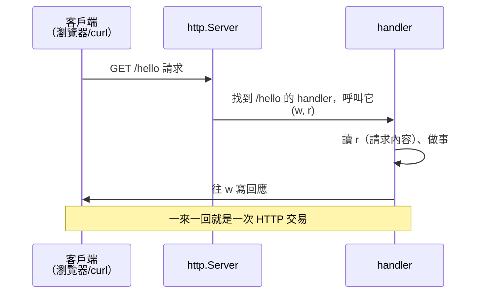

# [go-6-3] `net/http`：不靠框架，標準庫就能跑一個 HTTP 伺服器

> **本章目標**：用 Go 標準庫 `net/http` 寫出一個「不靠任何框架」就能跑的 HTTP 伺服器，也學會當 HTTP 客戶端去呼叫別人的 API。這是理解 Part 7 整套 Web 後端的地基。

很多語言要寫後端，第一步就是裝一個 Web 框架（Node 的 Express、Python 的 Flask）。Go 不用——標準庫的 `net/http` 本身就是個**完整、可上線**的 HTTP 伺服器。這就是為什麼 Go 社群有一句名言：「很多專案只用標準庫就夠了。」這章我們不碰任何框架，先用純 `net/http` 把伺服器和客戶端都跑一次，你就會懂 Part 7 那些框架到底在「包」什麼。

## 你會學到

- `http.HandleFunc` / `http.ListenAndServe`：十行內跑一個伺服器
- handler 的本質：`http.ResponseWriter`（怎麼回）和 `*http.Request`（收到什麼）
- 怎麼回一包 JSON（接上一章 `encoding/json`）
- 當 HTTP **客戶端**：用 `http.Get` 呼叫別人的 API，並記得關 `resp.Body`
- 為什麼真實服務要自己建 `http.Server` 而不是用最偷懶的寫法（逾時設定）

## 概念說明

### 一個 HTTP 伺服器在做什麼？

HTTP 伺服器的工作，說穿了就是一個迴圈：**收到請求 → 看是哪個路徑 → 交給對應的處理函式 → 把結果寫回去**。

```
伺服器啟動，一直聽著某個埠（例如 8080）：
    每收到一個請求：
        看請求的路徑（例如 /users）
        找到負責這個路徑的 handler
        handler 讀請求、做事、把回應寫回去
```

在 Go 裡，負責「某個路徑」的那個處理函式叫 **handler**，它長這樣：

```
func(w http.ResponseWriter, r *http.Request)
```

- `r *http.Request`：**進來的請求**——網址、方法（GET/POST）、header、body 全在這裡面。
- `w http.ResponseWriter`：**出去的回應**——你往這個 `w` 寫東西，就等於寫回給客戶端。把它想成「回應的輸出管線」（這其實就是 `go-6-5` 要講的 `io.Writer`，先有個印象）。



這張圖在說：客戶端發請求給伺服器，伺服器依路徑把請求轉給對應的 handler，handler 讀 `r`、處理、往 `w` 寫回去，客戶端就收到回應。

> HTTP 這個協定本身（方法、狀態碼、header 在幹嘛） → [課外讀物 E-3-3：HTTP 協定](../../../課外讀物/E-3-network/E-3-3-http-protocol.md)

### `ServeMux`：把路徑對應到 handler 的「總機」

誰決定「`/hello` 該交給哪個 handler」？是一個叫 **`ServeMux`**（multiplexer，多工器，可以想成電話總機）的東西。你向它登記「這個路徑 → 這個 handler」，它就負責把進來的請求轉接到對的地方。

Go 1.22 之後 `ServeMux` 變強了，可以直接在路徑裡寫方法和路徑參數，例如 `"GET /users/{id}"`——以前這得靠框架才有。你先知道「有個總機在做路徑對應」就好，細節 Part 7 再深入。

## 程式碼範例

### 範例一：最小的 HTTP 伺服器

這是 Go 後端的「Hello World」。短到你會懷疑是不是漏了什麼——沒有，標準庫就這麼直接。

```go
package main

import (
	"fmt"
	"net/http"
)

func main() {
	// 登記：路徑 "/hello" 交給這個匿名函式處理
	http.HandleFunc("/hello", func(w http.ResponseWriter, r *http.Request) {
		// 往 w 寫字，就是寫回給客戶端
		fmt.Fprintf(w, "你好，%s！\n", r.URL.Query().Get("name"))
	})

	// 開始在 8080 埠聽，並且阻塞在這裡（這行不會返回，除非出錯）
	fmt.Println("伺服器跑在 http://localhost:8080")
	if err := http.ListenAndServe(":8080", nil); err != nil {
		// 埠被佔用之類的啟動失敗會在這裡炸出來
		fmt.Println("伺服器啟動失敗：", err)
	}
}
```

跑起來後，瀏覽器開 `http://localhost:8080/hello?name=Alice`，會看到「你好，Alice！」。逐項說明：

- `http.HandleFunc(路徑, 函式)`：向「預設的總機」登記一條路徑對應。
- `fmt.Fprintf(w, ...)`：還記得 `go-6-1` 的 `fmt`？`Fprintf` 的 `F` 就是「寫到某個目標」——這裡的目標是 `w`（回應）。你往 `w` 寫什麼，客戶端就收到什麼。
- `r.URL.Query().Get("name")`：從網址的查詢參數 `?name=...` 取出 `name` 的值。這就是 `go-6-1` 說的「從外部進來的都是字串」——要當數字用就得自己 `strconv`。
- `http.ListenAndServe(":8080", nil)`：開始聽 8080 埠。第二個參數傳 `nil` 代表「用預設總機」（也就是剛剛 `HandleFunc` 登記的那個）。這行會一直阻塞，是伺服器的主迴圈。

> ⚠️ 這個「最小寫法」方便教學，但**不適合直接上線**——它沒有設定任何逾時（timeout），惡意或很慢的客戶端可以把連線一直掛著拖垮你。範例三會給出正式的寫法。

### 範例二：回一包 JSON（後端最常見的事）

真實的 API 很少回純文字，而是回 JSON。把上一章 `encoding/json` 接進來：

```go
package main

import (
	"encoding/json"
	"net/http"
)

type User struct {
	ID   int64  `json:"id"`
	Name string `json:"name"`
}

func usersHandler(w http.ResponseWriter, r *http.Request) {
	user := User{ID: 1, Name: "Alice"}

	// 告訴客戶端「我回的是 JSON」——一定要在寫 body 之前設 header
	w.Header().Set("Content-Type", "application/json")

	// 直接把 struct 編碼成 JSON，寫進 w
	if err := json.NewEncoder(w).Encode(user); err != nil {
		// 寫到一半失敗（例如客戶端斷線）能做的有限，記 log 即可
		http.Error(w, "內部錯誤", http.StatusInternalServerError)
		return
	}
}

func main() {
	mux := http.NewServeMux()            // 自己建一個總機，比用全域預設的乾淨
	mux.HandleFunc("GET /users", usersHandler) // Go 1.22+：路徑可直接限定方法
	http.ListenAndServe(":8080", mux)
}
```

說明：

- `w.Header().Set("Content-Type", "application/json")`：告訴客戶端回應的格式是 JSON。**這一步要在寫任何 body 之前做**——一旦開始寫 body，header 就送出去了，之後再設沒用。
- `json.NewEncoder(w).Encode(user)`：這是「直接把 struct 編碼後寫進 `w`」的慣用寫法，比先 `json.Marshal` 成 `[]byte` 再 `w.Write(...)` 少一次記憶體複製。這裡的 `w` 能被 `json.Encoder` 接受，正是因為它是一個 `io.Writer`（`go-6-5` 的伏筆）。
- `mux.HandleFunc("GET /users", ...)`：用自己建的 `ServeMux`，而且路徑前面加 `GET ` 限定只收 GET 請求——別人用 POST 打這個路徑會自動被回 405。
- `http.Error(w, 訊息, 狀態碼)`：回一個錯誤狀態碼的便捷寫法。

### 範例三：正式一點的伺服器——自己建 `http.Server` 設逾時

這是你真的要上線時該用的骨架：自己建 `http.Server`，設好逾時。

```go
package main

import (
	"net/http"
	"time"
)

func main() {
	mux := http.NewServeMux()
	mux.HandleFunc("GET /health", func(w http.ResponseWriter, r *http.Request) {
		w.Write([]byte("ok"))
	})

	server := &http.Server{
		Addr:    ":8080",
		Handler: mux,
		// 逾時是線上服務的基本防線：擋住「慢速連線攻擊」和卡死的連線
		ReadTimeout:  5 * time.Second,  // 讀完整個請求最多 5 秒
		WriteTimeout: 10 * time.Second, // 寫完整個回應最多 10 秒
		IdleTimeout:  60 * time.Second, // keep-alive 連線閒置最多 60 秒
	}

	server.ListenAndServe()
}
```

說明：

- 為什麼不嫌麻煩要自己建 `http.Server`？因為 `http.ListenAndServe(":8080", mux)` 那個偷懶寫法**沒有任何逾時**，等於門戶大開。一個惡意客戶端可以連上來、然後慢吞吞地每秒送一個位元組，把連線佔著不放（這叫 Slowloris 攻擊）。設了 `ReadTimeout` / `WriteTimeout`，超時的連線會被直接切斷。
- 這三個逾時是「對服務本身的保護」，和 `go-4-6` 的 `context` 逾時（對「單一請求處理過程」的保護）是互補的兩層。Part 7 的 `go-7-5` 會把 `context` 和「優雅關機」接進來。

> 為什麼線上服務一定要設逾時——逾時、重試是韌性的基本功 → 參見 **[sre 課程大綱](../../sre/課程大綱.md)**、[課外讀物 E-15-1：Fallback 與降級](../../../課外讀物/E-15-resilience/E-15-1-fallback.md)

### 範例四：當 HTTP 客戶端——呼叫別人的 API

後端不只被呼叫，也常常去呼叫別的服務。`net/http` 同一個套件就能當客戶端。

```go
package main

import (
	"fmt"
	"io"
	"net/http"
)

func main() {
	resp, err := http.Get("https://example.com")
	if err != nil {
		// 連不上、DNS 解析失敗等網路層錯誤
		fmt.Println("請求失敗：", err)
		return
	}
	// 成對原則：拿到 Body 就要關，否則連線無法被回收重用（CLAUDE.md「成對的東西要成對」）
	defer resp.Body.Close()

	fmt.Println("狀態碼：", resp.StatusCode)

	body, err := io.ReadAll(resp.Body) // 把整個回應內容讀出來（go-6-5 的 io）
	if err != nil {
		fmt.Println("讀取回應失敗：", err)
		return
	}
	fmt.Printf("回應前 100 字：%.100s\n", body)
}
```

說明：

- `http.Get(url)` 回傳 `(*http.Response, error)`——先檢查 `error`（連不上）。
- **`defer resp.Body.Close()` 是絕對不能忘的一行**：`resp.Body` 是一個開著的連線資源，不關它會洩漏連線，底層的連線池也無法把這條連線拿去重用。這正是 `go-3-3` 的 `defer` 和「成對」原則的典型場景——拿到 Body 的下一行就 `defer` 關掉。
- `io.ReadAll(resp.Body)` 把回應 body 整個讀成 `[]byte`（`go-6-5` 會講 `io` 這一套）。
- ⚠️ 正式環境呼叫外部 API 時，不要用這個「全域 `http.Get`」——它沒逾時。要自己建 `&http.Client{Timeout: 10 * time.Second}`，並用 `http.NewRequestWithContext(ctx, ...)` 把 `go-4-6` 的 context 傳進去，這樣上游取消時這個外呼也會被一起中斷。

## 小練習

1. **加一個路徑**：在範例二的伺服器上加一個 `GET /time` 路徑，回傳現在的 UTC 時間的 JSON（例如 `{"now":"2026-11-26T06:30:00Z"}`）。用 `go-6-1` 學的 `time.Now().UTC()` 和 `time.RFC3339` 格式。
2. **讀查詢參數並轉型**：加一個 `GET /square` 路徑，讀查詢參數 `?n=5`，回傳 `{"n":5,"square":25}`。記得 `n` 進來是字串，要用 `strconv.Atoi` 轉，轉失敗要回 400 Bad Request。
3. **思考題**：範例一的「最小伺服器」和範例三的「自建 `http.Server`」，功能上都能回應請求，差別只在逾時設定。為什麼說「能跑起來」不代表「能上線」？請用一個具體的攻擊情境說明沒有逾時的危險。

<details>
<summary>參考解答</summary>

**第 1 題（回現在時間的 JSON）**

```go
func timeHandler(w http.ResponseWriter, r *http.Request) {
	resp := map[string]string{
		"now": time.Now().UTC().Format(time.RFC3339), // 內部一律用 UTC（go-6-1）
	}
	w.Header().Set("Content-Type", "application/json")
	json.NewEncoder(w).Encode(resp)
}
// 登記：mux.HandleFunc("GET /time", timeHandler)
```

驗收點：打 `GET /time` 回傳類似 `{"now":"2026-11-26T06:30:00Z"}`。用 `time.RFC3339`（標準的 ISO 8601 格式）而不是自訂格式，讓任何客戶端都好解析；用 `.UTC()` 呼應上一章的時區守則。

**第 2 題（讀參數、轉型、錯誤回 400）**

```go
func squareHandler(w http.ResponseWriter, r *http.Request) {
	nStr := r.URL.Query().Get("n")
	n, err := strconv.Atoi(nStr)
	if err != nil {
		// 壞輸入 → 400 Bad Request，並說清楚哪裡錯
		http.Error(w, "參數 n 必須是整數，收到："+nStr, http.StatusBadRequest)
		return
	}
	w.Header().Set("Content-Type", "application/json")
	json.NewEncoder(w).Encode(map[string]int{"n": n, "square": n * n})
}
```

驗收點：

- `GET /square?n=5` → `{"n":5,"square":25}`。
- `GET /square?n=abc` → HTTP 400，body 說明 n 必須是整數。
- 這題把 `go-6-1`（strconv）、本章（net/http）、JSON 回應串起來，是後端 handler 的縮影：**讀輸入 → 驗證/轉型 → 處理 → 回 JSON，壞輸入回 4xx**。

**第 3 題（為什麼能跑不等於能上線）**

「能跑起來」只證明「正常客戶端正常使用時會得到正確回應」。但線上服務面對的不只是正常客戶端，還有惡意流量。沒有逾時的具體危險：

**Slowloris 攻擊**——攻擊者開很多條連線到你的伺服器，每條都「開始送請求，但故意送得極慢」（例如每 10 秒才送一個位元組，永遠不送完）。因為你沒設 `ReadTimeout`，伺服器會耐心地等每一條連線把請求送完，於是這些連線一直佔著不放。連線數是有上限的，佔滿之後**正常使用者就再也連不進來**——用很少的頻寬就讓你的服務停擺。

設了 `ReadTimeout: 5 * time.Second`，任何「5 秒還沒把請求送完」的連線會被直接切斷，攻擊就失效了。這就是為什麼本課反覆強調：**在安全、效能這些領域，「能跑起來」什麼都不能證明**——正常路徑能跑，不代表擋得住刻意的攻擊。上線前的防線（逾時、限流、驗證）要主動加上，不能等出事。

> 限流（rate limiting）是另一道配套防線 → [課外讀物 E-10-8：Rate Limiting](../../../課外讀物/E-10-security/E-10-8-rate-limiting.md)

</details>

## 課外讀物

> HTTP 協定本身、狀態碼、header 的意義 → [課外讀物 E-3-3：HTTP 協定](../../../課外讀物/E-3-network/E-3-3-http-protocol.md)

> Web 安全的整體地圖（為什麼逾時、限流、輸入驗證缺一不可） → [課外讀物 E-10-1：Web Security 總覽](../../../課外讀物/E-10-security/E-10-1-web-security-overview.md)

> 下一章：handler 裡要存取資料庫了——怎麼連 PostgreSQL、怎麼用 context 設查詢逾時 → `go-6-4` `database/sql`

> 把 handler、路由、middleware、優雅關機組成完整服務 → Part 7 Web 後端實戰
