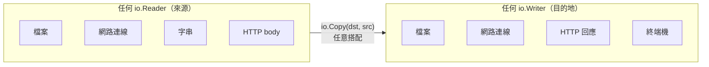

# [go-6-5] `io` 與 `bufio`：`Reader` / `Writer` 介面為什麼能串起整個生態系

> **本章目標**：搞懂 `io.Reader` 和 `io.Writer` 這兩個「只有一個方法」的小介面，為什麼是整個 Go 標準庫最重要的設計——它讓檔案、網路連線、字串、HTTP body 全都能用同一套方式串接。再學 `bufio` 怎麼用緩衝讓讀寫變快、變好用。

前面幾章你已經偷偷用過它們了：`go-6-3` 的 `w http.ResponseWriter`、`json.NewEncoder(w)`、`io.ReadAll(resp.Body)`——這些能互相接起來，背後都是同一個原因。這章把那個「為什麼什麼都能接什麼」的祕密講明白。這是整個 Part 6 收尾、也是最能體現 `go-2-3` 「小介面」威力的一章。

## 你會學到

- `io.Reader` / `io.Writer`：兩個「只有一個方法」的介面長什麼樣
- 為什麼「小介面」是 Go 最強的設計——萬物皆可接
- `io.Copy`：一行把「任何來源」倒進「任何目的地」
- `bufio`：為什麼要加一層緩衝（buffer），以及 `Scanner` 怎麼一行一行讀
- 這套設計怎麼呼應 `go-2-3`（隱式 interface）和介面隔離原則

## 概念說明

### 兩個小到不可思議的介面

Go 標準庫裡最重要的兩個介面，各自**只有一個方法**：

```go
type Reader interface {
	Read(p []byte) (n int, err error)  // 把資料讀進 p，回傳讀了幾個 byte
}

type Writer interface {
	Write(p []byte) (n int, err error) // 把 p 的資料寫出去，回傳寫了幾個 byte
}
```

就這樣。`Reader` 代表「一個可以**讀出位元組**的東西」，`Writer` 代表「一個可以**寫入位元組**的東西」。它們不在乎資料實際上是從哪來、往哪去——檔案、網路、記憶體、鍵盤，只要能 `Read` 或 `Write`，就算數。

還記得 `go-2-3` 的「隱式實作」嗎？**任何型別只要有一個長得對的 `Read` 方法，它就自動是一個 `io.Reader`**，不用寫 `implements`。這是關鍵——Go 標準庫裡一大堆型別都剛好實作了這兩個介面：

| 這個東西 | 是 `io.Reader`？ | 是 `io.Writer`？ |
|----------|:---:|:---:|
| `*os.File`（檔案） | ✅ | ✅ |
| `net.Conn`（網路連線） | ✅ | ✅ |
| `*strings.Reader`（字串當來源） | ✅ | |
| `*bytes.Buffer`（記憶體緩衝） | ✅ | ✅ |
| `http.ResponseWriter`（HTTP 回應） | | ✅ |
| `resp.Body`（HTTP 回應 body） | ✅ | |
| `os.Stdout`（標準輸出） | | ✅ |

### 為什麼這是「串起整個生態系」的設計

因為大家都實作同一組小介面，**任何「讀的東西」都能接到任何「寫的東西」上**，不需要為每種組合各寫一套。想把一個檔案的內容送到網路？把「讀 HTTP body」的結果寫進「一個檔案」？把「一個字串」當成資料來源丟給解析器？——全部是同一個動作：**從一個 `Reader` 讀，往一個 `Writer` 寫。**



這張圖在說：左邊任何一種「來源」都能透過同一個 `io.Copy` 倒進右邊任何一種「目的地」，因為它們都只是 `io.Reader` 和 `io.Writer`。4 種來源 × 4 種目的地 = 16 種組合，卻只需要**一個** `io.Copy` 函式——這就是小介面的威力。

> 這正是 `go-2-3` interface 和「介面隔離原則」的極致：介面越小，能實作它的型別就越多，能組合的方式就越多 → **[課外讀物 E-7-5] I — Interface Segregation Principle**

把它對比一下你熟悉的世界：USB 之所以能讓鍵盤、隨身碟、滑鼠、手機都插同一個孔，是因為大家都遵守同一個「小小的插頭規格」。`io.Reader` / `io.Writer` 就是 Go 資料流的 USB 規格。

### 為什麼需要 `bufio`：一次一個 byte 太慢了

`io.Reader` 的 `Read` 每呼叫一次，底層可能就是一次真實的系統呼叫（跟作業系統要資料）或一次網路往返——這些都很貴。如果你一次只讀一個 byte，讀一個 1MB 的檔案就要上百萬次昂貴操作，慢得離譜。

**`bufio`（buffered I/O，緩衝輸入輸出）**在中間加一層「緩衝區」：它一次先跟底層要一大塊（例如 4KB）放進記憶體，你之後的小量讀取都從這塊記憶體拿，拿完了才再去要下一塊。這樣昂貴的底層操作次數大幅減少。


這張圖在說：`bufio` 當中間人，把「你這端很多次小讀取」轉換成「對底層少數幾次大讀取」，用一塊記憶體緩衝把昂貴的底層操作次數降到最低。`bufio.Writer` 反過來——先把你寫的小東西累積在緩衝區，攢夠一塊才真正寫出去（所以用完要記得 `Flush()` 把剩下的擠出去）。

## 程式碼範例

### 範例一：`io.Copy` —— 一行搞定「來源倒進目的地」

這段展示同一個 `io.Copy`，怎麼把三種完全不同的來源倒進同一個目的地（終端機），完全不用管來源是什麼。

```go
package main

import (
	"io"
	"os"
	"strings"
)

func main() {
	// 來源 1：一個字串（strings.NewReader 把字串包裝成 io.Reader）
	src1 := strings.NewReader("來自字串的資料\n")

	// os.Stdout（終端機）是一個 io.Writer。把字串來源倒進去：
	io.Copy(os.Stdout, src1) // 印出「來自字串的資料」

	// 來源 2：一個檔案（*os.File 也是 io.Reader）
	file, err := os.Open("go.mod")
	if err == nil {
		defer file.Close()      // 成對：開了檔就要關
		io.Copy(os.Stdout, file) // 同一個 io.Copy，把檔案內容倒到終端機
	}
}
```

說明：

- `io.Copy(dst, src)` 的簽名是 `io.Copy(dst io.Writer, src io.Reader)`——它**只認識介面**，完全不在乎 `src` 到底是字串還是檔案。
- `strings.NewReader("...")` 把一個普通字串「包裝」成 `io.Reader`，於是字串也能被當成資料來源餵給任何吃 `Reader` 的函式。這在測試時超好用——不需要真的開檔案，用字串假裝一個輸入就行。
- 同一個 `io.Copy`，第一次倒字串、第二次倒檔案，程式碼一模一樣。這就是小介面帶來的「寫一次、到處通用」。

### 範例二：`bufio.Scanner` —— 一行一行讀（最常用）

逐行處理文字（讀 log、讀設定、處理使用者輸入）是日常。`bufio.Scanner` 是標準做法。

```go
package main

import (
	"bufio"
	"fmt"
	"strings"
)

func main() {
	// 假裝這是一個多行的輸入來源（實務上可能是檔案或 os.Stdin）
	input := "第一行\n第二行\n\n第四行"
	reader := strings.NewReader(input) // 字串 → io.Reader

	scanner := bufio.NewScanner(reader) // 包一層 bufio，支援一行一行掃
	lineNumber := 0
	for scanner.Scan() { // 每呼叫一次，讀下一行；沒有更多行就回 false
		lineNumber++
		line := scanner.Text() // 取出這一行（已經去掉結尾的換行符）
		if strings.TrimSpace(line) == "" {
			continue // 跳過空行
		}
		fmt.Printf("第 %d 行：%s\n", lineNumber, line)
	}

	// 迴圈結束後檢查錯誤——和 go-6-4 的 rows.Err() 同一個道理
	if err := scanner.Err(); err != nil {
		fmt.Println("讀取時發生錯誤：", err)
	}
}
```

說明：

- `bufio.NewScanner(reader)` 吃任何 `io.Reader`——這裡餵字串，但換成檔案（`os.Open` 回傳的）或標準輸入（`os.Stdin`）**程式碼完全不用改**。這就是介面的好處。
- `for scanner.Scan()` 是逐行讀的標準骨架：`Scan()` 讀到下一行回 true，沒有更多行回 false 結束迴圈。`scanner.Text()` 取出當前行（自動去掉 `\n`）。
- **`scanner.Err()` 收尾檢查**：和 `go-6-4` 的 `rows.Err()` 一模一樣的坑——迴圈正常結束不代表沒出錯，真正的錯誤藏在 `Err()` 裡。這是 Go 「迴圈式讀取」的通用模式，看到 `for X.Scan()` 或 `for X.Next()` 就要記得後面檢查 `X.Err()`。
- ⚠️ `Scanner` 預設單行上限約 64KB，處理可能有超長行的資料要用 `scanner.Buffer(...)` 調大，否則超長行會讓 `Scan()` 停下來（錯誤在 `Err()`）。

### 範例三：`bufio.Writer` —— 攢一批再寫，記得 Flush

情境：要寫很多小段資料。不加緩衝的話每次 `Write` 都可能是一次昂貴的底層操作；用 `bufio.Writer` 攢成一批。

```go
package main

import (
	"bufio"
	"fmt"
	"os"
)

func main() {
	// os.Stdout 是 io.Writer，用 bufio 包一層加緩衝
	writer := bufio.NewWriter(os.Stdout)

	// 這 1000 次 Write 不會各自觸發一次底層寫入，而是先攢在緩衝區
	for i := 1; i <= 1000; i++ {
		fmt.Fprintf(writer, "第 %d 行\n", i)
	}

	// 關鍵：一定要 Flush！把緩衝區裡還沒寫出去的資料擠出去
	// 忘了 Flush，緩衝區裡的資料就永遠不會被寫出，像是「寫了卻消失」
	if err := writer.Flush(); err != nil {
		fmt.Fprintln(os.Stderr, "flush 失敗：", err)
	}
}
```

說明：

- `bufio.NewWriter(os.Stdout)` 在 `os.Stdout` 外面包一層緩衝。1000 次 `Fprintf` 的資料先累積在記憶體，攢到一定量（或 `Flush` 時）才真正一次寫出。
- **`writer.Flush()` 是 `bufio.Writer` 最容易忘、後果最詭異的一步**：緩衝區裡的資料如果沒 Flush 就結束程式，那些資料**根本不會被寫出去**——你會看到「明明呼叫了 Write，輸出卻少了一截」，而且不報錯。標準做法是拿到 `bufio.Writer` 後馬上 `defer writer.Flush()`（成對原則），保證離開前一定擠乾淨。這裡為了示範把它寫在最後、並檢查錯誤。

## 小練習

1. **字串當來源**：寫一個函式 `countLines(r io.Reader) (int, error)`，用 `bufio.Scanner` 數出來源有幾行。然後用 `strings.NewReader` 餵一個多行字串測它。體會「函式吃 `io.Reader` 介面，所以測試時可以用字串、正式時可以用檔案」的好處。
2. **接起來**：`go-6-3` 的範例四我們用 `io.ReadAll(resp.Body)` 讀 HTTP 回應。改成用 `io.Copy(os.Stdout, resp.Body)` 直接把回應內容倒到終端機。想想這兩種做法在「資料很大」時的差別（一個全讀進記憶體，一個邊讀邊寫）。
3. **思考題**：`io.Reader` 和 `io.Writer` 都只有一個方法。如果 Go 的設計者當初把它們設計成「一個大介面，包含 Read、Write、Seek、Close 十幾個方法」，對整個生態系會有什麼壞處？（提示：想想 `strings.Reader` 這種「只能讀、不能寫、不能關」的東西還能不能被通用。）

<details>
<summary>參考解答</summary>

**第 1 題（吃 io.Reader 的計行函式）**

```go
func countLines(r io.Reader) (int, error) {
	scanner := bufio.NewScanner(r)
	count := 0
	for scanner.Scan() {
		count++
	}
	return count, scanner.Err() // 把掃描過程的錯誤一起回出去
}

func main() {
	text := "a\nb\nc\n"
	n, err := countLines(strings.NewReader(text)) // 用字串餵
	fmt.Println(n, err) // 3 <nil>
}
```

驗收點：`countLines` 的參數型別是 `io.Reader`（介面），不是具體的檔案或字串。所以測試時 `strings.NewReader("a\nb\nc\n")` 餵字串、正式時 `os.Open(...)` 餵檔案、處理網路時餵 `resp.Body`——**同一個函式全都能用，測試完全不需要碰真實檔案系統**。這就是「對介面寫程式」最實際的好處，也是為什麼標準庫裡的函式幾乎都收 `io.Reader` 而不是 `*os.File`。

**第 2 題（io.Copy vs io.ReadAll）**

```go
resp, err := http.Get("https://example.com")
if err != nil {
	return
}
defer resp.Body.Close()
io.Copy(os.Stdout, resp.Body) // 邊讀邊寫，不囤在記憶體
```

兩種做法的差別：

- `io.ReadAll(resp.Body)` 把**整個**回應讀進一個 `[]byte`——如果回應有 1GB，你的記憶體就瞬間吃掉 1GB，大檔案會把程式撐爆（OOM）。
- `io.Copy(os.Stdout, resp.Body)` 是**串流（streaming）**：它內部用一塊小緩衝區，讀一塊就寫一塊，記憶體用量固定、和資料總大小無關。處理大檔案、大回應時這是正確做法。
- 教訓：資料小、而且你需要「整包內容」時 `io.ReadAll` 方便；資料大、或只是要「從 A 搬到 B」時用 `io.Copy` 串流，別把整包囤進記憶體。

**第 3 題（為什麼小介面比大介面好）**

如果 `Reader` / `Writer` 被設計成一個包含 Read、Write、Seek、Close 等十幾個方法的大介面，壞處是：

- **很多型別根本無法實作它**。`strings.Reader`（字串當來源）天生只能讀、不能寫、不能關——它湊不出那十幾個方法，於是就**不能**被當成這個大介面來用。檔案可以（它什麼都能做），但字串、網路單向流、唯讀資料全被排除在外。
- 結果就是 `io.Copy` 這種通用函式**沒辦法存在**——因為能符合大介面的型別太少，通用性喪失殆盡。

反過來，把介面切到最小（只有一個 `Read`），**門檻低到幾乎所有「能讀的東西」都能實作它**，於是 `io.Copy` 能接受的來源種類最大化。這正是「介面隔離原則」的核心主張：**介面要小、要專一，不要逼實作者去實作它用不到的方法**。Go 標準庫用 `io.Reader` / `io.Writer` 把這個原則發揮到極致——介面越小，生態系越能自由組合。

> 介面要小而專一 → **[課外讀物 E-7-5] I — Interface Segregation Principle**

</details>

## 課外讀物

> 為什麼小介面、鬆耦合是好設計 → **[課外讀物 E-7-5] I — Interface Segregation Principle**、**[課外讀物 E-7-6] D — Dependency Inversion Principle**

> interface 的隱式實作是這套設計的根基 → 回看 `go-2-3` interface

> Part 6 到此結束。接下來把 `net/http`、`encoding/json`、`database/sql` 全部組起來，做一個能上線的 Web 後端 → Part 7 Web 後端實戰 🏆
