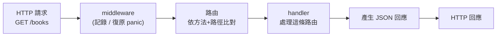
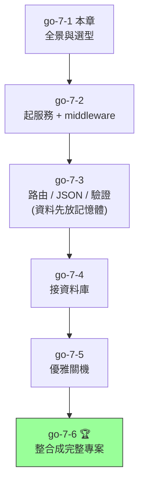

# [go-7-1] Go 做後端的全景：標準庫 vs 框架，以及「為什麼很多人只用標準庫」

> **本章目標**：在動手寫第一行伺服器程式前，先建立全景——Go 做後端的生態長怎樣、標準庫 `net/http` 到底能做到哪、chi／gin／echo 這些框架補了什麼，以及為什麼有一大票團隊「只用標準庫」就上線。最後認識整個 Part 7 要一起做的貫穿範例。

前面六個 Part，你已經把 Go 這門語言本身學完了：語法（Part 1）、struct 與 interface（Part 2）、錯誤是值（Part 3）、並行（Part 4）、套件與測試（Part 5）、標準庫（Part 6）。這個 Part 是本書的終點——把這些**全部串起來**，做一個能跑、能連資料庫、能並行、能優雅關機、能編成單一執行檔上線的 **Web 後端 API**。

這一章先不寫服務，先看地圖。寫後端最容易一開始就被「要不要用框架、用哪個框架」卡住；看懂全景，你才知道這門課為什麼這樣選，也才知道換到別的專案時怎麼判斷。

## 你會學到

- 為什麼用 Go 寫後端（優勢與取捨），以及一個 HTTP 請求進到 Go 服務後的旅程
- 標準庫 `net/http` 到底能做到哪（呼應 `go-6-3`）
- Go 的 Web 框架生態：chi、gin、echo 各補了什麼
- 「為什麼很多人只用標準庫」——尤其 Go 1.22 之後
- 整個 Part 7 要一起做的貫穿範例：一個「書籍清單」REST API

## 概念說明

### 為什麼用 Go 寫後端？

你在 **basic 課程** 用 TypeScript、可能也聽過 **csharp 課程** 用 C# 做後端，那 Go 的賣點是什麼？

```
優勢：編譯成「單一執行檔」，部署超簡單（一個檔案丟上去就跑，不用裝執行環境）；
      並行是語言內建（go-4-x），一個請求一條 goroutine，天生擅長「同時招呼很多連線」；
      有 GC，不用像 Rust 那樣管記憶體；標準庫就能做完整後端，依賴少。
取捨：語言刻意簡單，沒有泛型以外的花招（寫起來偶爾囉嗦）；
      生態不如 Java／Node 龐大，但後端這塊該有的都有。
```

適合的場景：**高並發、要長期維護、想要部署簡單**的後端服務（API、微服務、各種網路中介層）。可以把 Go 想成「有 GC 的 C，加上內建並行」——這正是它在雲端後端大量被採用的原因。

> Go 後端做好後，可以接 **infra 課程**（自架部署）或 **aws 課程**（雲端部署），可靠性可接 **sre 課程**。

### 心智模型：一個請求進到後端後發生什麼

在挑工具前，先把「一個 HTTP 請求的旅程」放在腦子裡（你在 **basic 課程 Part 4** 看過類似的，`go-6-3` 也跑過一個最小伺服器）：

```
1. 使用者的瀏覽器／App 發來一個 HTTP 請求
   （例如 GET /books，想拿所有書）
2. 伺服器根據「HTTP 方法 + 路徑」決定「由哪個函式(handler)處理」 ← 路由(routing)
3. 中間可能先經過一層層「共用處理」（記錄、驗證、復原 panic） ← middleware
4. 那個 handler 執行邏輯（可能去查資料庫）
5. handler 回傳資料，伺服器把它變成 HTTP 回應（常是 JSON）送回去
```



這張圖在說：後端框架（或標準庫）要幫你做的就這幾件事——**路由**（把請求轉給對的 handler）、**middleware**（每條請求都要做的共用處理）、以及**請求／回應的解析與產生**（常是 JSON）。這個 Part 的章節就是把這幾塊一一做出來：`go-7-2` 做伺服器與 middleware、`go-7-3` 做路由與 JSON、`go-7-4` 接資料庫、`go-7-5` 優雅關機、`go-7-6` 收尾成完整專案。

### 標準庫 `net/http` 到底能做到哪

`go-6-3` 你已經見過：**Go 不裝任何第三方套件，光用標準庫 `net/http` 就能當 HTTP 伺服器**。這在很多語言是做不到的——Node 要配 Express、Python 要配 Flask／FastAPI、Java 要配 Spring。Go 的標準庫本身就是一個夠用的 Web 框架：

| 你需要的 | 標準庫提供的 |
|---|---|
| 監聽埠、接受連線 | `http.ListenAndServe` |
| 路由（方法 + 路徑 + 路徑參數） | `http.ServeMux`（**Go 1.22 起**支援 `GET /books/{id}` 這種寫法） |
| handler 的統一形狀 | `http.Handler` 介面 / `http.HandlerFunc` |
| middleware | 不需要特別 API——「包一層 handler」就是 middleware（`go-7-2` 會講） |
| 讀請求、寫回應 | `*http.Request`、`http.ResponseWriter` |
| JSON 進出 | `encoding/json`（`go-6-2`） |

**關鍵轉折**：Go 1.22（2024 年）之前，標準庫的 `ServeMux` 很陽春——不能依 HTTP 方法分流、不能取路徑參數（`/books/3` 的 `3`），所以大家才需要框架來補路由。Go 1.22 把這兩件事都補進標準庫後，「只用標準庫」的門檻大幅降低，這也是為什麼這門課**選擇用標準庫教**（細節在 `go-7-3`）。

### Go 的 Web 框架生態

那框架還有存在意義嗎？有。當專案變大，有些東西標準庫不直接給，框架幫你包好。主要幾個：

| 框架 | 定位 | 它補了什麼 |
|---|---|---|
| **chi** | 最「貼近標準庫」的路由器 | 和 `net/http` 完全相容（handler 形狀一樣），補強路由分組、middleware 串接、更靈活的路徑樣式 |
| **gin** | 效能取向、功能全 | 自己一套 `Context` API（不完全是標準庫的形狀），內建參數綁定、驗證、JSON 回應等便利函式，社群大 |
| **echo** | 和 gin 定位接近 | 一樣有自己的 `Context`、內建 middleware 一卡車、API 設計簡潔 |

挑選的直覺：**chi 像是「標準庫 + 一點方便」**（學會標準庫幾乎就會用 chi）；**gin／echo 則是另起一套 API**，上手快、便利函式多，但你寫的 handler 就長得和標準庫不一樣了，換框架要重學。

### 為什麼很多人「只用標準庫」？

這是 Go 社群一個很有特色的文化，理由值得你記住：

- **依賴少 = 麻煩少**：每多一個第三方框架，就多一份要跟著升級、可能有漏洞、可能停止維護的依賴。標準庫跟著 Go 版本走，穩定、長期有人維護。
- **handler 形狀是「共通貨幣」**：標準庫定義的 `http.Handler` 介面（`go-2-3` 的 interface）是整個 Go 生態的共識。你用標準庫寫的 handler 和 middleware，能直接丟進 chi，也能被各種工具重用。綁死某框架的 `Context` 就沒這好處。
- **Go 1.22 後，路由這塊的缺口補上了**：以前大家用框架，最主要就是為了「方法路由 + 路徑參數」。現在標準庫自己就有，少了最大的理由。

> **要說清楚的分寸**：這**不是**「用框架就是錯」。大專案、團隊已經熟某框架、需要大量現成 middleware 時，用框架完全合理。這門課選標準庫，是因為它**最能讓你看懂底層在幹嘛**——學會標準庫，之後看任何 Go 框架都是「換個包裝」。先學會開手排，自排一看就懂。

### 這個 Part 的貫穿範例：書籍清單 API

為了把每一章串成一條線，整個 Part 7 會一起做同一個東西：一個管理「書籍清單」的 REST API（**REST** 是一種用 HTTP 方法對應「對資源做的操作」的 API 風格，下面的表格就是它的樣子）。

一本書長這樣（這個 struct 會一路用到最後）：

```json
{ "id": 1, "title": "Go 程式設計", "author": "某作者", "year": 2024, "available": true }
```

這個 API 要提供的端點（**endpoint**：一條「方法 + 路徑」的進入點）：

| 方法 | 路徑 | 做什麼 |
|---|---|---|
| `GET` | `/books` | 列出所有書 |
| `GET` | `/books/{id}` | 取某一本書 |
| `POST` | `/books` | 新增一本書 |
| `PUT` | `/books/{id}` | 更新某一本書 |
| `DELETE` | `/books/{id}` | 刪除某一本書 |

這張表就是這個 Part 的工程藍圖。各章的分工：



你負責看懂的這前半段（7-1～7-3），會先把書籍資料**放在記憶體**裡，專心把「HTTP 這一層」做對；`go-7-4` 才把它換成真的 PostgreSQL。這樣切是刻意的：一次只學一個新東西（`CLAUDE.md` 的原則）。

## 程式碼範例

這章不寫伺服器，只做兩件開工前的準備，讓你之後每一章都能直接接著做。

### 建立專案

用 `go-0-4` 學的 Go Modules 開一個新專案：

```bash
mkdir bookapi
cd bookapi
go mod init example.com/bookapi
```

這會產生一個 `go.mod`，宣告這個模組叫 `example.com/bookapi`（模組名用網域反寫是慣例，單機練習隨便取也行）。接下來整個 Part 都在這個專案裡長大。

> 到目前為止我們**一個第三方套件都還沒裝**——因為前半段只用標準庫。`go.mod` 裡會乾乾淨淨，只有一行 `go` 版本。這就是「只用標準庫」的體感。

### 先把資料模型寫出來

把那本「書」用 struct 定義出來（`go-2-1` 的 struct、`go-6-2` 的 struct tag）。建立 `main.go`：

```go
package main

import "fmt"

// Book 是這個 API 的核心資料型別。
// 欄位大寫開頭才能被 encoding/json 看到並匯出（go-5-1 的可見性、go-6-2 的 JSON）。
// 後面的 `json:"..."` 是 struct tag，決定轉成 JSON 時的欄位名（go-7-3 會真的用到）。
type Book struct {
	ID        int    `json:"id"`
	Title     string `json:"title"`
	Author    string `json:"author"`
	Year      int    `json:"year"`
	Available bool   `json:"available"`
}

func main() {
	book := Book{ID: 1, Title: "Go 程式設計", Author: "某作者", Year: 2024, Available: true}
	fmt.Printf("%+v\n", book)
}
```

逐項說明：

- 欄位名都是**大寫開頭**（`ID`、`Title`…）。`go-5-1` 說過：大寫才會對外匯出——而 `encoding/json`（`go-6-2`）正是從「外面」用反射讀這些欄位，小寫欄位它根本看不到、不會被序列化。這是新手很常踩的坑，先記住。
- `json:"id"` 這個 struct tag，告訴 JSON 套件「這個欄位轉成 JSON 時叫 `id`（小寫）」。沒有 tag 的話欄位名會原封不動用 `ID`、`Title`，不符合 JSON 慣例。
- `%+v` 是 `fmt` 的格式化動詞（`go-6-1`），印 struct 時連欄位名一起印，方便看。

跑跑看，確認專案能動：

```bash
go run .
# {ID:1 Title:Go 程式設計 Author:某作者 Year:2024 Available:true}
```

能印出這行，代表專案骨架好了。`go-7-2` 就讓它變成一個真的能用瀏覽器打開的 HTTP 伺服器。

## 小練習

1. 用自己的話回答：Go 1.22 對「只用標準庫做後端」這件事，帶來了什麼關鍵改變？為什麼它之前是大家選框架的主因？
2. 建立 `bookapi` 專案、`go mod init`，寫出 `Book` struct 並 `go run .` 印出一本書，確認專案能跑。
3. 查一下：chi、gin、echo 三個框架，哪一個的 handler 形狀和標準庫 `net/http` 完全相容？（搜尋「chi net/http compatible」）想一下這個相容性為什麼是優點。

<details>
<summary>參考解答</summary>

**第 1 題（概念）**

Go 1.22 把兩件事補進標準庫的 `http.ServeMux`：**依 HTTP 方法路由**（`GET /books` 和 `POST /books` 能分給不同 handler）和**路徑參數**（能從 `/books/3` 取出 `3`）。

在這之前，標準庫的 `ServeMux` 只能依「路徑前綴」分流，不認方法、不給路徑參數——而這兩件幾乎是任何 REST API 的基本需求。所以大家只好裝一個第三方路由器（chi、gorilla/mux 之類）或整套框架（gin／echo）來補。Go 1.22 之後，這個「最常見的缺口」標準庫自己就補上了，於是「只用標準庫」對很多專案來說變成夠用的選項。

一句話：**1.22 之前大家用框架主要是為了路由；1.22 把路由補進標準庫，就少了最大的理由。**

**第 2 題（動手，需自行實機驗證）**

```bash
mkdir bookapi && cd bookapi
go mod init example.com/bookapi
```

把本章「先把資料模型寫出來」那段貼進 `main.go`，然後：

```bash
go run .
# {ID:1 Title:Go 程式設計 Author:某作者 Year:2024 Available:true}
```

驗收點：`go.mod` 裡有 `module example.com/bookapi` 和一行 `go 1.2x`；`go run .` 能印出那本書。

**第 3 題（查詢）**

答案是 **chi**。chi 的 handler 就是標準的 `http.HandlerFunc`（`func(w http.ResponseWriter, r *http.Request)`），middleware 也是標準的 `func(http.Handler) http.Handler`。

為什麼這是優點：你用標準庫寫的 handler／middleware 可以原封不動丟進 chi，反之亦然；各種第三方工具（監控、追蹤）只要支援「標準 handler」就能用。gin／echo 則是把 `w, r` 包成自己的 `*gin.Context`／`echo.Context`，便利歸便利，但你的程式碼就和那個框架綁在一起了，換框架要大改。**相容於標準介面 = 你的程式碼能被整個生態重用**，這正是 `go-2-3` interface 那章「面向介面、而非面向實作」的價值。

</details>

## 課外讀物

> 一個 HTTP 請求從瀏覽器到後端的完整旅程、HTTP 方法與狀態碼 → [課外讀物 E-3-3：HTTP 協定](../../../課外讀物/E-3-network/E-3-3-http-protocol.md)、**basic 課程 Part 4**

> 「面向介面而非面向實作」為什麼讓程式碼能被重用（標準 handler 的價值） → 複習 `go-2-3`、[課外讀物 E-7-6：依賴反轉原則](../../../課外讀物/E-7-solid/E-7-6-dip.md)

> 用 Go 以外的語言做同一件事，對照看看 → **csharp 課程**、**basic 課程 Part 4～5**

> 下一節：真的起一個 HTTP 伺服器，並學會寫 middleware → `go-7-2`
