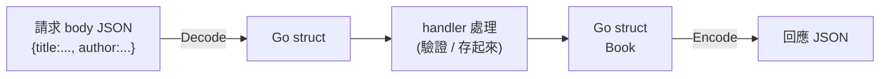

# [go-7-3] 處理請求與回應：路由與路徑參數、JSON 進出、輸入驗證

> **本章目標**：把書籍 API 做成真正的 CRUD——用 Go 1.22 的 `ServeMux` 做「方法 + 路徑參數」路由（`GET /books/{id}`）、用 `encoding/json` 把 JSON 和 struct 雙向轉換、並對進來的資料做輸入驗證。這一章之後，你的 API 就能增刪查改，只差把資料從記憶體換成資料庫（`go-7-4`）。

`go-7-2` 的 `ServeMux` 只用了最陽春的路徑比對。這章把它升級成能分辨 HTTP 方法、能從 `/books/3` 取出 `3` 的真正路由，再補上 REST API 的兩個日常核心：**JSON 進出**和**輸入驗證**。資料這章先放在記憶體（配一把鎖），專心把「HTTP 這一層」做對。

## 你會學到

- Go 1.22 `ServeMux` 的新路由：`GET /books`、`POST /books`、`GET /books/{id}`
- 用 `r.PathValue("id")` 取路徑參數
- 用 `encoding/json`（`go-6-2`）把 struct 轉成 JSON 回應、把請求 body 的 JSON 解析成 struct
- 寫一個乾淨、一致的 JSON 回應與錯誤回應格式
- 輸入驗證：為什麼「絕不信任進來的資料」，以及該怎麼擋
- 多條請求同時讀寫記憶體資料，為什麼要配一把鎖（呼應 `go-4-5`、`go-4-7`）

## 概念說明

### Go 1.22 的新路由：方法 + 路徑參數

`go-7-1` 提過：Go 1.22 起，`ServeMux` 的登記字串可以**帶 HTTP 方法，也可以帶路徑參數**。寫法是 `"方法 /路徑/{參數名}"`：

```
mux.HandleFunc("GET /books",        listBooks)   // 列出全部
mux.HandleFunc("GET /books/{id}",   getBook)     // {id} 是會變動的路徑參數
mux.HandleFunc("POST /books",       createBook)  // 同一路徑、不同方法 → 不同 handler
mux.HandleFunc("PUT /books/{id}",   updateBook)
mux.HandleFunc("DELETE /books/{id}", deleteBook)
```

兩個重點：

- **同一個路徑 `/books`，`GET` 和 `POST` 能分給不同 handler**——這正是 REST 的樣子（`go-7-1` 那張端點表）。1.22 之前標準庫做不到，得靠框架。
- `{id}` 是**路徑參數（path parameter）**：網址裡會變動的那一段。handler 裡用 `r.PathValue("id")` 把它取出來（拿到的是字串，要自己轉型別）。

> ⚠️ **這需要 Go 1.22 以上**。`go version` 確認一下；低於 1.22 的話這套寫法不存在。這也是為什麼 `go-7-1` 強調 1.22 是個分水嶺。

### API 都在傳 JSON，需要「翻譯」

`go-6-2` 學過：Go 內部用 struct，JSON 是文字，中間要靠 `encoding/json` 雙向翻譯：

```
回應時：Go struct   →（Marshal / 序列化）→ JSON 文字 → 送給前端
接收時：前端來的 JSON →（Unmarshal / 反序列化）→ Go struct
```

在 HTTP handler 裡，我們通常不用 `json.Marshal` 拿到 `[]byte` 再自己寫，而是用**串流**的版本直接對著 `w`（回應）和 `r.Body`（請求）工作：

- 回應：`json.NewEncoder(w).Encode(資料)` —— 把資料直接編碼成 JSON 寫進回應。
- 接收：`json.NewDecoder(r.Body).Decode(&目標)` —— 把請求 body 的 JSON 解進一個 struct。



這張圖在說：JSON 在「進」和「出」兩個方向被翻成 / 翻自 Go struct，你的 handler 中間只需專心處理「乾淨的 struct」。

### 絕不信任進來的資料：輸入驗證

前端（或任何呼叫者）送來的資料，**永遠可能是壞的、惡意的、或缺東西的**。handler 收到反序列化後的 struct，不能假設它合理——`title` 可能是空的、`year` 可能是負數或未來年份、整段 JSON 可能根本格式壞掉。**輸入驗證**就是在「資料進到核心邏輯之前」擋掉這些：

```
收到請求資料後，先問：
    JSON 格式對嗎？          不對 → 回 400，說「請求格式錯誤」
    必填欄位都在、合理嗎？    不合理 → 回 400，說清楚哪個欄位錯
    （都通過才往下走）
```

這不只是「程式別崩」的問題，也是安全的第一道防線（`go-7-1` 範圍外的 SQL injection 等攻擊，根源常是「信任了不該信任的輸入」）。

## 程式碼範例

### 先準備：記憶體裡的書庫（配一把鎖）

資料庫是 `go-7-4` 的事，這章先把書存在一個 `map` 裡。但有個並行的坑必須先講：**`net/http` 幫每一條請求各開一條 goroutine**（`go-4-1`）——意思是**多條請求會同時讀寫這個 map**。而 `go-1-5` 提過、`go-4-7` 會深講：map 不是並行安全的，多個 goroutine 同時寫會觸發資料競爭、甚至直接讓程式崩潰。所以我們用一把 `sync.Mutex`（`go-4-5`）保護它：

```go
import "sync"

// bookStore 把「書庫 map」和「保護它的鎖」綁在一起。
// 每個讀寫方法都先鎖、defer 解鎖——成對出現（go-3-3 / CLAUDE.md）。
type bookStore struct {
	mu     sync.Mutex
	books  map[int]Book
	nextID int
}

func newBookStore() *bookStore {
	return &bookStore{books: make(map[int]Book), nextID: 1}
}

func (s *bookStore) list() []Book {
	s.mu.Lock()
	defer s.mu.Unlock()
	result := make([]Book, 0, len(s.books))
	for _, b := range s.books {
		result = append(result, b)
	}
	return result
}

func (s *bookStore) get(id int) (Book, bool) {
	s.mu.Lock()
	defer s.mu.Unlock()
	b, ok := s.books[id]
	return b, ok // 第二個回傳值告訴呼叫者「有沒有找到」（go-1-5 的 map 慣用法）
}

func (s *bookStore) create(b Book) Book {
	s.mu.Lock()
	defer s.mu.Unlock()
	b.ID = s.nextID // 由伺服器決定 ID，不信任前端送來的 ID
	s.nextID++
	s.books[b.ID] = b
	return b
}

func (s *bookStore) delete(id int) bool {
	s.mu.Lock()
	defer s.mu.Unlock()
	if _, ok := s.books[id]; !ok {
		return false
	}
	delete(s.books, id)
	return true
}
```

說明：

- 把「資料」和「保護它的鎖」**包在同一個 struct**，每個方法 `Lock()` 後立刻 `defer Unlock()`（`go-3-3`／`go-4-5`）——這是 Go 保護共享狀態的標準骨架，鎖和解鎖成對出現，不會忘了放。
- `get` 回傳 `(Book, bool)`，用第二個布林值表達「找到了沒」（`go-1-5` 的 map 讀取慣用法），比回傳一個零值 Book 讓呼叫者去猜清楚得多。
- `create` **無視前端送來的 ID，由伺服器自己發號**（`nextID`）——ID 是伺服器的職責，不能讓呼叫者指定，否則會互相覆蓋。

### 兩個小幫手：統一 JSON 回應與錯誤格式

handler 會一直重複「設 Content-Type、寫狀態碼、Encode JSON」，抽成一個小函式（`go-7-2` 說的「不重複」）。錯誤回應也統一成固定形狀 `{"error": "..."}`，讓前端好處理（`CLAUDE.md`／課外讀物 E-6-8：API 錯誤格式要一致）：

```go
import (
	"encoding/json"
	"log"
	"net/http"
)

// writeJSON：把任何資料編成 JSON 寫回去，設好狀態碼與 Content-Type。
func writeJSON(w http.ResponseWriter, status int, data any) {
	w.Header().Set("Content-Type", "application/json; charset=utf-8")
	w.WriteHeader(status) // 狀態碼要在寫 body 之前設（go-7-2 練習 2 的教訓）
	if err := json.NewEncoder(w).Encode(data); err != nil {
		log.Printf("寫 JSON 回應失敗：%v", err)
	}
}

// writeError：統一的錯誤回應格式 {"error": "訊息"}。
func writeError(w http.ResponseWriter, status int, message string) {
	writeJSON(w, status, map[string]string{"error": message})
}
```

說明：`writeJSON` 的 `data any` 用空介面（`go-2-4`）收任何型別——這是少數該用 `any` 的地方（通用序列化）。`w.WriteHeader(status)` 設 HTTP 狀態碼，一樣要在寫 body 前（`go-7-2` 練習 2 踩過）。

### 讀取類 handler：列出、取單筆（含路徑參數）

```go
import (
	"net/http"
	"strconv"
)

func (s *bookStore) handleList(w http.ResponseWriter, r *http.Request) {
	writeJSON(w, http.StatusOK, s.list())
}

func (s *bookStore) handleGet(w http.ResponseWriter, r *http.Request) {
	// 取路徑參數 {id}，它是字串，要自己轉成 int（go-6-1 的 strconv）
	id, err := strconv.Atoi(r.PathValue("id"))
	if err != nil {
		writeError(w, http.StatusBadRequest, "id 必須是數字")
		return
	}
	book, ok := s.get(id)
	if !ok {
		writeError(w, http.StatusNotFound, "找不到這本書")
		return
	}
	writeJSON(w, http.StatusOK, book)
}
```

說明：

- `r.PathValue("id")` 取 `/books/{id}` 的那段，拿到**字串**，用 `strconv.Atoi`（`go-6-1`）轉成 int。轉不動（例如網址是 `/books/abc`）就回 **400 Bad Request**——這是「呼叫者給錯東西」。
- 書不存在就回 **404 Not Found**。注意 400 和 404 是不同的錯：400 是「你問的方式就錯了」，404 是「問法沒錯但東西不在」。回對狀態碼是 REST API 的基本禮貌。
- 每個錯誤分支都 `return`，別讓程式繼續往下寫第二次回應。

### 寫入類 handler：新增（JSON 進 + 驗證）

這段把三件事合在一起：反序列化 JSON body、驗證、存起來後回傳：

```go
import (
	"encoding/json"
	"net/http"
	"strings"
	"time"
)

// createBookInput 是「新增書」時接受的輸入形狀。
// 刻意和 Book 分開：呼叫者不該、也不能指定 id（由伺服器發）。
type createBookInput struct {
	Title  string `json:"title"`
	Author string `json:"author"`
	Year   int    `json:"year"`
}

// validate 檢查輸入合不合理，回傳「第一個錯誤訊息」；都通過回空字串。
func (in createBookInput) validate() string {
	if strings.TrimSpace(in.Title) == "" {
		return "title 不可為空"
	}
	if strings.TrimSpace(in.Author) == "" {
		return "author 不可為空"
	}
	currentYear := time.Now().Year()
	if in.Year < 1450 || in.Year > currentYear {
		// 1450：印刷術普及的大致年代，當作合理下限；不能是未來
		return "year 必須介於 1450 到今年之間"
	}
	return ""
}

func (s *bookStore) handleCreate(w http.ResponseWriter, r *http.Request) {
	var input createBookInput

	// 反序列化：把請求 body 的 JSON 解進 input
	decoder := json.NewDecoder(r.Body)
	decoder.DisallowUnknownFields() // 多出不認識的欄位就報錯，別默默吞掉（抓前端打錯字）
	if err := decoder.Decode(&input); err != nil {
		writeError(w, http.StatusBadRequest, "請求 JSON 格式錯誤："+err.Error())
		return
	}

	// 驗證
	if msg := input.validate(); msg != "" {
		writeError(w, http.StatusBadRequest, msg)
		return
	}

	// 存起來，回傳建立好的完整 Book（含伺服器發的 id），狀態碼 201 Created
	created := s.create(Book{
		Title:     input.Title,
		Author:    input.Author,
		Year:      input.Year,
		Available: true, // 新書預設可借
	})
	writeJSON(w, http.StatusCreated, created)
}
```

這段是本章的重點，逐項說明：

- **輸入用獨立的 `createBookInput`，不直接收 `Book`**。為什麼？因為「呼叫者能提供的欄位」和「一本書完整長相」是兩回事——`id` 由伺服器發、`available` 有預設值，都不該讓呼叫者指定。這種「對外的輸入型別和內部資料型別分開」是後端的好習慣（呼應 `go-2-3` 的介面隔離精神、課外讀物 E-7-5）。
- `decoder.DisallowUnknownFields()`：JSON 裡出現 struct 沒有的欄位就報錯。這能幫呼叫者抓到打錯的欄位名（例如把 `title` 打成 `titel`），不會默默忽略——呼應 `CLAUDE.md` 的「該炸就讓它炸，不要吞錯」。
- `validate()` 回傳「第一個錯誤訊息字串」，空字串代表通過。訊息對人有意義（`CLAUDE.md`／E-6-8）——回「year 必須介於 1450 到今年之間」，而不是一句乾巴巴的 "invalid"。
- 成功回 **201 Created**（不是 200），這是 REST 對「成功新增一筆資源」的標準狀態碼，並把建立好的完整 Book（含 id）回給呼叫者。

### 組起來：完整的 CRUD 伺服器

把 `go-7-2` 的 middleware、本章的 store 與 handler 全部接起來（為了篇幅，更新 `PUT` 的 handler 留作練習，和新增幾乎一樣）：

```go
func main() {
	store := newBookStore()

	mux := http.NewServeMux()
	mux.HandleFunc("GET /books", store.handleList)
	mux.HandleFunc("GET /books/{id}", store.handleGet)
	mux.HandleFunc("POST /books", store.handleCreate)
	mux.HandleFunc("DELETE /books/{id}", store.handleDelete)

	// go-7-2 的 middleware
	var handler http.Handler = mux
	handler = recovery(handler)
	handler = logging(handler)

	fmt.Println("伺服器跑在 http://127.0.0.1:8080")
	if err := http.ListenAndServe("127.0.0.1:8080", handler); err != nil {
		fmt.Println("伺服器錯誤：", err)
	}
}

// handleDelete 示範 DELETE：成功回 204 No Content（沒有 body）
func (s *bookStore) handleDelete(w http.ResponseWriter, r *http.Request) {
	id, err := strconv.Atoi(r.PathValue("id"))
	if err != nil {
		writeError(w, http.StatusBadRequest, "id 必須是數字")
		return
	}
	if !s.delete(id) {
		writeError(w, http.StatusNotFound, "找不到這本書")
		return
	}
	w.WriteHeader(http.StatusNoContent) // 204：成功但沒有內容要回
}
```

跑起來測整套 CRUD：

```bash
go run .

# 新增一本（POST + JSON body）
curl -X POST http://127.0.0.1:8080/books \
  -H "Content-Type: application/json" \
  -d '{"title":"Go 程式設計","author":"某作者","year":2024}'
# {"id":1,"title":"Go 程式設計","author":"某作者","year":2024,"available":true}

# 列出全部
curl http://127.0.0.1:8080/books
# [{"id":1,"title":"Go 程式設計",...}]

# 取單筆
curl http://127.0.0.1:8080/books/1
# {"id":1,...}

# 驗證擋壞資料：title 空的 → 400
curl -i -X POST http://127.0.0.1:8080/books \
  -H "Content-Type: application/json" \
  -d '{"title":"","author":"x","year":2024}'
# HTTP/1.1 400 Bad Request
# {"error":"title 不可為空"}

# 刪除 → 204
curl -i -X DELETE http://127.0.0.1:8080/books/1
# HTTP/1.1 204 No Content
```

到這裡，你的書籍 API 已經是一個像樣的 REST 服務了：方法路由、路徑參數、JSON 進出、輸入驗證、對的狀態碼都有。只差一件事——**重開伺服器，資料就全沒了**（因為在記憶體裡）。那就是下一章 `go-7-4` 的工作：把 `bookStore` 換成真的 PostgreSQL。

## 小練習

1. 把整套 CRUD 伺服器跑起來，用 `curl` 走一遍：新增兩本 → 列出 → 取其中一本 → 刪一本 → 再列出，確認每步的狀態碼與回應都對。再故意送格式壞掉的 JSON（例如少一個引號）和 `year` 是負數的資料，確認都回 400 且錯誤訊息清楚。
2. 補上 `PUT /books/{id}` 的 handler `handleUpdate`：取路徑參數 id、反序列化＋驗證 body（可重用 `createBookInput` 與 `validate`）、找不到該 id 回 404、成功就更新並回更新後的 Book（200）。記得在 `bookStore` 加一個並行安全的 `update` 方法。
3. 思考題：`handleCreate` 用了 `DisallowUnknownFields()`，使得送多餘欄位會被擋。這在「嚴格抓前端打錯字」上是優點，但在「API 要往後相容、舊用戶端可能送新欄位」的情境下可能變成缺點。你覺得公開 API 和內部 API 對這個選擇應該一樣嗎？

<details>
<summary>參考解答</summary>

**第 1 題（走一遍 CRUD，需自行實機驗證）**

照本章的 `curl` 範例依序打即可。驗收重點：

- 新增回 **201** 且 body 有伺服器發的 `id`；列出回 **200** 的 JSON 陣列；取不存在的 id（如 `/books/999`）回 **404**；刪除回 **204**。
- 壞 JSON（少引號）→ **400**，訊息含「請求 JSON 格式錯誤」；`year` 負數 → **400**，訊息「year 必須介於 1450 到今年之間」。
- 送 `/books/abc` → **400**「id 必須是數字」。

**第 2 題（補 PUT）**

先在 `bookStore` 加 `update`：

```go
func (s *bookStore) update(id int, b Book) (Book, bool) {
	s.mu.Lock()
	defer s.mu.Unlock()
	if _, ok := s.books[id]; !ok {
		return Book{}, false
	}
	b.ID = id // 保持原 id，不被 body 影響
	s.books[id] = b
	return b, true
}
```

handler：

```go
func (s *bookStore) handleUpdate(w http.ResponseWriter, r *http.Request) {
	id, err := strconv.Atoi(r.PathValue("id"))
	if err != nil {
		writeError(w, http.StatusBadRequest, "id 必須是數字")
		return
	}

	var input createBookInput
	decoder := json.NewDecoder(r.Body)
	decoder.DisallowUnknownFields()
	if err := decoder.Decode(&input); err != nil {
		writeError(w, http.StatusBadRequest, "請求 JSON 格式錯誤："+err.Error())
		return
	}
	if msg := input.validate(); msg != "" {
		writeError(w, http.StatusBadRequest, msg)
		return
	}

	updated, ok := s.update(id, Book{
		Title:     input.Title,
		Author:    input.Author,
		Year:      input.Year,
		Available: true,
	})
	if !ok {
		writeError(w, http.StatusNotFound, "找不到這本書")
		return
	}
	writeJSON(w, http.StatusOK, updated)
}
```

路由登記 `mux.HandleFunc("PUT /books/{id}", store.handleUpdate)`。驗收：

```bash
curl -i -X PUT http://127.0.0.1:8080/books/1 \
  -H "Content-Type: application/json" \
  -d '{"title":"改過的書名","author":"某作者","year":2025}'
# HTTP/1.1 200 OK，body 是更新後的 Book
curl -i -X PUT http://127.0.0.1:8080/books/999 -H "Content-Type: application/json" -d '{"title":"x","author":"y","year":2024}'
# HTTP/1.1 404 Not Found
```

注意 `update` 裡 `b.ID = id`——保持路徑指定的 id，不讓 body 偷改 id。這和 `create` 由伺服器發 id 是同一個原則：**id 是伺服器的職責。**

**第 3 題（DisallowUnknownFields 的取捨）**

不該一視同仁：

- **內部 API**（自己人呼叫自己人）：適合開 `DisallowUnknownFields()`。兩邊一起升級、欄位對不上通常就是 bug，當場炸出來比默默吞掉好（`CLAUDE.md` 的「該炸就讓它炸」）。
- **公開 API**（給不受你控制的第三方用）：通常**不**開。因為你要往後相容——新版本加了欄位，舊用戶端還在送舊格式、或新用戶端送了舊伺服器不認得的欄位時，你希望「忽略不認識的欄位、照樣運作」，而不是整個請求被擋。這是 REST API 演進的常見原則（寬進嚴出）。

核心：這是個**有取捨的工程決定**，不是「一定要開」或「一定不要」。判準是「呼叫者是不是你能一起升級的對象」。這也是 `CLAUDE.md` 說的——分清楚哪些是強制、哪些是「看情境的慣例」，別把偏好講成標準。

</details>

## 課外讀物

> JSON 的 struct tag、`omitempty`、數字精度的坑等細節 → 複習 `go-6-2`；map 與 `(value, ok)` 慣用法 → `go-1-5`

> 多條請求同時讀寫共享資料為什麼要上鎖、不鎖會怎樣 → 複習 `go-4-5`（`sync.Mutex`）、`go-4-7`（資料競爭與 `-race`）

> API 錯誤回應為什麼要統一格式、狀態碼怎麼挑 → [課外讀物 E-6-8：後端的乾淨程式碼](../../../課外讀物/E-6-best-practices/E-6-8-backend-clean-code.md)、[課外讀物 E-3-3：HTTP 協定](../../../課外讀物/E-3-network/E-3-3-http-protocol.md)

> 「絕不信任輸入」是安全的第一道防線——輸入沒驗好會通向哪些攻擊 → [課外讀物 E-10-4：SQL Injection](../../../課外讀物/E-10-security/E-10-4-sql-injection.md)、[課外讀物 E-10-1：Web 安全總覽](../../../課外讀物/E-10-security/E-10-1-web-security-overview.md)

> 怎麼對 HTTP handler 寫測試（不用真的起伺服器） → 複習 `go-5-4`（`httptest`）、[課外讀物 E-9-8：API 測試](../../../課外讀物/E-9-testing/E-9-8-api-testing.md)

> 下一節：把 `bookStore` 從記憶體換成真的 PostgreSQL，接 `database/sql`、處理連線池與交易邊界 → `go-7-4`
