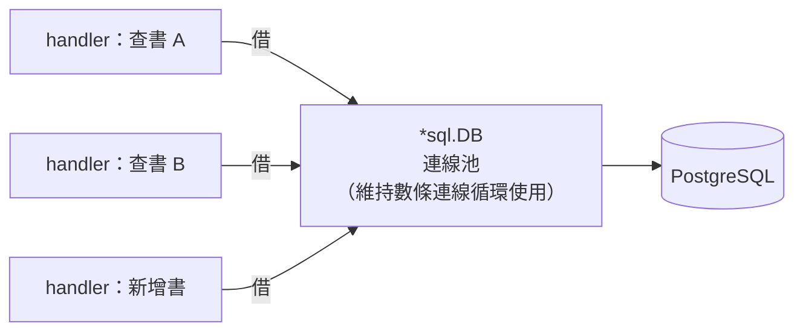
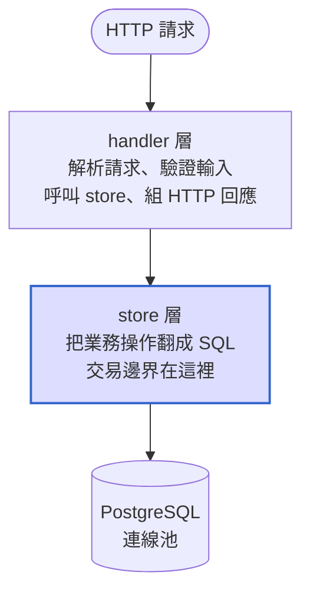
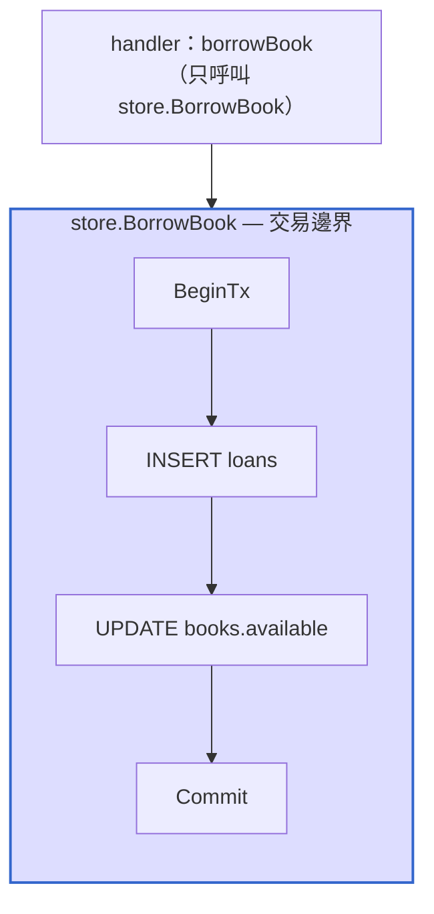

# [go-7-4] 接資料庫：把 `database/sql` 接進 handler

> **本章目標**：把前三章用標準庫做好的「書籍清單」API，從記憶體裡的假資料換成真正的 PostgreSQL。你會學到怎麼把一個 `*sql.DB` 連線池「注入」給 handler 共用、連線池該怎麼調、以及最關鍵的一題——**交易（transaction）的邊界到底放在哪一層**。

Part 7 到這裡，你已經有一個能起 HTTP 服務（`go-7-2`）、能路由與處理 JSON（`go-7-3`）的書籍 API，但資料還躺在記憶體裡的一個 slice，程式一重啟就全沒了。這章把它接上資料庫。`database/sql` 的基本用法你在 `go-6-4` 學過了（`Query`／`Exec`／`QueryRow`、參數化查詢、用 `context` 設逾時、`Begin` 開交易）——這章不重講那些，而是回答「放進一個**真的 web 服務**裡」才會冒出來的三個問題：

- 連線這麼貴，**每個 handler 都自己開一條**嗎？（不是，所以要談連線池）
- `*sql.DB` 要怎麼交到每個 handler 手上？（談依賴注入）
- 一個請求要改好幾張表、必須「全部成功或全部不算」時，**交易的 `Begin`／`Commit` 寫在 handler 裡還是更底層**？（這章的重頭戲）

## 你會學到

- `*sql.DB` 其實是一個**連線池**，不是單一連線——以及 `SetMaxOpenConns` 這些旋鈕在調什麼
- 怎麼把連線池「注入」給 handler：用一個 struct 把依賴收在一起，而不是用全域變數
- 把資料存取邏輯收進一個 **store 層**，讓 handler 只管 HTTP、不碰 SQL
- **交易的邊界放在哪**：為什麼交易屬於「一個業務操作」，而不屬於單一 SQL 或單一 handler
- `BeginTx` + `defer tx.Rollback()` 的標準收尾骨架，以及它怎麼跟 `context` 配合

## 概念說明

### `*sql.DB` 是一個連線池，不是一條連線

初學 `database/sql` 最大的誤會，是以為 `sql.Open(...)` 回傳的 `*sql.DB` 代表「一條通往資料庫的連線」。不是。**它代表一整個連線池（connection pool）**。

為什麼需要池？因為「開一條資料庫連線」很貴——要走 TCP 握手、要在資料庫端建 session、可能還要 TLS。一個 web 服務同時在處理幾十上百個請求，如果每個請求都現開一條、用完就關，光是開關連線就把資料庫拖垮了。連線池的作法是：**預先維持一小撮連線，誰要用就借一條，用完還回去給下一個人用。**



這張圖在說：所有 handler 共用**同一個** `*sql.DB`，各自向池子借一條連線來跑查詢，跑完立刻還回去。所以 `*sql.DB` 在整個程式裡**只該建立一次**，然後大家共用——它內部自己是並行安全（`go-4-7` 的 data race 它幫你擋好了）的，可以放心給上萬個 goroutine 同時用。

**最常見的新手錯誤**，就是在每個 handler 裡 `sql.Open(...)` 開一個新的池：

> **常見錯誤** — 很多人會在 handler 裡這樣寫：
> ```go
> func getBook(w http.ResponseWriter, r *http.Request) {
>     db, _ := sql.Open("pgx", dsn) // ❌ 每次請求都開一個新連線池
>     defer db.Close()
>     // ...查詢...
> }
> ```
> 問題是：`sql.Open` 建的是「一個池」，你等於**每個請求都蓋一座新的游泳池、用完拆掉**，完全失去了池化的意義，而且 `sql.Open` 本身沒有真的連上去（它是惰性的），真正的連線成本會在第一次查詢時爆發。
> **正確做法**：整個程式 `sql.Open` **一次**，把回傳的 `*sql.DB` 當依賴傳給所有 handler 共用。

### 連線池的幾個旋鈕

`sql.Open` 之後，有幾個設定值該調，否則用預設值在高流量下會出事：

```go
db.SetMaxOpenConns(25)                 // 最多同時開 25 條連線
db.SetMaxIdleConns(25)                 // 閒置時也保留 25 條，不急著關（省下重開成本）
db.SetConnMaxLifetime(5 * time.Minute) // 一條連線最多活 5 分鐘就換新的
```

逐項說明「為什麼」：

- `SetMaxOpenConns`：**上限**。資料庫能承受的連線數有限（PostgreSQL 預設 `max_connections` 常是 100），你的服務如果不設上限，流量一尖峰就可能開出幾百條連線，直接把資料庫打爆、連別的服務都連不進去。設一個「你的服務該佔的額度」是必要的保護。
- `SetMaxIdleConns`：**閒置保留數**。設太小，離峰時連線被關光，一來流量又得重新建連線（慢）。一般設成跟 `MaxOpenConns` 一樣或接近。
- `SetConnMaxLifetime`：**連線壽命**。資料庫或中間的負載平衡器可能會悄悄把「太老」的連線掐掉，你這端卻還以為它活著，拿去用才發現壞了。設一個壽命讓連線定期汰換，能避開這種「拿到一條死連線」的坑。

> 這些數字沒有「業界標準答案」，要依資料庫規格與實測調整——這屬於「依團隊與環境而定」的那一類設定，不是語言強制的規則。先用上面這組保守值起步即可。

### 把連線池交給 handler：用 struct 收依賴，別用全域變數

handler 的函式簽名是固定的（`func(w http.ResponseWriter, r *http.Request)`），沒地方塞 `*sql.DB`。那它怎麼拿到連線池？兩條路：

1. **全域變數**：宣告一個 `var db *sql.DB`，handler 直接抓來用。能動，但這是 `go-7-2`／Clean Code 都想避免的——全域狀態讓「這個 handler 到底依賴什麼」變得看不見，測試時也很難替換成假的資料庫。
2. **把依賴收進一個 struct，handler 變成它的 method**（推薦）。

第二種長這樣——先用 pseudo code 說清楚結構：

```
有一個「應用程式」物件，手上握著它需要的所有依賴（資料庫、設定、logger…）
每個 handler 都是這個物件的一個方法
方法天生就能透過 this（Go 叫 receiver）拿到那些依賴
```

對應到 Go，用一個 `BookStore` 把資料存取集中起來，再用一個 `app` struct 握著它：

```go
// BookStore 專門負責「書」的資料存取，手上握著連線池
type BookStore struct {
	db *sql.DB
}

// app 握著這個服務的所有依賴（目前只有 store，之後可加 logger、設定…）
type app struct {
	store *BookStore
}

// handler 是 app 的 method，透過 receiver a 就能拿到 a.store
func (a *app) listBooks(w http.ResponseWriter, r *http.Request) {
	books, err := a.store.List(r.Context())
	// ...把 books 寫成 JSON 回去...
}
```

這麼做的好處，正是 `go-2-3` interface 與[課外讀物 E-7-6（DIP，依賴反轉）](../../../課外讀物/E-7-solid/E-7-6-dip.md)講的那套：handler 不自己去「生」出依賴，而是「被交給」依賴。等到 `go-7-6` 要寫測試時，你會看到這個設計讓我們可以把 `store` 換成一個假的、不碰真資料庫的版本，handler 完全不用改。

> handler 只做「翻譯」——把 HTTP 請求翻成對 store 的呼叫、把 store 的結果翻回 HTTP 回應。真正的 SQL 收在 store 層。這是「一個函式只做一件事」（函式設計 → [課外讀物 E-6-3](../../../課外讀物/E-6-best-practices/E-6-3-function-design.md)；SRP → [課外讀物 E-7-2](../../../課外讀物/E-7-solid/E-7-2-srp.md)）。

### 三層的樣子

接了資料庫之後，一個請求的資料會流過三層。看清楚每一層的職責：



這張圖的重點是中間那層（store）：**它是唯一碰 SQL 的地方，也是交易的邊界所在。** 上面的 handler 不知道 SQL 長怎樣，下面的資料庫不知道 HTTP 存在。這種分層讓你換資料庫、換路由框架時，受影響的範圍都被圈在一層裡。

### 本章重頭戲：交易的邊界放在哪一層？

**交易（transaction）** 是「一組操作，要嘛全部成功、要嘛全部不算」的保證（ACID 的完整概念 → [課外讀物 E-4-3](../../../課外讀物/E-4-database/E-4-3-transaction-acid.md)）。問題不是「怎麼寫交易」（`go-6-4` 教過 `Begin`／`Commit`／`Rollback`），而是**交易的 `Begin` 和 `Commit` 該寫在哪一層**。

先想一個會用到交易的例子。假設借書這個動作要同時做兩件事：

```
借一本書(書 id, 使用者 id)：
    1. 在 loans 表插入一筆借閱紀錄
    2. 把 books 表那本書的 available 改成 false
```

這兩步**必須一起成功**。如果第 1 步成功、第 2 步失敗，就會出現「有借閱紀錄、書卻還標著可借」的髒資料。所以要把它們包在一個交易裡。

現在是關鍵問題——這個交易包在哪？有人會想包在最底層（每個 SQL 一個交易），有人會想包在最上層（handler 裡）。兩個都錯。判準是這一句：

> **一個交易 = 一個「必須原子完成的業務操作」。交易的邊界，要跟「業務操作」的邊界對齊。**

- **不要包在單一 SQL 外**：每個 `INSERT`／`UPDATE` 各自一個交易，等於沒有交易——第 1 步 commit 完第 2 步才失敗，髒資料照樣產生。
- **不要包在 handler 裡**：handler 的職責是 HTTP，不該知道「借書要動哪兩張表」。而且交易邏輯寫在 handler，就沒辦法被「不是從 HTTP 來的呼叫」（排程任務、CLI、別的 handler）重用。
- **包在 store 層的那個「業務方法」裡**：`store.BorrowBook(ctx, bookID, userID)` 這個方法內部開交易、做完兩步、`Commit`。對 handler 來說它就是「一個會成功或失敗的操作」，handler 不需要知道裡面有交易。



這張圖在說：交易的「框」剛好框住 `BorrowBook` 這個業務方法的內部，`BeginTx` 和 `Commit` 一頭一尾；handler 在框外，只負責呼叫它。

## 程式碼範例

### 範例一：建立連線池（整個程式一次）

這段示範 `sql.Open` 之後該做的事：設好池子的旗鈕、用 `PingContext` 真的連一次確認活著。

```go
package main

import (
	"context"
	"database/sql"
	"fmt"
	"time"

	_ "github.com/jackc/pgx/v5/stdlib" // 以空白匯入註冊 "pgx" 這個 driver
)

// openDB 建立並驗證一個連線池。整個程式只該呼叫它一次。
func openDB(dsn string) (*sql.DB, error) {
	// sql.Open 只是「準備好」一個池，並沒有真的連上去（它是惰性的）
	db, err := sql.Open("pgx", dsn)
	if err != nil {
		return nil, fmt.Errorf("開啟資料庫失敗：%w", err)
	}

	db.SetMaxOpenConns(25)
	db.SetMaxIdleConns(25)
	db.SetConnMaxLifetime(5 * time.Minute)

	// 用一個短逾時真的連一次，確認資料庫活著——
	// 不 Ping 的話，連線錯誤要等到第一個請求進來才會爆
	ctx, cancel := context.WithTimeout(context.Background(), 5*time.Second)
	defer cancel()
	if err := db.PingContext(ctx); err != nil {
		return nil, fmt.Errorf("連不上資料庫：%w", err)
	}

	return db, nil
}
```

說明：

- `_ "github.com/jackc/pgx/v5/stdlib"` 是 **空白匯入**（blank import）：我們不直接用這個套件的任何東西，只要它的 `init()` 跑一下、把名為 `"pgx"` 的 driver 註冊給 `database/sql`。這就是為什麼 `sql.Open("pgx", ...)` 的第一個參數認得 `"pgx"`。（`lib/pq` 是另一個常見選擇，driver 名是 `"postgres"`；兩者擇一即可。）
- `sql.Open` **不會真的連線**，所以它幾乎不會因為「資料庫沒開」而回錯。真正連上去是靠 `PingContext`——我們在這裡主動連一次，讓設定錯誤「早點、在啟動時」就炸出來，而不是拖到第一個使用者請求才發現（這呼應 `CLAUDE.md`「該炸就讓它炸」）。
- 每個會碰資料庫的呼叫都吃 `context`——這裡 `PingContext` 用 `go-4-6` 的 `WithTimeout`，避免啟動時卡在一個連不上的資料庫上無限等。

### 範例二：store 層的單筆查詢（handler 用它）

這段示範 store 怎麼封裝一個「查單一本書」的操作，以及 handler 怎麼呼叫它。注意 handler 完全看不到 SQL。

```go
// Book 是回傳給前端的資料型別
type Book struct {
	ID        int64  `json:"id"`
	Title     string `json:"title"`
	Author    string `json:"author"`
	Available bool   `json:"available"`
}

// ErrNotFound 讓上層（handler）能分辨「查無此書」與「資料庫壞了」
var ErrNotFound = errors.New("找不到這本書")

// GetByID 查單一本書。查無資料回傳 ErrNotFound，而不是 nil。
func (s *BookStore) GetByID(ctx context.Context, id int64) (Book, error) {
	const query = `SELECT id, title, author, available FROM books WHERE id = $1`

	var b Book
	// QueryRowContext：吃 ctx（可被逾時/取消中斷）、用 $1 參數化（防 SQL injection）
	err := s.db.QueryRowContext(ctx, query, id).
		Scan(&b.ID, &b.Title, &b.Author, &b.Available)

	switch {
	case errors.Is(err, sql.ErrNoRows):
		// 查無資料是「預期內」的情況，翻成我們自己的 ErrNotFound 往上傳
		return Book{}, ErrNotFound
	case err != nil:
		return Book{}, fmt.Errorf("查詢書籍 %d 失敗：%w", id, err)
	}
	return b, nil
}
```

handler 這樣用它，把 store 的錯誤翻成對應的 HTTP 狀態碼：

```go
func (a *app) getBook(w http.ResponseWriter, r *http.Request) {
	id, err := strconv.ParseInt(r.PathValue("id"), 10, 64) // 1.22 的路徑參數（go-7-3）
	if err != nil {
		http.Error(w, "id 必須是整數", http.StatusBadRequest) // 400
		return
	}

	book, err := a.store.GetByID(r.Context(), id) // 把請求的 context 傳下去
	switch {
	case errors.Is(err, ErrNotFound):
		http.Error(w, "找不到這本書", http.StatusNotFound) // 404
		return
	case err != nil:
		http.Error(w, "伺服器錯誤", http.StatusInternalServerError) // 500
		return
	}

	writeJSON(w, http.StatusOK, book) // 200（writeJSON 是 go-7-3 寫的小工具）
}
```

兩個重點：

- **`QueryRowContext` 的 `ctx` 用 `r.Context()`**：`net/http` 會給每個請求一個 context，當**客戶端斷線**（使用者關掉頁面）時這個 context 會被取消。把它一路傳到資料庫查詢，查詢就能在「反正沒人要結果了」時提早放棄，不白佔連線——這正是 `go-4-6` context 在後端的實戰價值。下一章 `go-7-5` 優雅關機還會再用到它。
- **`sql.ErrNoRows` 要翻譯**：`QueryRow` 查無資料時 `Scan` 會回 `sql.ErrNoRows`。這是「預期內」的情況（使用者查一個不存在的 id 很正常），所以 store 把它翻成自己的 `ErrNotFound`，handler 再翻成 `404`。別把「查無資料」跟「資料庫壞了」混成同一個錯誤——前者是 404、後者是 500（錯誤包裝與分辨 → `go-3-2`）。

### 範例三：交易邊界在 store 的業務方法裡

這段是本章核心：`BorrowBook` 把「插入借閱紀錄 + 更新書況」兩步包在一個交易裡，`Begin`／`Commit` 都在這個方法內。

```go
// BorrowBook 借一本書：插入借閱紀錄，並把書標記為不可借。
// 這兩步必須一起成功，所以包在一個交易裡——交易的邊界就是這個業務操作。
func (s *BookStore) BorrowBook(ctx context.Context, bookID, userID int64) error {
	// BeginTx 吃 ctx：交易期間 ctx 被取消，交易會被中止
	tx, err := s.db.BeginTx(ctx, nil)
	if err != nil {
		return fmt.Errorf("開啟交易失敗：%w", err)
	}
	// 關鍵收尾：defer 一個 Rollback。只要下面任何一步 return，Rollback 就會跑。
	// 若交易已經 Commit 成功，這個 Rollback 會回傳「交易已結束」的錯誤，無害、忽略即可。
	defer tx.Rollback()

	// 第 1 步：插入借閱紀錄
	const insertLoan = `INSERT INTO loans (book_id, user_id) VALUES ($1, $2)`
	if _, err := tx.ExecContext(ctx, insertLoan, bookID, userID); err != nil {
		return fmt.Errorf("寫入借閱紀錄失敗：%w", err) // defer 的 Rollback 會把第 1 步也撤銷
	}

	// 第 2 步：把書標記為不可借，但「只有原本可借時」才更新
	const markUnavailable = `UPDATE books SET available = false WHERE id = $1 AND available = true`
	result, err := tx.ExecContext(ctx, markUnavailable, bookID)
	if err != nil {
		return fmt.Errorf("更新書況失敗：%w", err)
	}
	// 影響 0 列 → 這本書本來就被借走了（或不存在），整筆交易不該成立
	if rows, _ := result.RowsAffected(); rows == 0 {
		return ErrNotFound // return → defer Rollback → 第 1 步的插入也被撤銷
	}

	// 兩步都成功，才 Commit。到這行之前任何 return 都會讓整筆交易作廢。
	if err := tx.Commit(); err != nil {
		return fmt.Errorf("提交交易失敗：%w", err)
	}
	return nil
}
```

逐項說明這個「交易骨架」：

- **`defer tx.Rollback()` 緊跟在 `BeginTx` 之後**：這是 Go 交易最重要的習慣。方法裡任何一條 `return`（任何一步出錯）都會觸發這個 `defer`，把還沒 `Commit` 的操作全部撤銷。你**不需要**在每個錯誤分支手動寫 `tx.Rollback()`——那樣又囉嗦又容易漏掉一條路徑。這正是 `go-3-3` `defer` 收尾、以及 `CLAUDE.md`「成對的東西要成對」（開了交易就要有結束）的標準應用。
- **為什麼 `Commit` 成功後那個 `defer` 的 `Rollback` 不會搞砸？** 因為交易一旦 `Commit`（或 `Rollback`）就結束了，對一個已結束的交易再呼叫 `Rollback` 只會回傳 `sql.ErrTxDone` 這個無害的錯誤，資料不會被動到。所以「無腦 `defer tx.Rollback()`」是安全的慣例。
- **交易裡的查詢用 `tx.ExecContext`，不是 `s.db.ExecContext`**：一旦開了交易，所有步驟都要走 `tx`（它借定了同一條連線），走 `s.db` 會跑到池子裡**另一條連線**上、不在這個交易內，等於白包。
- **`RowsAffected() == 0` 的判斷**：第 2 步特意寫成 `WHERE id = $1 AND available = true`——如果這本書已經被別人借走，這個 `UPDATE` 會影響 0 列。我們據此判定「這筆借閱不該成立」並 `return`，交易因此整個 rollback，第 1 步插入的借閱紀錄也跟著消失。這就是交易的價值：**兩步綁在一起，不會只做一半。**

> 這裡順手避開了一個並行的坑：用 `AND available = true` 搭配檢查 `RowsAffected`，兩個人同時搶借同一本書時，資料庫層級的更新只會有一個成功——不需要在 Go 這端自己加鎖。資料庫鎖與並行更新的細節 → [課外讀物 E-4-5](../../../課外讀物/E-4-database/E-4-5-database-lock.md)。

### 把它接起來：`main` 裡建池、建 app、綁路由

```go
func main() {
	dsn := os.Getenv("DATABASE_URL") // 連線字串從環境變數來，不寫死在程式裡
	if dsn == "" {
		log.Fatal("請設定 DATABASE_URL 環境變數")
	}

	db, err := openDB(dsn)
	if err != nil {
		log.Fatal(err)
	}
	defer db.Close() // 程式結束時關掉整個池

	// 建立依賴，由上往下注入：db → store → app
	application := &app{store: &BookStore{db: db}}

	mux := http.NewServeMux()
	mux.HandleFunc("GET /books/{id}", application.getBook) // method + 路徑參數（1.22）
	mux.HandleFunc("GET /books", application.listBooks)
	// ...其他路由...

	log.Println("服務啟動於 :8080")
	if err := http.ListenAndServe(":8080", mux); err != nil {
		log.Fatal(err)
	}
}
```

說明：依賴是**由外往內、在 `main` 一次組好**的——`db` 餵給 `BookStore`、`BookStore` 餵給 `app`、`app` 的 method 當 handler。這條組裝鏈就是 DIP（[課外讀物 E-7-6](../../../課外讀物/E-7-solid/E-7-6-dip.md)）的樣子：高層（handler）不自己生依賴，而是在最外層被組裝好、注入進來。這個結構在 `go-7-6` 會原封不動長成完整專案，也是讓它好測試的根基。

> ⚠️ 這章用 `http.ListenAndServe` 先讓它跑起來，但一個會上線的服務**不該這樣直接退出**——收到關機訊號時，正在處理的請求會被硬生生切斷。下一章 `go-7-5` 專門處理這件事：優雅關機。

## 小練習

1. **補上 `List` 與 `Create`**：在 `BookStore` 補兩個方法——`List(ctx) ([]Book, error)` 用 `QueryContext` 查全部書（記得 `defer rows.Close()`、迴圈 `rows.Scan`、最後檢查 `rows.Err()`）；`Create(ctx, title, author) (Book, error)` 用 `INSERT ... RETURNING id, title, author, available` 插入並回傳新書。兩者都要吃 `ctx`、都用參數化查詢。
2. **還書的交易**：仿照 `BorrowBook` 寫一個 `ReturnBook(ctx, bookID)`——刪除（或標記）借閱紀錄，並把 `books.available` 改回 `true`，兩步包在同一個交易裡。想清楚：哪一步影響 0 列時該讓整筆 rollback？
3. **思考題**：如果把 `BorrowBook` 裡的 `tx.ExecContext` 不小心寫成 `s.db.ExecContext`（走池子而不是走交易），程式還是會編譯、也可能「看起來正常」。但它實際上壞在哪？在什麼情況下你會看到資料不一致？（提示：那兩步現在分別落在池子裡的哪幾條連線上、各自算不算在那個交易裡？）

<details>
<summary>參考解答</summary>

**第 1 題（`List` 與 `Create`）**

```go
// List 查全部書。注意 rows 要關、Scan 迴圈後要檢查 rows.Err()。
func (s *BookStore) List(ctx context.Context) ([]Book, error) {
	const query = `SELECT id, title, author, available FROM books ORDER BY id`
	rows, err := s.db.QueryContext(ctx, query)
	if err != nil {
		return nil, fmt.Errorf("查詢書籍清單失敗：%w", err)
	}
	defer rows.Close() // 成對：QueryContext 拿到 rows 就要關，否則連線還不回池子

	// 初始化成空 slice 而非 nil，讓沒有資料時 JSON 輸出是 [] 而不是 null
	books := []Book{}
	for rows.Next() {
		var b Book
		if err := rows.Scan(&b.ID, &b.Title, &b.Author, &b.Available); err != nil {
			return nil, fmt.Errorf("讀取書籍列失敗：%w", err)
		}
		books = append(books, b)
	}
	// 迴圈結束後一定要檢查 rows.Err()——迴圈中途的錯誤只會在這裡現形
	if err := rows.Err(); err != nil {
		return nil, fmt.Errorf("走訪書籍列時出錯：%w", err)
	}
	return books, nil
}

// Create 插入一本新書並回傳它（含資料庫產生的 id）。
func (s *BookStore) Create(ctx context.Context, title, author string) (Book, error) {
	const query = `INSERT INTO books (title, author, available)
	               VALUES ($1, $2, true)
	               RETURNING id, title, author, available`
	var b Book
	err := s.db.QueryRowContext(ctx, query, title, author).
		Scan(&b.ID, &b.Title, &b.Author, &b.Available)
	if err != nil {
		return Book{}, fmt.Errorf("新增書籍失敗：%w", err)
	}
	return b, nil
}
```

兩個驗收點：`List` 的 `defer rows.Close()` 一定要有（漏了會洩漏連線，池子很快被耗光），而且迴圈後要 `rows.Err()`；`Create` 用 `RETURNING` 一次拿回資料庫產生的 `id`，省去再查一次。

**第 2 題（`ReturnBook`）**

```go
func (s *BookStore) ReturnBook(ctx context.Context, bookID int64) error {
	tx, err := s.db.BeginTx(ctx, nil)
	if err != nil {
		return fmt.Errorf("開啟交易失敗：%w", err)
	}
	defer tx.Rollback()

	// 第 1 步：刪掉這本書「還沒還」的借閱紀錄
	res, err := tx.ExecContext(ctx,
		`DELETE FROM loans WHERE book_id = $1`, bookID)
	if err != nil {
		return fmt.Errorf("刪除借閱紀錄失敗：%w", err)
	}
	// 沒有任何借閱紀錄可刪 → 這本書根本沒被借出，不該「還」→ 整筆作廢
	if rows, _ := res.RowsAffected(); rows == 0 {
		return ErrNotFound
	}

	// 第 2 步：把書標回可借
	if _, err := tx.ExecContext(ctx,
		`UPDATE books SET available = true WHERE id = $1`, bookID); err != nil {
		return fmt.Errorf("更新書況失敗：%w", err)
	}

	return tx.Commit()
}
```

該讓整筆 rollback 的是**第 1 步（刪除借閱紀錄）影響 0 列**時——代表這本書沒有未歸還的借閱，「還書」這個操作本身不成立。

**第 3 題（走 `s.db` 而非 `tx` 的後果）**

`s.db.ExecContext` 會向連線池**另外借一條連線**來跑，那條連線上**沒有**你開的那個交易。後果是：第 1 步（走 `s.db`）其實是在交易外、**立刻生效且無法 rollback**；只有走 `tx` 的那步真的在交易裡。於是當第 2 步失敗、`defer tx.Rollback()` 觸發時，它只能撤銷交易內的步驟，撤不了那個已經獨立 commit 的 `s.db` 操作——你就得到了「一半做了、一半沒做」的髒資料，而這正是你想用交易避免的事。更隱蔽的是，低流量時兩條連線可能剛好指向一致的狀態、「看起來正常」，直到並行一上來才爆，非常難查。結論：**開了交易，裡面每一步都必須走 `tx`。**

</details>

## 課外讀物

> 交易的 ACID 到底保證了什麼、隔離級別是什麼 → [課外讀物 E-4-3：交易與 ACID](../../../課外讀物/E-4-database/E-4-3-transaction-acid.md)；並行更新與鎖 → [課外讀物 E-4-5：資料庫鎖](../../../課外讀物/E-4-database/E-4-5-database-lock.md)

> 為什麼參數化查詢（`$1`）能擋掉 SQL injection → [課外讀物 E-10-4：SQL Injection](../../../課外讀物/E-10-security/E-10-4-sql-injection.md)

> handler 不自己生依賴、而是被注入依賴，正是「依賴反轉」 → [課外讀物 E-7-6：D — Dependency Inversion Principle](../../../課外讀物/E-7-solid/E-7-6-dip.md)

> 下一章：這章用 `http.ListenAndServe` 直接把服務跑起來，但它一退出就把進行中的請求切斷了。收到 `SIGTERM` 時怎麼「排空」再退出 → `go-7-5` 優雅關機與 `context`
