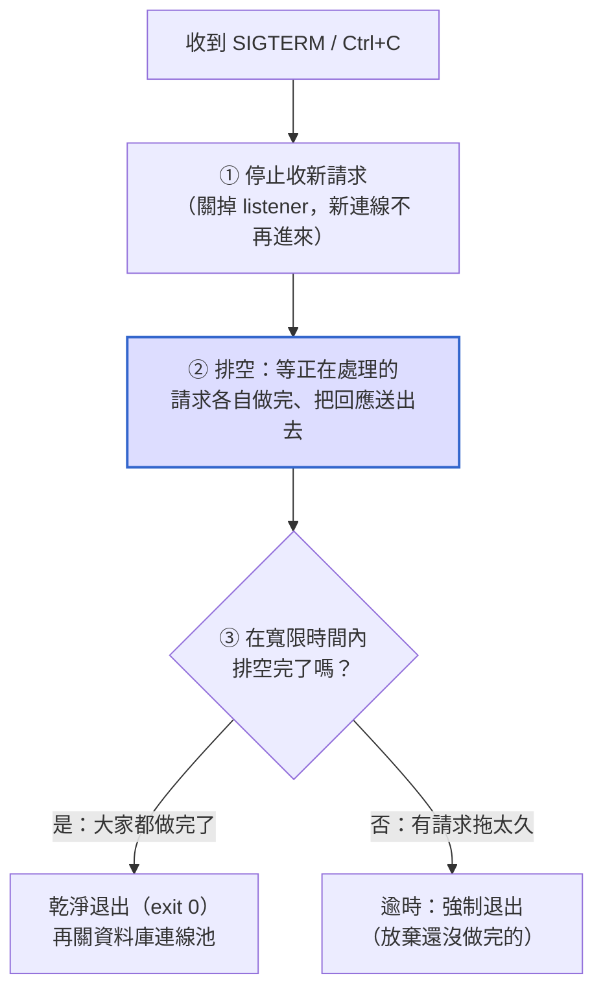
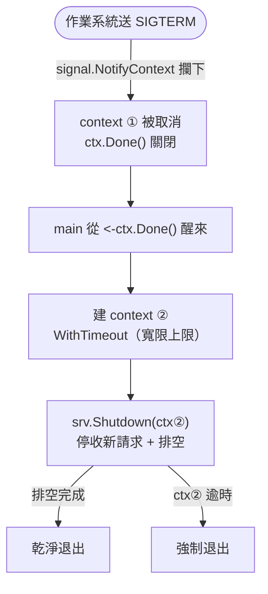

# [go-7-5] 🐹 優雅關機與 `context`：收到 `SIGTERM` 怎麼排空再退出

> **本章目標**：讓你的服務在收到關機訊號（`SIGTERM`／`Ctrl+C`）時，不要粗暴地立刻死掉，而是**停止收新請求 → 等正在處理的請求做完 → 逾時才強制退出**。這叫「優雅關機（graceful shutdown）」，是任何會上線的後端服務的必備骨架，也是 `go-4-6` 的 `context` 在真實服務裡最漂亮的一次應用。

前一章 `go-7-4` 我們用 `http.ListenAndServe` 把服務跑起來，但留了一個尾巴：**它一退出，正在處理的請求就被硬生生切斷。** 這一章把這個尾巴收掉。

## 你會學到

- 為什麼「直接退出」在正式環境會害到使用者——`SIGTERM` 是怎麼一回事
- 優雅關機的三步：**停止收新請求 → 排空（drain）進行中的請求 → 逾時就強制退**
- 用 `signal.NotifyContext` 把「收到作業系統訊號」變成一個會自動取消的 `context`
- 用 `http.Server.Shutdown` 排空進行中的請求
- 怎麼在「等不完」時設一個上限，到點強制收工，不要無限等

## 概念說明

### 為什麼不能直接退出？`SIGTERM` 的故事

你的服務不會自己決定什麼時候關。**關機訊號是外面送進來的**：

- 你在終端機按 `Ctrl+C` → 作業系統送 `SIGINT`（interrupt）給你的程式。
- 部署系統要換新版本、或要把這台機器收掉時 → 送 `SIGTERM`（terminate，「請你自己收一收、準備結束」）。容器平台（像 Kubernetes）滾動更新時就是這樣：先送 `SIGTERM`，給你一段「寬限時間（grace period）」收尾，時間到還沒退，才送 `SIGKILL`（直接拔插頭，不給你反應機會）。

「訊號（signal）」就是作業系統拍你肩膀的方式。`SIGTERM` 這一拍的意思是：**「準備收工，但我給你一點時間。」** 問題是——Go 程式**預設**收到 `SIGTERM` 的反應是「立刻死掉」。如果你不做任何處理，會發生這種事：

```
使用者送出一個「借書」請求
    → 你的 handler 正跑到一半（借閱紀錄插好了、書況還沒更新）
    → 這時部署系統送來 SIGTERM
    → 程式「啪」地立刻結束
    → 使用者那端：連線被重置，收到一個莫名其妙的錯誤
    → 資料那端：交易可能沒 commit，或更糟，留下半套狀態
```

「優雅關機」要做的，就是讓程式收到 `SIGTERM` 後**別急著死**，先把手上的事做完再走。

### 優雅關機的三步



這張圖是本章的全部精神，三步缺一不可：

- **① 停止收新請求**：先把大門關上。新來的連線不再接受，但**已經在裡面的請求不受影響**，繼續讓它們跑。
- **② 排空（drain）**：等已經在處理的請求一個個做完、把回應正常送回去。這就是「優雅」的核心——不丟掉任何一個已經收下的請求。
- **③ 設一個上限**：萬一某個請求卡住了（例如一個很慢的查詢），你不能無限等下去——部署系統的寬限時間一到就會送 `SIGKILL`。所以自己設一個逾時（通常比寬限時間短一點），到點就放棄剩下的、強制退出。

Go 的 `net/http` 把①②包成**一個**方法：`srv.Shutdown(ctx)`。它會立刻停止接受新連線，然後阻塞等待所有進行中的請求結束；而③——那個「等多久就放棄」——就靠你傳給它的那個 `ctx` 的逾時來控制。這下你應該看出 `context` 要登場了。

### `context` 怎麼串起這整件事

這章會用到 `go-4-6` 的 context **兩次**，用途不同，別搞混：

1. **第一個 context：把「收到訊號」變成「context 被取消」。** `signal.NotifyContext` 回傳一個特別的 context——平常好好的，一旦收到你指定的訊號（`SIGINT`／`SIGTERM`）就**自動取消**。於是「等關機訊號」這件事，就變成大家熟悉的 `<-ctx.Done()`。

2. **第二個 context：給排空設一個逾時。** 用 `context.WithTimeout` 做一個「最多等 N 秒」的 context，傳給 `srv.Shutdown(ctx)`。排空在 N 秒內完成最好；超過 N 秒，這個 ctx 逾時，`Shutdown` 會回傳錯誤，你就知道「有請求沒排空完」，強制退出。



這張圖把兩個 context 的分工畫清楚：context ① 負責「**何時**開始關機」（被訊號觸發），context ② 負責「關機**最多花多久**」（逾時上限）。

### 一個常被忽略的前提：handler 自己也要「聽勸」

`srv.Shutdown` 會等進行中的請求做完——但它**不會去中斷**那些請求。所以如果你有個 handler 裡面是「睡 10 分鐘」或「一個沒設逾時的資料庫查詢」，`Shutdown` 也只能傻等它，等到你設的寬限時間逾時、然後強制退。

這就回扣到 `go-7-4` 的那個習慣：**handler 裡每個耗時操作都要吃 `r.Context()`。** 當然，`Shutdown` 期間 `net/http` 預設不會主動取消進行中請求的 context（它要讓請求有機會好好做完）；但你把 `r.Context()` 傳給資料庫查詢這件事，仍然讓「客戶端自己斷線」時能即時放手，兩者相輔相成。簡言之：**優雅關機要能真的優雅，靠的是「伺服器會等」＋「handler 寫得短、該吃 context 的都吃了」兩邊配合。**

## 程式碼範例

### 範例一：最小可行的優雅關機骨架

這是你可以直接套用的完整骨架。重點全在註解裡，先整段看，再逐項拆解。

```go
package main

import (
	"context"
	"errors"
	"log"
	"net/http"
	"os/signal"
	"syscall"
	"time"
)

func main() {
	mux := http.NewServeMux()
	mux.HandleFunc("GET /health", func(w http.ResponseWriter, r *http.Request) {
		w.Write([]byte("ok"))
	})

	srv := &http.Server{
		Addr:    ":8080",
		Handler: mux,
	}

	// ── context ①：收到 SIGINT/SIGTERM 就自動取消 ──
	// 注意：一定要拿它回傳的 stop 並 defer，把訊號監聽解除（成對）
	ctx, stop := signal.NotifyContext(context.Background(),
		syscall.SIGINT, syscall.SIGTERM)
	defer stop()

	// 在另一條 goroutine 跑伺服器，因為 ListenAndServe 會一直阻塞到伺服器結束。
	// main 這條要空出來去等關機訊號。
	go func() {
		log.Println("服務啟動於 :8080")
		// 伺服器正常被 Shutdown 關掉時，ListenAndServe 會回傳 ErrServerClosed，
		// 那不是錯誤、是預期的；其他錯誤才是真的出事。
		if err := srv.ListenAndServe(); err != nil &&
			!errors.Is(err, http.ErrServerClosed) {
			log.Fatalf("伺服器意外結束：%v", err)
		}
	}()

	// main 卡在這裡等——直到 context ① 被訊號取消
	<-ctx.Done()
	stop() // 解除訊號監聽：這之後再按一次 Ctrl+C 就會用預設行為「立刻強制結束」，
	//        當作「我等不及了，馬上退」的逃生門
	log.Println("收到關機訊號，開始排空進行中的請求…")

	// ── context ②：排空最多等 15 秒 ──
	shutdownCtx, cancel := context.WithTimeout(context.Background(), 15*time.Second)
	defer cancel()

	// Shutdown：停止收新請求，並阻塞等待進行中的請求做完（或 shutdownCtx 逾時）
	if err := srv.Shutdown(shutdownCtx); err != nil {
		// 走到這裡＝15 秒內沒排空完，有請求被強制中斷
		log.Fatalf("排空逾時，強制退出：%v", err)
	}

	log.Println("所有請求已處理完畢，乾淨退出")
}
```

逐項說明：

- **`signal.NotifyContext(parent, SIGINT, SIGTERM)`**：這是 Go 1.16 加的便利函式，一步到位把「監聽訊號」和「context」接起來。它回傳 `ctx` 和 `stop`：收到任一指定訊號，`ctx` 就被取消（`ctx.Done()` 關閉）；`stop` 用來解除監聽。**`defer stop()` 是成對原則**（`CLAUDE.md`：註冊了就要解除）——登記了訊號監聽，離開時要還回去。
- **為什麼伺服器要跑在 goroutine 裡？** 因為 `srv.ListenAndServe()` 是阻塞的，它會一直待在那裡服務請求、直到伺服器被關閉才回傳。如果直接在 `main` 呼叫它，`main` 就卡住了，沒有人去等關機訊號。所以把它丟到一條 goroutine（`go-4-1`），`main` 這條專門用 `<-ctx.Done()` 等訊號。
- **`http.ErrServerClosed` 不是錯誤**：當 `Shutdown`（或 `Close`）被呼叫、伺服器正常關閉時，`ListenAndServe` 會回傳這個哨兵錯誤（sentinel error）。它代表「我是被正常關掉的」，所以我們用 `errors.Is`（`go-3-2`）把它濾掉，只有**別的**錯誤才算真的意外。
- **`<-ctx.Done()`**：`main` 就停在這一行等。平常風平浪靜，一旦使用者按 `Ctrl+C` 或部署系統送 `SIGTERM`，context ① 被取消，這行立刻返回，往下走進關機流程。
- **關機後再 `stop()` 一次**：解除訊號監聽，等於把「收到 `Ctrl+C` 就優雅關機」這個攔截拿掉。效果是——如果排空很慢、使用者**再按一次 `Ctrl+C`**，這次沒人攔了，程式會用作業系統預設行為直接結束。這是個貼心的逃生門：「我知道你在排空，但我等不及了，馬上退。」
- **`srv.Shutdown(shutdownCtx)`**：這一個呼叫就包辦了圖裡的①②——停止接受新連線、等進行中的請求做完。它會**阻塞**，直到所有請求結束（回傳 `nil`），或 `shutdownCtx` 逾時（回傳 `context.DeadlineExceeded`）。後者代表有請求拖過了 15 秒，我們選擇強制退出。

### 範例二：接上 `go-7-4` 的資料庫——關機順序很重要

真實服務不只有 HTTP，還握著資料庫連線池。關機時的**順序**有講究：**先排空 HTTP，再關資料庫**。這段把 `go-7-4` 的連線池接進來。

```go
func main() {
	dsn := os.Getenv("DATABASE_URL")
	if dsn == "" {
		log.Fatal("請設定 DATABASE_URL 環境變數")
	}

	db, err := openDB(dsn) // go-7-4 的連線池
	if err != nil {
		log.Fatal(err)
	}

	application := &app{store: &BookStore{db: db}}
	srv := &http.Server{Addr: ":8080", Handler: application.routes()}

	ctx, stop := signal.NotifyContext(context.Background(),
		syscall.SIGINT, syscall.SIGTERM)
	defer stop()

	go func() {
		log.Println("服務啟動於 :8080")
		if err := srv.ListenAndServe(); err != nil &&
			!errors.Is(err, http.ErrServerClosed) {
			log.Fatalf("伺服器意外結束：%v", err)
		}
	}()

	<-ctx.Done()
	stop()
	log.Println("收到關機訊號，開始排空…")

	shutdownCtx, cancel := context.WithTimeout(context.Background(), 15*time.Second)
	defer cancel()

	// ① 先排空 HTTP：等所有進行中的請求做完。
	//    這一步結束後，保證沒有任何 handler 還在用資料庫了。
	if err := srv.Shutdown(shutdownCtx); err != nil {
		log.Printf("排空逾時：%v", err)
	}

	// ② 確定沒人在用之後，才關資料庫連線池。
	if err := db.Close(); err != nil {
		log.Printf("關閉資料庫時出錯：%v", err)
	}

	log.Println("乾淨退出")
}
```

**關機順序為什麼是「先 HTTP 後 DB」？** 想像反過來：你先把資料庫連線池 `db.Close()` 了，但這時還有個 handler 正跑到一半、正要下一句 SQL——它會拿到一條已經被關掉的連線，整個請求炸掉。那還叫什麼優雅關機？正確順序是：**先讓 `srv.Shutdown` 把所有 handler 排空、確定沒有任何人還會碰資料庫了，再關連線池。** 這就是「成對的東西按相反順序收尾」——`db` 先開、最後關；伺服器後開、先停。

> 注意這裡 `db.Close()` 沒有用 `defer`，而是明確寫在 `Shutdown` 之後。因為 `defer` 的執行順序（後進先出）會在這個情境下幫倒忙——我們要的是精確的「HTTP 完全停下來」之後「才」關 DB，用明確的順序表達比 `defer` 清楚。

### 範例三：用一個「慢 handler」親眼看到排空在作用

光讀程式碼感受不到「排空」。這段加一個故意很慢的 handler，讓你在關機時親眼看到它被等完。

```go
mux.HandleFunc("GET /slow", func(w http.ResponseWriter, r *http.Request) {
	log.Println("慢請求：開始處理（要 5 秒）")
	select {
	case <-time.After(5 * time.Second):
		// 正常做完 5 秒的工作
		w.Write([]byte("慢請求完成\n"))
		log.Println("慢請求：處理完成")
	case <-r.Context().Done():
		// 客戶端自己斷線了（例如使用者關掉頁面）→ 提早放手，別白做
		log.Println("慢請求：客戶端斷線，放棄")
	}
})
```

**怎麼驗證**（需自行實機跑一次）：

1. 啟動服務，另開一個終端機 `curl localhost:8080/slow`（它會卡著等 5 秒）。
2. 在那 5 秒內，回到服務的終端機按 **一次** `Ctrl+C`。
3. 觀察：服務印出「收到關機訊號，開始排空…」，但**沒有立刻結束**——它在等那個慢請求。
4. 約 5 秒後，慢請求那邊 `curl` 正常收到「慢請求完成」，服務才印「乾淨退出」。

這就是優雅關機的鐵證：**關機訊號來了，但已經在處理的請求被完整做完、正常回應，而不是被切斷。** 你也可以反過來試：把慢 handler 的 5 秒改成 20 秒（超過排空上限 15 秒），再做一次——這次服務會在 15 秒時印出「排空逾時」並強制退出，那個 `curl` 會收到連線被中斷。這驗證了圖裡的第③步。

> 範例裡的 `select { case <-r.Context().Done(): }` 就是 `go-4-6` 教的骨架：handler 盯著請求的 context，客戶端一斷線就放手。這跟伺服器層的 `Shutdown` 是兩個不同的取消來源，但用的是同一套 context 機制。

## 小練習

1. **把骨架跑起來**：用範例一加上範例三的 `/slow` handler，照「怎麼驗證」走一遍——在慢請求進行中按 `Ctrl+C`，確認服務會等它做完才退出。再把排空上限改成 2 秒、慢請求維持 5 秒，觀察「逾時強制退出」的那條路。
2. **順序的代價**：把範例二的關機順序故意寫反（先 `db.Close()` 再 `srv.Shutdown`），搭配一個會查資料庫的慢 handler，想清楚（或實測）在關機時打一個這種請求會發生什麼事。寫一句話說明為什麼正確順序是「先 HTTP 後 DB」。
3. **思考題**：`signal.NotifyContext` 回傳的 `stop` 如果你**忘了呼叫**（既沒 `defer stop()`、關機後也沒 `stop()`），會漏掉什麼？（提示：和 `go-4-6` 裡「`WithTimeout` 的 `cancel` 一定要呼叫」是同一類問題——登記了某個東西卻沒解除登記。）

<details>
<summary>參考解答</summary>

**第 1 題（跑起來 + 兩條路）**

把範例一的 `main` 加上範例三的 `/slow` 路由即可。驗收點：

- 排空上限 15 秒、慢請求 5 秒：按 `Ctrl+C` 後服務等約 5 秒、慢請求正常完成、印「乾淨退出」。
- 排空上限 2 秒、慢請求 5 秒：按 `Ctrl+C` 後服務約 2 秒就印「排空逾時，強制退出」，`curl` 那端連線被中斷。

這兩條路剛好對應流程圖第③步的「是」與「否」。

**第 2 題（順序寫反的後果）**

先 `db.Close()` 會把連線池關掉，但此時 `srv.Shutdown` 還沒跑、那個查資料庫的慢 handler 還在進行中。它下一句 SQL 就會拿到一條已關閉的連線，查詢回傳類似 `sql: database is closed` 的錯誤，請求以 500 收場——使用者的請求明明只差一步就完成，卻因為我們關錯順序而失敗。正確順序「先 HTTP 後 DB」保證了：`srv.Shutdown` 返回時，所有 handler 都已結束、沒有人會再碰資料庫，這時關連線池才安全。核心是「成對資源按相反順序釋放」：先開的（DB）最後關，後開的（HTTP 伺服器）先停。

**第 3 題（忘了 `stop` 的後果）**

`signal.NotifyContext` 在底層向作業系統**登記**了「這些訊號要轉給我」。`stop` 的作用是解除這個登記、把相關資源釋放掉。忘了呼叫它，在一個短命的程式裡後果不明顯（程式反正要結束了），但：(1) 在長命、會反覆建立 context 的程式裡（例如每次某事件都 `NotifyContext` 一次卻不 `stop`），會累積未釋放的訊號監聽，屬於資源洩漏；(2) 更實際的是失去那個「逃生門」——我們在關機後 `stop()` 是為了讓「再按一次 `Ctrl+C`」能立刻強制結束；不 `stop`，第二次 `Ctrl+C` 還是被攔著變成訊號、不會立即退出。這跟 `go-4-6` 的 `defer cancel()` 完全同源：**登記了某個東西，就要有對應的解除登記**，這也是 `CLAUDE.md`「成對的東西要成對」。

</details>

## 課外讀物

> 這章用到的 `context` 取消／逾時機制，完整原理在 → [context 專章](../part-4/go-4-6-context.md)（`go-4-6`）

> 「可優雅關機、可排空」是線上服務「不中斷地換版本」的基礎，也是可靠性工程關心的核心之一 → 參見 **[sre 課程大綱](../../sre/課程大綱.md)**

> 下一章：把 `go-7-2` 到 `go-7-5` 學的全部——路由、JSON、資料庫、交易、優雅關機——合成一個真的能編譯、能跑、有測試、能部署成單一執行檔的完整專案 → `go-7-6` 整合專案 🏆
