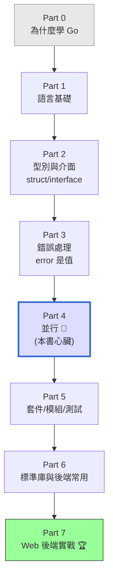

# Go 程式設計課程大綱

> **核心理念**：Go（又叫 Golang）是 Google 為了「大規模後端與雲端服務」設計的語言。它的賭注是**用「簡單」換「可維護」**——語法少、關鍵字少、一種迴圈、沒有繼承、沒有例外（exception），刻意把花招拿掉，讓一個團隊幾年後回來看還讀得懂。
> 它最自豪的是**並行（concurrency）**：一行 `go` 就開一條輕量執行緒（goroutine），用「傳訊息」的 channel 溝通，讓你用很少的程式碼寫出吃滿多核的服務。這門課假設你**沒寫過 Go**，從零開始，最後你能讀懂、也能自己寫出一個會連資料庫、能並行、能上線的 **Go 後端服務**。

---

## 這門課的定位

| | 說明 |
|---|------|
| **適合對象** | 想學一門「為並行與雲端後端而生」的語言的人；要讀懂或維護 Go 寫的後端服務的人；受夠了複雜語言、想要「少即是多」的人。**沒寫過 Go 也能從頭學起。** |
| **目標** | 學完能：讀懂一般的 Go 後端程式碼；用 struct＋**interface（隱式實作）**組織程式；用 **`error` 是值**的風格做穩健的錯誤處理；用 **goroutine／channel／`context`** 寫並行與可取消的服務；寫 **table-driven 測試**；並用標準庫（或輕量框架）做出一個**連 PostgreSQL、能優雅關機、能編成單一執行檔部署的 REST API**。 |
| **建議（非必須）** | 有 **basic 課程**的程式基礎（變數、函式、流程控制）會更好上手。先讀過 **cs 課程（計算機概論）** 的「記憶體、堆疊堆積、作業系統、並行」（Part 3、5）會更快看懂 goroutine 為什麼這樣設計。 |
| **這門課 vs rust / csharp** | **Go 和 C#、TypeScript 一樣有垃圾回收（GC），不用自己管記憶體**——所以比 Rust 好入門很多。但 Go 把並行做成語言的一級公民（goroutine／channel），這是 C#／TS 要靠函式庫才有的。可以把 Go 想成「有 GC 的 C，加上內建的並行」。 |

> 通用知識（測試、SOLID、錯誤處理設計、Git）在頂層 `課外讀物/`（E-6、E-7、E-9、E-8），本課會在需要時交叉引用，不重複造輪子。
> 標 🐹 的是**Go 的招牌、最該花時間嚼透的概念**，標 🏆 的是**整合專案**。

> **本課的深度設計**：Part 4「並行」是整本書的心臟，會用最多篇幅、最多圖解慢慢講。Go 的難不在語法（語法一天就看完），而在**「怎麼用 goroutine 和 channel 把事情組織對」**——這裡才是真正要練的地方。

---

## 學習路徑總覽

> 脈絡：**先把少少的語法基礎打好 → 學 Go 怎麼用 struct＋interface 組織程式、用 error 值處理錯誤 → 翻過「並行」這座山（本書心臟）→ 套件與測試讓專案長大 → 最後用標準庫做一個完整後端服務。** Go 的語法很快就學完，真正的功夫在 Part 4 和 Part 7。

---

## Part 0 — 開始之前：為什麼是 Go

### 章節列表

- `go-0-1` 為什麼學 Go？用「簡單」換「大團隊幾年後還維護得動」
- `go-0-2` Go 站在哪：和 C、Rust、TypeScript/C# 的定位比較（有 GC、編譯成單一執行檔、內建並行）
- `go-0-3` 環境準備：安裝 Go、`go` 工具鏈，跑出第一個 Hello World
- `go-0-4` Go Modules 入門：`go mod` 建專案、`go build` / `go run`、加套件的日常流程

---

## Part 1 — 語言基礎

> Go 的語法少到你會驚訝。先把這些「不靠並行也能懂」的基礎打好。

### 章節列表

- `go-1-1` 變數、常數與「零值」：`var` / `:=` 的多種寫法，與為什麼 Go 沒有 `undefined`（每個型別都有零值）
- `go-1-2` 基本型別：整數、浮點、布林、字串，以及 `byte` / `rune`；為什麼型別轉換一定要寫明
- `go-1-3` 🐹 函式與多回傳值：Go 招牌的 `(結果, error)` 從這裡開始；具名回傳值
- `go-1-4` 流程控制：`if`（可帶初始化）、`for`（Go 只有這一個迴圈關鍵字）、`switch`
- `go-1-5` 🐹 slice、array 與 map：最常用的集合，與 `slice` 底層、`append` 的經典陷阱
- `go-1-6` 指標入門：`*` 與 `&`，為什麼 Go 的指標比 C 單純（沒有指標運算）

---

## Part 2 — 用型別與介面組織程式

> Go 沒有 class、沒有繼承。它用 struct 裝資料、用 method 綁行為、用 **interface 隱式實作** 做抽象——這套組合是 Go 的靈魂。

### 章節列表

- `go-2-1` struct：定義你自己的資料型別；struct tag 初探
- `go-2-2` 方法與接收者（receiver）：值接收者 vs 指標接收者，什麼時候用哪個
- `go-2-3` 🐹 interface：Go 的「隱式實作」——不用寫 `implements`，長得像就算（鴨子型別）
- `go-2-4` 空介面、`any` 與型別斷言：`x.(T)`、type switch，以及為什麼要節制地用
- `go-2-5` 組合而非繼承：struct 內嵌（embedding）怎麼取代繼承
- `go-2-6` 泛型（Generics，Go 1.18+）：型別參數與 constraints 的基礎

---

## Part 3 — 錯誤處理：錯誤是值

> Go 不用例外（exception）。錯誤就是一個普通的回傳值，強迫你當場決定怎麼辦——囉嗦，但無處可逃。

### 章節列表

- `go-3-1` 🐹 `error` 是一個值：顯式回傳、`if err != nil` 的哲學與取捨（對照 try/catch）
- `go-3-2` 包裝與檢查錯誤：`fmt.Errorf("...: %w", err)`、`errors.Is` / `errors.As`（呼應課外讀物 E-6-8）
- `go-3-3` 🐹 `defer`：收尾動作怎麼寫、執行順序、關檔與解鎖的標準用法
- `go-3-4` `panic` 與 `recover`：什麼時候該用、什麼時候絕對不要（和 `error` 的分界）

---

## Part 4 — 並行（Concurrency）：Go 的心臟 🐹

> 這是 Go 最獨特、最強、也最需要練的部分。別的語言要靠函式庫，Go 把並行做成語言內建。整個 Part 用大量圖解，慢慢來——這裡的難不是語法，是「怎麼把事情組織對」。

### 章節列表

- `go-4-1` 🐹 goroutine：一行 `go` 就開一條並行，以及它跟作業系統執行緒的差別（為什麼能開上萬條）
- `go-4-2` 🐹 channel：goroutine 之間「用傳訊息溝通，而不是共享記憶體」；有無緩衝的差別
- `go-4-3` `select`：同時等多個 channel，與逾時的寫法
- `go-4-4` 常見並行模式：worker pool、fan-out / fan-in、關閉 channel 的規矩（誰關、關了會怎樣）
- `go-4-5` `sync`：`WaitGroup` 等全部做完、`Mutex` 什麼時候還是得共享記憶體
- `go-4-6` 🐹 `context`：取消、逾時、把「請求範圍」的訊號串下去——後端服務的必備骨架
- `go-4-7` 資料競爭（data race）與 `-race`：看不見的並行 bug 怎麼抓（呼應 cs 課程 Part 5）

---

## Part 5 — 套件、模組與測試

> 把程式碼組織好、用上生態系、並寫測試保證正確——讓專案能長大、能多人協作。

### 章節列表

- `go-5-1` package 與可見性：大寫開頭＝對外匯出，`import` 與套件怎麼切
- `go-5-2` Go Modules 深入：`go.mod` / `go.sum`、語意化版本、`go get` 升降版
- `go-5-3` 🐹 寫測試：`testing` 套件、`go test`、Go 招牌的 **table-driven test**（呼應課外讀物 E-9）
- `go-5-4` 進一步的測試：覆蓋率、`Benchmark`、用 `httptest` 測 HTTP handler

---

## Part 6 — 標準庫與後端常用

> Go 的標準庫很強，很多專案「只用標準庫」就能上線。這個 Part 挑後端最常碰的幾塊。

### 章節列表

- `go-6-1` 日常工具：`fmt`、`strings`、`strconv`、`time`（時間與時區的坑）
- `go-6-2` `encoding/json`：struct tag、序列化與反序列化、`omitempty`，與 JSON 數字精度的坑
- `go-6-3` `net/http`：Go 內建就能當 HTTP 客戶端與伺服器，不靠框架先跑一個
- `go-6-4` `database/sql`：連 PostgreSQL、`Query` / `Exec`、用 `context` 設逾時、交易（呼應 basic Part 5、課外讀物 E-4）
- `go-6-5` `io` 與 `bufio`：`Reader` / `Writer` 介面為什麼能串起整個生態系

---

## Part 7 — Web 後端實戰 🏆

> 把學到的全部串起來，用 Go 做一個能跑、能連資料庫、能並行、能優雅關機、能編成單一執行檔上線的 **Web 後端 API**。這是本書的最終目標。

### 章節列表

- `go-7-1` Go 做後端的全景：標準庫 vs 框架（chi / gin / echo），以及「為什麼很多人只用標準庫」
- `go-7-2` 起一個 HTTP 服務：`http.ServeMux`、handler、怎麼寫 middleware
- `go-7-3` 處理請求與回應：路由與路徑參數、JSON 進出、輸入驗證
- `go-7-4` 接資料庫：把 `database/sql` 接進 handler、連線池、交易邊界放哪裡
- `go-7-5` 🐹 優雅關機與 `context`：收到 `SIGTERM` 怎麼排空進行中的請求再退出（呼應 `go-4-6`）
- `go-7-6` 🏆 整合專案：一個完整的 REST API（CRUD＋PostgreSQL＋table-driven 測試＋`go build` 成單一執行檔部署）

---

## 與其他課程 / 課外讀物的對照

| Go 章節 | 對應的課程 / 課外讀物 | 關係 |
|---------|---------------------|------|
| `go-1-5` slice / map | **dsa 課程** Part 2、3 | 用 Go 對照動態陣列與雜湊表的實作 |
| `go-2-3` interface | 課外讀物 E-7-5（ISP）、E-7-6（DIP） | Go 用「隱式 interface＋組合」而非繼承做抽象 |
| `go-3-x` 錯誤處理 | 課外讀物 E-6-8 | 錯誤處理設計原則的 Go 實踐 |
| `go-4-x` 並行 | **cs 課程** Part 5、**rust 課程** Part 8 | 並行問題的語言級解法；對照 Rust 的 async／所有權如何「無懼並行」 |
| `go-4-6` `context`、`go-7-5` 優雅關機 | **sre 課程**、課外讀物 E-15（韌性） | 可取消、可排空是可靠服務的基本功 |
| `go-5-3` 測試 | 課外讀物 E-9 | 測試觀念的 Go 實踐（table-driven） |
| `go-6-4` `database/sql` | **basic 課程** Part 5、課外讀物 E-4 | 用 Go 連資料庫，對照 TS/C# 的另一條路線 |
| `go-7-x` Web 後端 | **basic 課程** Part 4-5、**csharp 課程** | 用 Go 做後端 API，對照 TypeScript / C# |
| `go-7-6` 發布部署 | **infra 課程**、**aws 課程** | 後端做好後接自架或上雲部署 |

> 想先懂「記憶體、並行」的底層原理 → 先讀 **cs 課程（計算機概論）** Part 3、5
> 想看另一種「沒有 GC、靠所有權做並行」的對照 → 參見 **rust 課程**（姊妹課，Go 好入門、Rust 更底層）
> 想深入錯誤處理 / 測試 / 介面設計的通用原則 → 參見 **課外讀物 E-6、E-9、E-7**
> 後端 API 做好後想部署上線 → 參見 **infra 課程**（自架）或 **aws 課程**（雲端）

---

## 課程統計

| Part | 主題 | 章節數 | 標記 |
|------|------|--------|:---:|
| 0 | 開始之前：為什麼是 Go | 4 | |
| 1 | 語言基礎 | 6 | 🐹×2 |
| 2 | 型別與介面 | 6 | 🐹×1 |
| 3 | 錯誤處理：錯誤是值 | 4 | 🐹×2 |
| 4 | 並行（本書心臟） | 7 | 🐹×3 |
| 5 | 套件、模組與測試 | 4 | 🐹×1 |
| 6 | 標準庫與後端常用 | 5 | |
| 7 | Web 後端實戰 | 6 | 🐹×1、🏆×1 |
| **合計** | | **42** | |

> 狀態：Part 0–4（27 章）已完成；Part 5–7（測試、標準庫、Web 後端實戰，15 章）待寫。
