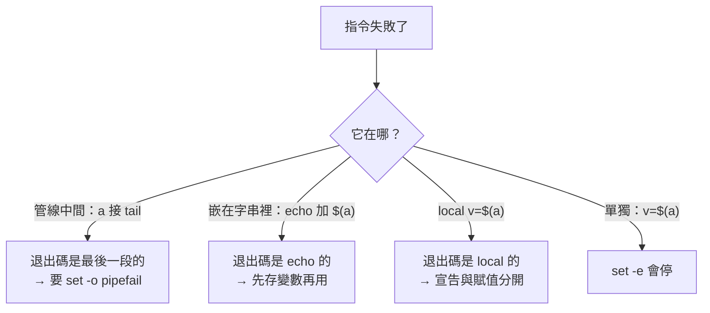

# [E-1-10] 管線把錯誤吃掉了：判斷成功要看結果，不要看輸出的最後一行

> **目標**：知道 shell 裡三種「指令失敗了、腳本卻照樣往下跑」的情況——`| tail` 截掉錯誤、管線的退出碼只看最後一段、`$(…)` 嵌在字串裡失敗不會停——並學會用 `pipefail`、先存變數、直接比對結果（commit、檔案、狀態）來判斷成功。

## 一個情境：回報「已合併」，其實沒合

你寫了一行指令把分支合進 main，嫌輸出太長，接了 `tail -1` 只看最後一行：

```bash
git merge --ff-only feature 2>&1 | tail -1
```

最後一行印出一段看起來很正常的訊息，你就回報「合好了」。後來才發現 main 根本沒動：合併被擋了（工作目錄有別人沒 commit 的改動），**錯誤訊息印在前面幾行，被 `tail -1` 截掉了**。

這不是 git 的問題，也不是你眼花。是「看輸出判斷成功」這個做法本身靠不住。

## 坑一：`| tail` 讓你看不到錯誤

`tail -1` 只留最後一行。很多工具的錯誤訊息在前面、最後一行反而是提示或摘要。你只看到你想看的那一行。

## 坑二：管線的退出碼只看最後一段

**退出碼（exit code）** 是指令結束時回給 shell 的數字：0 是成功，其他是失敗。`set -e`（遇到失敗就停）靠的就是它。

問題是：**管線 `a | b` 的退出碼是 `b` 的**。

```bash
false | tail -1
echo $?          # 0 ← false 失敗了，但 tail 成功，整條算成功
```

所以就算你開了 `set -e`，`git merge … | tail -1` 失敗了腳本也不會停。

解法：開 `pipefail`，管線裡任何一段失敗，整條就算失敗：

```bash
set -eo pipefail
false | tail -1   # 這裡就停了，退出碼 1
```

## 坑三：`$(…)` 嵌在別的指令裡，失敗不會停

**命令替換（command substitution）** `$(指令)` 會把指令的輸出塞進字串。它失敗時腳本停不停，要看它放在哪：

```bash
set -e
v=$(false)                    # 會停：單純的賦值，退出碼就是 $(…) 的
echo "版本=$(false)"           # 不會停：退出碼是 echo 的（成功）
local v=$(false)              # 在函式裡也不會停：退出碼是 local 的（成功）
```

實際踩到的樣子：build 腳本用 `echo "version=$(node -e '讀設定檔的某個欄位')"` 組版本字。設定檔格式被別人改了，node 報錯，但腳本照跑，**版本字靜默變成空的**，產物照樣產出。

解法：先存變數、檢查，再用：

```bash
set -eo pipefail
base_version=$(node -e '…')          # 失敗在這裡就停
[ -n "${base_version}" ] || { echo "讀不到版本號" >&2; exit 1; }
echo "version=${base_version}"
```

函式裡用 `local` 時，宣告和賦值分兩行：`local v; v=$(…)`。



這張圖在說：失敗有沒有被 `set -e` 看到，取決於它被包在什麼裡面。

## 最根本的解法：看結果，不看輸出

上面三招都是讓「失敗」浮出來。但最可靠的是**直接檢查你要的那個結果**：

| 你想確認 | 不要看 | 要看 |
|---|---|---|
| 合併成功 | merge 的輸出最後一行 | `git rev-parse main` 是不是等於分支的 commit |
| 檔案部署了 | rsync 有沒有報錯 | 遠端那個檔的內容 hash 等於本地的 |
| 服務換版了 | 部署指令的退出碼 | 服務自己回報的版本號 |

```bash
git merge --ff-only feature
[ "$(git rev-parse main)" = "$(git rev-parse feature)" ] || { echo "main 沒有前進到 feature" >&2; exit 1; }
```

輸出是「工具想告訴你的話」，結果是「世界真的變成什麼樣」。回報「做完了」之前，看後者。

> **常見錯誤** — 為了讓輸出短一點，在驗證步驟接 `| tail`、`| head`、`2>/dev/null`：
> 這三個都會讓錯誤消失在你眼前。要縮輸出，先把完整輸出存檔（`> log.txt 2>&1`），判斷成功用退出碼或結果檢查，再從檔案挑你想看的行。
> 更多「把錯誤藏起來」的反模式 → [E-6-6 反模式](../E-6-best-practices/E-6-6-anti-patterns.md)

## 小結

- `| tail -1` 會截掉錯誤；管線的退出碼只看最後一段，要 `set -o pipefail`。
- `$(…)` 放在 `echo "…"`、`local` 裡失敗不會觸發 `set -e`；先存變數、檢查非空再用。
- 判斷成功看**結果**（commit 雜湊、檔案內容、服務回報的版本），不看**輸出的最後一行**。

> 看 commit 雜湊判斷分支位置 → [E-8-1 Git 的內部運作](../E-8-git/E-8-1-git-internals.md)
> 「驗收本身可不可信」的方法 → [E-9-10 陽性對照](../E-9-testing/E-9-10-positive-control.md)
> 另一個「Mac 上腳本靜默出錯」的坑 → [E-1-9 bash 3.2 把全形字元吃進變數名](./E-1-9-bash32-multibyte-variable.md)
