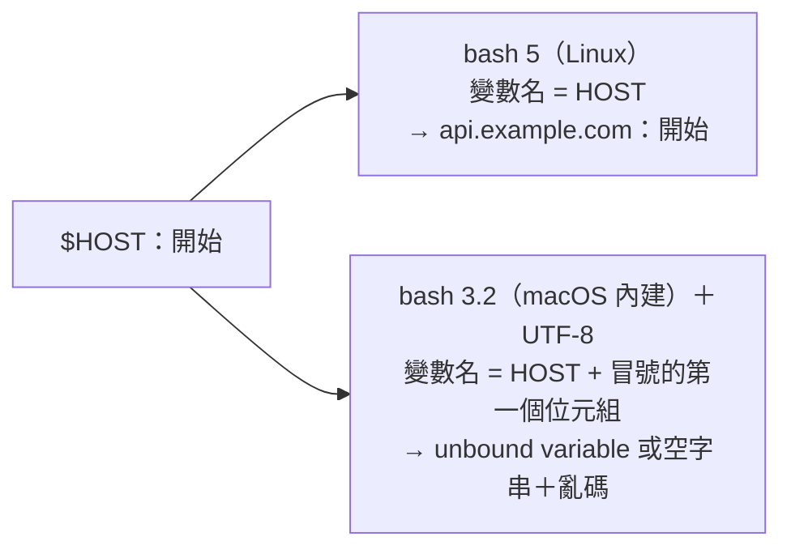

# [E-1-9] Mac 的 bash 會把全形字元吃進變數名：`"$NAME："` 為什麼報 unbound variable

> **目標**：知道 macOS 內建的 bash 3.2 遇到「變數後面緊接全形字元」時會把字元的位元組當成變數名的一部分；看得懂它的症狀、知道為什麼在 Linux 上測不出來，並學會用 `${變數}` 和一行 grep 預防。

## 一個情境：同一支腳本，Linux 好好的，Mac 一跑就炸

你寫了一支部署腳本，在 Linux 伺服器上跑得好好的。換到自己的 Mac 跑：

```bash
#!/bin/bash
set -u
HOST="api.example.com"
echo "連線到 $HOST：開始檢查"
```

```
./check.sh: line 4: HOST�: unbound variable
```

`HOST` 明明有設。錯誤訊息裡的變數名後面多了一個亂碼字元——這就是線索。

## 發生了什麼：shell 怎麼決定變數名在哪裡結束

`$HOST` 沒有大括號時，shell 要自己判斷變數名到哪裡為止：從 `$` 後面開始，**一直讀到第一個「不能出現在變數名裡」的字元**。規則是英文字母、數字、底線可以。

全形冒號「：」在 UTF-8 裡是三個位元組（`EF BC 9A`），不是英文字母。照理說讀到它就該停。

macOS 內建的是 **bash 3.2**（最後一個 GPLv2 授權的版本；之後的版本改用 GPLv3，Apple 就沒再更新）。實測它在 UTF-8 的 locale（語系設定）下，會把全形字元的**第一個位元組**當成變數名的一部分（下面「怎麼確認」那段可以自己重現）：

```
你以為的：  $HOST  +  ：開始檢查
bash 3.2： $HOST\xEF  +  \xBC\x9A開始檢查
```

變數 `HOST\xEF` 當然不存在。有 `set -u` 就報 unbound variable；沒有 `set -u` 更糟——它安靜地展開成空字串，還把冒號剩下的兩個位元組印成亂碼：

```bash
NAME=abc
echo "[$NAME：ok]"     # bash 3.2 印出：[��ok]  ← abc 不見了
```

Linux 上通常是 bash 5，沒有這個行為，所以**在伺服器上永遠測不出來**。



這張圖在說：同一行字，兩個版本的 bash 切出來的變數名不一樣。

## 怎麼確認是不是這個問題

```bash
/bin/bash --version          # macOS 內建：GNU bash, version 3.2.57 …
/bin/bash -c 'set -u; NAME=abc; echo "$NAME：ok"'              # 報 unbound variable
LC_ALL=C /bin/bash -c 'set -u; NAME=abc; echo "$NAME：ok"'     # 印 abc：ok
```

把 locale 換成 `C` 就正常，證明是「多位元組字元的判斷」出問題，不是你的變數沒設。

## 解法：大括號把變數名框起來

```bash
echo "連線到 ${HOST}：開始檢查"   # 兩個版本都正確
```

`${HOST}` 明確告訴 shell 變數名到 `}` 為止，就不用猜了。

規則：**變數後面緊接著非英數字元（尤其是中文、全形標點）時，一律寫 `${變數}`。** 寫完用這行自查，它會列出所有「`$變數名` 後面緊接非 ASCII 字元」的地方：

```bash
LC_ALL=C grep -nE '\$[A-Za-z_][A-Za-z0-9_]*[^ -~]' check.sh
```

- `LC_ALL=C`：讓 grep 逐位元組比，不受語系影響。
- `[^ -~]`：不在「空白到 `~`」這段可見 ASCII 範圍內的位元組，也就是中文、全形字元的位元組。

> **常見錯誤** — 以為「我在 Linux 上測過了」就夠：
> 腳本只在伺服器上跑過，交給同事在 Mac 上跑才炸；或者更糟，沒有 `set -u`，變數安靜地變成空字串，指令照跑、結果錯了。
> 正確做法：要給 Mac 用的腳本，用 `/bin/bash`（不是 Homebrew 裝的新版）實際跑一次，加上上面那行 grep。
> 更多「在某台機器上剛好沒事」的坑 → [E-6-6 反模式](../E-6-best-practices/E-6-6-anti-patterns.md)

## 小結

- macOS 內建 bash 3.2，在 UTF-8 下會把全形字元的位元組吃進 `$變數` 的名字裡。
- 症狀：`set -u` 時 unbound variable、錯誤訊息裡變數名多一個亂碼；沒有 `set -u` 時變數變成空字串加亂碼。
- Linux 的 bash 5 沒事，所以伺服器上測不出來。
- 變數後面接非英數字元一律 `${變數}`，用 `LC_ALL=C grep -nE '\$[A-Za-z_][A-Za-z0-9_]*[^ -~]'` 自查。

> 環境變數、`PATH` 的基本觀念 → [E-1-5 環境變數](./E-1-5-environment-variables.md)
> 另一個「腳本看起來成功其實失敗」的坑 → [E-1-10 管線把錯誤吃掉了](./E-1-10-pipeline-hides-errors.md)
