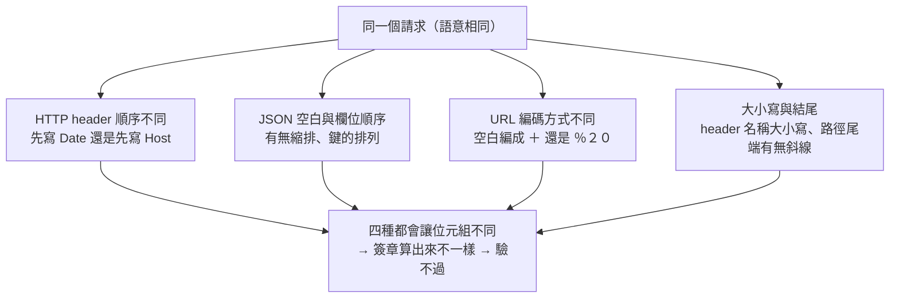

# [E-10-11] 簽名字串正規化：簽章最容易出錯的地方，是「到底要簽哪個字串」

> **目標**：理解為什麼「同一個請求」會算出不同的簽章（header 順序、JSON 空白、URL 編碼差異）、因此而驗不過的痛；學會用 **canonicalization（正規化）** 定一套明確規則把請求整理成唯一一個字串；並看懂一個經典又致命的漏洞——**簽章範圍沒涵蓋到關鍵欄位**。

## 一個問題：明明簽章邏輯沒錯，為什麼驗不過？

你照著上一篇做好了簽章：寄件端用密鑰對請求算 HMAC，收件端用同一把密鑰重算比對。程式碼看起來天衣無縫。

結果一上線，驗證**時好時壞**。同樣一筆「轉帳 100 元到帳號 B」的請求，有時驗得過，有時說簽章不符。你抓破頭：密鑰沒錯、演算法沒錯，到底哪裡出問題？

問題不在「怎麼簽」，而在**「簽的是哪個字串」**。

簽章演算法（不管 HMAC 還是非對稱）本質上是一個對「**一串位元組（bytes）**」做運算的函式。它極度敏感——**輸入差一個空格、差一個大小寫、欄位順序換一下，算出來的簽章就完全不同。** 而「一個 HTTP 請求」在寄件端和收件端之間，其實會以**好幾種看起來一樣、位元組卻不同**的面貌存在。這篇就是要解決這個落差。

> 本篇假設你已經懂「怎麼簽、怎麼驗」→ [E-10-10 數位簽章入門](./E-10-10-digital-signatures.md)

## 生活類比：兩個人報同一個地址，寫法卻不一樣

你和朋友約在同一個地方，各自把地址抄給計程車司機：

```
你寫的：      台北市信義區市府路45號
朋友寫的：    臺北市 信義區 市府路 45 號
```

這兩個地址指的是**同一個地點**，人看得懂它們一樣。但如果有台機器要「逐字比對這兩串文字是否完全相同」，它會說「不一樣」——一個用「台」一個用「臺」、一個有空格一個沒有、數字前後有無空白都不同。

簽章演算法就是那台「逐字比對」的機器。它不懂「意思一樣」，它只認「位元組完全一樣」。

所以解法是：**在簽章之前，先把地址用一套明確規則『抄成同一種標準寫法』**，例如一律規定「用『台』、不留空格、數字半形」。兩邊都先套這套規則整理一遍，再比對——這道「整理成唯一標準寫法」的手續，就是 **canonicalization（正規化 / 規範化）**。

> **canonicalization（正規化）**：把同一份資料可能有的多種表示法，依一套事先講好的明確規則，整理成**唯一一個標準形式（canonical form）**，再拿去簽章或比對。

## 同一個請求，為什麼會長出好幾個字串？

具體來說，一個 HTTP 請求在傳遞過程中，有好幾個地方會「意思一樣、位元組不同」：



這張圖表達：語意相同的一個請求，會因為 header 順序、JSON 空白、URL 編碼、大小寫等差異，變成好幾串位元組不同的文字，而簽章只認位元組，於是驗不過。

逐個看這些「隱形的差異」從哪來：

- **HTTP header 順序**：HTTP 規格不保證 header 的順序。寄件端的程式庫可能照 `Host, Date, Content-Type` 排，中間經過一層代理（proxy）後變成 `Date, Host, Content-Type`——內容一樣，順序變了。
- **JSON 空白與欄位順序**：`{"amount":100,"to":"B"}` 和 `{ "to": "B", "amount": 100 }` 在程式裡是同一個物件，但當成字串卻完全不同——縮排、空格、鍵的順序都可能變。
- **URL 編碼**：查詢字串裡的空白，可以編成 `+` 也可以編成 `%20`；中文等字元的百分比編碼（percent-encoding）大小寫（`%2f` vs `%2F`）也可能不同。
- **大小寫與結尾斜線**：HTTP header 名稱不分大小寫（`Content-Type` 等於 `content-type`），路徑 `/orders` 和 `/orders/` 可能被某些框架視為相同。

這些差異中，**只要有任何一個在寄件端簽章時和收件端驗章時不一致，簽章就對不上。**

## 解法：先定一份「正規化規則」，兩邊都照它整理

正規化的核心，是**雙方事先白紙黑字講好一套規則**，明確到不留任何模糊空間。一份正規化規則至少要回答三個問題：

```
1. 要簽「哪些」欄位？
   （例：HTTP 方法、路徑、timestamp、以及 request body）

2. 這些欄位用「什麼順序、怎麼串接」成一個字串？
   （例：各欄位之間用換行符 \n 連接，順序固定為 方法→路徑→timestamp→body）

3. 每個欄位各自要怎麼「標準化」？
   （例：方法一律大寫、header 名稱一律小寫、body 的 JSON 鍵依字母排序且不留空白）
```

把這份規則寫成 pseudo code：

```
函式 建立正規化字串(請求)：
    方法 = 請求.方法 轉大寫            // GET、POST…一律大寫
    路徑 = 請求.路徑                   // 不含查詢字串，結尾斜線規則固定
    時間戳 = 請求.header["x-timestamp"]
    內文 = 正規化JSON(請求.body)       // 鍵依字母排序、不留多餘空白

    // 用固定順序、固定分隔符，串成「唯一一個」字串
    回傳 方法 + "\n" + 路徑 + "\n" + 時間戳 + "\n" + 內文
```

重點是：**簽章和驗證，都先呼叫這個同一個 `建立正規化字串` 函式，再對它的輸出做 HMAC 或非對稱簽章。** 只要雙方跑的是同一套規則，位元組就會一致，簽章自然對得上。

## 正式程式碼範例

情境：**一個 API 請求的簽章正規化。** 我們把「如何把請求整理成唯一字串」獨立成一個純函式，簽章端和驗證端共用它。

先是正規化 JSON 的部分。這段的作用是：**把物件的鍵依字母排序、不留任何多餘空白，讓同一個物件永遠序列化成同一串位元組。**

```typescript
// 把物件的鍵遞迴排序後再 JSON 序列化，消除「鍵順序、空白」造成的差異。
// 注意：這裡只處理單層與巢狀物件的鍵排序；真實系統要再考慮陣列、Unicode 正規化等，
// 實務上建議直接採用成熟的標準（如 JSON Canonicalization Scheme, RFC 8785），不要自己造。
function canonicalizeJson(value: unknown): string {
  if (value === null || typeof value !== "object") {
    return JSON.stringify(value);
  }
  if (Array.isArray(value)) {
    return `[${value.map(canonicalizeJson).join(",")}]`;
  }
  const sortedKeys = Object.keys(value as Record<string, unknown>).sort();
  const entries = sortedKeys.map((key) => {
    const child = (value as Record<string, unknown>)[key];
    return `${JSON.stringify(key)}:${canonicalizeJson(child)}`;
  });
  return `{${entries.join(",")}}`;
}
```

接著把整個請求串成唯一字串。這段的作用是：**用固定的欄位、固定的順序、固定的分隔符，組出那一串「要拿去簽」的正規化字串。**

```typescript
interface SignableRequest {
  method: string; // 例如 "post"
  path: string; // 例如 "/transfers"
  timestamp: string; // 例如 "2026-11-26T08:00:00Z"
  body: unknown; // 請求本文（物件）
}

// 這個函式是「唯一真相」：簽章端與驗證端都必須呼叫它，不可各寫一套。
function buildCanonicalString(request: SignableRequest): string {
  const method = request.method.toUpperCase(); // 方法一律大寫
  const path = request.path; // 路徑規則（結尾斜線）事先約定一致
  const body = canonicalizeJson(request.body); // 鍵排序、無多餘空白

  // 固定順序，固定用換行符分隔；順序與分隔符都是規則的一部分，不能隨意更動
  return [method, path, request.timestamp, body].join("\n");
}
```

有了這個共用函式，簽章就只是「對它的輸出做 HMAC」。這段的作用是：**示範簽章端與驗證端跑的是同一套正規化，所以位元組必然一致。**

```typescript
import { createHmac, timingSafeEqual } from "node:crypto";

function signRequest(request: SignableRequest, secret: string): string {
  const canonical = buildCanonicalString(request); // ← 同一個函式
  return createHmac("sha256", secret).update(canonical).digest("hex");
}

function verifyRequest(
  request: SignableRequest,
  receivedSignature: string,
  secret: string,
): boolean {
  const canonical = buildCanonicalString(request); // ← 同一個函式
  const expected = createHmac("sha256", secret).update(canonical).digest("hex");

  const expectedBuffer = Buffer.from(expected, "hex");
  const receivedBuffer = Buffer.from(receivedSignature, "hex");
  if (expectedBuffer.length !== receivedBuffer.length) {
    return false;
  }
  return timingSafeEqual(expectedBuffer, receivedBuffer);
}
```

## 常見錯誤（反模式）

> **常見錯誤一（最致命）：簽章範圍沒涵蓋到關鍵欄位**
>
> 這是正規化相關漏洞裡**後果最嚴重**的一種，而且不是「驗不過」這種「會吵的 bug」，是「悄悄被繞過」的安全洞。
>
> 假設一筆轉帳請求長這樣，但簽章時**只把路徑和時間戳納入正規化字串，漏掉了 body 裡的金額**：
>
> ```typescript
> // ❌ 危險：正規化字串只簽了 method、path、timestamp，沒簽 body
> function buildCanonicalStringBad(request: SignableRequest): string {
>   return [request.method, request.path, request.timestamp].join("\n");
>   // body（含轉帳金額、收款帳號）完全沒被簽到！
> }
> ```
>
> 問題是：攻擊者攔截到一筆合法的「轉帳 100 元」請求，**把 body 裡的金額從 100 改成 100000、收款帳號改成自己的**，但 method、path、timestamp 原封不動。於是簽章**照樣驗得過**——因為被改的那部分，根本不在簽章保護的範圍內。你有簽章，卻等於沒簽。
>
> **正確做法**：**凡是「被改了會造成損害」的欄位，全部都要納入正規化字串。** 金額、收款帳號、數量、權限範圍——一個都不能漏。簽章保護的強度，等於「簽章覆蓋範圍」的強度；沒被簽到的部分，攻擊者想怎麼改就怎麼改。定規則時，預設是「全簽」，要排除某欄位得有明確理由。

> **常見錯誤二：簽章端和驗證端各自寫一套「整理字串」的程式碼**
>
> 寄件團隊用 Node.js 寫了一版正規化，收件團隊用另一個語言各寫一版，兩邊「照文件各自實作」。
>
> 問題是：正規化的魔鬼全在細節——JSON 鍵怎麼排序、空值怎麼處理、浮點數 `1.0` 要不要寫成 `1`、URL 編碼大小寫……兩套實作**遲早會在某個邊角 case 上分岔**，於是又回到「時好時壞」的驗證地獄，而且極難查。
>
> **正確做法**：正規化規則要當成**一份嚴謹的規格**白紙黑字寫死（最好直接採用既有標準，例如 JSON 的 RFC 8785），並盡量共用同一份實作或用同一組測試向量（test vectors，一組「輸入→預期正規化字串」的對照資料）去驗證每個語言的實作結果一致。別讓兩邊「憑感覺對齊」。

> **常見錯誤三：把「會變動但不該影響簽章」的東西也簽進去**
>
> 反方向的坑：有人為了「保險」，把**整個原始 HTTP 請求（含所有 header）**一字不漏地簽下去。
>
> 問題是：請求在路上常會被合法地加工——代理伺服器會加上 `X-Forwarded-For`、`Via` 等 header，負載平衡器可能調整 header 順序。這些變動與「請求語意」無關，卻會害簽章驗不過，造成大量正常請求被誤拒。
>
> **正確做法**：正規化字串只納入**「語意相關、傳輸途中不會被合法改動」**的欄位（方法、路徑、指定的幾個 header、body、timestamp）。挑選要簽哪些欄位，本身就是正規化規則的一部分——**既不能漏掉關鍵欄位（錯誤一），也不要把易變的雜訊簽進來。**

## 小結

- 簽章演算法只認**位元組**，不認「語意相同」。同一個請求因 **header 順序、JSON 空白與鍵順序、URL 編碼、大小寫**不同，會變成好幾串位元組不同的文字，於是簽章對不上。
- **canonicalization（正規化）**：依一套事先講好的明確規則，把請求整理成**唯一一個標準字串**，再拿去簽／驗。規則要回答三件事——**簽哪些欄位、什麼順序怎麼串、每個欄位怎麼標準化**。
- 簽章端與驗證端必須**共用同一個正規化函式**（或至少用同一組 test vectors 保證一致），別各寫一套。
- 最致命的漏洞是**簽章範圍沒涵蓋關鍵欄位**（例如漏簽金額）——攻擊者改沒被簽到的部分，簽章照樣驗得過，等於沒簽。原則：**會被改就造成損害的欄位，全部都要簽。**
- 也別走另一個極端把「傳輸途中會被合法改動的雜訊（如代理加的 header）」簽進去，否則正常請求會被誤拒。

> 怎麼簽、HMAC 與非對稱怎麼選 → [E-10-10 數位簽章入門](./E-10-10-digital-signatures.md)
> 簽章與正規化都對了，攻擊者把整個合法請求原封不動重送一次呢？ → [E-10-12 時間戳＋nonce 防重放](./E-10-12-replay-protection.md)
