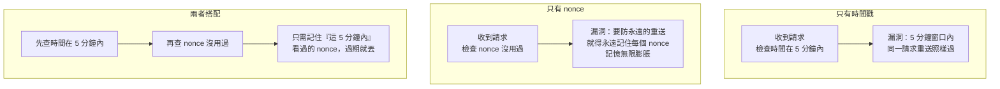

# [E-10-12] 時間戳＋nonce 防重放：簽章驗對了，為什麼還會被「重送一次」打穿

> **目標**：理解**重放攻擊（replay attack）** 是什麼——把一個「完全合法」的請求原封不動再送一次，仍可能得逞；學會用**時間戳（timestamp）＋ nonce** 兩者搭配來防它；並真正搞懂「為什麼兩個都要、少一個都不行」。

## 一個問題：簽章完美無缺，攻擊者卻讓你轉了兩次帳

你已經做好了簽章（E-10-10）和正規化（E-10-11）。現在一筆「從 A 轉 100 元到 B」的請求，簽章覆蓋了所有關鍵欄位，攻擊者**改任何一個字，簽章都會壞掉**。看起來固若金湯。

但攻擊者不改它。他做一件更簡單的事：**把這個一字不差、簽章完全合法的請求，原封不動地再送一次。**

```
原始合法請求：  POST /transfers  body={from:A, to:B, amount:100}  簽章=✔ 合法
攻擊者攔截到它，什麼都不改，直接重送：
重送第 2 次：   POST /transfers  body={from:A, to:B, amount:100}  簽章=✔ 還是合法
重送第 3 次：   ...簽章永遠合法，因為他根本沒改任何東西
```

你的伺服器收到第二個請求，一驗——簽章完美、欄位沒動——於是**又轉了一次 100 元**。攻擊者重送十次，你就轉了十次。這就是**重放攻擊（replay attack，重放 / 重送攻擊）**：

> **重放攻擊**：攻擊者攔截到一個合法的請求，**不做任何修改**，單純把它重複送出，誘使伺服器把同一個操作執行多次。

關鍵在於：**簽章只保證「這個請求沒被改、是對方發的」，但它完全不管「這個請求是不是已經送過了」。** 一個合法請求，被原樣複製一百份，每一份的簽章都一樣合法。簽章防竄改，但防不了重送。

> 簽章保護的是完整性與來源，不包含「是否重複」→ [E-10-10 數位簽章入門](./E-10-10-digital-signatures.md)

## 生活類比：一張沒寫使用期限、也沒編號的提款單

把這個請求想成一張「蓋好章、授權轉帳」的提款單。

如果這張單子上**既沒有日期、也沒有流水編號**，會發生什麼事？有心人把它拿去影印一百份，每一份的章都是真的、都有效。銀行無從分辨「這是正本還是第 37 份影本」，只好每張都照付。

現實中的單據怎麼防這件事？靠兩樣東西：

- **日期 / 有效期限**：「本單據限當日有效」。影本過了今天就作廢，**把風險壓縮在一個很短的時間窗內**。
- **流水編號（獨一無二）**：每張單子有唯一編號，銀行**記下已經兌付過的編號**，同一個編號第二次來就拒絕。

數位世界的防重放，用的正是這兩樣的對應物：

- **時間戳（timestamp）** ↔ 日期 / 有效期限
- **nonce** ↔ 流水編號

**nonce** 是 **number used once（用過一次就作廢的數值）** 的縮寫——一個每次請求都重新產生的、獨一無二的隨機值。

## 兩個機制：時間戳與 nonce 各防什麼

### 時間戳：拒收「太舊」的請求

做法：**每個請求都附上「它是什麼時候產生的」這個時間，並納入簽章保護。** 伺服器收到後，比對「現在時間」和「請求上的時間」，**差距超過一個容許窗（例如 5 分鐘）就直接拒絕**。

```
伺服器收到請求：
    請求時間 = 請求.timestamp
    如果 |現在 - 請求時間| > 5 分鐘：
        拒絕（太舊了，可能是被重放的舊請求）
```

這樣攔截到的舊請求，過了 5 分鐘就變成廢紙，攻擊者沒辦法「哪天想用再拿出來重送」。

### nonce：記住「這個請求收過了」

做法：**每個請求都附上一個獨一無二的隨機值（nonce），伺服器把處理過的 nonce 記下來。同一個 nonce 第二次出現，就拒絕。**

```
伺服器收到請求：
    如果 請求.nonce 已經在「用過的清單」裡：
        拒絕（這個請求處理過了，是重送）
    否則：
        處理請求
        把這個 nonce 記進「用過的清單」
```

這樣就算是「5 分鐘窗口內」的重送，也會因為 nonce 重複而被擋下。

## 核心：為什麼兩個都要、少一個都不行

這是整篇的重點。很多人只做其中一個，結果都有破綻：



這張圖表達：只有時間戳會留下窗口內的重放空隙；只有 nonce 則得無限記憶；兩者搭配時，時間戳把記憶範圍限定成一個小窗口，nonce 在窗口內擋掉重複——互補成完整的防護。

把兩者的短板講清楚：

| 只用一個 | 破綻 |
|---|---|
| **只有時間戳** | 時間戳只能擋「太舊」的請求。在**容許窗口內**（例如 5 分鐘），攻擊者把合法請求瘋狂重送，每一個時間都還在窗內 → **窗口內照樣可以重放** |
| **只有 nonce** | nonce 能擋重複，但要擋「攻擊者一年後才拿出來重送」，伺服器就得**永遠記住每一個用過的 nonce**，這份清單**無限膨脹**，時間久了根本存不下、也查不動 |

兩者一搭配，短板互相補起來：

> **時間戳負責「把需要記憶的範圍，限定成一個很短的窗口」；nonce 負責「在這個窗口內，擋掉任何重複」。**

因為有時間戳，伺服器**只需要記住「最近 5 分鐘內」看過的 nonce**——超過 5 分鐘的請求反正會被時間戳擋掉，那些舊 nonce 就可以安心丟掉，記憶量被限定在一個固定的小範圍。這就是為什麼**兩個一定要一起用**。

## 正式程式碼範例

情境：**一個轉帳 / 下單 API，要同時防竄改（簽章）和防重放（時間戳＋nonce）。** 這裡聚焦在防重放的檢查，簽章驗證沿用前兩篇。

先定義請求要帶的欄位，以及「用過的 nonce」要怎麼存。這段的作用是：**說明 nonce 的儲存為什麼用「帶過期時間的快取」而不是普通資料表。**

```typescript
interface SignedRequest {
  timestamp: string; // ISO 時間字串，已納入簽章保護（見 E-10-11）
  nonce: string; // 每次請求重新產生的獨一無二隨機值，也要納入簽章
  body: unknown;
  signature: string;
}

// 容許的時間窗：請求時間和現在差超過這個就拒收。
// 設太短 → 正常的時鐘誤差、網路延遲會誤殺；設太長 → 窗口內重放空間變大。5 分鐘是常見折衷。
const MAX_CLOCK_SKEW_MS = 5 * 60 * 1000;

// 「用過的 nonce」存放處：用一個「每筆自動過期」的鍵值存放（例如 Redis，設 TTL）。
// 為什麼不用一張永久資料表？因為有了時間窗，超過窗口的 nonce 再也用不到，
// 讓它自動過期才不會無限膨脹——這正是「時間戳＋nonce」搭配的用意。
interface NonceStore {
  // 嘗試記下一個 nonce；若它「已存在」回傳 false（代表重送），成功記下回傳 true。
  // 這個檢查與寫入必須是「原子操作」，理由見下方。
  putIfAbsent(nonce: string, ttlMs: number): Promise<boolean>;
}
```

接著是防重放的主檢查。這段的作用是：**依序做兩道關卡——先用時間戳擋掉太舊的，再用 nonce 擋掉窗口內的重複。**

```typescript
async function checkReplayProtection(
  request: SignedRequest,
  nonceStore: NonceStore,
): Promise<void> {
  // 第一道關卡：時間戳。太舊（或時間異常地指向未來太多）一律拒收。
  const requestTime = new Date(request.timestamp).getTime();
  if (Number.isNaN(requestTime)) {
    throw new Error("請求的時間戳格式無效");
  }
  const drift = Math.abs(Date.now() - requestTime);
  if (drift > MAX_CLOCK_SKEW_MS) {
    throw new Error("請求已過期或時間異常，拒絕處理（防重放第一道關卡）");
  }

  // 第二道關卡：nonce。因為有第一道關卡，這裡只需記住「一個時間窗」那麼久的 nonce。
  // putIfAbsent 是「原子地：不存在才寫入」——同一個 nonce 若已被記過，回傳 false。
  const isFirstTime = await nonceStore.putIfAbsent(request.nonce, MAX_CLOCK_SKEW_MS);
  if (!isFirstTime) {
    throw new Error("這個請求已經處理過了，拒絕重複執行（防重放第二道關卡）");
  }
}
```

最後是產生請求時，寄件端怎麼生出一個合格的 nonce。這段的作用是：**強調 nonce 必須用「密碼學安全的亂數」產生，不能用可預測的來源。**

```typescript
import { randomUUID } from "node:crypto";

// 用密碼學安全的亂數產生 nonce。
// 不要用 Math.random()（可被預測）、也不要用「遞增計數器」或時間當 nonce——
// 可預測的 nonce 等於沒有，攻擊者能事先算出或猜出下一個值。
function createNonce(): string {
  return randomUUID();
}
```

## 常見錯誤（反模式）

> **常見錯誤一：只做時間戳，以為「5 分鐘窗口很短，應該沒事」**
>
> ```typescript
> // ❌ 只檢查時間，沒有 nonce
> if (Math.abs(Date.now() - requestTime) > FIVE_MINUTES) {
>   throw new Error("請求過期");
> }
> // ...然後就直接處理了
> ```
>
> 問題是：5 分鐘對人來說很短，對攻擊者的腳本來說是**一段可以塞進幾千次重送的時間**。攔截到一筆合法轉帳後，在 5 分鐘內狂送，每一筆時間都還在窗內、簽章都合法，於是全部被執行。「窗口短」不等於「安全」，只是把攻擊壓縮進那個窗口而已。
>
> **正確做法**：時間戳**一定要搭配 nonce**。時間戳負責限定記憶範圍，nonce 負責在範圍內擋掉重複——缺一不可。

> **常見錯誤二：nonce 的「檢查」和「寫入」分成兩步，中間有空隙**
>
> ```typescript
> // ❌ 先查、再寫，兩步之間有縫
> const seen = await nonceStore.has(request.nonce);
> if (seen) throw new Error("重送");
> await nonceStore.add(request.nonce); // ← 與上面那行之間，別的請求可能插進來
> ```
>
> 問題是：攻擊者**同時**送出兩個一樣的請求。兩個請求都在「寫入」之前就跑完了「查詢」，兩邊都查到「沒看過」，於是**兩個都放行**——這是典型的**競態條件（race condition，兩個操作搶同一份狀態導致結果錯亂）**。防重放在這種併發重送下破功了。
>
> **正確做法**：「檢查 nonce 是否存在」與「寫入 nonce」必須是**單一的原子操作（atomic operation，不可被中途插入的不可分割動作）**。例如 Redis 的 `SET key value NX EX <秒>`（不存在才寫、並設過期），或資料庫對 nonce 欄位加**唯一鍵（unique constraint）**、靠「插入重複會失敗」來擋。上面範例的 `putIfAbsent` 就是在表達這個「原子地：不存在才寫入」的語意。

> **常見錯誤三：用可預測的值當 nonce**
>
> 有人圖方便，拿「遞增的流水號」或「當下的毫秒時間」當 nonce。
>
> 問題是：這些值是**可預測的**。攻擊者能推算出你下一個 nonce 會是什麼，進而預先構造出「看起來沒用過」的請求，繞過 nonce 檢查。nonce 的防護力完全建立在「**不可預測、幾乎不可能撞號**」上。
>
> **正確做法**：用**密碼學安全的亂數**產生 nonce（例如 `crypto.randomUUID()` 或 `crypto.randomBytes()`），別用 `Math.random()`、計數器或時間戳。

## 小結

- **重放攻擊（replay attack）**：攻擊者攔截一個**完全合法**的請求，**一字不改**地重送，讓伺服器重複執行同一個操作（例如重複轉帳）。
- 簽章防「竄改」，但**防不了「重送」**——一個合法請求複製一百份，每份簽章都合法。
- 防法是**時間戳＋nonce 兩者搭配**：
  - **時間戳**：拒收太舊的請求，把風險限定在一個短窗口內。
  - **nonce（number used once）**：每個請求帶一個獨一無二的隨機值，伺服器記住用過的就拒絕重複。
- **為什麼兩個都要**：只有時間戳 → 窗口內仍可重放；只有 nonce → 伺服器得無限記憶每個 nonce。搭配後，**時間戳把「需要記住的 nonce」限定成一個小窗口**，過期就能丟。
- 實作兩個雷：nonce 的「檢查＋寫入」要是**原子操作**（否則併發重送會穿過去）；nonce 要用**密碼學安全亂數**（可預測的 nonce 等於沒有）。

> 防重放是建立在簽章與正規化都正確的前提上 → [E-10-10 數位簽章入門](./E-10-10-digital-signatures.md)、[E-10-11 簽名字串正規化](./E-10-11-canonicalization.md)
> 「限制單位時間內的請求數量」是另一個相關但不同的機制，兩者常一起用 → [E-10-8 Rate Limiting：限流](./E-10-8-rate-limiting.md)
