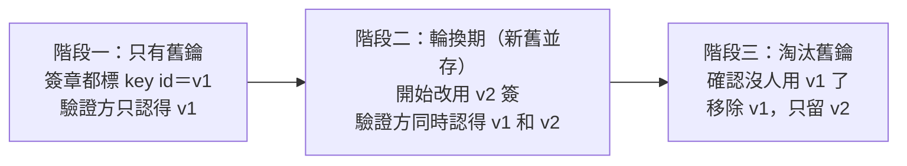

# [E-10-13] 金鑰輪換與 KMS：密鑰一定會外洩，所以系統要能「換鎖」而不停機

> **目標**：接受一個前提——密鑰遲早會外洩或過期；理解**金鑰輪換（key rotation）** 怎麼在「換鑰匙」的同時不中斷服務（新舊並存＋用 **key id** 標記）；搞懂為什麼密鑰**絕不能寫死在程式或 commit 進 repo**；並認識 **KMS（金鑰管理服務）** 是什麼、解決什麼問題。

## 一個問題：那把簽章用的密鑰，被人看到了怎麼辦？

前面幾篇我們一直在用一把「密鑰」簽章。現在面對一個殘酷的現實：

**這把密鑰，遲早會出事。** 可能是某位離職工程師電腦裡還留著它、可能它不小心被印進了一份 log、可能它被 commit 進了 Git 歷史、也可能只是「用了三年，照安全規範該換了」。

一旦密鑰外洩，拿到它的人就能**偽造出你的合法簽章**——冒充你發通知、偽造你的請求。這時你必須換一把新密鑰。但問題來了：

```
你有 50 個對外客戶，都拿著舊密鑰在驗證你發的通知。

如果你「啪」一聲把密鑰換成新的：
  → 你用新密鑰簽的通知，客戶拿舊密鑰一驗 → 全部驗不過 → 全部炸掉

如果你為了不炸，遲遲不敢換：
  → 外洩的舊密鑰一直有效 → 風險一直掛著
```

「不換會有風險、硬換會停機」——這個兩難，就是**金鑰輪換（key rotation）** 要解決的問題。核心思路其實很像換家裡的門鎖：你不會「拆掉舊鎖的瞬間，新鎖還沒裝好，讓家門洞開一段時間」，而是會有一段「新舊鎖都能開門」的過渡期。

## 生活類比：公司換門禁卡，不是某天早上全員突然刷不進去

想像公司要把所有門禁卡換一批新的。最蠢的做法是：「下週一早上 9 點，舊卡全部失效」——結果新卡還沒發到每個人手上，一堆人被擋在門外。

正常公司會這樣做：

1. **過渡期：新舊卡都能刷。** 先把新卡發下去，這段期間門禁系統**同時認舊卡和新卡**。
2. **大家都換到新卡後，才停用舊卡。** 確認沒人還在用舊卡了，再把舊卡從系統移除。

金鑰輪換就是這個流程：

> **輪換期間「新舊密鑰並存」，雙方都先換到能用新鑰的狀態，確認舊鑰沒人用了，才把舊鑰停用。** 全程門禁系統（你的服務）不中斷。

但這裡有個門禁卡沒有的技術問題：門禁系統刷卡時，讀卡機知道「這張是新卡還是舊卡」。可是收到一個**簽章**時，驗證方怎麼知道「這是用新密鑰簽的、還是舊密鑰簽的」，該拿哪一把去驗？這就要靠下一節的 **key id**。

## 做法：每筆簽章標上 key id，新舊鑰並存

輪換能無痛進行的關鍵，是**每一筆簽章都附帶一個「key id（金鑰識別碼）」**，告訴驗證方「我是用『哪一把』密鑰簽的」。驗證方手上同時保有新舊幾把密鑰，看 key id 決定用哪一把來驗。

用 pseudo code 描述驗證端：

```
收到請求（帶 key id 和 簽章）：
    依 key id 找出對應的那把密鑰
    如果 找不到這個 key id → 拒絕（未知的金鑰）
    用那把密鑰驗證簽章
```

輪換的三個階段，用 key id 串起來就很清楚：



這張圖表達：輪換不是「瞬間切換」，而是經過一段「新舊金鑰靠 key id 並存」的過渡期，等舊金鑰確定沒人使用，才安全地移除——全程不停機。

有了 key id，「換鎖」就變成平滑的三步，而不是一次驚險的大爆炸。

## 為什麼密鑰絕不能寫死在程式或 commit 進 repo

在講怎麼保管密鑰之前，先講清楚一條鐵則——密鑰**不可以寫死在原始碼裡**：

```typescript
// ❌ 絕對不要這樣做
const SIGNING_KEY = "sk_live_9f8a7b6c5d4e3f2a1b0c"; // 寫死在程式碼裡
```

這有三個致命問題：

1. **Git 會永遠記得它。** 就算你之後把這行刪掉，它仍留在 Git 的歷史紀錄裡——任何能 clone 這個 repo 的人，翻歷史就拿得到。「刪掉那行再 commit」**救不回來**，等於已經外洩。
2. **要輪換就得改程式、重新部署。** 密鑰和程式碼綁在一起，換密鑰變成「改碼→審查→部署」一整套流程，又慢又容易出錯，結果就是沒人想換。
3. **誰能讀到程式碼，誰就拿到密鑰。** 原始碼的存取範圍（所有工程師、CI 系統、甚至外包）遠大於「該碰密鑰的人」。

正確的大方向是：**密鑰要和程式碼分開存放**，程式在執行時才去「取用」它，而不是把它焊死在碼裡。最基本的做法是放進**環境變數（environment variable）** 或專門的秘密管理工具；更進一步，就是下一節的 KMS。

> 密碼不能存明文、金鑰不能寫死在碼裡——都是同一個精神：敏感資料要有專門的保管方式 → [E-10-6 密碼儲存：為什麼不能存明文](./E-10-6-password-storage.md)

## KMS 是什麼、解決什麼

**KMS（Key Management Service，金鑰管理服務）** 是一個**專門集中保管密鑰的服務**（雲端平台大多有提供）。它要解決的，是「密鑰散落各處、誰都能複製一份、換了也不知道誰在用」這類管理混亂。

它提供三件靠自己土法煉鋼很難做好的事：

| KMS 提供 | 解決什麼問題 |
|---|---|
| **集中保管** | 密鑰只存在 KMS 裡，不散落在各台機器的設定檔、環境變數、工程師的筆電 |
| **存取權限控制** | 明確規定「誰（哪個服務、哪個角色）能用這把密鑰做什麼」，而不是「拿到字串的人都能用」 |
| **稽核紀錄（audit log）** | 每一次「誰在何時用了哪把密鑰」都留下紀錄，外洩或濫用時查得出來 |

最關鍵的一個設計：**對很多 KMS 來說，密鑰「出不來」。** 你不是「跟 KMS 要出密鑰字串、拿回自己程式裡用」——那又回到密鑰滿天飛的老問題。而是**把資料送進 KMS，請 KMS 用它裡面保管的密鑰『代為』簽章 / 加密，再把結果送回來**。密鑰本身從頭到尾沒離開過 KMS。


這張圖表達：服務不是把密鑰取出來自己用，而是把資料交給 KMS、由 KMS 用內部密鑰代為運算再回傳結果；密鑰不離開 KMS，且每次使用都留下稽核紀錄。

### 信封加密（envelope encryption）點到為止

你可能會問：「每筆資料都送進 KMS 處理，量大時不會很慢嗎？」針對「加密大量資料」這個情境，業界有個常見技巧叫**信封加密（envelope encryption）**：

> 簡單說——**不是拿 KMS 的主密鑰去加密每一筆大資料**，而是臨時產生一把「資料金鑰」加密資料（快），再請 KMS 用主密鑰把這把「資料金鑰」加密起來（慢但只做一次），兩者一起存。主密鑰永遠鎖在 KMS 裡，只負責保護那把小小的資料金鑰。

這篇只需要知道有這個概念、它是為了「兼顧安全與效能」而生即可，細節不展開。

## 正式程式碼範例

情境：**對外 API 的簽章金鑰輪換。** 我們聚焦在「用 key id 支援新舊鑰並存」這個核心，密鑰本身從環境或金鑰服務取得，不寫死。

先是驗證端：**手上保有多把密鑰（以 key id 為索引），依請求帶來的 key id 挑對的那把來驗。** 這是輪換能並存的關鍵。

```typescript
import { createHmac, timingSafeEqual } from "node:crypto";

// 以 key id 為索引的多把密鑰。密鑰值來自環境變數或 KMS，程式碼裡沒有任何明文密鑰。
// 輪換期間這裡會同時有 v1 和 v2；淘汰舊鑰時才把 v1 移除。
type KeyId = string;

function loadSigningKeys(): Map<KeyId, string> {
  const keys = new Map<KeyId, string>();
  // 從環境變數讀取；實務上可改成向 KMS 取得，或由 KMS 代為簽章（密鑰完全不進程式）
  const v1 = process.env.SIGNING_KEY_V1;
  const v2 = process.env.SIGNING_KEY_V2;
  if (v1) keys.set("v1", v1);
  if (v2) keys.set("v2", v2);
  if (keys.size === 0) {
    // 缺密鑰是啟動期就該炸的設定錯誤，不要默默用空字串硬跑
    throw new Error("找不到任何簽章密鑰，請檢查環境變數設定");
  }
  return keys;
}

function verifyWithKeyId(
  canonicalString: string,
  receivedSignature: string,
  keyId: KeyId,
  keys: Map<KeyId, string>,
): boolean {
  const secret = keys.get(keyId);
  if (!secret) {
    // 未知的 key id：可能是早已淘汰的舊鑰，或偽造的，一律拒絕
    throw new Error(`未知的金鑰識別碼：${keyId}`);
  }
  const expected = createHmac("sha256", secret).update(canonicalString).digest("hex");
  const expectedBuffer = Buffer.from(expected, "hex");
  const receivedBuffer = Buffer.from(receivedSignature, "hex");
  if (expectedBuffer.length !== receivedBuffer.length) {
    return false;
  }
  return timingSafeEqual(expectedBuffer, receivedBuffer);
}
```

接著是簽章端：**設定「現在要用哪個 key id 簽」，並把 key id 一起放進請求，讓驗證方知道該用哪把驗。** 輪換時只要改這個「目前使用的 key id」，不必動驗證端的程式。

```typescript
import { createHmac } from "node:crypto";

interface SignedEnvelope {
  keyId: KeyId; // 告訴驗證方：我是用哪一把簽的
  signature: string;
}

function signWithCurrentKey(
  canonicalString: string,
  currentKeyId: KeyId,
  keys: Map<KeyId, string>,
): SignedEnvelope {
  const secret = keys.get(currentKeyId);
  if (!secret) {
    throw new Error(`目前指定的金鑰不存在：${currentKeyId}`);
  }
  const signature = createHmac("sha256", secret).update(canonicalString).digest("hex");
  // key id 隨簽章一起送出——這是整個輪換機制能運作的關鍵
  return { keyId: currentKeyId, signature };
}
```

輪換的操作流程因此變得很單純：**階段二**把簽章端的 `currentKeyId` 從 `v1` 改成 `v2`（驗證端已同時備妥 v1、v2，照 key id 自動挑）；**階段三**確認沒有任何請求再帶 `v1` 後，把 v1 從兩邊的金鑰清單移除即可。全程不中斷服務。

## 常見錯誤（反模式）

> **常見錯誤一：把密鑰 commit 進 repo，出事後「刪掉那行」以為沒事**
>
> ```typescript
> // ❌ 寫死密鑰，還 commit 進 Git
> const SIGNING_KEY = "sk_live_9f8a7b6c5d4e3f2a1b0c";
> ```
>
> 問題是：**Git 的歷史會永遠保留它。** 就算你發現後把這行刪掉、再 commit 一次，那把密鑰仍完整躺在 Git 歷史的某個 commit 裡，任何能存取 repo 的人翻得出來。「刪掉再提交」是**無效的補救**。
>
> **正確做法**：(1) 密鑰一律從**環境變數或秘密管理服務 / KMS** 取得，程式碼裡不出現明文；(2) 把密鑰檔（`.env` 等）加進 `.gitignore`，從源頭杜絕；(3) 萬一真的 commit 進去了，**唯一有效的補救是立刻把那把密鑰作廢並輪換成新的**——而不是去清 Git 歷史（就算清了，也要假設它已經外洩）。

> **常見錯誤二：輪換時「硬切」，不給新舊並存的過渡期**
>
> 某天部署時，簽章端直接換成新密鑰，驗證端的舊密鑰同時被移除。
>
> 問題是：切換不是瞬間同步的——部署有先後、客戶更新有快慢、還有一堆「在切換前就送出、切換後才被處理」的在途請求（in-flight requests）。硬切會讓這些請求**全部驗不過**，造成一段時間的大規模失敗。
>
> **正確做法**：走「新舊並存」的三階段輪換，靠 **key id** 讓驗證方自動挑對的密鑰。先讓新舊都能驗（階段二），**確認舊鑰再也沒有流量**之後，才移除舊鑰（階段三）。

> **常見錯誤三：簽章不帶 key id，輪換時只能靠「猜」**
>
> 簽章裡沒有任何「這是哪把鑰簽的」資訊。輪換期間驗證端手上有兩把鑰，收到一個簽章時，只好**兩把都試一遍、哪把過就算哪把**。
>
> 問題是：這種「全部試一遍」除了慢，更糟的是**模糊了安全邊界**——你無法明確知道「這筆到底是哪把鑰簽的」，稽核時分不清、也難判斷舊鑰到底還有沒有人在用（於是永遠不敢淘汰）。
>
> **正確做法**：**每筆簽章都明確帶上 key id。** 驗證方依 key id 精準挑出那一把來驗，未知的 key id 直接拒絕。這樣輪換的每個階段都清清楚楚，也才知道什麼時候可以安全地淘汰舊鑰。

## 小結

- **前提**：密鑰遲早會外洩或到期，所以系統**必須能換密鑰、而且換的時候不停機**。
- **金鑰輪換（key rotation）**：走「**新舊密鑰並存**」的過渡期——每筆簽章標上 **key id**，驗證方手上保有多把密鑰、依 key id 挑對的那把驗。確認舊鑰沒人用了，才移除它。三階段：只有舊鑰 → 新舊並存 → 淘汰舊鑰。
- **密鑰絕不能寫死在程式或 commit 進 repo**：Git 歷史永遠記得它、輪換得改碼重部署、存取範圍太大。要和程式碼分開存放，從環境變數 / 秘密服務 / KMS 取用。萬一 commit 進去了，唯一補救是**立刻作廢並輪換**，不是清歷史。
- **KMS（金鑰管理服務）**：集中保管密鑰、控制存取權限、留稽核紀錄；關鍵是**密鑰出不來**——把資料送進去請它代為簽章 / 加密，密鑰不離開 KMS。
- **信封加密（envelope encryption）**：為兼顧安全與效能，用臨時資料金鑰加密大資料、再用 KMS 主密鑰保護那把資料金鑰（知道有這概念即可）。

> 敏感資料要有專門的保管方式，與密碼不能存明文同源 → [E-10-6 密碼儲存：為什麼不能存明文](./E-10-6-password-storage.md)
> 這把被輪換的密鑰，就是前面用來簽章的那把 → [E-10-10 數位簽章入門](./E-10-10-digital-signatures.md)
