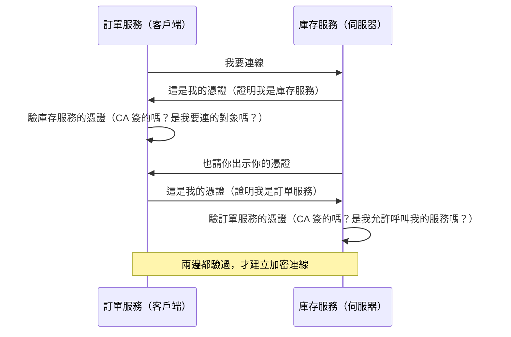
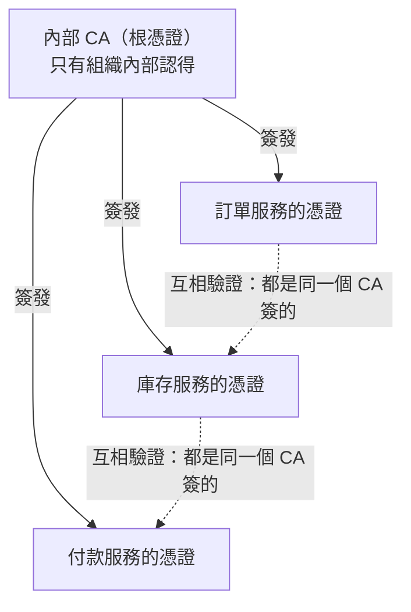
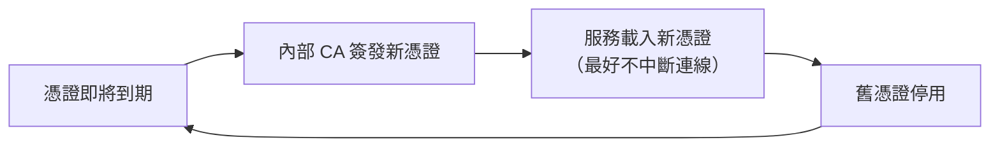

# [E-10-14] mTLS 與內部 CA：服務之間怎麼互相證明身分

> **目標**：理解「內網不等於可信」這個前提，搞懂雙向 TLS（mutual TLS）和一般 TLS 差在哪、內部憑證機構（internal CA）在做什麼、以及憑證輪換與到期為什麼是這套機制的命門。

## 一個問題：內網裡的服務，怎麼知道「對方真的是它說的那個服務」？

想像你有一套後端，被拆成好幾個小服務：訂單服務、庫存服務、付款服務、通知服務。它們都跑在同一個內部網路（internal network，外面連不進來的私有網段）裡，彼此用 HTTP 互相呼叫——訂單服務要扣庫存，就打一個請求給庫存服務。

這時候冒出一個問題：

```
庫存服務收到一個請求，內容是「把商品 A1001 的庫存扣 5 個」。

這個請求，真的是「訂單服務」發的嗎？
還是有別的東西（被入侵的某台機器、裝錯位置的服務、甚至攻擊者）
在內網裡冒充訂單服務，亂發扣庫存的請求？
```

很多人的直覺是：「反正都在內網裡，外面進不來，應該都是自己人，不用驗。」這個假設——**「內網 = 可信」**——正是這篇要打破的東西。

## 生活類比：公司大樓裡，還是要刷識別證

你進一棟公司大樓，大門口有警衛和門禁，外人進不來。那麼進了大樓之後，各個樓層、機房、財務室的門，還需要刷卡嗎？

需要。因為「**進得了大門**」不等於「**這個人就有權進機房**」——可能是跟著別人溜進來的、可能是離職沒收回門禁的前員工、可能是被偷走的識別證。成熟的大樓是**每一道門都驗證身分**，而不是「進了大門就全棟暢行無阻」。

這個思維在資安上叫 **零信任（zero trust）**：

> **不因為「在內網裡」就自動信任任何請求。每一次服務之間的呼叫，雙方都要能證明「我是誰」，對方也要驗證過才接受。**

為什麼內網不能當成可信邊界？因為「大門」遲早會被攻破——某台機器中毒、某個服務有漏洞被入侵、某個設定開太寬。一旦有人進到內網，如果內部服務彼此「看到請求就信」，攻擊者就能在裡面橫著走，想呼叫誰就呼叫誰。這叫**橫向移動（lateral movement）**，是內網失守後最可怕的一段。mTLS 要擋的就是這個。

## 先回憶一般 TLS：只驗一邊

你在 [E-3-2 HTTPS 與 TLS](../E-3-network/E-3-2-https-tls.md) 學過 TLS 握手。平常你用瀏覽器連一個網站，走的是**單向驗證**：

```
瀏覽器連上 shop.example.com：
    伺服器出示它的憑證（certificate，證明「我真的是 shop.example.com」）
    瀏覽器驗證這張憑證（是不是可信 CA 簽的、網域對不對、沒過期）
    → 通過：建立加密連線

但反過來——伺服器完全不知道「連進來的瀏覽器是誰」。
（它不在乎，因為網站本來就是開給大眾用的。）
```

重點在最後一句：**一般 TLS 只有伺服器要證明身分，客戶端不用。** 這對「開給大眾的網站」很合理——商店不會要求每個逛街的人先出示身分證。

但「服務對服務」的情境完全不同：庫存服務**非常在乎**「來扣庫存的到底是不是訂單服務」。這時候「只驗伺服器一邊」就不夠了。

## 雙向 TLS（mutual TLS）：兩邊都出示憑證

**mTLS（mutual TLS，雙向傳輸層安全）** 就是把 TLS 的身分驗證變成**雙向的**——不只客戶端驗伺服器，**伺服器也要驗客戶端**。兩邊都出示自己的憑證，兩邊都驗對方。

用 pseudo code 把「一般 TLS」和「mTLS」擺在一起對照：

```
一般 TLS（單向）：
    客戶端 → 連上伺服器
    伺服器 → 出示憑證
    客戶端 → 驗伺服器的憑證
    （伺服器不管客戶端是誰）
    → 建立連線

mTLS（雙向）：
    客戶端 → 連上伺服器
    伺服器 → 出示憑證
    客戶端 → 驗伺服器的憑證
    伺服器 → 「請你也出示憑證」
    客戶端 → 出示自己的憑證
    伺服器 → 驗客戶端的憑證（是不是可信 CA 簽的？是不是我允許的那個服務？）
    → 兩邊都驗過，才建立連線
```

這張圖把 mTLS 握手中「多出來的那一半」畫出來：



這張圖表達：mTLS 比一般 TLS 多了下半段——伺服器反過來要求客戶端出示憑證並驗證，身分驗證從「單向」變成「雙向」。

驗完之後還有一個常被忽略的細節：**伺服器知道了「對方是誰」，接下來才能決定「它能不能做這件事」。** 驗身分（這張憑證屬於訂單服務）和授權（訂單服務可以扣庫存，但不能改價格）是兩件事——mTLS 只負責前者，把「我確定對方是訂單服務」這個事實交出來，後面的權限判斷由服務自己做。

## 那憑證從哪來？內部 CA

mTLS 要運作，每個服務都得有一張「可信的憑證」。對外網站的憑證是跟公開的 CA（Certificate Authority，憑證機構，如 Let's Encrypt）申請的——但內部服務不適合這樣做：你的庫存服務根本沒有對外網域，公開 CA 也不會幫你簽「內網服務」的憑證。

解法是**自己當 CA**，也就是架一個**內部憑證機構（internal CA）**：

> **內部 CA 是一把「只有你組織內部認得」的根憑證（root certificate）。你用它幫每一個內部服務簽發憑證。所有服務都被設定成「只信任這個內部 CA 簽出來的憑證」——於是它們就能互相驗證身分了。**

它的信任關係長這樣：



這張圖表達：內部 CA 是信任的根，所有服務的憑證都由它簽發；因為大家都認同一個 CA，任兩個服務就能驗證「對方的憑證是不是自己人簽的」。

這跟 [E-10-7 憑證釘扎](./E-10-7-mitm.md)是同一套信任模型的兩種用法：公開網站靠「公開 CA 清單」建立信任，而你的內網則**縮小信任範圍到只認一個你自己掌握的 CA**。範圍越小，被亂簽發憑證冒充的風險就越低——外面任何公開 CA 簽的憑證，在你內網都不被接受。

## 正式程式碼範例：Node.js 跑 mTLS

下面用 Node.js 內建的 `https` 模組示範。情境是**訂單服務（客戶端）呼叫庫存服務（伺服器），兩邊都出示並驗證憑證**。先看伺服器端——重點是那幾個「要求並驗證客戶端憑證」的選項。

```typescript
import { createServer } from "node:https";
import { readFileSync } from "node:fs";

const inventoryServer = createServer(
  {
    // 庫存服務自己的憑證與私鑰（由內部 CA 簽發）
    cert: readFileSync("/certs/inventory-service.crt"),
    key: readFileSync("/certs/inventory-service.key"),

    // 內部 CA 的根憑證：用來驗「連進來的客戶端憑證」是不是自己人簽的
    ca: readFileSync("/certs/internal-ca.crt"),

    // 這兩個選項才是 mTLS 的關鍵——少了它們就只是一般 TLS
    requestCert: true,        // 要求客戶端也出示憑證
    rejectUnauthorized: true, // 客戶端憑證驗不過，直接拒絕連線
  },
  (request, response) => {
    // 走到這裡，表示對方的憑證已經被內部 CA 驗過了。
    // 進一步取出「對方到底是哪個服務」，交給後續的授權判斷。
    const clientCertificate = (request.socket as import("node:tls").TLSSocket).getPeerCertificate();
    const callerServiceName = clientCertificate.subject?.CN ?? "unknown";

    response.end(`已確認呼叫方為：${callerServiceName}`);
  },
);

inventoryServer.listen(8443);
```

這段最重要的是 `requestCert` 和 `rejectUnauthorized` 這兩個選項：**少了它們，Node.js 就退回成一般 TLS（只驗伺服器）**。`rejectUnauthorized: true` 代表「客戶端憑證驗不過就直接斷線」——這正是我們要的嚴格態度。

接著是客戶端（訂單服務）這一端。它除了驗伺服器，還要**主動帶上自己的憑證**：

```typescript
import { request } from "node:https";
import { readFileSync } from "node:fs";

const inventoryCall = request({
  host: "inventory-service.internal",
  port: 8443,
  path: "/deduct",
  method: "POST",

  // 訂單服務自己的憑證與私鑰——這是要「出示給伺服器驗」的
  cert: readFileSync("/certs/order-service.crt"),
  key: readFileSync("/certs/order-service.key"),

  // 同一個內部 CA：用來驗「庫存服務出示的憑證」是不是自己人
  ca: readFileSync("/certs/internal-ca.crt"),
});

inventoryCall.on("error", (error) => {
  // 不要吞掉——憑證驗證失敗（過期、不是內部 CA 簽的、對象不符）都會在這裡爆出來，
  // 這種錯誤代表「身分對不上」，必須讓它清楚地炸出來，而不是默默重試或忽略。
  console.error("呼叫庫存服務失敗，可能是憑證問題：", error.message);
});
```

兩段對照著看就懂了：**雙方都同時扮演「出示憑證」和「驗證對方憑證」兩個角色**，而且兩邊的 `ca` 都指向同一個內部 CA——這就是「大家都認同一個 CA」在程式裡的樣子。

## 憑證會過期：輪換是這套機制的命門

憑證不是簽一次用到天荒地老——每張憑證都有**到期日（expiry）**。這其實是刻意的安全設計：萬一某張憑證的私鑰外洩了，到期日能確保「這張被偷的憑證不會永遠有效」。所以憑證的有效期往往故意設得短（內網服務常見幾天到幾個月）。

短效期帶來一個運維上的硬需求——**憑證輪換（certificate rotation）**：在憑證到期前，自動簽發一張新的、換上去、丟掉舊的。



這張圖表達：憑證輪換是一個不斷重複的循環——簽發新的、換上、停用舊的，趕在到期之前完成。

輪換做不好，會踩到這套機制最經典的坑：**憑證過期沒人換，整批服務在同一刻集體連不上彼此。** 這不是假設，而是大型系統實際出過的大事故——一張到期的內部憑證，可以讓整個系統在幾分鐘內骨牌式崩掉。所以實務上，這件事一定要**自動化**：由工具（內部 CA 搭配自動發憑證的機制，或服務網格 service mesh 代勞）在背景定期換，不靠人去記「哪張快到期了」。

這也和 [E-10-13 金鑰輪換與 KMS](./E-10-13-key-rotation-kms.md) 是同一個精神：**憑證裡其實也包著一把私鑰，它跟其他密鑰一樣，都需要能「定期換、出事能緊急換」的機制。**

## 常見錯誤（反模式）

> **常見錯誤一：「反正在內網，不用驗身分」**
>
> 最根本、也最常見的錯誤心態。服務之間直接用明文 HTTP 互打，理由是「外面進不來，內網都是自己人」。
>
> 問題是：**內網的邊界遲早會被突破**——一台機器中毒、一個服務有漏洞、一個設定開太寬，攻擊者就進來了。一旦進來，若內部服務彼此「看到請求就信」，他就能在裡面任意呼叫每一個服務（橫向移動），把一個點的淪陷放大成整個系統的淪陷。
>
> **正確做法**：採**零信任**——不因為「在內網」就信任任何請求。服務對服務的呼叫用 mTLS 互驗身分，把「內網 = 可信」這個假設徹底拿掉。內網是「縱深防禦」的其中一層，不是唯一一層（呼應 [E-10-1 Web 安全總覽](./E-10-1-web-security-overview.md)）。

> **常見錯誤二：以為「有 TLS」就等於「有 mTLS」**
>
> 服務之間確實改用 HTTPS 了，大家就覺得「身分驗證做好了」。但如果伺服器端沒開 `requestCert`，那只是**一般 TLS**——只有客戶端在驗伺服器，伺服器**根本沒驗連進來的是誰**。
>
> 問題是：這種情況下，內網裡**任何東西**只要信任你的內部 CA，就能連上你的服務，伺服器完全不知道對方是不是它該接受的呼叫方。你以為鎖了門，其實只鎖了一半。
>
> **正確做法**：mTLS 的關鍵在「伺服器端也要求並驗證客戶端憑證」——就是範例裡的 `requestCert: true` 加 `rejectUnauthorized: true`。少了這兩個，再多的 HTTPS 也只是單向驗證。

> **常見錯誤三：憑證到期沒自動輪換，靠人記**
>
> 第一次手動簽了一堆憑證、設了一年效期，裝上去就沒再管了。一年後某天，憑證集體到期，所有服務在同一刻開始互相拒絕連線，整個系統瞬間癱瘓，而且第一時間還查不出原因。
>
> 問題是：**憑證到期是「時間一到必然發生」的事，不是「可能會出」的意外。** 靠人去記「哪張幾號到期」遲早會漏，而且越多服務越容易漏；手動換還常常換到一半、新舊交接沒接好，一樣斷線。
>
> **正確做法**：把簽發、輪換、停用**全部自動化**——用內部 CA 搭配自動發憑證機制，或交給服務網格（service mesh）代為處理，在到期前就無痛換好。效期可以故意設短（出事時傷害範圍小），但前提是輪換必須是全自動的（呼應 [E-10-13 金鑰輪換與 KMS](./E-10-13-key-rotation-kms.md)）。

## 小結

- **內網不等於可信**：邊界遲早會被突破，服務之間不能「看到請求就信」，否則一個點淪陷就會演變成橫向移動、整個系統失守。這套思維叫**零信任**。
- **一般 TLS 只驗伺服器一邊**（適合開給大眾的網站）；**mTLS（雙向 TLS）兩邊都出示並驗證憑證**，讓服務彼此都能確認「對方真的是它說的那個服務」。
- 關鍵開關：伺服器端要「要求並驗證客戶端憑證」（範例的 `requestCert` + `rejectUnauthorized`），少了就只是一般 TLS。
- **內部 CA** 是信任的根——你自己當 CA，幫每個內部服務簽憑證，所有服務只信這個 CA；信任範圍越小，被冒充的風險越低。
- mTLS 只負責「確認對方是誰（身分）」，「它能不能做這件事（授權）」是另一件事，由服務自己判斷。
- **憑證會到期**，所以**輪換必須自動化**——憑證集體過期是會讓整個系統瞬間癱瘓的經典事故，絕不能靠人去記。

> TLS 握手與憑證驗證的基礎 → [E-3-2 HTTPS 與 TLS](../E-3-network/E-3-2-https-tls.md)
> 憑證釘扎——把信任範圍縮到特定憑證，和內部 CA 是同一套信任模型的不同用法 → [E-10-7 HTTPS 不是萬能的：中間人攻擊與憑證釘扎](./E-10-7-mitm.md)
> 憑證裡的私鑰也要能定期換、能緊急換 → [E-10-13 金鑰輪換與 KMS](./E-10-13-key-rotation-kms.md)
