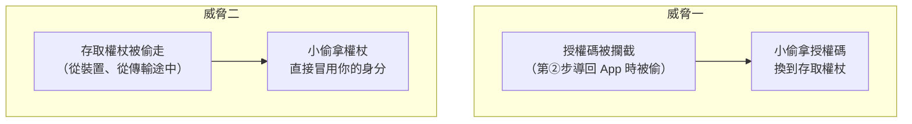
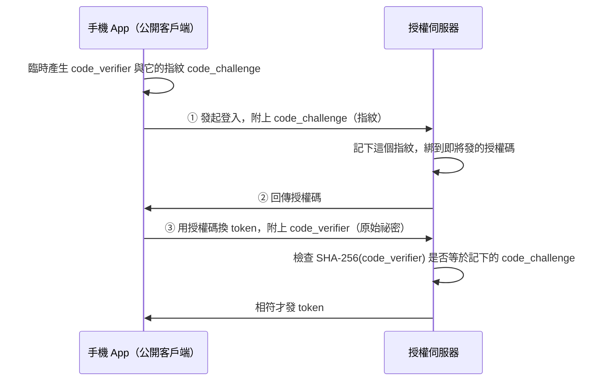
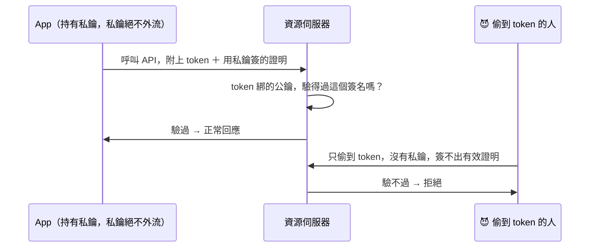

# [E-10-15] PKCE 與 DPoP：OAuth 的進階防護

> **目標**：接續 E-10-5，理解「公開客戶端」為什麼需要額外一層綁定——PKCE 怎麼防「授權碼被攔截」、DPoP 怎麼防「存取權杖被偷走冒用」，以及「把東西綁到只有我有的祕密上」這個共同的核心思路。

## 先回憶 OAuth，再看它漏在哪

在 [E-10-5 OAuth 2.0 與第三方登入](./E-10-5-oauth.md) 你學過：「用 Google 登入」不是把密碼交出去，而是走一套授權流程，最後第三方拿到的是一張**有限的通行證（token）**。流程裡有一個關鍵的中間產物叫**授權碼（authorization code）**：

```
① App 把你導到 Google 登入頁，你登入並同意授權
② Google 把你導回 App，附上一個「授權碼」（一次性的短字串）
③ App 拿這個授權碼去跟 Google 換「存取權杖（access token）」
④ App 用存取權杖去拿你授權的資料
```

這套流程在**伺服器端的網站**上很安全，因為第②、③步之間有一道隱形的保護：網站有一個只有它和 Google 知道的**客戶端密鑰（client secret）**，換 token 時要附上這個密鑰。授權碼就算被偷，小偷沒有密鑰，也換不到 token。

但問題來了——**手機 App 和瀏覽器裡的單頁應用（SPA，Single-Page Application）存不住這個密鑰。**

## 誰是「公開客戶端」？為什麼它特別危險

OAuth 把客戶端分成兩種：

> - **機密客戶端（confidential client）**：跑在你自己控制的伺服器上，能安全保存客戶端密鑰。例如傳統的後端網站。
> - **公開客戶端（public client）**：程式碼直接送到使用者裝置上執行——手機 App、瀏覽器 SPA。它**無法安全保存任何密鑰**。

為什麼公開客戶端存不住密鑰？因為它的程式整包都在使用者手上：手機 App 可以被反編譯、SPA 的 JavaScript 在瀏覽器裡攤開給任何人看。**只要是寫死在裡面的密鑰，就等於公開的。** 這不是「藏得夠不夠好」的問題，是本質上藏不住。

少了「客戶端密鑰」這道保護，公開客戶端面對兩個威脅：



這張圖表達兩個不同階段的威脅：一個發生在「授權碼還沒換成 token」時被攔截，另一個發生在「token 已經發出」後被偷走。PKCE 對付前者，DPoP 對付後者。

一個個來。

## PKCE：防「授權碼被攔截」

**PKCE（Proof Key for Code Exchange，唸作 "pixy"，授權碼交換的證明金鑰）** 要解決的是威脅一：授權碼在第②步被導回 App 時，可能被同一台裝置上的惡意 App、或被設計不良的轉址給攔截到。小偷拿到授權碼，就能自己去換 token。

PKCE 的思路非常漂亮——**既然公開客戶端存不住「長期固定的密鑰」，那就每次登入臨時產生一個「一次性的祕密」，用它把「發起授權」和「兌換授權碼」綁在一起。**

用 pseudo code 描述這個「一次性綁定」：

```
登入開始前，App 自己臨時產生：
    code_verifier  = 一段夠長的隨機字串（這是「祕密」，留在 App 自己手上）
    code_challenge = SHA-256(code_verifier)（這是「祕密的指紋」，可以公開）

① App 把你導去登入時，附上 code_challenge（指紋）
   → 授權伺服器先把這個指紋記下來，和即將發的授權碼綁在一起

② 你登入授權，拿到授權碼

③ App 拿授權碼去換 token 時，附上 code_verifier（原始祕密）
   → 授權伺服器檢查：SHA-256(code_verifier) 是不是等於當初那個 code_challenge？
     是 → 證明「來換 token 的，就是當初發起登入的同一個 App」→ 發 token
     否 → 拒絕
```

關鍵在於：**攔到授權碼的小偷，手上沒有 `code_verifier`**（那個原始隨機字串從頭到尾沒離開過真正的 App）。他只看得到公開的指紋 `code_challenge`，而從指紋反推不出原始字串（這是 SHA-256 雜湊的特性，見 [E-10-10 數位簽章入門](./E-10-10-digital-signatures.md) 對雜湊的說明）。所以**光有授權碼換不到 token**。



這張圖表達：PKCE 用一組「臨時祕密 + 它的指紋」把「發起登入」和「兌換授權碼」綁成同一個 App 的行為，中途攔到授權碼的人因為缺了原始祕密而換不到 token。

把產生這組值的程式寫出來——重點在「verifier 是祕密、challenge 是它的雜湊」：

```typescript
import { randomBytes, createHash } from "node:crypto";

// base64url 是「網址安全」的 base64：把 +、/、= 換掉，才能安全放進網址
function toBase64Url(input: Buffer): string {
  return input.toString("base64").replace(/\+/g, "-").replace(/\//g, "_").replace(/=+$/, "");
}

interface PkcePair {
  codeVerifier: string;  // 祕密：留在 App，換 token 時才送出
  codeChallenge: string; // 指紋：發起登入時公開送出
}

function createPkcePair(): PkcePair {
  // verifier 要夠長、夠亂——它是這次登入的一次性祕密
  const codeVerifier = toBase64Url(randomBytes(32));

  // challenge 是 verifier 的 SHA-256 雜湊；從它反推不出 verifier
  const codeChallenge = toBase64Url(createHash("sha256").update(codeVerifier).digest());

  return { codeVerifier, codeChallenge };
}
```

這段的重點是兩個值的關係：`codeChallenge` 是 `codeVerifier` 的 SHA-256 雜湊，**單向、反推不回去**。所以把 challenge 公開（放進登入網址）完全沒關係，真正的祕密 verifier 始終留在 App 手上。今天 PKCE 已經不只是「公開客戶端專用」——它被當成**所有 OAuth 授權碼流程的預設標配**，連機密客戶端也建議一起用。

## DPoP：防「存取權杖被偷走冒用」

PKCE 保護的是「換 token 之前」。但 token 發出來之後呢？這是威脅二：**存取權杖本身被偷走。**

預設的存取權杖是所謂的 **bearer token（持有者權杖）**——字面意思就是「**誰持有，誰就是主人**」。它像現金或不記名車票：撿到的人就能用，系統不會多問「你是不是當初領這張票的人」。於是只要 token 從裝置、從某個 log、從傳輸途中被偷走，小偷就能**直接冒用你的身分**，暢行無阻。

**DPoP（Demonstrating Proof-of-Possession，持有證明）** 要把這件事堵掉。它的思路和 PKCE 一脈相承——**把 token 綁到「只有這個客戶端才有的祕密」上，讓 token 離開這個客戶端就失效。**

做法是：

> App 自己產生一對金鑰（私鑰、公鑰，見 [E-10-10](./E-10-10-digital-signatures.md)）。拿 token 時，把**公鑰**一起交給授權伺服器，伺服器就把「這張 token 綁定這把公鑰」記下來。之後每次用 token 呼叫 API，App 都要用**私鑰**簽一個小證明附上去，證明「我真的持有那把私鑰」。

這種綁了金鑰的 token 叫 **sender-constrained token（綁定發送者的權杖）**——相對於「誰拿誰用」的 bearer token，它是「**拿了還得證明你是當初那個人**」。



這張圖表達：DPoP 讓每次用 token 都要附上一個「只有私鑰持有者簽得出來」的證明，偷到 token 卻沒偷到私鑰的人，無法通過驗證。

把「每次請求附上證明」的概念寫成程式——重點是私鑰留在 App、每個請求簽一個新證明：

```typescript
import { sign, type KeyObject } from "node:crypto";

interface DpopProofInput {
  httpMethod: string;  // 例如 "POST"
  httpUrl: string;     // 這次要呼叫的完整網址
  privateKey: KeyObject; // App 自己的私鑰，絕不外流、絕不送出
}

// 每一次 API 呼叫都產生一個「新的、綁定這次請求」的證明
function createDpopProof(input: DpopProofInput): string {
  // 證明裡綁進「這次是打哪個方法、哪個網址、什麼時間」，
  // 讓這個證明只對「這一次請求」有效，偷走也沒辦法拿去用在別的請求上。
  const claims = {
    method: input.httpMethod,
    url: input.httpUrl,
    issuedAt: Date.now(),
  };

  const payload = Buffer.from(JSON.stringify(claims));

  // 用私鑰簽名：只有持有這把私鑰的人簽得出來，公鑰驗得過
  return sign(null, payload, input.privateKey).toString("base64url");
}
```

這段的核心是：**私鑰（`privateKey`）只用來簽、永遠不送出去**，每次呼叫都用它簽一個「綁定這次請求」的新證明。偷到 token 的人沒有這把私鑰，簽不出有效證明，token 到了他手上就是一張廢紙。這正是 sender-constrained 的意義——token 和「持有私鑰這件事」被綁死了。

## PKCE 與 DPoP 一起看

兩者解決的是 OAuth 生命週期裡**不同階段**的問題，常常一起用：

| | PKCE | DPoP |
|---|---|---|
| 防的威脅 | 授權碼在「換成 token 之前」被攔截 | 存取權杖在「發出之後」被偷走冒用 |
| 保護的階段 | 授權碼 → token 的兌換 | token → API 呼叫的每一次使用 |
| 綁定的祕密 | 一次性的 `code_verifier`（這次登入用完就丟） | 一對長期的公私鑰（私鑰留在客戶端） |
| 一句話 | 「來換 token 的，是當初發起登入的同一個 App」 | 「來用 token 的，是當初領 token 的同一個 App」 |

看出共同的核心了嗎——**兩者都是在「把某個東西綁到只有合法客戶端才握有的祕密上」**：PKCE 綁的是一次性的 verifier，DPoP 綁的是私鑰。公開客戶端沒有「客戶端密鑰」這道牆，就用這種「臨時產生、綁定自己」的祕密補回來。

## 常見錯誤（反模式）

> **常見錯誤一：公開客戶端硬塞一個「客戶端密鑰」進去**
>
> 既然傳統網站靠 client secret 保護，有人就在手機 App 或 SPA 裡也寫死一個 client secret，覺得「這樣就安全了」。
>
> 問題是：**公開客戶端存不住任何密鑰**。手機 App 能被反編譯、SPA 的 JavaScript 攤在瀏覽器裡——寫死的 secret 等於公開貼出來。它給你的是「假的安全感」，攻擊者拿到這個 secret 後，保護完全不存在。
>
> **正確做法**：公開客戶端**不要用 client secret**，改用 **PKCE**——它不需要事先共享任何長期密鑰，靠每次登入臨時產生的一次性祕密來達成綁定，正是為「存不住密鑰的客戶端」設計的。

> **常見錯誤二：以為「有 HTTPS，token 就偷不走」**
>
> 很多人覺得「反正連線走 HTTPS 加密了，token 在傳輸途中安全，不用再管」。
>
> 問題是：HTTPS 只保護**傳輸途中**（見 [E-10-7 中間人攻擊](./E-10-7-mitm.md)）。但 token 會**停在裝置上**——存在手機的儲存空間、瀏覽器的 storage、不小心被寫進 log、被惡意腳本（XSS）讀走。這些地方的外洩，HTTPS 一點都保護不到。而只要是 bearer token，偷到就能直接冒用。
>
> **正確做法**：HTTPS 是必要的底線，但要擋「token 被偷走冒用」得靠 **DPoP** 這種 **sender-constrained token**——把 token 綁到客戶端私鑰上，讓偷到 token 的人因為沒有私鑰而用不了。安全要縱深防禦，HTTPS 只是其中一層（呼應 [E-10-1 Web 安全總覽](./E-10-1-web-security-overview.md)）。

> **常見錯誤三：DPoP 的證明「一簽到底」重複用**
>
> 為了省事，App 只在第一次呼叫時簽一個 DPoP 證明，之後每個請求都重複附上同一個。
>
> 問題是：如果這個證明沒有綁定「這一次是哪個方法、哪個網址、什麼時間」，它就變成另一個「誰撿到誰能用」的東西——被側錄下來後可以**重放（replay）**去打別的請求，DPoP 的意義就沒了。
>
> **正確做法**：每一次 API 呼叫都簽一個**新的、綁定這次請求**的證明（像範例那樣把 method、url、時間一起簽進去），讓證明只對「這一次」有效。這和防重放是同一個精神 → [E-10-12 重放保護](./E-10-12-replay-protection.md)。

## 小結

- **公開客戶端（手機 App、瀏覽器 SPA）存不住任何密鑰**——程式整包在使用者手上，寫死的 secret 等於公開。少了「客戶端密鑰」這道牆，它面對兩個威脅。
- **PKCE** 防威脅一（授權碼被攔截）：登入時臨時產生一次性祕密 `code_verifier`，用它的指紋把「發起登入」和「兌換授權碼」綁成同一個 App 的行為，攔到授權碼卻沒有原始祕密的人換不到 token。今天已是所有授權碼流程的標配。
- **DPoP** 防威脅二（token 被偷走冒用）：把 token 綁到客戶端的私鑰上，變成 **sender-constrained token**，每次呼叫都要用私鑰簽證明，偷到 token 卻沒私鑰的人用不了。相對於「誰拿誰用」的 bearer token。
- 共同核心：**把某個東西綁到「只有合法客戶端才握有的祕密」上**——PKCE 綁一次性 verifier，DPoP 綁私鑰。
- 別犯的錯：公開客戶端別硬塞 client secret（存不住）；別以為有 HTTPS 就不用管 token 被偷（HTTPS 只保護傳輸途中）；DPoP 證明要每次請求重簽、別重複用。

> OAuth 的基本流程與「授權而非給密碼」 → [E-10-5 OAuth 2.0 與第三方登入](./E-10-5-oauth.md)
> 公私鑰、簽名與雜湊的原理 → [E-10-10 數位簽章入門](./E-10-10-digital-signatures.md)
> 為什麼「只有 HTTPS」不夠、安全要縱深防禦 → [E-10-7 HTTPS 不是萬能的：中間人攻擊與憑證釘扎](./E-10-7-mitm.md)
> DPoP 證明要綁定單次請求，背後是防重放的思路 → [E-10-12 重放保護](./E-10-12-replay-protection.md)
