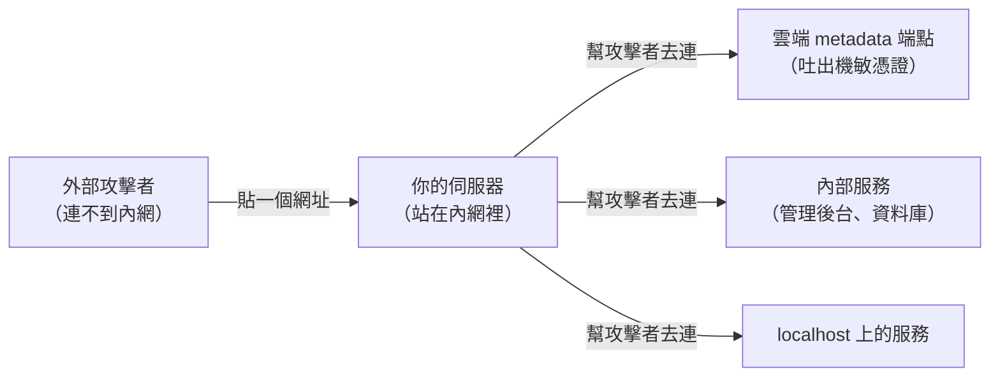
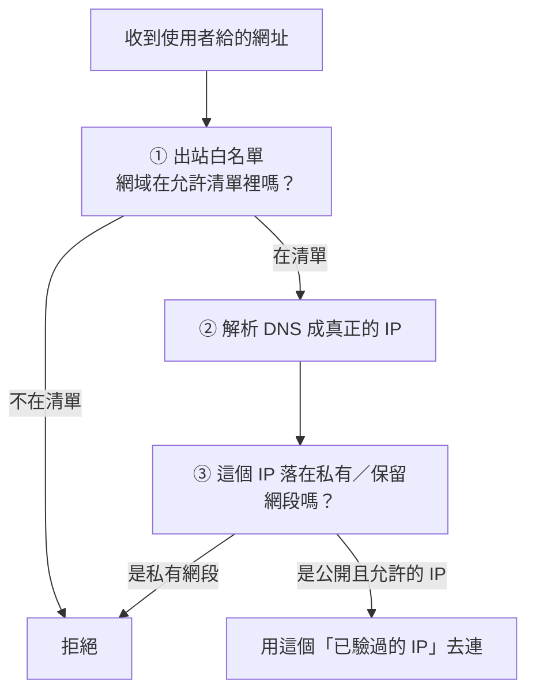

# [E-10-16] SSRF 與出站白名單：別讓使用者叫你的伺服器去連任意網址

> **目標**：理解伺服器端請求偽造（SSRF）這類漏洞的本質——「讓使用者控制伺服器要連哪裡」本身就是個洞，以及怎麼用出站白名單、解析後再驗、擋私有網段來堵它。

## 一個問題：讓使用者貼圖片網址，你的伺服器去抓

這是個再常見不過的功能。你的網站讓使用者設定頭像，除了「上傳檔案」，還貼心地提供「貼一個圖片網址，我幫你抓下來」：

```
使用者在表單填：https://example.com/my-avatar.png
你的伺服器收到後：
    去 GET 這個網址
    把抓回來的圖存成使用者的頭像
```

看起來人畜無害。但你有沒有想過——**使用者填進來的「網址」，決定了你的伺服器要去連哪裡。** 如果他不填圖片網址，而是填：

```
http://169.254.169.254/latest/meta-data/iam/security-credentials/
```

你的伺服器就會乖乖地去「抓」這個網址。而這個網址，是許多雲端平台上**只有從機器內部才連得到的 metadata 端點（metadata endpoint）**——它會吐出這台機器的雲端身分憑證。使用者從外面連不到它，但**你的伺服器連得到**。於是攻擊者借你的伺服器之手，把本該藏在內部的機敏憑證讀了出來。

這就是 **SSRF（Server-Side Request Forgery，伺服器端請求偽造）**。

## 本質：問題不在「連到壞地方」，而在「使用者能決定連哪」

先把這個漏洞的本質講清楚，因為它很容易被誤解成「擋掉幾個壞網址就好」。

> **SSRF 的根源是：你讓「使用者的輸入」決定了「伺服器要發請求到哪個位址」。** 一旦使用者能控制目的地，他就能叫你的伺服器去連任何「它連得到、但使用者自己連不到」的地方。

為什麼這特別危險？因為**你的伺服器站在一個特權位置**——它在內網裡，連得到一堆外面連不到的東西：



這張圖表達：攻擊者自己連不到內網，但他能誘導「連得到內網的伺服器」代替他去連，把伺服器當成打進內網的跳板。

這跟 [E-10-4 SQL Injection（注入家族）](./E-10-4-sql-injection.md) 是同一個家族的病——**把「使用者的資料」當成了「指令」來執行**。SQL injection 是讓使用者的輸入變成了 SQL 指令；SSRF 是讓使用者的輸入變成了「伺服器要去連的目的地」。注入家族的共同解法也一樣：**永遠不要信任使用者輸入，尤其是當它會變成某種「指令」的時候。**

## 錯誤的第一反應：黑名單

很多人第一個想法是「那我把壞的網址擋掉就好」——列一張黑名單，看到 `169.254.169.254`、`localhost`、`127.0.0.1` 就拒絕。

```
// 看起來能擋，其實滿是破綻的黑名單
如果 網址包含 "169.254.169.254" → 拒絕
如果 網址包含 "localhost" → 拒絕
否則 → 放行
```

這招幾乎一定會被繞過，因為「同一個位址」有太多種寫法：

- `127.0.0.1` 也可以寫成 `127.1`、`0x7f.0.0.1`、`2130706433`（十進位整數形式）、`[::1]`（IPv6）。
- 攻擊者還能用自己控制的網域，故意把它的 DNS 解析指向 `169.254.169.254`——網址字串裡根本沒有那串數字。
- 更狠的是 **DNS rebinding（DNS 重綁定）**：第一次解析時回一個正常的公開 IP（騙過你的檢查），等你真的去連的那一瞬間，再把解析結果換成內網 IP。

黑名單的根本問題是：**它要窮舉「所有壞的」，而壞的寫法是無限的。** 你永遠補不完。

> 這個「黑名單補不完、白名單才可靠」的道理，是注入家族防禦的共同心法 → [E-10-4 SQL Injection](./E-10-4-sql-injection.md)。

## 正確的思路：出站白名單 + 解析後再驗 + 擋私有網段

正確的防禦反過來——**不列「不准連哪」，而是列「只准連哪」**，再補上幾道針對繞過手法的檢查。三層一起上：



這張圖表達：請求要通過「網域白名單 → 解析成真實 IP → IP 不是私有網段」三道關卡，而且最後是拿「已驗過的那個 IP」去連，不給 DNS 第二次翻盤的機會。

逐層說明：

**① 出站白名單（egress allowlist）**：`egress` 是「出站 / 對外連出」的意思。白名單限制「伺服器只能主動連出去到清單裡的位址」。如果你的功能只需要連少數幾個已知的網域（例如只允許某個圖床），就把目的地限死在那幾個——這是最強的一道，因為它直接否定了「連任意網址」這件事。

**② 解析後再驗（resolve, then validate）**：不要只檢查「網址字串」，要先把網域**解析成實際的 IP**，再對那個 IP 做判斷。更重要的是——**驗過之後，要拿「你驗的那個 IP」去連，而不是把網域字串再丟給 HTTP 函式庫讓它重新解析一次。** 否則就留了 DNS rebinding 的空檔：你驗的是第一次解析的結果，實際連的是第二次解析的結果。

**③ 擋私有／保留網段**：就算網域過了白名單、解析出來是公開 IP，也要再確認這個 IP 不落在「內部專用」的網段裡——像 `127.0.0.0/8`（本機）、`10.0.0.0/8`、`172.16.0.0/12`、`192.168.0.0/16`（私有網路）、`169.254.0.0/16`（含那個雲端 metadata 端點）。這些位址本來就不該是「使用者要你去抓圖」會連到的地方。

## 正式程式碼範例

把上面三層寫成一個「驗證使用者給的網址」的函式。先是判斷「某個 IP 是不是私有／保留網段」——這段是第③層的核心：

```typescript
import { isIP } from "node:net";

// 判斷一個 IPv4 位址是否落在「不該對外開放去連」的網段
function isPrivateOrReservedIpv4(ip: string): boolean {
  const parts = ip.split(".").map(Number);
  if (parts.length !== 4 || parts.some((n) => Number.isNaN(n) || n < 0 || n > 255)) {
    // 連格式都不對，當作不安全，直接擋掉
    return true;
  }
  const [a, b] = parts;

  return (
    a === 127 ||                          // 127.0.0.0/8 本機（localhost）
    a === 10 ||                           // 10.0.0.0/8 私有網路
    (a === 172 && b >= 16 && b <= 31) ||  // 172.16.0.0/12 私有網路
    (a === 192 && b === 168) ||           // 192.168.0.0/16 私有網路
    (a === 169 && b === 254) ||           // 169.254.0.0/16 含雲端 metadata 端點
    a === 0                               // 0.0.0.0/8 保留
  );
}
```

這段的重點是：把「內部專用」的網段一條條列清楚，只要解析出來的 IP 落在任何一條裡，就不是「去外網抓圖」該連的對象。注意這裡示範 IPv4，正式環境還要一併處理 IPv6（例如 `::1`、`fc00::/7`）。

接著是把三層串起來的主驗證函式。重點在**先解析成 IP、驗過之後回傳「那個 IP」給後續使用**：

```typescript
import { lookup } from "node:dns/promises";

const ALLOWED_HOSTS = new Set(["images.example-cdn.com", "cdn.example.com"]);

interface SafeTarget {
  host: string;
  resolvedIp: string; // 已驗過的 IP——後續「拿這個去連」，不要再讓 HTTP 函式庫重新解析
}

async function validateUserProvidedUrl(rawUrl: string): Promise<SafeTarget> {
  let parsed: URL;
  try {
    parsed = new URL(rawUrl);
  } catch {
    throw new Error(`網址格式不正確：${rawUrl}`);
  }

  // 只允許 http / https，擋掉 file://、gopher:// 等可被濫用的協定
  if (parsed.protocol !== "https:" && parsed.protocol !== "http:") {
    throw new Error(`不允許的協定：${parsed.protocol}`);
  }

  // ① 出站白名單：網域不在清單裡，直接拒絕
  if (!ALLOWED_HOSTS.has(parsed.hostname)) {
    throw new Error(`網域不在允許清單內：${parsed.hostname}`);
  }

  // ② 解析成真正的 IP
  const { address } = await lookup(parsed.hostname);

  // ③ 解析出來的 IP 不能落在私有／保留網段
  if (isIP(address) === 4 && isPrivateOrReservedIpv4(address)) {
    throw new Error(`目標位址指向內部網段，拒絕連線：${address}`);
  }

  // 回傳「已驗過的那個 IP」，讓呼叫端拿它去連，
  // 避免 HTTP 函式庫自己再解析一次 DNS——那會留下 DNS rebinding 的空檔。
  return { host: parsed.hostname, resolvedIp: address };
}
```

這段把三層檢查依序串起來，而**最關鍵的一行是回傳 `resolvedIp`**：驗證和實際連線必須用「同一個 IP」。如果你只回傳網域字串、讓後面的 HTTP 函式庫重新解析，攻擊者就能在這兩次解析之間把 DNS 換掉（DNS rebinding），讓你「驗的是安全 IP、連的是內網 IP」。這個「解析一次、驗它、用它」的紀律，是 SSRF 防禦最容易被忽略、也最致命的細節。

## 常見錯誤（反模式）

> **常見錯誤一：用黑名單擋壞網址**
>
> 列一張「不准連」的清單——`localhost`、`127.0.0.1`、`169.254.169.254`——看到就擋。
>
> 問題是：**同一個位址有無限種寫法**。`127.0.0.1` 能寫成 `127.1`、`0x7f.0.0.1`、十進位整數 `2130706433`、IPv6 的 `[::1]`；攻擊者還能用自己的網域把 DNS 指向內網 IP，讓網址字串裡根本沒有可疑的數字。黑名單要窮舉「所有壞的」，而壞的是列不完的。
>
> **正確做法**：用**白名單**——只允許少數已知的網域／IP，其餘一律拒絕。再加上「解析成 IP 後檢查是不是私有網段」當第二道。防禦「只准什麼」永遠比「不准什麼」可靠（和注入家族同一個心法，見 [E-10-4](./E-10-4-sql-injection.md)）。

> **常見錯誤二：只驗網址字串，不驗解析後的 IP（留下 DNS rebinding）**
>
> 檢查時只看網址字串——「網域在白名單、長得正常」就放行，然後把**原始網址**丟給 HTTP 函式庫去連。
>
> 問題是：你「檢查時」解析的 IP，和 HTTP 函式庫「真正連線時」解析的 IP，是**兩次獨立的 DNS 查詢**。攻擊者可以讓第一次回正常 IP（騙過你的檢查）、第二次回內網 IP（真正連進去）——這就是 **DNS rebinding（DNS 重綁定）**。你驗了個寂寞。
>
> **正確做法**：**解析一次、驗它、然後用「驗過的那個 IP」去連**（範例回傳 `resolvedIp` 的用意）。只要連線用的 IP 就是你驗過的那個，DNS 第二次怎麼翻盤都沒用。

> **常見錯誤三：忘了擋跳轉（redirect）**
>
> 白名單、IP 檢查都做了，但你的 HTTP 函式庫**預設會自動跟隨跳轉（follow redirects）**。使用者給一個白名單內、乖乖的網址，你驗過放行、開始抓——結果對方回一個 `302`，把你跳轉到 `http://169.254.169.254/...`，你的函式庫就自動跟過去了。
>
> 問題是：**你只驗了第一個網址，跳轉後的目的地完全沒驗。** 等於開了一個後門讓攻擊者繞過前面所有檢查。
>
> **正確做法**：抓使用者給的網址時，要嘛**關掉自動跟隨跳轉**，要嘛**對每一次跳轉的目的地都重跑一遍同樣的驗證**（白名單 + 解析 + 私有網段檢查）。別讓「跳轉」成為白名單的漏網之魚。

## 小結

- **SSRF（伺服器端請求偽造）** 的本質不是「連到壞地方」，而是**「讓使用者的輸入決定伺服器要連哪裡」這件事本身就是漏洞**——因為你的伺服器站在內網，連得到一堆使用者自己連不到的東西（雲端 metadata 端點、內部服務、localhost）。
- 它和 SQL injection 是同一個家族：**把使用者的資料當成了某種「指令」**（這裡是「連哪裡」的指令）。解法同源：別信任使用者輸入。
- **黑名單擋不住**——同一個位址寫法無限，還有 DNS 把戲。要用**白名單**：只准連清單內的位址。
- 三層防禦：**① 出站白名單**（只准連已知網域）→ **② 解析成真實 IP 再驗，並拿驗過的 IP 去連**（堵 DNS rebinding）→ **③ 擋私有／保留網段**（127/10/172.16/192.168/169.254…）。
- 最容易漏、最致命的細節：**驗證和連線要用同一個 IP**（解析一次、驗它、用它），還要**處理跳轉**（關掉自動跟隨，或對每次跳轉重驗）。

> 同屬「別把使用者輸入當指令」的注入家族，白名單心法同源 → [E-10-4 SQL Injection](./E-10-4-sql-injection.md)
> Web 安全的全貌與縱深防禦思維 → [E-10-1 Web 安全總覽](./E-10-1-web-security-overview.md)
