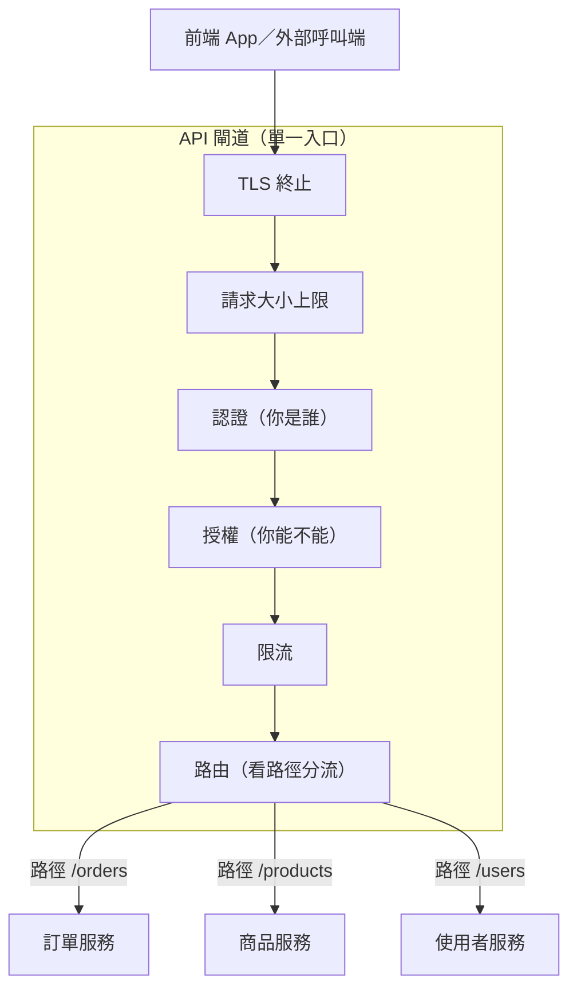
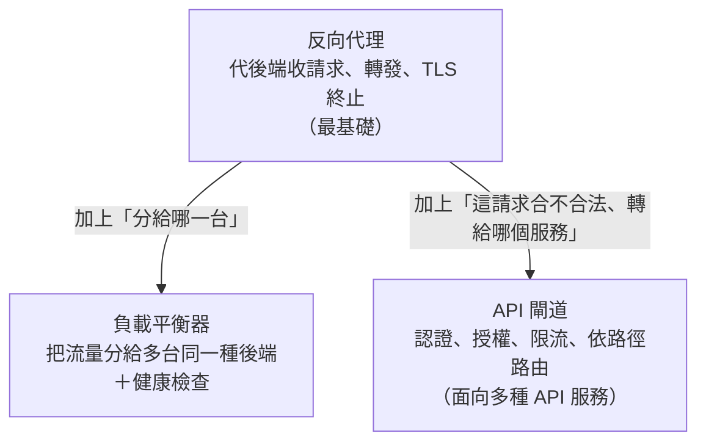

# [E-10-17] API Gateway：在一堆後端服務前擺一道「單一入口」

> **目標**：理解 API 閘道（API Gateway）是多個後端服務前面的單一入口，它該集中處理哪些「橫切關注點」（認證、授權、限流、路由、TLS 終止、請求大小上限），為什麼不該放業務邏輯，以及它和負載平衡器、反向代理的分界。

## 一個問題：每個服務都自己做認證，然後呢？

想像你有一組後端服務：訂單服務、商品服務、使用者服務、金流服務。它們各自是獨立的程式、獨立部署，前端 App 會分別去呼叫它們。

一開始東西不多，每個服務自己處理「進來的請求合不合法」——各自驗 token、各自限流、各自擋太大的請求。聽起來沒問題，但隨著服務愈來愈多，麻煩就來了：

```
訂單服務：自己寫一套「驗 token + 限流 + 擋大檔」
商品服務：又自己寫一套（而且驗 token 的邏輯跟訂單服務不太一樣）
使用者服務：再寫一套（限流的數字還設錯了）
金流服務：第四套……
```

問題很明顯：

- **重複**：同一件事（驗 token）在四個地方各寫一遍。
- **不一致**：四套邏輯慢慢長歪，驗法不同、錯誤格式不同，出事很難查。
- **難改**：哪天要換認證方式，四個服務、四個團隊全都要動。

這些事情有個共同點——**它們都不是某個服務「專屬」的業務，而是每個服務都要做的共通關卡。** 既然大家都要做，與其各做各的，不如**在所有服務前面擺一道共用的入口，統一做掉**。這道入口就是這篇的主角：**API 閘道（API Gateway）**。

## 生活類比：公司大樓的一樓櫃台

把那一組後端服務想成大樓裡不同樓層的部門，API 閘道就是**一樓的櫃台兼警衛**。

你要找 8 樓的財務部，不會直接衝進電梯——你得先在一樓櫃台：

- **出示證件**（你是誰？→ 認證）
- **櫃台確認你有沒有權限上 8 樓**（你能不能去？→ 授權）
- **同一個人五分鐘內衝進來一百次會被攔下**（→ 限流）
- **帶著一卡車貨想塞進電梯會被擋**（→ 請求大小上限）
- **櫃台告訴你財務部在 8 樓、往那部電梯走**（→ 路由）

財務部（後端服務）因此可以專心做財務的事，不用每個部門都自己養一組警衛。**把「每個部門都要做的共通關卡」集中到一樓**——這就是 API 閘道的精神。

## 橫切關注點：為什麼值得集中

上面那些「每個服務都要做」的事，有個正式名字叫**橫切關注點（cross-cutting concern）**——意思是它「橫切」過所有服務，不屬於任何一個服務的核心業務，卻是每個服務都躲不掉的共通需求。

認證、授權、限流、TLS 終止這些都是橫切關注點。它們最適合「抽出來集中做一次」，而不是散在每個服務裡各做一遍。API 閘道存在的理由，一句話就是：**把橫切關注點從各個後端服務抽出來，集中在單一入口處理。**

## 閘道該做哪些事

先用 pseudo code 把閘道收到一個請求時、由外而內的處理順序走一遍：

```
收到一個進來的請求：
    1. TLS 終止：把加密的 HTTPS 解開成明文，後面才處理得了
    2. 檢查請求大小：body 超過上限（如 1 MB）直接擋掉，別讓它進來佔資源
    3. 認證：這個請求帶的 token 有效嗎？是誰？→ 不合法就擋
    4. 授權：這個「誰」有權限呼叫這個路徑嗎？→ 沒權限就擋
    5. 限流：這個來源最近是不是打太兇了？→ 超量回 429
    6. 路由：看網址路徑，決定要轉給哪個後端服務
    7. 把請求轉發給那個後端，拿回結果再回給呼叫端
```

畫成圖更清楚——所有流量都先經過閘道這道關卡，過關了才分流到各個後端：



這張圖表達的是：外部請求不直接碰到任何後端，一律先過閘道的那串共通關卡，通過後才依路徑被轉給對應的服務。

整理成一張「該做清單」：

| 閘道該做的事 | 是什麼 | 為什麼放這裡 |
|---|---|---|
| **TLS 終止（TLS termination）** | 在閘道把 HTTPS 的加密解開，對內改走較單純的連線 | 憑證集中一處管理，後端服務不必各自處理加解密 |
| **請求大小上限** | body 超過上限就擋（如 1 MB） | 在最外層就擋掉灌爆用的巨大請求，後端完全不用碰到 |
| **認證（authentication，你是誰）** | 驗 token／金鑰，確認呼叫端身分 | 共通邏輯，集中一套避免各服務驗法不一致 |
| **授權（authorization，你能不能）** | 確認這個身分有沒有權限呼叫這條路徑 | 粗粒度的門禁在這裡擋掉，省得每個服務重寫 |
| **限流（rate limiting）** | 限制同一來源單位時間的請求數 | 通用的限流在入口做最省力（見下方引用） |
| **路由（routing）** | 依路徑／標頭把請求轉給對應後端 | 這正是「單一入口、多個後端」的核心 |

接著把其中幾關寫成一段示意的 TypeScript。閘道的本質是**一串依序執行的中介層（middleware）**，前一關過了才輪到下一關；這裡用一個簡單的 pipeline 表達這個順序：

```typescript
// 每一關就是一個 middleware：檢查請求，決定「放行」或「擋下」。
// 回傳 null 代表放行、進下一關；回傳 GatewayError 代表擋下、直接回給呼叫端。
interface GatewayError {
  status: number;   // 要回給呼叫端的 HTTP 狀態碼
  message: string;  // 對人有意義的錯誤訊息
}

type Middleware = (request: IncomingRequest) => Promise<GatewayError | null>;

// 認證關：沒有有效 token 就擋，並把解析出的使用者掛到請求上供後面使用
const authenticate: Middleware = async (request) => {
  const token = request.headers["authorization"];
  if (!token) {
    return { status: 401, message: "缺少認證 token，請先登入" };
  }
  const user = await verifyToken(token);
  if (!user) {
    return { status: 401, message: "token 無效或已過期" };
  }
  request.user = user; // 後續的授權關、後端服務都能用到
  return null;
};
```

把各關串起來依序跑，任何一關擋下就停住、不再往後：

```typescript
// 閘道主流程：依序跑完所有關卡，全過才轉發給後端
async function handleRequest(request: IncomingRequest): Promise<Response> {
  const pipeline: Middleware[] = [
    enforceBodySizeLimit, // 請求大小上限
    authenticate,         // 認證
    authorize,            // 授權
    rateLimit,            // 限流
  ];

  for (const middleware of pipeline) {
    const error = await middleware(request);
    if (error) {
      // 哪一關擋下就回哪一關的錯誤，不繼續往後跑
      return jsonResponse(error.status, { error: error.message });
    }
  }

  // 全部過關 → 依路徑路由到對應後端，把結果原樣帶回
  const backend = routeByPath(request.path);
  return forwardTo(backend, request);
}
```

重點在那個 `for` 迴圈的順序：**由外而內、由便宜到昂貴**——先用最便宜的檢查（大小、token 有沒有）擋掉明顯不合法的請求，愈後面才做愈貴的事（查權限、查限流計數），最後才真的把請求轉給後端。這樣壞請求在最前面就被擋掉，不會白白耗用後面的資源。

## 不該做的事：業務邏輯別往閘道塞

閘道很好用，於是會有人想：「反正所有請求都會經過它，乾脆把一些邏輯也放進去吧？」——例如「下單時順便算一下折扣」「這個使用者是 VIP 就改走特別流程」。

**千萬別。** 這些是**業務邏輯（business logic）**，是某個服務專屬的核心職責，不是橫切關注點。一旦業務邏輯開始往閘道裡爬，閘道會慢慢變成一個**大泥球（big ball of mud，指一團誰都不敢動、牽一髮動全身的程式碼）**：

- 它開始依賴訂單的規則、金流的規則、每個服務的內部細節，不再是單純的入口。
- 每個團隊要改自己的業務，都得回頭動這個共用的閘道——它變成所有人的瓶頸與地雷。
- 閘道一掛，不只是「入口不通」，連業務邏輯都跟著死。

判準很簡單：**「這件事是每個服務都要做的共通關卡，還是只屬於某一個服務？」** 共通的（認證、限流）才放閘道；專屬某服務的（怎麼算折扣）留在那個服務裡。

## 閘道、負載平衡器、反向代理的分界

這三個東西都站在「呼叫端」和「後端」之間，長得很像，很容易搞混。先用一句話分清楚，再看圖：

- **反向代理（reverse proxy）**：代替後端出面收請求的中間人。它是最基礎的角色——轉發請求、可以順便做 TLS 終止、快取。它不在乎後面是幾台、是什麼服務。
- **負載平衡器（load balancer）**：專門把流量「平均分給多台**同一種**後端」，還會做健康檢查、避開掛掉的機器。它關心的是「分給哪一台」。
- **API 閘道（API gateway）**：面向「**多種 API 服務**」的入口，在反向代理的基礎上，再加上認證、授權、限流、依路徑路由這些 **API 管理**功能。它關心的是「這個請求合不合法、該轉給哪個服務」。



這張圖表達的是：三者共用「站在中間代收請求」的底，但各自往不同方向長——負載平衡器往「分流到多台相同後端」長，API 閘道往「API 管理與多服務路由」長。

實務上它們常常**重疊、疊在一起用**：一個 API 閘道內部通常本身就是一種反向代理，也可能內建負載平衡能力；而一個負載平衡器（L7，看得懂 HTTP 的那種）也能做一部分路由。所以不必糾結「這到底算哪一個」——**重點是分清楚各自的職責，別把認證授權塞進單純的負載平衡器，也別把業務邏輯塞進閘道。**

> 負載平衡器怎麼分流、健康檢查、L4／L7 的差別 → [E-13-7：Load Balancer 流量如何分配到多台伺服器](../E-13-scaling/E-13-7-load-balancer.md)
> 為什麼在入口做 TLS 終止、憑證集中管理 → [E-3-2：HTTPS 與 TLS](../E-3-network/E-3-2-https-tls.md)

## 常見錯誤（反模式）

> **常見錯誤一：把業務邏輯塞進閘道，養出新的大泥球**
>
> 「反正請求都會經過閘道」是最危險的一句話。有人把算折扣、判 VIP、組訂單這類業務邏輯放進閘道：
>
> ```typescript
> // 危險！閘道開始碰訂單的業務規則，它不再是單純的入口
> if (request.path === "/orders" && request.user.isVip) {
>   request.body.discount = calculateVipDiscount(request.body); // 😱 折扣邏輯爬進閘道了
> }
> ```
>
> 問題是：閘道從此依賴訂單服務的內部規則，折扣規則一改就得動閘道，每個團隊都要回來改這個共用元件，它變成全公司的瓶頸與單點風險。**正確做法**：閘道只做橫切關注點（認證、授權、限流、路由），折扣這種業務邏輯留在訂單服務裡。判準就一句：「這是每個服務都要做的共通關卡，還是某個服務專屬的？」

> **常見錯誤二：閘道驗過了，後端就「完全裸奔」**
>
> 閘道做了認證授權，於是後端服務想：「反正進得來的都被閘道驗過了，我直接信任就好。」——後端完全不檢查身分、不驗輸入。
>
> 問題是：這等於把「所有安全」都押在閘道一道牆上。一旦有人繞過閘道（內網被打進來、某個服務被攻陷後橫向移動、設定失誤讓服務直接對外），後端毫無防備、門戶大開。**正確做法**：閘道擋的是**粗粒度**的門禁（有沒有合法 token），後端服務仍要做**細粒度**的檢查（這個使用者到底能不能動這筆資料、輸入合不合法）——這就是「深度防禦」。後端為什麼不能無條件信任「進得來的請求」，正是下一篇「攻擊者模型」要談的**信任邊界**。

> **常見錯誤三：忘了閘道自己是單點故障**
>
> 所有流量都走這一道入口——那它掛了呢？如果閘道只有一台，它一倒，**背後所有服務一起從外界消失**，就算每個後端都好好的也沒人進得來。
>
> **正確做法**：把單一入口（邏輯上的單一）和單一機器（實體上只有一台）分開看。閘道在邏輯上是單一入口，但實體上必須**多台、高可用**，前面再由負載平衡器分流；雲端託管的閘道通常本身就跨多節點高可用。「單一入口」指的是職責集中，不是「只准有一台機器」。

## 小結

- **API 閘道（API Gateway）**：多個後端服務前面的**單一入口**，把每個服務都要做的**橫切關注點**（認證、授權、限流、路由、TLS 終止、請求大小上限）抽出來集中處理，省掉各服務各做一套的重複、不一致與難改。
- 閘道處理請求的順序是**由外而內、由便宜到昂貴**：先用最便宜的檢查擋掉明顯不合法的，最後才轉發給後端。
- **不該做業務邏輯**：折扣、VIP 判斷這種某服務專屬的邏輯一旦爬進閘道，就會把它變成牽一髮動全身的**大泥球**。判準是「共通關卡 vs 某服務專屬」。
- **和鄰居的分界**：反向代理是最基礎的「代收轉發」，負載平衡器專注「分給哪一台相同後端」，API 閘道則加上「這請求合不合法、該轉給哪個服務」。三者常疊著用，重點是分清職責。
- 兩個常見的雷：**後端別因為閘道驗過就完全裸奔**（深度防禦，細粒度檢查留在後端）；**閘道自己要高可用**（單一入口是職責集中，不是只有一台機器）。

> 限流為什麼適合放在入口層、怎麼做 → [E-10-8：Rate Limiting 防止暴力破解與 DDoS](./E-10-8-rate-limiting.md)
> 閘道做認證時常用的授權協定 → [E-10-5：OAuth](./E-10-5-oauth.md)
> 後端為什麼不能無條件信任「閘道放進來的請求」——下一篇用「信任邊界」把這件事講透 → [E-10-18：攻擊者模型（Threat Modeling）](./E-10-18-threat-modeling.md)
