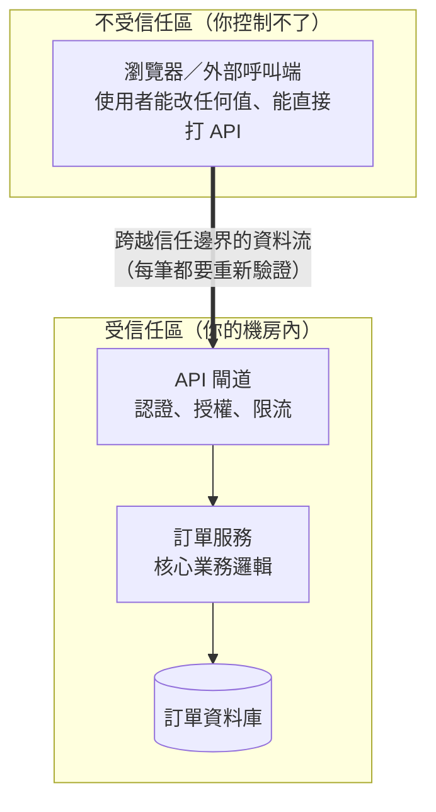

# [E-10-18] 攻擊者模型（Threat Modeling）：設計時就先想「這裡會被怎麼打」

> **目標**：理解威脅建模（threat modeling）是在設計系統時先問三個問題——誰會攻擊、他能碰到什麼（攻擊面）、我在信任什麼（信任邊界）——把安全從「事後補鐵窗」變成「蓋房子前就想好小偷從哪進來」。

## 一個問題：安全是最後才加的那一塊嗎？

很多人做系統的順序是這樣的：先把功能做出來、能跑了、上線了，然後某天想到「啊，該加點安全措施」，才回頭補上登入、補上輸入檢查、補上防火牆規則。

這就像**房子蓋好了才開始想「小偷會不會進來」**，然後到處補鐵窗、裝補丁。問題是——有些洞是**結構性的**：後門沒鎖、送貨口直通保險庫、牆是紙糊的。這些不是事後貼幾片鐵窗能補的，它們在「怎麼蓋」的那一刻就已經決定了。

安全也一樣。真正嚴重的漏洞往往不是「某行程式碼寫錯」，而是**設計的時候就沒想清楚「誰會來打、從哪打、哪些東西其實不該信任」**。威脅建模就是把這件事提前到設計階段做：

> **蓋房子前先站在小偷的角度，把家裡走一遍——門、窗、後院、送貨口，問「如果我是小偷，我會從哪進來？」** 威脅建模就是對你的系統做同一件事。

這篇用一個具體、中性的例子貫穿：**一個對外開放的「下單 API」**（使用者透過它送出訂單）。

## 三個問題：誰、碰得到什麼、信任什麼

威脅建模的核心，就是在設計時認真回答三個問題。

### 問題一：誰會攻擊？（攻擊者的能力與動機）

「攻擊者」不是一種人，而是一整排能力與動機都不同的角色。先把他們攤開——正式說法叫**攻擊者（threat actor）**，指任何可能對系統下手的對象：

| 攻擊者 | 能力 | 動機（想幹嘛） |
|---|---|---|
| 腳本小子（script kiddie） | 低，拿現成工具亂掃 | 好玩、刷存在感 |
| 牟利的犯罪者 | 中到高 | 偷資料、盜刷、勒索 |
| 內部人員（員工、離職員工） | 有合法帳號、知道內部細節 | 報復、私下牟利、手滑 |
| 競爭對手／有組織團體 | 高、資源多、有耐心 | 商業情報、癱瘓你 |

為什麼要先想「誰」？因為**不同攻擊者決定了你要防到什麼程度**。只防腳本小子，一套基本過濾就夠；但如果你的下單 API 牽涉金流、會被牟利者盯上，就得假設對手有耐心、會繞、會組合各種手法——防禦的力道完全不同。

而且特別注意那一行**內部人員**——很多人只防「外面的壞人」，忘了有合法帳號的人同樣會是威脅。這個盲點等一下會再回來談。

### 問題二：他能碰到什麼？（攻擊面 attack surface）

**攻擊面（attack surface）**指的是：**所有「對外暴露、攻擊者摸得到」的入口的總和**。攻擊者只能打他碰得到的東西，所以把攻擊面列出來，就等於列出了「所有可能被打的地方」。

對那個下單 API，攻擊面大概包括：

```
- 下單 API 本身的每一個 endpoint（下單、查單、取消）
- 登入／取得 token 的端點
- 使用者能填的每一個欄位（商品 ID、數量、收件地址、備註……）
- 檔案上傳（如果允許上傳發票、附件）
- 任何對外的 webhook、callback（金流回調）
- 錯誤訊息、API 文件（會不會洩漏內部結構）
```

心法：**攻擊面愈小愈安全。** 每多開一個對外端點、每多收一個使用者能控制的欄位，就是多一個「可能被打的地方」。所以威脅建模常常直接導向一個行動——**把不必要暴露的東西關掉、收起來**。

### 問題三：我在信任什麼？（信任邊界 trust boundary）

這是三個問題裡最關鍵、也最容易被忽略的一個。

**信任邊界（trust boundary）**是一條線：**資料從「不受信任的那一側」跨進「受信任的那一側」的那條界線。** 跨越這條線的每一筆資料，都必須被當成「可能是攻擊」來檢查。

對下單 API 來說，最重要的一條信任邊界，就在**「瀏覽器／外部呼叫端」和「你的後端」之間**。瀏覽器那一側是你**完全控制不了**的——使用者可以打開開發者工具改任何值、可以不透過你的網頁直接打 API、可以送任何他想送的東西。所以：

> **凡是從瀏覽器（或任何外部）跨進後端的資料，一律不可信。** 這條信任邊界上的每一筆資料，進來都要重新驗證，不能因為「這是我自己的前端送來的」就放行。

把下單 API 的信任邊界畫出來：



這張圖表達的是：那條粗箭頭穿過的地方就是信任邊界，外側的一切都不可信，所有跨界進來的資料都要在邊界上被當成潛在攻擊重新檢查。

注意：信任邊界**不只一條**。服務和服務之間、你的系統和第三方金流之間、應用程式和資料庫之間，都各有一條。威脅建模就是**把每一條信任邊界畫出來，然後對每一條跨界的資料流問同一句話：「這裡會被怎麼打？」**

## 把三個問題變成一句操作

三個問題回答完，實際動作可以濃縮成這段 pseudo code：

```
畫出系統的資料流圖，標出每一條信任邊界
對「每一條跨越信任邊界的資料流」：
    問：這筆資料若被攻擊者惡意控制，他能做什麼？
    針對那個威脅，在「邊界上」加上對應的檢查或防護
```

關鍵字是**「在邊界上」**。防禦要加在資料「剛跨進受信任區的那一刻」，而不是等它流進系統深處才補。下面這段 TypeScript 示範下單 API 在信任邊界上該做的事——重點不是程式碼多複雜，而是**哪些東西一律不信**：

```typescript
interface OrderRequest {
  productId: string;
  quantity: number;
}

// 這個函式就站在信任邊界上：所有欄位都來自不可信的外部，一律重新驗證。
async function handleCreateOrder(rawInput: unknown, token: string) {
  // ① 驗身分：token 來自外部，不可信 → 一定要驗
  const user = await verifyToken(token);
  if (!user) {
    throw new HttpError(401, "token 無效或已過期，請重新登入");
  }

  // ② 驗結構與範圍：外部送來的 body 不可信 → 驗型別、驗合理範圍
  const input = parseOrderRequest(rawInput); // 格式不符就擋，不硬塞
  if (input.quantity <= 0 || input.quantity > 999) {
    throw new HttpError(400, "數量必須介於 1 到 999 之間");
  }

  // ③ 關鍵：價格「絕對不信前端傳來的」，一律由後端自己查權威資料
  const price = await priceService.getPrice(input.productId); // 不是 rawInput.price！

  return orderService.create({ user, productId: input.productId, quantity: input.quantity, price });
}
```

最該記住的是第 ③ 點：**價格、金額、使用者身分、權限這種關鍵值，永遠不信前端傳來的，一律由後端自己查權威來源。** 如果圖省事直接用 `rawInput.price`，攻擊者只要把請求裡的 price 改成 1 元就能用一塊錢下單——這就是典型的「信任邊界被突破」。

## STRIDE：對一條資料流，可以被怎麼打？

畫好信任邊界、盯著一條跨界的資料流，你還是要問「具體會被怎麼打」。**STRIDE** 是一份幫你別漏掉的清單，把威脅分成六類（這裡**點到為止**，知道有這六個方向即可）：

| STRIDE | 中文 | 下單 API 的例子 | 大方向對策 |
|---|---|---|---|
| **S**poofing | 偽冒身分 | 假冒別人的身分下單 | 認證、驗 token |
| **T**ampering | 竄改資料 | 把請求裡的 price 改成 1 元 | 關鍵值後端自查、簽章 |
| **R**epudiation | 事後否認 | 「這筆訂單不是我下的」 | 稽核日誌（audit log） |
| **I**nformation Disclosure | 資訊洩漏 | 查別人的訂單、錯誤訊息吐出內部結構 | 授權、最小化錯誤訊息 |
| **D**enial of Service | 阻斷服務 | 海量下單請求灌爆服務 | 限流 |
| **E**levation of Privilege | 權限提升 | 普通使用者變成能動後台 | 細粒度授權、最小權限 |

用法很單純：**對每一條跨越信任邊界的資料流，拿這六類各問一遍「這裡有沒有這種風險」**，有的話就在邊界上補對應的防護。它不是什麼高深理論，而是一張「別漏想」的檢查表。

## 常見錯誤（反模式）

> **常見錯誤一：信任前端傳來的資料**
>
> 這是最經典、也最常見的信任邊界被突破。開發者想「這是我自己寫的前端送上來的，應該沒問題」，就直接拿來用：
>
> ```typescript
> // 危險！直接用前端傳來的 price 和 userId
> async function createOrder(body: { productId: string; price: number; userId: string }) {
>   return orderService.create(body); // 😱 攻擊者改個 price 就一元下單、改個 userId 就幫別人下單
> }
> ```
>
> 問題是：瀏覽器在信任邊界的**外側**，你控制不了。攻擊者根本不需要用你的網頁，他可以直接組一個請求、把 price 改成 1、把 userId 改成別人。**正確做法**：跨越信任邊界的資料一律重新驗證；關鍵值（價格、身分、權限）一律由後端查權威來源，不信前端。一句口訣：**「前端傳來的一切都是『建議』，不是『事實』。」**

> **常見錯誤二：只防外面的壞人，忘了內部的信任邊界**
>
> 很多威脅建模只畫了「外部使用者 → 我的系統」這一條邊界，然後假設「進到機房裡面就都是自己人、都可信」。於是服務和服務之間不做認證、內部 API 完全不設防。
>
> 問題是：信任邊界不只最外面那一條。一旦有人用某種手法讓你的**某個後端服務去替他發請求**，這個服務就站在信任區裡、帶著信任區的權限，去打那些「以為安全所以不設防」的內部資源——這正是**伺服器端請求偽造（SSRF，Server-Side Request Forgery）**的本質：攻擊者突破的不是最外層的牆，而是你以為不存在的那條**內部信任邊界**。**正確做法**：把內部的信任邊界也畫出來（服務之間、系統對第三方），別預設「進到裡面就都可信」——這就是「零信任」的精神。
>
> > SSRF 怎麼一步步突破內部信任邊界、怎麼防 → [E-10-16：SSRF 與出站白名單](./E-10-16-ssrf-egress-allowlist.md)

> **常見錯誤三：把威脅建模當成「上線前做一次」的文件**
>
> 有人在專案初期畫了一張漂亮的威脅模型圖，放進文件夾，然後就再也沒碰過。半年後系統加了檔案上傳、接了新的第三方、開了新的對外端點——**攻擊面整個變了，但那張圖還停在半年前。**
>
> 問題是：攻擊面和信任邊界會隨系統演進而改變，每加一個對外入口就是一個新的攻擊點。一張過期的威脅模型，比沒有更危險——它給你「已經想過了」的錯覺。**正確做法**：把威脅建模當成**持續的習慣**，不是一次性的交付物。每次要新增對外端點、接新的外部依賴、改動信任邊界時，就回頭問那三個問題——誰會打、他多了哪些碰得到的東西、這條新的資料流跨了哪條信任邊界。

## 小結

- **威脅建模（threat modeling）**：在**設計階段**就先想清楚安全，而不是上線後才補。核心是像小偷一樣把系統走一遍，先想「會從哪被打」。
- 三個問題：**誰會攻擊**（攻擊者的能力與動機，別忘了內部人員）、**他能碰到什麼**（攻擊面 attack surface，愈小愈安全）、**我在信任什麼**（信任邊界 trust boundary，資料從不可信跨進可信的那條線）。
- 操作上就一句：**畫出每一條信任邊界，對每一條跨界的資料流問「這裡會被怎麼打」**，然後把防護加「在邊界上」。
- 關鍵值（價格、身分、權限）**永遠不信前端**，一律由後端查權威來源——「前端傳來的是建議，不是事實」。
- **STRIDE**（偽冒、竄改、否認、資訊洩漏、阻斷服務、權限提升）是一張「別漏想」的檢查表，對每條資料流各問一遍。
- 三個雷：**別信前端資料**、**別只防外部而忘了內部信任邊界**（SSRF 正是突破內部邊界）、**別把威脅建模當一次性文件**（攻擊面會隨系統演進）。

> 各類 Web 攻擊的全貌、它們分別打在哪 → [E-10-1：Web 安全總覽（OWASP Top 10）](./E-10-1-web-security-overview.md)
> SSRF 如何突破你以為不存在的內部信任邊界 → [E-10-16：SSRF 與出站白名單](./E-10-16-ssrf-egress-allowlist.md)
> 信任邊界在架構上的具體體現——把共通關卡集中在單一入口 → [E-10-17：API Gateway 的分工](./E-10-17-api-gateway.md)
