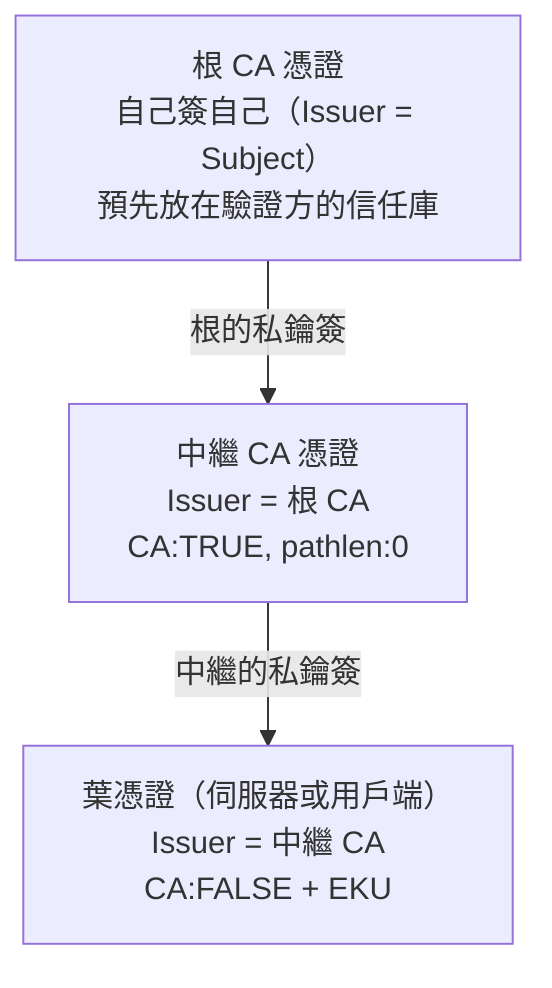
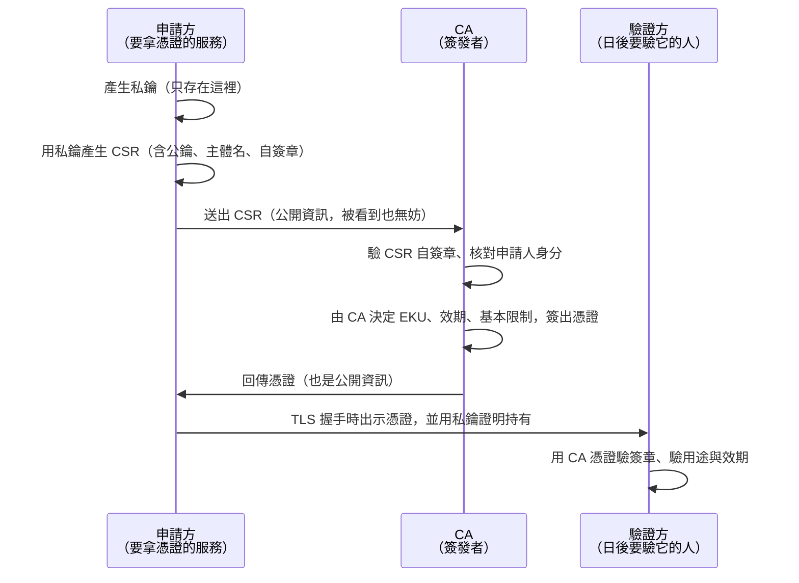

# [E-10-19] 憑證拆解：X.509、憑證鏈與 CSR

> **目標**：能把一張憑證拆開讀懂每個欄位、自己驗一條憑證鏈、看懂 CSR（憑證簽署請求）流程裡「誰產私鑰、誰簽、誰拿到什麼」，並用 openssl 從零建一個玩具 CA 親手跑一遍。

## 先說這篇不重講什麼

觀念篇已經有了，這篇只做「拆開來看」與「動手」：

- TLS 握手、CA 信任鏈的基本概念 → [E-3-2 HTTPS 與 TLS](../E-3-network/E-3-2-https-tls.md)
- 簽章是什麼、私鑰簽公鑰驗 → [E-10-10 數位簽章入門](./E-10-10-digital-signatures.md)
- 雙向 TLS、內部 CA、零信任 → [E-10-14 mTLS 與內部 CA](./E-10-14-mtls-internal-ca.md)
- 私鑰外洩後怎麼換 → [E-10-13 金鑰輪換與 KMS](./E-10-13-key-rotation-kms.md)
- 用 certbot 自動拿公開憑證 → [infra-4-4 HTTPS 憑證](../../lessons/infra/part-4/infra-4-4-https-with-certbot.md)

這些文章都說了「憑證由 CA 簽發」，但沒打開過一張憑證。這篇就來打開它。

## 生活類比：憑證是一張「蓋了章的身分證影本」

想像你去辦一張會員卡：

```
你（申請方）：
    在家裡自己刻一顆私章（私鑰）——這顆章從頭到尾不離開你家
    填一張申請表（CSR）：姓名、要辦什麼用途，附上「印鑑樣本」（公鑰），
        並在申請表上蓋你的私章，證明「這份申請真的是持章人填的」
    把申請表寄給發卡單位

發卡單位（CA）：
    核對申請表上的印鑑和蓋的章對得上（驗 CSR 簽章）
    決定這張卡能用來做什麼、有效到哪天（CA 說了算，不是你說了算）
    做一張卡：上面印你的姓名、印鑑樣本、用途、效期，再蓋上發卡單位的大印（CA 簽章）
    把卡寄回給你

之後任何人要確認你：
    看卡上的發卡單位大印是不是真的（驗 CA 簽章）
    請你當場用私章蓋一下，比對跟卡上的印鑑樣本一樣（TLS 握手時證明持有私鑰）
```

整個流程裡，**私章從來沒有寄出去過**。發卡單位手上只有你的印鑑樣本，它可以證明「這個樣本屬於你」，但它沒辦法冒充你蓋章。這就是 CSR 流程最重要的性質，後面會再回來講。

## 一張憑證裡有什麼

憑證的標準格式叫 **X.509**（國際電信聯盟訂的一套憑證格式，現在 TLS 用的都是第 3 版，簡稱 X.509 v3）。把它攤開，主要欄位如下：

| 欄位 | 白話意思 | 例子 |
|---|---|---|
| **主體（Subject）** | 這張憑證在講誰。裡面的 **CN**（Common Name，通用名稱）是最常見的名字欄位 | `CN=client-001` |
| **主體別名（SAN，Subject Alternative Name）** | 伺服器憑證真正被拿來比對網域的欄位；現代瀏覽器**只看 SAN、不看 CN** | `DNS:api.example.com` |
| **簽發者（Issuer）** | 誰簽的這張憑證 | `CN=Toy Intermediate CA` |
| **效期（Validity）** | `notBefore` ～ `notAfter`，這段時間外一律無效 | 90 天 |
| **序號（Serial Number）** | 同一個 CA 內唯一的編號，撤銷時就是用它指認「哪一張」 | 一串隨機數 |
| **公鑰（Subject Public Key Info）** | 申請方的公鑰，加上演算法（RSA、EC 橢圓曲線…） | EC P-256 |
| **基本限制（Basic Constraints）** | 這張憑證**能不能再去簽別人**。`CA:TRUE` 是 CA，`CA:FALSE` 是末端使用者 | 葉憑證一定是 `CA:FALSE` |
| **金鑰用途（Key Usage）** | 這把金鑰能做的密碼學動作：簽憑證、數位簽章… | `keyCertSign`、`digitalSignature` |
| **延伸金鑰用途（EKU，Extended Key Usage）** | 這張憑證能拿來當**什麼角色**：伺服器、用戶端、程式碼簽章… | `serverAuth`、`clientAuth` |
| **CA 的簽章** | 簽發者用自己的私鑰對以上全部內容簽的章 | — |

其中**基本限制**和 **EKU** 是最常被忽略、但出事時最要命的兩個：

- 少了 `CA:FALSE` 的限制，一張普通憑證的持有人就可能拿它去簽出「看起來合法」的子憑證。歷史上真的出過驗證端沒檢查這個欄位、導致任何人都能偽造網站憑證的漏洞。
- EKU 決定一張憑證「能扮演什麼角色」。只寫了 `clientAuth` 的憑證，拿去當伺服器憑證會被拒絕——這是刻意的，避免「發給某支程式的登入憑證」被拿去假冒網站。

### 伺服器憑證 vs 用戶端憑證

兩者用同一套 X.509 格式，差在幾個欄位和使用場景：

| | 伺服器憑證 | 用戶端憑證 |
|---|---|---|
| 證明什麼 | 「我真的是 `api.example.com`」 | 「我是某個被核准的呼叫方」 |
| EKU | `serverAuth` | `clientAuth` |
| 名字放哪 | **SAN** 的 DNS 名稱（瀏覽器拿來比對網址） | 通常在 Subject 的 CN 或其他欄位，由驗證方自行解讀 |
| 誰簽 | 對外服務：公開 CA；內部服務：內部 CA | 幾乎都是**你自己的 CA**（或邊緣服務替你代管的 CA），公開 CA 不會替你的用戶端簽 |
| 誰來驗 | 連線的客戶端（瀏覽器、curl） | 伺服器或邊緣節點（mTLS） |

## 信任鏈：根 CA → 中繼 CA → 葉憑證

[E-3-2](../E-3-network/E-3-2-https-tls.md) 畫過信任一層層往下傳的圖。這裡把「驗證方實際在做什麼」講細：



這張圖表達：每一層的 Issuer 指向上一層的 Subject，而上一層用自己的私鑰在下一層蓋章；只有最上面的根是「自己簽自己」，它的可信度不是算出來的，是**預先被放進信任庫**的。

驗證方拿到一張葉憑證時，做的事大致是：

```
從葉憑證開始，往上走：
    找到「Subject 等於這張 Issuer」的上一層憑證
    用上一層憑證裡的公鑰，驗這一層的簽章 → 對不上就失敗
    檢查這一層在效期內
    如果上一層不是葉，檢查它是 CA:TRUE、路徑長度沒超過 pathlen
    一路走到某張「在我信任庫裡」的根 → 成功
    走不到 → 失敗（unable to get local issuer certificate）

最後檢查葉憑證本身：
    EKU 符合這次用途嗎？（伺服器要 serverAuth、用戶端要 clientAuth）
    伺服器憑證：SAN 裡有我要連的網域嗎？
    有沒有被撤銷？（看驗證方有沒有設定要查）
```

為什麼要多一層中繼，不讓根直接簽葉？因為**根的私鑰是整套信任的命根子**，越少用越安全。實務上根的私鑰離線保管（甚至鎖在保險箱的硬體裡），平常只用中繼去簽；中繼出事了，用根重新簽一個新的中繼就好，不必叫所有驗證方換掉信任庫。

這也帶出最常見的設定錯誤：**伺服器只送葉憑證、沒送中繼憑證**。驗證方的信任庫通常只有根，沒有中繼，於是「往上走」在第一步就斷了。certbot 產出的 `fullchain.pem`（葉＋中繼）和 `cert.pem`（只有葉）就是為了這件事分成兩個檔案。

## CSR 流程：私鑰不離開申請方

**CSR（Certificate Signing Request，憑證簽署請求）** 就是前面類比裡的那張申請表。它裡面有：

- 申請方想要的主體名稱（Subject）
- 申請方的**公鑰**
- 申請方用**自己的私鑰**對以上內容簽的章（證明「送這份申請的人，手上真的有這把公鑰對應的私鑰」）

CSR 裡**沒有私鑰**。整個流程三方各拿到什麼，畫成時序圖：



這張圖表達：私鑰從頭到尾只出現在申請方那一欄；在網路上傳遞的 CSR 和憑證都是可以公開的東西。

### 為什麼「私鑰不離開申請方」這麼重要

把它反過來想：如果是 CA 幫你產私鑰、再把「私鑰＋憑證」一起寄給你，會怎樣？

```
CA 產私鑰再寄出：
    CA 那邊有一份私鑰（CA 的人、CA 的備份、CA 的日誌都可能留下它）
    寄送過程有一份（Email、聊天軟體、共用雲端資料夾…）
    你這邊有一份
    → 三個地方任一處外洩，別人就能「完全變成你」，而且憑證本身完全合法、無從察覺

申請方自己產私鑰、只寄 CSR：
    私鑰只存在申請方一處
    CA 只看過公鑰——即使 CA 被入侵，攻擊者也拿不到你的私鑰
    → 「誰能冒充這張憑證」的答案只有一個：持有私鑰的那台機器
```

這也決定了「別人給你一份 CSR、請你簽」這種情境下的分工：

| 角色 | 手上有什麼 | 不該有什麼 |
|---|---|---|
| 申請方（產 CSR 的人） | 私鑰、CSR、之後收到的憑證 | — |
| 簽發方（你） | CA（或邊緣服務代管的 CA）、CSR、簽出的憑證 | **對方的私鑰**——對方要是連私鑰一起傳過來，這把鑰匙就該當作已外洩，請對方重產 |

> 很多邊緣服務在簽用戶端憑證時會給兩個選項：「由平台幫你產私鑰和 CSR」或「上傳你自己的 CSR」。前者方便，但私鑰會在平台介面上顯示一次、要你自己下載保管；後者才是「私鑰從沒離開過申請方」。對方有能力自己產 CSR 時，優先用後者。

### CA 決定用途，不是申請方說了算

CSR 裡其實也能塞「我希望的擴充欄位」，例如申請方可以在 CSR 裡寫「請給我 `CA:TRUE`」。**簽發方不應照單全收**：EKU、基本限制、效期這些都該由 CA 依政策決定。下面動手的時候會看到，`openssl x509 -req` 預設**不會**把 CSR 裡的擴充欄位帶進憑證，全部要由簽發方用設定檔明確指定——這是故意的安全預設。

## 指紋 vs 公鑰指紋（SPKI）

你會在各種介面上看到兩種「指紋」，很容易混淆：

| | 憑證指紋（Fingerprint） | 公鑰指紋（SPKI fingerprint / SPKI pin） |
|---|---|---|
| 算什麼的雜湊 | **整張憑證**（含效期、序號、簽章） | 只算憑證裡的**公鑰那一段**（SPKI，Subject Public Key Info） |
| 換發憑證後 | **一定會變**（效期、序號不同了） | 如果沿用同一把私鑰，**不會變** |
| 常見用途 | 在介面或白名單上指認「就是這一張」 | 憑證釘扎（[E-10-7](./E-10-7-mitm.md)）、「認這把鑰匙，不管換發幾次」 |

用生活類比：憑證指紋像「這張卡片的照片」——卡片重印一張，照片就不一樣；公鑰指紋像「印鑑樣本」——卡片重印，只要章沒換，樣本還是同一個。

選哪個看你想綁什麼：想要「每次換發都得重新核准」就綁憑證指紋；想要「換發不用改設定」就綁公鑰指紋——但代價是私鑰得沿用，失去換鑰的好處。

## 效期怎麼選：為什麼短比較好

效期是一個取捨：

```
效期長（例如十年）：
    優點：設定一次就忘了它
    缺點：私鑰外洩後，這張憑證在十年內都是「合法的冒充工具」
          撤銷機制常常不可靠（下一節），等於只能靠效期自然死亡
          十年後到期時，沒有人記得它、也沒人會換 → 一次性大當機

效期短（例如 90 天、甚至幾天）：
    優點：外洩的傷害有上限；「續期」被迫自動化，到期不會是意外
    缺點：一定要有自動換發機制，否則就是頻繁手動換、頻繁出事
```

公開網站憑證的方向很明確：效期一直在縮短，產業規範已經排定逐年把上限往下壓（從一年多一路壓到一個多月的等級）。理由就是上面那段——**與其相信撤銷，不如讓憑證自己快點死掉。**

用戶端憑證則常見另一種現實：邊緣服務的效期選單從一年到十幾年都有，預設值還常常很長。挑選時可以這樣想：

- **對方能自動換發**（是一支你能控制的程式）→ 選短的，搭配自動化
- **對方只能手動換**（外部合作方、要人工上傳）→ 選一個「一定會有人記得」的長度，**並且把到期日寫進行事曆和監控**，不要選一個長到「到期時大家都已經離職了」的數字

這和 [E-10-14](./E-10-14-mtls-internal-ca.md) 講的「輪換必須自動化」是同一件事：效期是你選的，到期是必然的。

## 撤銷：憑證還沒到期，但不想再認它了

私鑰外洩、員工離職、合作終止——憑證還沒到期，但要讓它立刻失效。這叫**撤銷（revocation）**，常見做法：

| 方式 | 怎麼運作 | 問題 |
|---|---|---|
| **CRL**（Certificate Revocation List，撤銷清單） | CA 定期發布「被撤銷的序號清單」，驗證方下載來比對 | 清單會越來越大；更新有延遲 |
| **OCSP**（Online Certificate Status Protocol，線上狀態查詢） | 驗證方即時問 CA「這個序號還有效嗎」 | 每次連線多一次查詢；CA 查不到時，很多客戶端選擇「當作有效」放行（soft-fail），等於沒擋 |
| **短效期** | 不撤銷，等它自然過期 | 效期要真的夠短 |
| **在驗證方自己封鎖** | 在 mTLS 驗證點直接把某個指紋／序號列入拒絕清單 | 只在你控制驗證方時可行——內部服務、你自己的邊緣規則都屬於這種 |

公開網站的世界裡，撤銷一直不太可靠，這也是產業轉向「短效期」的原因之一。但**用戶端憑證通常是你自己的 CA、你自己的驗證點**，撤銷反而好做：在邊緣或伺服器上把那張憑證標成撤銷，下一個請求就會被擋（邊緣規則怎麼寫，見 [E-10-20 邊緣防火牆](./E-10-20-edge-waf.md)）。

## 動手：用 openssl 建一個玩具 CA

以下指令都在 macOS 內建的 **LibreSSL 3.3**（`/usr/bin/openssl`，Apple 內附的 openssl 分支）和 **OpenSSL 3**（Homebrew 安裝）上實際跑過。兩邊輸出格式有些差異，在對應步驟註明。

> ⚠️ 這是教學用的玩具 CA：私鑰沒加密、放在同一個資料夾。真實的 CA 私鑰要加密保存、離線或放在專用硬體裡。

### 第 0 步：準備一個空資料夾和設定檔

設定檔描述「CA 要在每種憑證上蓋哪些擴充欄位」。這就是前面說的「用途由 CA 決定」——它寫在**簽發方**的設定檔裡，不是申請方的 CSR 裡。

```bash
mkdir toy-pki && cd toy-pki
cat > ext.cnf <<'CNF'
# LibreSSL 的 req 指令讀設定檔時，一定要有 distinguished_name 這段（可以是空的）
[ req ]
distinguished_name = req_dn

[ req_dn ]

[ v3_root ]
basicConstraints = critical, CA:TRUE
keyUsage = critical, keyCertSign, cRLSign
subjectKeyIdentifier = hash

[ v3_intermediate ]
# pathlen:0 表示「這個中繼只能簽葉憑證，不能再往下簽別的 CA」
basicConstraints = critical, CA:TRUE, pathlen:0
keyUsage = critical, keyCertSign, cRLSign
subjectKeyIdentifier = hash
authorityKeyIdentifier = keyid
CNF
```

上半段是兩種 CA 的設定。下半段接著寫兩種葉憑證：它們都是 `CA:FALSE`，差別只在 EKU，伺服器憑證多一個 SAN（`>>` 是接在同一個檔案後面）。

```bash
cat >> ext.cnf <<'CNF'
[ v3_client ]
basicConstraints = critical, CA:FALSE
keyUsage = critical, digitalSignature
extendedKeyUsage = clientAuth
authorityKeyIdentifier = keyid

[ v3_server ]
basicConstraints = critical, CA:FALSE
keyUsage = critical, digitalSignature
extendedKeyUsage = serverAuth
subjectAltName = DNS:api.example.com
authorityKeyIdentifier = keyid
CNF
```

`critical` 的意思是「看不懂這個欄位的驗證方必須拒絕這張憑證」，用在「漏看會出大事」的欄位上。

### 第 1 步：建根 CA 和中繼 CA

根 CA 是「自己簽自己」，用 `req -x509` 一步產出；中繼 CA 走正常的 CSR 流程，由根來簽。金鑰用 EC P-256（`prime256v1`，一種橢圓曲線，金鑰短、運算快，兩個版本都支援）。

```bash
# 根 CA：私鑰 → 自簽憑證（十年）
openssl ecparam -name prime256v1 -genkey -noout -out root.key
openssl req -x509 -new -key root.key -sha256 -days 3650 \
  -subj "/CN=Toy Root CA" -config ext.cnf -extensions v3_root -out root.crt

# 中繼 CA：私鑰 → CSR → 由根簽（五年）
openssl ecparam -name prime256v1 -genkey -noout -out intermediate.key
openssl req -new -key intermediate.key -subj "/CN=Toy Intermediate CA" -out intermediate.csr
openssl x509 -req -in intermediate.csr -CA root.crt -CAkey root.key -CAcreateserial \
  -sha256 -days 1825 -extfile ext.cnf -extensions v3_intermediate -out intermediate.crt
```

`-CAcreateserial` 讓 openssl 自動產生隨機序號並記在 `root.srl`。

### 第 2 步：申請方產私鑰和 CSR

**這一步發生在申請方的機器上。** 現實中你只會收到 `client.csr`，不會看到 `client.key`。

```bash
openssl ecparam -name prime256v1 -genkey -noout -out client.key
openssl req -new -key client.key -subj "/CN=client-001" -out client.csr
```

### 第 3 步：簽發方先檢查 CSR，再簽

收到 CSR 先做兩件事：確認 CSR 的自簽章是對的（證明送件人有私鑰）、看清楚它申請的名字。

```bash
openssl req -in client.csr -noout -verify
openssl req -in client.csr -noout -subject
```

輸出：

```
# OpenSSL 3
Certificate request self-signature verify OK
subject=CN=client-001

# LibreSSL
verify OK
subject=/CN=client-001
```

確認無誤後，用中繼 CA 簽出一張 90 天、只能當用戶端的憑證：

```bash
openssl x509 -req -in client.csr -CA intermediate.crt -CAkey intermediate.key -CAcreateserial \
  -sha256 -days 90 -extfile ext.cnf -extensions v3_client -out client.crt
```

注意 EKU、`CA:FALSE`、效期全部來自 `-extfile` 和 `-days`，**跟 CSR 裡寫了什麼無關**。實測：拿一份在 CSR 裡偷塞 `CA:TRUE` 的申請，不帶 `-extfile` 直接簽，簽出來的憑證裡根本沒有 Basic Constraints 欄位——CSR 的願望清單被忽略了。

> OpenSSL 3 有 `-copy_extensions` 選項可以把 CSR 的擴充欄位抄進憑證；LibreSSL 3.3 沒有這個選項。不管哪個版本，除非你完全信任申請方，否則都不該開。

### 第 4 步：讀出欄位

```bash
openssl x509 -in client.crt -noout -subject -issuer -dates
openssl x509 -in client.crt -noout -text | grep -A1 -E "Basic Constraints|Key Usage|Public Key Algorithm"
```

輸出（OpenSSL 3；LibreSSL 的 subject/issuer 會寫成 `/CN=client-001` 的斜線格式）：

```
subject=CN=client-001
issuer=CN=Toy Intermediate CA
notBefore=Nov 27 08:21:48 2026 GMT
notAfter=Feb 25 08:21:48 2027 GMT
            Public Key Algorithm: id-ecPublicKey
                Public-Key: (256 bit)
--
            X509v3 Basic Constraints: critical
                CA:FALSE
            X509v3 Key Usage: critical
                Digital Signature
            X509v3 Extended Key Usage:
                TLS Web Client Authentication
```

對照前面的欄位表：主體、簽發者、效期、公鑰演算法、基本限制、金鑰用途、EKU 全部讀得到。想看完整內容就拿掉 `grep`，`-text` 會把所有欄位（含序號）印出來。

### 第 5 步：驗證「憑證裡的公鑰跟 CSR 是同一把」

這是簽發方和申請方都該做的檢查：簽發方確認沒拿錯 CSR，申請方確認收到的憑證配得上自己的私鑰。做法是把三個地方的公鑰都取出來算雜湊，三個要一樣：

```bash
openssl pkey -in client.key -pubout | openssl dgst -sha256      # 申請方的私鑰推出來的公鑰
openssl req  -in client.csr -noout -pubkey | openssl dgst -sha256 # CSR 裡的公鑰
openssl x509 -in client.crt -noout -pubkey | openssl dgst -sha256 # 憑證裡的公鑰
```

輸出（雜湊值每次產生的金鑰都不同，這裡縮寫）：

```
# OpenSSL 3：前面會多一個 SHA2-256(stdin)= 前綴
SHA2-256(stdin)= 90f31e3f…
SHA2-256(stdin)= 90f31e3f…
SHA2-256(stdin)= 90f31e3f…

# LibreSSL：只印雜湊值
b7c2ee8b…
b7c2ee8b…
b7c2ee8b…
```

三行一樣就是同一把。換一把別的私鑰跑第一行，雜湊就會完全不同——這也是「伺服器啟動時報 key values mismatch」該先查的事：憑證和私鑰檔案是不是配錯對了。

> 第一行要用到私鑰，只有申請方能跑。簽發方手上沒有私鑰，就比對後兩行。

### 第 6 步：兩種指紋

```bash
# 憑證指紋：整張憑證的 SHA-256
openssl x509 -in client.crt -noout -fingerprint -sha256

# 公鑰指紋（SPKI）：只算公鑰那段的 DER 編碼，再轉 base64（憑證釘扎常用這種格式）
openssl x509 -in client.crt -noout -pubkey \
  | openssl pkey -pubin -outform DER \
  | openssl dgst -sha256 -binary \
  | openssl base64
```

輸出形如：

```
sha256 Fingerprint=5F:76:6F:…:47:24      ← LibreSSL 寫成大寫的 SHA256 Fingerprint=
Ha2Ju6hB…W0Co=
```

DER 是憑證的二進位編碼格式（平常看到的 `-----BEGIN…-----` 是 PEM，等於 DER 再轉 base64 加上頭尾）。想親眼看到兩種指紋的差別：用同一份 `client.csr` 再簽一次，憑證指紋會變，公鑰指紋不變。

### 第 7 步：驗證憑證鏈

```bash
# 正確：信任根，中繼當成「中間人提供的不可信素材」
openssl verify -CAfile root.crt -untrusted intermediate.crt client.crt

# 少了中繼：鏈斷掉
openssl verify -CAfile root.crt client.crt

# 指定用途：用戶端憑證拿去當用戶端 → 通過；拿去當伺服器 → 拒絕
openssl verify -CAfile root.crt -untrusted intermediate.crt -purpose sslclient client.crt
openssl verify -CAfile root.crt -untrusted intermediate.crt -purpose sslserver client.crt
```

輸出（OpenSSL 3）：

```
client.crt: OK

CN=client-001
error 20 at 0 depth lookup: unable to get local issuer certificate
error client.crt: verification failed

client.crt: OK

CN=client-001
error 26 at 0 depth lookup: unsuitable certificate purpose
error client.crt: verification failed
```

LibreSSL 的錯誤代碼一樣（20、26），文字略有不同（例如 26 寫成 `unsupported certificate purpose`）。

`-untrusted` 這個名字取得很好：中繼憑證是對方送來的，你不「信任」它，只是拿它當拼圖，看能不能拼到你信任的根。**真正被信任的只有 `-CAfile` 裡的東西。**

錯誤 20 就是前面說的「伺服器沒送中繼」在真實世界的樣子；錯誤 26 就是 EKU 在保護你——一張只發給用戶端的憑證，不能拿去假冒伺服器。

### 加碼：伺服器憑證和 fullchain

```bash
openssl ecparam -name prime256v1 -genkey -noout -out server.key
openssl req -new -key server.key -subj "/CN=api.example.com" -out server.csr
openssl x509 -req -in server.csr -CA intermediate.crt -CAkey intermediate.key -CAcreateserial \
  -sha256 -days 90 -extfile ext.cnf -extensions v3_server -out server.crt

openssl x509 -in server.crt -noout -text | grep -A1 "Subject Alternative Name"
openssl verify -CAfile root.crt -untrusted intermediate.crt -purpose sslserver server.crt

# 伺服器要送出去的是「葉＋中繼」，順序是葉在前
cat server.crt intermediate.crt > server-fullchain.crt
```

輸出會看到 `DNS:api.example.com` 和 `server.crt: OK`。`server-fullchain.crt` 就是 certbot 的 `fullchain.pem` 那種檔案。

## 常見錯誤（反模式）

> **常見錯誤一：私鑰跟著憑證一起傳來傳去**
>
> 「我幫你產好了，私鑰和憑證都在這個壓縮檔裡」，然後丟進聊天群組或寄信。
>
> 問題是：私鑰一旦經手第二個地方，你就再也說不清「有誰拿過它」。憑證本身完全合法，冒用者用起來跟本人一模一樣，驗證方毫無察覺。
>
> **正確做法**：申請方自己產私鑰、只送 CSR；簽發方只回傳憑證。如果收到了別人的私鑰，就當它已經外洩，請對方重產一把、重送 CSR（換鑰流程見 [E-10-13](./E-10-13-key-rotation-kms.md)）。

> **常見錯誤二：簽憑證時照抄 CSR 的要求**
>
> 為了省事，簽發方設定「CSR 要什麼擴充欄位就給什麼」。
>
> 問題是：申請方可以在 CSR 裡要 `CA:TRUE`、要 `serverAuth`、要任何網域。照抄等於把「這張憑證能做什麼」的決定權交給申請方——他就能拿到一張可以再簽別人、或冒充你網站的憑證。
>
> **正確做法**：EKU、基本限制、效期、SAN 全部由簽發方依政策決定（第 3 步的 `-extfile`）；CSR 只拿來取公鑰和核對申請名稱。

> **常見錯誤三：伺服器只設定葉憑證**
>
> 本機瀏覽器測起來好好的（因為它之前快取過中繼憑證），換一台機器、或用 curl、或用手機 App 就噴 `unable to get local issuer certificate`。
>
> **正確做法**：伺服器設定 fullchain（葉＋中繼），並用 `openssl verify` 或 `openssl s_client -showcerts` 確認送出去的鏈是完整的。

> **常見錯誤四：效期選最長，然後忘了它**
>
> 「十年，這樣就不用管了。」十年後的某一天，某個合作方的整套串接同時斷掉，當年經手的人早就不在了。
>
> **正確做法**：效期依「能不能自動換發」來選；不能自動化的，把到期日寫進監控與行事曆。這類「時間一到必然發生」的問題，是 [E-6-6 反模式](../E-6-best-practices/E-6-6-anti-patterns.md)裡「把問題留給未來的自己」的典型。

## 小結

- X.509 憑證的關鍵欄位：主體（CN／SAN）、簽發者、效期、序號、公鑰、**基本限制（能不能再簽別人）**、**EKU（能當什麼角色）**，最後是 CA 對全部內容的簽章。
- 信任鏈從葉往上驗，每一層用上一層的公鑰驗簽章，最後要走到信任庫裡的根；伺服器要送「葉＋中繼」。
- **CSR 流程的核心是私鑰不離開申請方**：網路上傳的只有 CSR 和憑證這兩個公開物；收到別人的私鑰就當它已外洩。
- 憑證的用途由 **CA 決定**，不是由 CSR 決定。
- 憑證指紋綁「這一張」，公鑰指紋（SPKI）綁「這把鑰匙」。
- 效期越短，外洩傷害越小，但前提是換發自動化；撤銷在公開網路不太可靠，在你自己控制的驗證點則好做。

> 這些用戶端憑證要在哪裡驗、驗完後端怎麼知道 → [E-10-20 邊緣防火牆（WAF）](./E-10-20-edge-waf.md)
> 雙向 TLS 與內部 CA 的觀念 → [E-10-14 mTLS 與內部 CA](./E-10-14-mtls-internal-ca.md)
> 憑證釘扎用的就是公鑰指紋 → [E-10-7 中間人攻擊與憑證釘扎](./E-10-7-mitm.md)
> 憑證到期與私鑰外洩後的換鑰 → [E-10-13 金鑰輪換與 KMS](./E-10-13-key-rotation-kms.md)
> 在 Cloudflare 用對方的 CSR 簽用戶端憑證、只對 API 開 mTLS → [E-18-3 用戶端憑證與 mTLS](../E-18-cloudflare/E-18-3-client-certificate-mtls.md)
