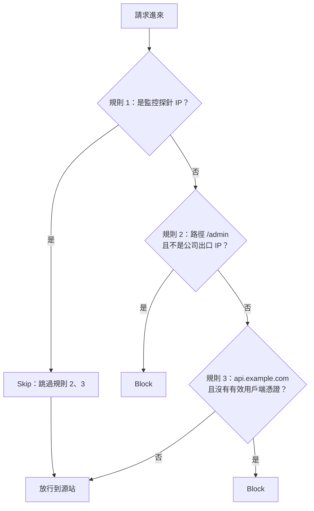
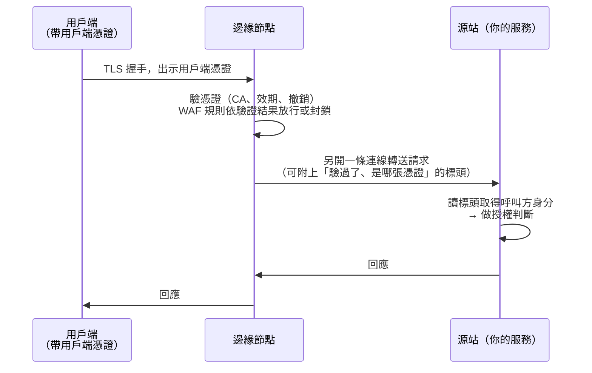
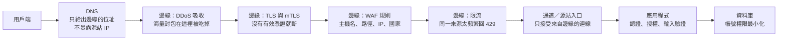

# [E-10-20] 邊緣防火牆（WAF）：在請求到你家之前就擋下來

> **目標**：理解 WAF 規則「條件＋動作＋順序」的寫法，搞清楚 mTLS 在邊緣驗和在應用程式驗的差別與風險、IP 白名單能做到和做不到的事，並能說出一個請求一路上每一層各擋什麼。

## 先說這篇不重講什麼

- 限流的演算法、Redis 計數、429 → [E-10-8 Rate Limiting](./E-10-8-rate-limiting.md)
- 單一入口該做和不該做的事 → [E-10-17 API Gateway](./E-10-17-api-gateway.md)
- 雙向 TLS 的握手與零信任 → [E-10-14 mTLS 與內部 CA](./E-10-14-mtls-internal-ca.md)
- 用戶端憑證的欄位、CSR、指紋 → [E-10-19 憑證拆解](./E-10-19-x509-certificate-csr.md)
- 「信任邊界」的想法 → [E-10-18 攻擊者模型](./E-10-18-threat-modeling.md)

E-10-8 的表格裡把 WAF 放在「最外層」，但沒講它長什麼樣、規則怎麼寫。這篇就是補那一格。

## 生活類比：社區大門的警衛

你住在一個有警衛的社區。訪客要到你家，得先經過社區大門：

```
社區警衛（WAF）能做的：
    認車牌：住戶的車直接放行（白名單）
    看名單：被列為黑名單的人一律擋下（封鎖）
    看證件：沒有住戶通行證的，請他出示證件或打電話確認（挑戰／驗證）
    看人數：同一台遊覽車十分鐘內來了五十趟，先攔下來（限流）

社區警衛做不到的：
    判斷「這位訪客能不能進你家的書房」——那是你家門鎖和你自己的事
    處理從後山小路翻牆進來的人——警衛只站在大門
```

WAF 就是這個警衛。它擋掉大部分明顯不對的人，讓你家門口清靜很多；但它不取代你家的門鎖，也管不到沒走大門的人。後面兩件事——**應用程式仍要自己授權**、**後端不能有繞過大門的路**——是這篇最重要的兩個結論。

## WAF 是什麼

**WAF（Web Application Firewall，網頁應用程式防火牆）** 是一個站在你的服務前面、**讀得懂 HTTP** 的過濾器。它跟傳統防火牆的差別：

| | 傳統網路防火牆 | WAF |
|---|---|---|
| 看什麼 | IP、埠號、協定（TCP/UDP） | HTTP 的內容：主機名、路徑、標頭、查詢字串、Body、TLS 用戶端憑證 |
| 典型規則 | 「只開 443」 | 「`/admin` 開頭的路徑，沒帶有效用戶端憑證就擋」 |
| 擺在哪 | 你的機器或網路邊界 | 常見是**邊緣（edge）**：CDN 業者遍布全球的節點，請求還沒進你的網路就先過濾 |

「邊緣」這個詞在這篇會一直出現。它指的是**離使用者最近、離你的伺服器最遠的那一層**——使用者連上的其實是 CDN（內容傳遞網路）業者的節點，由節點再把請求轉給你的伺服器（稱為**源站**，origin）。

### 跟「應用程式自己檢查」差在哪

應用程式本來就會檢查請求（驗 token、檢查參數），為什麼還要 WAF？

```
在應用程式擋：
    請求已經進到你的機器 → 已經吃掉你的頻寬、連線數、CPU
    遇到 DDoS（分散式阻斷服務攻擊：大量來源同時灌流量）時，光是收下請求就癱了
    擋得很準：知道使用者是誰、這個操作合不合法
    每個服務都要各自寫一次

在邊緣擋：
    請求還沒進你的網路就被丟掉 → 洪水打不到你
    擋得比較粗：只看得到 HTTP 表面（路徑、標頭、IP、憑證），看不懂業務邏輯
    改一條規則，所有服務一起生效，不用重新部署
```

結論跟 E-10-8 一樣：**越通用、越粗的檢查往外放；越貼業務的檢查留在應用程式。** 兩者是分工，不是替代。

## 規則＝條件運算式＋動作，而且有順序

WAF 的規則長得幾乎都一樣：

```
規則：
    如果 （某個條件運算式成立）
    就   （做某個動作）
```

### 條件：用欄位拼成運算式

條件是對請求欄位的判斷，再用 `and`／`or`／`not` 組起來。常見欄位：

| 想判斷 | 典型欄位（以 Cloudflare 規則語言的欄位名為例） |
|---|---|
| 主機名 | `http.host` |
| 路徑 | `http.request.uri.path` |
| 來源 IP | `ip.src` |
| 來源國家 | `ip.src.country` |
| 用戶端憑證是否有效 | `cf.tls_client_auth.cert_verified` |
| 用戶端憑證是否被撤銷 | `cf.tls_client_auth.cert_revoked` |
| 用戶端憑證指紋 | `cf.tls_client_auth.cert_fingerprint_sha256` |

各家 WAF 的欄位名不同，但能判斷的東西大同小異。寫出來的運算式像這樣：

```
# 只開放給兩個國家，其他國家來的都擋
(http.host eq "api.example.com" and not ip.src.country in {"TW" "JP"})

# 管理介面只允許公司出口 IP（203.0.113.0/24 是文件專用的示範位址）
(starts_with(http.request.uri.path, "/admin") and not ip.src in {203.0.113.0/24})

# API 一律要帶有效、未撤銷的用戶端憑證
(http.host eq "api.example.com" and (not cf.tls_client_auth.cert_verified or cf.tls_client_auth.cert_revoked))
```

### 動作：不只「擋」

| 動作 | 意思 | 適合 |
|---|---|---|
| **Block（封鎖）** | 直接回錯誤頁，請求不往後送 | 確定不該進來的：沒有憑證的 API 呼叫、黑名單 IP |
| **Challenge（挑戰）** | 要求瀏覽器通過驗證（跑一段 JavaScript、或點一下確認是人類）才放行 | 「可能是機器人」：給人類一條路，讓腳本卡住。**對 API 用戶端無效**——程式不會解挑戰，等於擋掉 |
| **Skip（略過）** | 這個請求跳過後面某些規則或某些防護 | 已知可信的流量：例如自家監控探針，略過限流 |
| **Log（只記錄）** | 不擋，只記下來 | 新規則上線前先觀察會誤殺誰 |

### 順序：先中先贏

規則由上往下比對。**一個請求一旦命中「終止型」動作（Block、Challenge 通過前），後面的規則就不會再看。** Skip 則是讓它跳過指定的後續規則。所以順序會改變結果：



這張圖表達：規則是一條由上往下的檢查線，Skip 會讓請求直接跳過後面的關卡，所以「寫在第一條的 Skip」等於替某些流量開了一條不受後面規則管的快速通道。

這也是最常見的設定事故：把一條條件寫太寬的 Skip 放在最上面，後面精心寫的 Block 全部失效。**Skip 的條件要寫得比 Block 更窄、更精確。**

## mTLS 在邊緣驗 vs 在應用驗

[E-10-14](./E-10-14-mtls-internal-ca.md) 的範例是**應用程式自己**驗用戶端憑證（Node.js 的 `requestCert`）。但如果你的服務放在邊緣後面，會出現一個新問題：

> TLS 連線是**在邊緣終止**的。用戶端憑證是出示給邊緣看的，你的源站收到的是「邊緣轉過來的另一條連線」，**根本看不到原本的用戶端憑證**。

所以「在哪裡驗」只有兩種選擇：



這張圖表達：用戶端憑證只在「用戶端到邊緣」這一段出現，邊緣驗完之後，源站知道的只是邊緣轉告的結果。

| | 在邊緣驗 | 在應用驗（不經邊緣、或邊緣只轉送 TCP 不解 TLS） |
|---|---|---|
| 誰持有 CA、誰驗 | 邊緣（常見是邊緣業者替你代管一個 CA） | 你的程式 |
| 沒憑證的請求 | 在邊緣就被擋，打不到源站 | 打得到源站，在握手階段被拒 |
| 源站怎麼知道呼叫方是誰 | 讀邊緣加上的請求標頭（憑證主體、指紋等） | 直接讀 TLS 連線上的對方憑證 |
| 撤銷、換發 | 在邊緣的介面上操作 | 自己管 CRL 或封鎖清單 |
| 最大的風險 | **源站信任了不該信任的標頭**（見下） | 每個服務都要正確設定 |

### 只靠邊緣的風險：繞過大門的人

在邊緣驗 mTLS 之後，源站通常會「看標頭決定身分」。問題在這裡：

```
如果你的源站有一個公開的 IP 或埠：
    攻擊者不走邊緣，直接連到源站
    自己在請求裡加上「我是驗證過的 client-001」的標頭
    源站讀到標頭 → 相信了 → 攻擊者變成 client-001

標頭只是字串，誰都可以寫。
它可信的前提是「這個請求一定是邊緣送來的」。
```

所以「在邊緣驗 mTLS」要成立，**源站必須只能被邊緣連到**。常見做法由強到弱：

1. **源站完全不對外開埠**，改用反向通道讓源站主動連出去給邊緣 → 外面根本沒有路能直連源站（見 [E-3-12 反向通道](../E-3-network/E-3-12-reverse-tunnel.md)）
2. **邊緣到源站這一段也做 mTLS**：邊緣出示自己的用戶端憑證給源站，源站只接受這張憑證的連線（有些業者稱為「已驗證的源站拉取」）
3. **源站防火牆只允許邊緣業者公布的 IP 範圍**：比沒做好，但下一節會說，這些 IP 是所有客戶共用的

另一個要想清楚的：**源站要不要再驗一次？** 原則是——身分驗證交給邊緣可以，但源站至少要做到「確認請求確實來自邊緣」（上面三選一），並且**自己做授權**（client-001 能做什麼）。邊緣只知道「這張憑證有效」，它不知道 client-001 能不能刪別人的資料。這和 E-10-17 說的「後端別因為閘道驗過就完全裸奔」是同一件事。

## IP 白名單：擋得住外人，不能當身分

「只允許某些 IP」是最直覺的規則，但它的能力有明確上限：

| 情況 | 會發生什麼 |
|---|---|
| **共用出口 IP**：一整間公司、一整棟大樓、一整個咖啡廳的人，對外都是同一個 IP（[E-3-8 NAT](../E-3-network/E-3-8-nat.md)） | 白名單放行的是「那個 IP 後面的所有人」，不是你想的那一個人 |
| **電信業者的大型 NAT**：行動網路常常是成千上萬個用戶共用一批 IP | 把某個行動網路 IP 加白名單，等於放行一大群陌生人 |
| **浮動 IP**：家用寬頻、行動網路的 IP 會變 | 今天能連、明天被擋 |
| **雲端 IP 會被回收再分配** | 你加白名單的雲端機器關掉後，那個 IP 可能分給別人 |
| **邊緣業者的 IP 是所有客戶共用的** | 「只允許邊緣 IP 連源站」也擋不住「另一個用同一家邊緣服務的人」 |

所以 IP 白名單的正確定位是：

> **IP 是「從哪裡來」，不是「你是誰」。** 它很適合當第一道粗篩（把世界上 99.9% 的雜訊擋掉），但真正的身分要靠憑證、token 這類「只有本人拿得出來」的東西。

實務上常見的組合是「IP 白名單 **且** 有效用戶端憑證」——兩個條件都要成立。IP 擋掉掃描器，憑證確認身分；憑證外洩了，攻擊者還得同時在對的網路裡。

## 限流放在邊緣

[E-10-8](./E-10-8-rate-limiting.md) 講了限流的演算法和「越通用越往外放」。放在邊緣的具體好處：

- **洪水不會進你的網路**：被限流的請求在邊緣就回 429，你的頻寬和連線數不受影響
- **全球節點一起算**：不需要自己準備 Redis 共用計數
- **規則跟 WAF 寫在一起**：可以用同一套條件運算式，例如「只對 `/login` 限流」

免費或入門方案常見的限制（各家不同、也會調整，以當下的方案說明為準）：

- **規則數量很少**（個位數，甚至只有一條）
- **計數依據只能選 IP**，不能依標頭、API key、用戶端憑證計數——遇到共用出口 IP，一群人會被當成同一個來源一起被限
- **時間視窗和封鎖時長選項很短、很少**（例如只能選十秒級的視窗）
- **只能選固定的動作**，不能自訂回應

所以免費方案的邊緣限流比較適合當「擋洪水的粗網」；細到「每個帳號每分鐘幾次」的限流還是要在應用程式做。

## 縱深防禦：一個請求一路上被誰檢查

把前面講的每一層串起來（[E-10-1](./E-10-1-web-security-overview.md) 說的「房子的多道防線」在這裡具體化）：



這張圖表達：每一層只擋自己看得懂的東西，越外層越粗、越便宜，越內層越精準；任何一層失守，後面還有別層。

| 層 | 擋什麼 | 擋不了什麼 |
|---|---|---|
| DNS／邊緣代理 | 讓外人查不到源站真實 IP | 源站 IP 已經在別處外洩過 |
| DDoS 吸收 | 大量垃圾流量 | 少量但精準的惡意請求 |
| mTLS | 沒有核准憑證的呼叫方 | 憑證外洩後的冒用；有效憑證持有人亂做事 |
| WAF 規則 | 不該來的主機名、路徑、地區、IP | 合法路徑上的業務邏輯漏洞 |
| 限流 | 暴力嘗試、單一來源洪水 | 低頻、分散的攻擊 |
| 源站入口 | 繞過邊緣的直連 | 邊緣本身的設定錯誤 |
| 應用程式 | 越權操作、不合法參數、注入 | — 這是最後一道「懂業務」的防線 |
| 資料庫權限 | 應用被攻破後的破壞範圍 | — |

## 常見錯誤（反模式）

> **常見錯誤一：邊緣驗過 mTLS，源站卻還開著公開的埠**
>
> 邊緣規則寫得很完整，源站也很放心地「看標頭就信」。但源站的 IP 從來沒關，攻擊者直接連源站、自己寫標頭，所有邊緣規則形同虛設。
>
> **正確做法**：源站只能被邊緣連到——最好是根本不開埠（反向通道），其次是邊緣到源站也做 mTLS；源站對「身分標頭」的信任，建立在「只有邊緣送得進來」之上。

> **常見錯誤二：把 IP 白名單當成身分驗證**
>
> 「這個 IP 是合作方的，放行就好，不用憑證。」後來發現那個 IP 是合作方整棟辦公大樓的共用出口，或是行動網路的共用 IP。
>
> **正確做法**：IP 只當粗篩，身分交給憑證或 token；需要更嚴格就「IP 且憑證」兩個都要。

> **常見錯誤三：一條太寬的 Skip 放在最上面**
>
> 為了讓某個監控服務不被擋，在第一條寫了「User-Agent 含 monitor 就 Skip 所有規則」。User-Agent 是用戶端自己填的字串，任何人都能填。
>
> **正確做法**：Skip 的條件要用偽造不了、或至少很難偽造的東西（特定 IP 範圍加特定憑證），並且只略過必要的那幾條規則。

> **常見錯誤四：新規則直接上 Block，沒先觀察**
>
> 寫了一條「只允許某兩個國家」的規則直接上線，結果合作方的伺服器在第三個國家的雲端機房，整條串接中斷。
>
> **正確做法**：新規則先用 Log（或在測試主機名上）跑一段時間，看會命中誰，再切成 Block。這是 [E-6-6 反模式](../E-6-best-practices/E-6-6-anti-patterns.md)裡「沒驗證就上線」在設定層面的版本。

## 小結

- **WAF 是讀得懂 HTTP 的防火牆**，放在邊緣時能讓壞請求根本進不了你的網路；它擋粗的，應用程式擋細的，兩者分工。
- 規則＝**條件運算式＋動作（Block、Challenge、Skip、Log）**，由上往下、先中先贏；Skip 要寫得最窄。
- **mTLS 在邊緣驗**時，用戶端憑證只到邊緣為止，源站靠邊緣轉告的標頭知道身分——前提是**源站只能被邊緣連到**，而且**授權仍由源站自己做**。
- **IP 是「從哪來」不是「你是誰」**：共用出口、大型 NAT、浮動 IP、共用的邊緣 IP 都讓它不能當身分。
- 邊緣限流擋洪水很有效，但免費方案通常只能依 IP、規則少、視窗短。
- 縱深防禦：DNS → DDoS 吸收 → mTLS → WAF → 限流 → 源站入口 → 應用程式 → 資料庫，每層各擋自己看得懂的。

> 用戶端憑證的欄位、CSR、指紋 → [E-10-19 憑證拆解](./E-10-19-x509-certificate-csr.md)
> 讓源站不開任何埠、只有邊緣連得到 → [E-3-12 不開門也能對外服務：反向通道](../E-3-network/E-3-12-reverse-tunnel.md)
> 限流的演算法與分層 → [E-10-8 Rate Limiting](./E-10-8-rate-limiting.md)
> 閘道驗過、後端仍要做細粒度檢查 → [E-10-17 API Gateway](./E-10-17-api-gateway.md)
