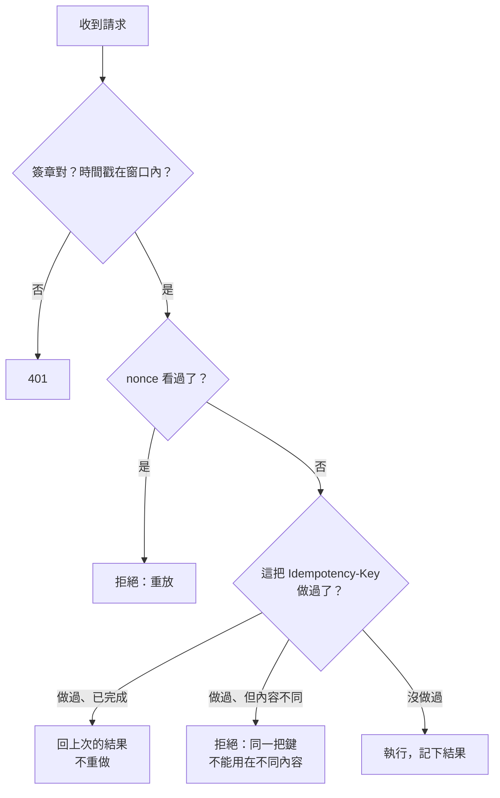

# [E-10-21] nonce 不等於冪等：一個擋「同一封包」，一個擋「同一個動作」

> **目標**：分清楚 nonce（防重放）和 Idempotency-Key（冪等鍵）各自回答什麼問題；理解為什麼「重試要換新的 nonce、但要帶同一把冪等鍵」；並知道只做 nonce 的 API 在重試時會怎樣重複執行。

## 先說這篇不重講什麼

- nonce 與時間戳怎麼防重放 → [E-10-12 時間戳＋nonce 防重放](./E-10-12-replay-protection.md)
- 冪等是什麼、冪等鍵怎麼存 → [E-13-15 冪等性、重試與訊息傳遞保證](../E-13-scaling/E-13-15-idempotency.md)
- 一把冪等鍵不夠、要分幾層 → [E-13-21 多層冪等鍵](../E-13-scaling/E-13-21-layered-idempotency-keys.md)

這兩個機制各自都有專篇。這篇只做一件事：**把它們放在一起比**，因為設計簽章 API 的人很容易以為「有 nonce 就不會重複了」。

## 一個情境：有 nonce，還是開了兩次

你設計一支伺服器對伺服器的 API：合作方簽章後呼叫 `POST https://api.example.com/v1/sessions`，替他的使用者開一個遊戲 session。為了防重放，每個請求都帶時間戳和 nonce，伺服器記住 10 分鐘內的 nonce，重複就擋。

某天合作方回報：同一個使用者被開了兩個 session。查下去是這樣：

1. 合作方送出請求 A（nonce = `n-111`），伺服器開好 session，回應在網路上弄丟了。
2. 合作方逾時，不知道成功了沒，於是重試。
3. 照你的規則，**重試要換新的 nonce**（不然會被當成重放擋掉）。於是送出請求 B（nonce = `n-222`）。
4. 對伺服器來說，B 是一個**全新、完全合法**的請求。又開了一個 session。

nonce 完全照設計運作，問題是它本來就不是用來擋這件事的。

## 生活類比：郵戳與訂單編號

- **nonce 像信封上的郵戳加流水號**：郵局用它判斷「這封信是不是有人影印了再寄一次」。同一封信不能寄兩次；但你重寄一封新的信，郵戳當然是新的。
- **冪等鍵像訂單編號**：店家用它判斷「這張訂單是不是已經做過了」。你打電話來問三次、寄三封信，只要訂單編號一樣，店家就只出一次貨，並告訴你「已經出貨了，這是單號」。

一個看「這個封包」，一個看「這件事」。

## 兩者各回答什麼問題

| | nonce（防重放） | Idempotency-Key（冪等鍵） |
|---|---|---|
| 回答的問題 | 這個**封包**是不是有人錄下來原封不動再送？ | 這個**動作**之前是不是已經做過？ |
| 誰產生 | 客戶端，**每個請求都新產生**（連重試也是） | 客戶端，**每個動作產生一次**，所有重試都帶同一把 |
| 伺服器記住什麼 | 用過的 nonce（短時間，例如 10 分鐘） | 這把鍵做過的動作、狀態、結果（通常更久） |
| 重複時怎麼回 | **拒絕**（這是攻擊或錯誤） | **回上次的結果**（這是正常重試） |
| 少了它會怎樣 | 偷錄流量的人可以重送一次合法請求 | 網路逾時重試時，動作被做兩次 |



這張圖在說：nonce 先擋「同一封包」，通過之後冪等鍵再擋「同一個動作」。兩關檢查的東西不一樣，少一關都會漏。

## 重試的正確寫法

```
// pseudo code：客戶端
動作鍵 = 產生一次隨機字串            ← 這個動作的所有重試共用
重試最多 N 次：
    nonce = 產生新的隨機字串          ← 每次送都換
    簽章（方法、路徑、時間戳、nonce、動作鍵、body）
    送出
    如果 收到回應：結束
```

冪等鍵要**放進簽章**。不簽的話，中間人可以把冪等鍵換掉，讓伺服器把一次重試當成新動作。

伺服器那邊有一個容易漏的情況：**同一把冪等鍵、內容卻不一樣**（例如第一次開 session 給使用者 A，重試時 body 變成使用者 B）。這通常是客戶端的 bug，要明確拒絕；悄悄回上一次的結果，會讓對方以為 B 開成了。

還有一個空窗：第一個請求還在執行，重試就到了。這時要回「處理中」（例如 202），讓客戶端晚點再問，不能當成沒做過再執行一次。

## 常見錯誤

> **常見錯誤一：「現在的端點都可以安全重試」**
>
> 一開始的端點都不動錢（查清單、開 session），重複執行也不太要緊，於是規格寫「可以安全重試」，沒做冪等。
> 問題是這句話會被當成慣例，帶到之後的「派發獎勵」「結算」端點上，那時重試一次就是重複發錢。
> 正確做法：**第一支會產生狀態的端點就把冪等鍵做進合約**，之後的端點照著來。

> **常見錯誤二：重試沿用同一個 nonce**
>
> 有人發現「重試被擋了」，就在重試時沿用原本的 nonce，再在伺服器放寬「同一個 nonce 可以出現兩次」。
> 這等於拆掉防重放。正確做法：nonce 每次都換，「是不是同一個動作」交給冪等鍵判斷。

> **常見錯誤三：nonce 和冪等紀錄分兩筆交易寫**
>
> 先把 nonce 標成用過、再建冪等紀錄，中間掛掉就出現「nonce 用掉了、動作沒記」的半套狀態。
> 正確做法：兩者在**同一筆短交易**裡建立；但動作本身（例如呼叫外部服務）不要包在那筆交易裡，用冪等紀錄的狀態（處理中／完成）補空窗。

更多反模式的通用整理 → [E-6-6 反模式](../E-6-best-practices/E-6-6-anti-patterns.md)

## 小結

- **nonce 擋同一個封包被重送**，每個請求都換新的，重複就拒絕。
- **冪等鍵擋同一個動作被做兩次**，所有重試共用一把，重複就回上次的結果。
- 只有 nonce 的 API，網路逾時重試就會重複執行；只有冪等鍵的 API，擋不住別人錄下封包重送。兩個都要。
- 冪等鍵要簽進簽章；同一把鍵、內容不同要拒絕；執行中再來要回「處理中」。

> 簽章到底該簽哪些欄位 → [E-10-11 簽名字串正規化](./E-10-11-canonicalization.md)
> 重試時「結果不明」怎麼收斂 → [E-13-17 三態結果](../E-13-scaling/E-13-17-tri-state-outcome.md)
